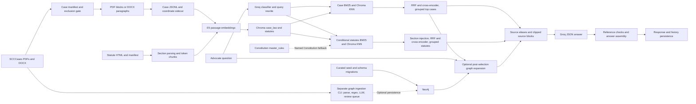
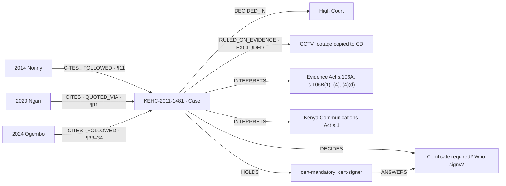

# Technical audit of Legal RAG direct retrieval

**Scope.** Advocate research flow in the local checkout on 26 November 2026, branch `eval/final-hardening`, HEAD `77a97f4d6d08e13e34c308a74ff5e009a58296a6`, including the pre-existing working-tree changes. The observations apply to this snapshot and the local Neo4j instance. The production deployment and the original preliminary run were not independently reconstructed. Only this Markdown report was added to the workspace.

## 1. Executive summary

- **The primary ruling is present as a two-page PDF and intentionally excluded by the case manifest.** The active case collection contains zero primary chunks, zero primary embeddings and no primary coordinate entries. The first confirmed loss in the case search path occurs before parsing or ranking, at the manifest exclusion gate.
- **Neo4j stores the correct exclusion outcome and links three later cases to the same canonical case.** The ordinary local process defaults to graph disabled. The graph-enabled expansion independently excludes the primary graph node from full-text eligibility because it has no Chroma mapping. It also omits the outcome and evidence-ruling fields from its answer payload.
- **Secondary judgments filled the available slots.** A and B reproduced the reported 2020, 2024 and 2014 parent set and order. The comparison is among indexed candidates. There is no primary score, rank or post-ranking rejection to explain. B reproduced the use of the conditional principle as the answer to a question about the actual decision.
- **The final answer sees excerpts, and the verifier checks reference strings.** The 500-character case window can remove the very passage that helped retrieve a chunk. Secondary case mentions can count as supported case-name references. The verifier output does not replace the rendered answer.

## 2. Existing architecture

| Component and status | Actual implementation and location |
| --- | --- |
| Case intake, implemented | [`build_case_chunks.main`](../build_case_chunks.py#L286) reads curated metadata and locates files. Excluded or absent files are skipped at [320–328](../build_case_chunks.py#L320). Staging JSONL and SQLite sidecar are written at [365–435](../build_case_chunks.py#L365). |
| PDF and DOCX parsing, implemented with omissions | [PDF OCR gate and fallback](../build_case_chunks.py#L83) uses pypdf and a mean threshold of 50 chars/page, optionally reuses or creates an OCR copy using OCRmyPDF, otherwise uses original. [PDF extraction](../build_case_chunks.py#L137) joins PyMuPDF text spans and filters short edge blocks and standalone numbers. [DOCX](../build_case_chunks.py#L246) reads body paragraphs. PDF page numbers are zero-based internally. |
| Case chunks, implemented | [`split_paras_into_chunks`](../build_case_chunks.py#L220) and [`split_into_chunks`](../build_case_chunks.py#L257) use a 3,000-character target with one overlapping paragraph. A single large paragraph or carried overlap can exceed the target. [`safe_chunk_id`](../build_case_chunks.py#L278) compacts the case ID and appends a zero-based index. Adjacent IDs and hashes are stored. |
| Statute preprocessing, implemented | [`parse_statutes.py`](../../parse_statutes.py#L112) extracts section text, references and definitions from structured HTML, [walks the act](../../parse_statutes.py#L276) and [parses the source](../../parse_statutes.py#L512). [`build_statute_chunks.py`](../build_statute_chunks.py#L33) uses E5 tokenizer, nominal 480 tokens with 50 overlap. |
| Embeddings and storage, implemented | [`embed_knowledge.embed_chunks`](../embed_knowledge.py#L83) skips existing IDs, batches 32, encodes normalized `passage: ` inputs and adds document and scalar metadata. [Collection creation](../embed_knowledge.py#L188) specifies cosine. Actual copied case store has cosine HNSW, 768 dimensions, ef_construction 100, ef_search 100, max_neighbors 16, resize_factor 1.2 and sync_threshold 1000. [`embeddings.get_embedder`](../embeddings.py#L21) caches `intfloat/e5-base-v2`; retrieval encodes `query: ` without explicit normalization. [DB paths and collection names](../config.py#L11). |
| Graph construction, seeded and partly implemented | [`seed_loader`](../graph/seed_loader.py#L61) normalizes keys, copies seed properties and merges nodes and typed edges [135–209](../graph/seed_loader.py#L135). The observed case has `extractor=seed`. Separate [`ingest/caselaw/pipeline.py`](../ingest/caselaw/pipeline.py#L71) parses headers, overrides, repairs text and segments paragraphs. [Deterministic extraction](../ingest/caselaw/deterministic.py#L69) detects citations, provisions and outcomes. [LLM calls](../ingest/caselaw/llm.py#L125) label FIRAC roles, citation treatment, evidence rulings, issues and principles from bounded excerpts; [validators](../ingest/caselaw/llm.py#L306) and [review queue](../ingest/caselaw/pipeline.py#L199) are separate from query serving. [Writer](../ingest/caselaw/pipeline.py#L213) and [flag-gated execution](../ingest/caselaw/pipeline.py#L627) exist. Live data lacks paragraph nodes. |
| Query understanding, implemented | [`Qclassifier.classify_legal_query`](../Qclassifier.py#L405) sends original wording to Groq and extracts intents, target components, entities, citation analysis and rewrite. `temperature=0.1`, output limit 800, up to three classifier attempts; known rate exhaustion returns failure. [Normalization](../Qclassifier.py#L510) adds confidence 0.5 for string domains. No deterministic preprocessing of case names or citations before classification. |
| Retrieval and synthesis, implemented | [`ChatView.tsx`](../../frontend/app/components/ChatView.tsx#L483) calls [`/api/qretrieve`](../app.py#L1282) then [`/api/generate-legal-answer`](../app.py#L1456). Case retrieval always runs after successful classification; statute branch is conditional. Graph layer is advisory and runs after case selection. Relevance, provenance and output concerns are detailed below. |
| Other routes, outside the audited hot path | [`/api/chat`](../app.py#L78) calls the separate [`pixe.run_rag_pipeline`](../pixe.py#L530) stack, which has its own expansion, scoring and context logic. [FIRAC ingestion](../app.py#L431) and [`CaseLaw/ingester.py`](../CaseLaw/ingester.py#L141) target the legacy summaries store. The active case retriever uses `CaseLawDB/case_law`. |

## 3. Original judgment and corpus indexing

**Source.** [Republic v Barisa Wayu Mataguda PDF](<../SCCCases/Republic v Barisa Wayu Mataguda 2011KEHC1481(KLR).pdf>), SHA-256 `64fe9ad7cadc14938fcfef59f9fdc124276f20c7f87fb5c6a328abfca6f32b21`. High Court of Kenya at Mombasa, Criminal Case No. 6 of 2008, M. Odero J, ruling delivered 22 July 2011. The neutral citation is present in the local filename, manifest identifier and canonical graph citation. The PDF heading uses the criminal case number.

- **Page 1.** PW11 was Sergeant Michael Oduor of CID Mombasa. He made the CD and viewed the footage with PW4 Lydia Kaguna Japeth, whom the court describes as the owner of Karama Hotel. The opening paragraph calls the premises Karama Lodge. The court was told the original footage had been erased and the CD was all that remained. The ruling describes the CD as prima facie admissible subject to the statutory conditions, and the available original footage as primary evidence that PW4 could have produced.
- **Page 2.** “PW11 did not mention any such certificate.” The judge identified PW4 as the responsible person who would sign to certify the footage’s validity and correctness. Watching the footage with PW4 did not satisfy the certificate requirement. The concluding sentence reads “Without the required certificate this CD is inadmissible as is inadmissible as evidence and I do so rule.” The duplicated wording appears in the PDF text. This resolves the objection to the CD, independent of the outcome of the criminal trial.
- The actual manifest row gives `case_identifier=2011KEHC1481(KLR)`, `parties=Republic v Barisa Wayu Mataguda`, `court_level=High Court`, `judge=M. Odero`, `year="2011"`, `legal_domain=Criminal Law`, `winning_party=Accused`, `binding_on_scc=true`, `exclude=true`. The note says it was kept excluded per instruction. The `winning_party` field is best read in the context of this evidentiary ruling. [Manifest row](../../data/processed/cases/cases_meta.json#L114)
- Reading the original PDF independently confirms both pages have text. Invoking the pure current PDF extractor in memory yielded 20 retained blocks, including PW11, PW4, erasure and the ruling. Its margin filter removes three blocks from this source, including the substantive s.106B(4)(a) line on page 1 and the dotted (b) and (c) placeholders on page 2. This separate diagnostic establishes extractability and the filter's behavior. The actual manifest gate prevents this parser from running for the target during the normal case build.
- **Stored records.** Zero target IDs in the 78-row case staging file and active Chroma collection, zero matching rows in `backend/locations.db`, zero embeddings for the target. There is no case chunk ID to return. A metadata-string scan of the local legacy summaries and ChunkDB collections also found no canonical name or compact ID. The positive stored graph record is shown in §5. No duplicate vector parent or graph case under the audited variants was found.

### SCC case collection coverage

All 11 manifest source files exist, and the directory inventory matches the manifest. All 78 indexed chunk IDs and their text match staging. All 78 embeddings are finite, nonzero and 768-dimensional. All retained parser blocks tested for the nine included sources were covered by the index and every included PDF page is represented using zero-based page ranges. The table reports discarded nonempty PDF text blocks, including running furniture, against the original text layer. The check covers the local SCC source collection and active case index. `SCCases.zip` lists the same 11 source names and `caselaw.zip` contains a Chroma backup. `backend/Caselaws` is empty. The separate Repo/FIRAC source materials are outside the active case collection audit.

| Case identifier | Source pages | Indexed chunks | Retained parser blocks | Filtered PDF blocks | Observed completeness |
| --- | ---: | ---: | ---: | ---: | --- |
| 2026SCC242(KLR) | 5 | 4 | 30 | 5 | Running footers removed |
| 2026SCC235(KLR) | 4 | 4 | 35 | 3 | Court heading and two appearances removed |
| 2026SCC241(KLR) | DOCX | 6 | 90 | — | Body paragraphs covered |
| 2001KECA154(KLR) | 5 | 7 | 53 | 4 | Substantive sentence and quotation fragments removed |
| 2014KEHC6468(KLR) | 3 | 3 | 42 | 2 | Admissibility and certificate discussion fragments removed |
| 2024KEHC17038(KLR) | 6 | 8 | 83 | 6 | Running footer removed; private-use glyphs in source extraction |
| 2024KEHC15763(KLR) | 9 | 10 | 108 | 9 | Running footer removed; private-use glyphs in source extraction |
| 2020KEHC8905(KLR) | 3 | 5 | 50 | 3 | Section 106B(4)(b) and (c) fragments removed |
| 2011KEHC1481(KLR) | 2 | 0 | 20 | 3 | Manifest exclusion; in-memory extraction only |
| 2021KEELC220(KLR) | 7 | 0 | 129 | 5 | Manifest exclusion; in-memory extraction only |
| 2010KECA346(KLR) | 18 | 31 | 203 | 15 | Substantive passage fragments and furniture removed |

The margin rule treats any short block wholly or partly within 54 points of a page edge as furniture. For example, the 2014 PDF loses “certificate for the admissibility of the said evidence. When that is done, the Court will be able to” on page 2. In the 2024 Ogembo index, `2024KEHC15763KLR_5` contains a private-use character inside “certificate.” These are source-to-index text defects independent of Mataguda's exclusion. The nine included cases had no missing chunks relative to staging. This comparison does not score source OCR accuracy against a separately annotated transcription.

## 4. Knowledge graph schema and relationship inventory

Live Neo4j read queries counted 209 nodes and 280 relationships by grouped `labels(n)` and `type(r)`; the raw counts, properties, constraints and index states are in Appendix A. No live graph writes were issued.

| Nodes | Count | Nodes | Count | Nodes | Count |
| --- | ---: | --- | ---: | --- | ---: |
| Case | 54 | ClaimType | 9 | Concept | 10 |
| ContractElement | 11 | Court | 10 | EvidenceType | 11 |
| GateCondition | 8 | Issue | 18 | LowerCourtDecision | 2 |
| Migration | 3 | Outcome | 10 | PartyType | 5 |
| Principle | 19 | Provision | 37 | Statute | 2 |

| Relationships | Count | Relationships | Count |
| --- | ---: | --- | ---: |
| ANSWERS | 19 | APPEAL_FROM | 2 |
| APPLIES | 11 | ARGUED_BY_PARTY | 2 |
| BINDS | 18 | CITES | 49 |
| CONFLICTS_WITH | 1 | CONSIDERED | 1 |
| DECIDED_IN | 54 | DECIDES | 22 |
| DERIVED_FROM | 19 | EXCLUDED_BY | 1 |
| HOLDS | 23 | INTERPRETS | 25 |
| INVOLVES | 12 | PART_OF | 4 |
| QUALIFIES | 3 | RULED_ON_EVIDENCE | 12 |
| STATES_OBITER | 1 | SUPPORTS | 1 |

- [Schema v1](../graph/migrations/0001_schema_v1.cypher#L7) declares uniqueness for Case, Court, Judge, Opinion, Paragraph, Issue, Principle, Provision, Statute, EvidenceType, Concept, Term, SourceDocument, IngestRun and Migration on their typed keys. [Schema v2](../graph/migrations/0002_caselaw_v1.cypher#L5) adds Article, Rule, Definition, ClaimType, Outcome, Award, ContractElement, GateCondition, Station, PartyType and LowerCourtDecision keys. The live inventory has 26 constraints and 44 indexes. The name index uses `name,aliases_text`; a separate citation lookup index exists. Paragraph, issue and principle text indexes and a 768-dimensional cosine paragraph vector index are declared. The `BINDS` hierarchy is recreated by [migration 0003](../graph/migrations/0003_fix_binds_v1.cypher#L17).
- [Typed node and relationship definitions](../graph/models.py#L25) include modeled document/paragraph/opinion/provenance and SCC-specific structures. The live graph has no Judge, Opinion, Paragraph, SourceDocument, IngestRun, Term or individual witness/party nodes. Judge and decision type are case properties. PartyType denotes categories. There are no dedicated live material-fact, reasoning or finding nodes. Issue, Principle, Provision and EvidenceType are populated. Outcome vocabulary exists, but no `HAS_OUTCOME` edges were observed. Case outcomes are recorded as text and evidence dispositions can be recorded separately as `RULED_ON_EVIDENCE.result`. The live graph is substantive legal knowledge with citation and authority relationships; it currently lacks the document/paragraph layer needed to verify those relationships against verbatim passages.
- Seed nodes merge by typed stable key; seed edges merge by typed endpoints and selected identity properties [seed loader 135–209](../graph/seed_loader.py#L135). The extraction path uses known citation merges, exact corpus keys and a fuzzy threshold of 90 when the year agrees. That path preserves the citation reference's raw spelling. It is not called during query resolution. Although its docstring says deduplicated, the resolver itself appends each resolved reference, preserving per-occurrence provenance. [Deterministic resolver](../ingest/caselaw/deterministic.py#L325)

## 5. Case-specific graph and resolution

The live canonical record has `case_key=KEHC-2011-1481`, `seed_id=case:2011KEHC1481`, `citation=[2011] KEHC 1481 (KLR)`, `date=2011-07-22`, `judge=M. Odero J`, `decision_type=Ruling`, `in_corpus=true`, `in_vector_index=false` and **no** `chroma_case_identifier`. Its stored outcome is “Objection upheld: CD copied from CCTV footage inadmissible without s.106B(4) certificate.” Its evidence edge has `result=EXCLUDED`; the certificate is represented through provision, issue and principle text. There are no linked document, paragraph, witness, individual CD, certificate-instance or original-footage-erasure records. The case has no direct generic s.106B edge; the edges target (1), (4) and (4)(d), alongside s.106A. The seed source and citation locator fields offer case-level provenance. There is no passage pointer for the 2011 evidence outcome. Appendix A contains the full direct-neighbor and selected second-hop read results.

The stored exclusion and lack of certificate agree with the PDF. `cert-signer` generalizes to “CCTV owner, phone owner” and “not merely whoever copied it.” The primary text identifies a responsible person and names PW4 in this case. It does not discuss phone owners or establish a categorical bar on a copier who independently meets the responsible-person condition. The seeded interpretation edge to `kenya-communications-act-1998/s1` represents the judgment's statutory reference; the PDF quotes the definition of “computer,” and the edge contains no paragraph or explanation of judicial interpretation.

| Input | Live unfiltered name index before vector-mapping filter | Actual graph full-text eligibility |
| --- | --- | --- |
| Republic v Barisa Wayu Mataguda | `KEHC-2011-1481` #1, 7.3145 | No rows |
| Republic v Barisa Wayu Matriguda | Same key #1, 5.5833 | No rows |
| Republic v Barisa Wayu Matuguda | Same key #1, 5.6323 | No rows |
| [2011] eKLR | Neo4j `ClientError` for raw Lucene expression | Exception swallowed by expansion |
| 2011 KEHC 1481 (KLR) | No rows | No rows |
| 2011KEHC1481(KLR) | No rows | No rows |

An explicit indexed property lookup by canonical key returns the node. [`graph.keys.case_key`](../graph/keys.py#L51) accepts bracketed neutral citations with a space before the number. The direct helper outputs were `UNKNOWN-2011-2011-kehc-1481-klr` for the spaced unbracketed form and `UNKNOWN-0000-2011kehc1481klr` for the compact form. `[2011] eKLR` produces `eKLR-2011-republic-v-barisa-wayu-mataguda` with the case name supplied and `eKLR-2011-unknown` without it. [`normalise_name`](../graph/keys.py#L24) normalizes punctuation, spacing and versus variants, while its docstring claims surname normalization that the body does not perform. The separate extractor [known merges](../ingest/caselaw/deterministic.py#L325) and [source overrides](../ingest/caselaw/overrides.yaml#L22) handle those variants during ingestion. The later judgments' live `CITES` edges target the same case node. A name-pattern query found one graph case across these variants. The separate [`case_lookup`](../graph/queries.py#L111) returned empty holdings and citations for the correct key because it reads Paragraph-shaped relationships, while the live seed uses Case-shaped relationships. This is a verified lookup mismatch.

## 6. Query retriever logic and parameters

| Stage | Baseline behavior and effect |
| --- | --- |
| Classification and rewriting | The prompt has statutory lookup, strategic analysis and hybrid modes, with no direct case-lookup mode. Classifier returned exact case entities for A, B, C and E, preserved the supplied misspelling for G, and sent B and F to statutory lookup. Case retrieval consumes `vector_query_caselaw` or `vector_query`; entities, adverse signals and citation analysis are carried but never used for normal case candidate admission or boosting. [Classifier modes](../Qclassifier.py#L22), [case parameter extraction](../Retriever.py#L238) |
| Case lexical retrieval | BM25Okapi over stored chunk text, whitespace split on both sides without punctuation/case normalization. Its process cache loads all documents once; initialization errors are swallowed, leaving the vector stream. Top 50 even when BM25 scores are zero. [Index](../Retriever.py#L66), [query](../Retriever.py#L674) |
| Case semantic retrieval | Cosine-distance KNN, up to 50 case chunks, no ordinary metadata filter and no similarity cutoff. Original English query is used only via the classifier's rewrite. [Vector search](../Retriever.py#L623) |
| Fusion and reranking | RRF deduplicates chunk IDs, adds equally weighted `1/(60+rank)` per stream and retains 30. `cross-encoder/ms-marco-MiniLM-L-6-v2` scores rewrite and document pairs; sigmoid of the clipped logit alone determines post-fusion rank. Displayed `base_similarity` is the sigmoid CE score, not Chroma similarity. Domain-boost function is unused. [Fusion and CE](../Retriever.py#L694), [returned scores](../Retriever.py#L736) |
| Parent and chunk selection | Group by `case_identifier`. Top three by maximum CE; no preference for the named primary source or court year. Below 0.4 for highest parent score triggers a warning, with no rejection. Adjacent chunks can be fetched one hop with zero score; selected evidence takes one per matching FIRAC component or three highest when none match. The verbatim chunks carry an empty FIRAC label. [Selection](../Retriever.py#L433), [adjacency](../Retriever.py#L339), [parent caps](../Retriever.py#L751) |
| Direct lookup facilities | Caller-supplied `pinned_docs` runs explicit `case_identifier` lookup then CE; normal natural language never creates pins. The case PDF and all-chunks reader also require an exact index ID, with the PDF route returning early when no row exists. The graph's canonical-key lookup is separate and not on this route. [Pins](../app.py#L1300), [pin retrieval](../Retriever.py#L636), [PDF reader](../app.py#L1009), [chunk reader](../app.py#L1157) |
| Statute routing and reranking | Triggered by statutory/hybrid modes or RULES/STATUTORY_TEXT components, after case retrieval. Selects statute rewrite if present. Filters named recognized acts, explicit article/section numbers and optional pins; intersected when multiple conditions apply. Unrecognized nonempty source-document names can leave an empty filter. BM25 and vector up to 50 each, RRF 60/30, named-act plus exact section injection up to 35, named Constitution fallback up to 10. Same CE family, sigmoid multiplied by 0.3 for schedule chunks absent schedule-related terms. Parent article ranking by best score; adjacent text can be added, top five articles. H resolves base section 106B, not a dedicated subsection index lookup. [Route](../app.py#L1316), [filters](../RulesRetriever.py#L283), [ranking](../RulesRetriever.py#L543) |
| Graph expansion | `GRAPH_ENABLED` defaults false, timeout 5 seconds, pool max 10. When enabled, uses exact Chroma mapping for top parent anchors, plus a raw Lucene string from the first 128 original-query characters, dropping words shorter than three, and takes three mapped names. Deduplicates anchor keys and uses fixed paths: `Case→Court`, `Case→Principle` via HOLDS/STATES_OBITER or `Case→Issue←Principle`, with one optional relation to a qualifying/conflicting Principle. Deduplicates by case and principle, ranks binding first for default SCC forum, then ratio, then lower court-rank number; caps at five. No traversal of CITES or RULED_ON_EVIDENCE, paragraph lookup, vector query or mutation of selected case ranks. Separate diagnostic graph helpers have different query shapes and are outside the active route. Errors fall back to empty graph list. [Flag](../graph/config.py#L27), [route](../app.py#L1363), [expansion](../graph/queries.py#L282), [static binding](../graph/authority.py#L29) |
| Context and final generator | Up to five statute groups at 600 characters per returned chunk, three cases at three chunks per case and 500 characters per chunk, then five graph authorities. No explicit total context token cap in this assembly. Groq `qwen/qwen3.8-27b`, default temperature 0, output limit 2,500 and timeout 60 s per request; key rotation with 30 s backoff. [Context](../app.py#L1526), [client](../groq_client.py#L62) |

## 7. Eight-query diagnostic replay

The replay ran the unchanged classifier and retrieval functions with the supplied wording and current models. Chroma opened disposable copies of the active stores. Case and statute ranking locals were captured at function return via a Python trace hook. Answer assembly, provider call, parsing, verification and response formatting ran from the original handler body in a Flask request context before the history block. Auth, persisted history, asynchronous title generation and HTTP transport were excluded. Verifier logs were directed to temporary storage. The local graph flag stayed at its default false in this replay. Appendix B includes original queries, actual classifier fields, every observed candidate, raw distances and scores, exclusions, selected chunks and exact generator messages and output. The graph-enabled comparison is separate.

| Test | Classification outcome | Final case parents in rank order (CE score) | Observed answer |
| --- | --- | --- | --- |
| A | Strategic, outcome analysis and application | 2020 (.974), Ogembo 2024 (.954), 2014 (.876) | Says specific deficiency is absent. Uses Matriguda spelling. |
| B | Direct statutory, despite explicit case reference | 2020 (.994), Ogembo 2024 (.986), 2014 (.840) | Leads with conditional doctrine. Later acknowledges that it has not established the actual outcome or exact citation. |
| C | Strategic, scenario match and application | 2020 (.975), Ogembo 2024 (.843), 2014 (.649) | Does not identify either witness or describe their roles. |
| D | Classifier failed twice under provider rate limiting | No ordinary retrieval. Separate literal-query case probe ranked 2020 (.996), Ogembo 2024 (.664), 2014 (.384). | No answer or context in the unchanged pipeline. |
| E | Strategic, outcome analysis and application | 2020 (.997), Ogembo 2024 (.956), 2014 (.895) | Says decision to admit or reject is absent. |
| F | Direct statutory, citation parsed as a case and a statute string | Ogembo 2024 (.786), 2026 SCC235 (.770), Obado 2024 (.649) | Says case is absent from supplied sources and extends that statement to the “available corpus.” |
| G | Strategic, outcome analysis and application | Ogembo 2024 (.990), 2020 (.988), 2014 (.979) | Repeats conditional doctrine under Matriguda. Does not state this CD was excluded. |
| H | Direct statutory and statutory interpretation | 2014 (.999), Ogembo 2024 (.999), 2020 (.991), plus Evidence Act s.106B as first and only statute | States several certificate elements and the signatory requirement. The submitted answer omits the subsection (2) matters element and notes that the statute excerpt is incomplete. |

### Latency in milliseconds

Case and rules columns are standalone stage measurements. Retrieval is their serial sum, excluding request overhead, while classifier and generation include provider retries. The estimated total is the sum of the four measured stages. Initial case retrieval includes cold model initialization. Graph was disabled in ordinary replay. D's literal probe is excluded from ordinary totals.

| Test | Classifier | Case | Rules | Retrieval | Generation | Measured stage sum |
| --- | ---: | ---: | ---: | ---: | ---: | ---: |
| A | 3,034 | 8,122 | 6,519 | 14,641 | 8,984 | 26,659 |
| B | 2,633 | 4,849 | 5,354 | 10,203 | 7,628 | 20,464 |
| C | 2,997 | 5,910 | 4,610 | 10,520 | 44,467 | 57,984 |
| D | 44,004 | — | — | — | — | 44,004 to classification failure |
| E | 36,596 | 3,912 | 3,819 | 7,731 | 41,685 | 86,012 |
| F | 36,743 | 3,914 | 3,410 | 7,324 | 38,972 | 83,039 |
| G | 37,219 | 3,533 | 3,630 | 7,163 | 44,141 | 88,523 |
| H | 2,596 | 3,498 | 406 | 3,904 | 46,923 | 53,423 |

D's independent retry took 42,490 ms and encountered 19 HTTP 429 responses. No production-service p95 or full HTTP latency can be inferred from these serial local timings and provider calls.

## 8. Retrieval ranking and where the evidence is lost

For A, B, C, E, F and G, the original had no vector, BM25, fused, CE or parent rank and no score. It never reached case evidence selection or synthesis, and the generated answer never cited it as a retrieved source. D stopped before ranking on the normal path. H's target is a provision rather than the 2011 ruling. The trace contains no post-CE case metadata filter. Missing primary chunks cannot be retrieved through adjacency.

The 2020 chunk `2020KEHC8905KLR_2` leads both initial streams for A, B, C and E. For A its cosine distance is 0.142632 (cosine similarity 0.857368), BM25 is 25.509170, and the 2020 parent CE is 0.973907. Its text puts the case-name variant, eKLR year, compact disc and CCTV together at the start of the chunk. `2024KEHC15763KLR_5` starts with a close variant and quotes the conditional principle. G's alternative spelling still attracts both cases. The 2014 decision also quotes the certificate and outcome and discusses analogous DVDs. F's numeric-only rewrite produces a different candidate distribution and no exact match. Later cases occupy the top slots because they are eligible and textually relevant, with no identity or primary-source weighting. There is no relative primary rank to compare.

A, B, C, E and G all did contain, inside the 2014 excerpt, the sentence “Without the required certificate this CD is inadmissible as evidence.” It appears in `2014KEHC6468KLR_2`, while the explicit name introducing the quotation in `2014KEHC6468KLR_1` is at character 2,341. The 500-character excerpt removes that attribution in every replay. A labels the surviving quotation `C3.2`; B, C and G label it `C3.3`; E labels it `C3.2`. Thus the **primary factual narrative is lost at ingestion**, and the **secondary fallback loses its nearby attribution during context assembly**. The generator overlooks or declines to connect that indirect excerpt, even when reviewing its parent. `2020KEHC8905KLR_1` and `2024KEHC15763KLR_4` likewise carry the target-name hits near their tails. Indexed reference passages and metadata are included in Appendix C.

## 9. Answer generation and citations

- [Prompt and answer schema](../app.py#L1633) demand source grounding, case outcomes from explicit text, a short answer and acknowledgment of gaps. They do not require the requested disposition before doctrine, prefer the primary judgment, or identify quotations from later cases as indirect. Required sections include applicable law, case discussion, application, procedure and follow-ups. This supplies a format for general discussion even when the user asks for a single fact. B and G lead with conditional language without asserting the CD was actually admitted. This is still an incorrect answer to the ruling question. B's own gaps field admits the actual disposition was not established in its response.
- [Scope check](../coverage.py#L45) checks statutes and `source_documents` against the statute manifest, not case availability. In E it mislabeled the requested case as an absent Act in the prompt. B mislabeled Kenya Law Reports and F mislabeled both the neutral citation and Kenya Law Reports. The PDF and graph node exist locally, so F's “available corpus” conclusion conflates the retrieved set, source directory, active vector collection and graph.
- [Citation aliases](../app.py#L1561) associate valid `C#.#` with a real retrieved chunk, but the case label is usually the compact parent ID, because `format_output` stores it in `case_name`. `G#.#` can resolve to a Chroma case identifier or principle key rather than a paragraph. Bare aliases and LLM-generated `citations_used` allow weaker attribution. [Verifier](../citation_verifier.py#L49) parses named references and G aliases, does not enforce case/statute alias-to-claim entailment, accepts case names found inside any selected chunk and reduces statute references to numeric cores. It checks full returned chunk text even when only a prefix reached generation. It does not verify contradiction, existence of a case paragraph or a primary source. B's C2.1 genuinely carries the conditional rule as a secondary quotation. It cannot establish the actual outcome claimed by the framing.
- **Confirmed implementation defect.** The caller reads `verified["unverified_claims_removed"]` and then calls `_build_answer(parsed)` using the original parse. A and B emitted verifier warnings and returned original wording; cleaned or regenerated verifier text can be discarded. A and B retain text containing references the checker flagged. Thus the audit does not treat “claims removed” as a true count of removed claims. [Verification and rendering](../app.py#L1739)
- **Statute control case.** H retrieved the correct statute. `evidence_act__2023-12-11__s106B__0__c1` contains the certificate requirements in its full text. At 600 characters, `S1.3` ends during the opening of (b), removing the rest of (b), (c) and (d). Other sources supplied partial secondary coverage, and H's answer omitted (c). The earliest identified loss of the complete primary statute passage was context clipping. Its additional Small Claims Court exception sentence cites C2.1, an Ogembo excerpt without that proposition. That is a directly inspectable unsupported attribution.

## 10. Baseline measurement

These are targeted diagnostics around one case with one statutory control, not independent benchmark questions. No generalization across the legal corpus is justified. Primary relevance is strict identity of the requested judgment. An indirect quotation can support a proposition without being relevant under the strict primary-document metric. A provision is relevant to H when it is Evidence Act s.106B, and the primary passage unit for H is the complete subsection (4).

| Metric | Definition and measured result |
| --- | --- |
| Document Recall@1/3/5/10 | Mean fraction of gold primary judgments found among first K distinct parents. One relevant primary per A–G. Among six completed case queries, **0/6 at all K** in initial vector, lexical and fused parent lists, CE and emitted parent list. The emitted list is capped at three, so its @5/@10 equal @3 by construction. Counting D as a failed service request gives **0/7**. |
| Precision@K | Strict-primary relevant parents divided by number returned up to K, averaged over completed case runs with nonempty lists. **0 at 1/3/5/10**, with the same output cap. Broader relevance precision requires independent judgments on secondary cases and retrieved statute results. |
| MRR | Mean reciprocal first relevant primary-parent rank, zero when absent, **0/6 completed** and **0/7 with failure**. |
| Relevant passage Recall@K and context inclusion | Gold primary query-supporting passages are identified on PDF pp. 1–2, measured as fraction covered among top candidates or supplied excerpts. **0% at every observed K** across the six completed case queries, **0/6** with any gold primary passage in context. The primary PDF has no indexed chunk IDs. For H the complete gold statutory passage ranks **3 in the statute chunk CE list** (the provision group ranks first) and is returned, but complete primary context inclusion is **0/1** after slicing. |
| Exact case citation resolution | Correct canonical identity resolved by the audited advocate path on B and F, **0/2** despite classifier recognition. All six tested name/citation input forms produced **0/6 eligible target matches** via the actual enabled full-text gate. Explicit canonical graph key lookup returned a node, and the unfiltered name-index control matched all three spelling variants. |
| Primary judgment retrieval and citation correctness | Correct original retrieved and linked as a source for the six completed case outputs, **0/6** for each. Per-claim citation correctness across all generated links requires claim segmentation and annotation. Appendix B provides the citations and source mappings for review. |
| Judicial outcome accuracy | Explicit decision excluding this CD for B, E and G, **0/3**. Conditional or insufficient-source statements do not satisfy the gold outcome. |
| Factual answer accuracy | A must state that the required certificate was absent, C must identify both witnesses and roles, D must report erasure. **0/2 completed** and **0/3 including D's failure**. F did not identify the cited primary judgment. H gives a partial statutory answer, so **0/1 under the complete subsection checklist**. At provision level its only returned statute group is the correct one, giving Recall@1 and Precision@1 of **1/1** for this control. |
| Unsupported claim rate | Unsupported atomic factual/legal claims divided by all annotated atomic claims in rendered answers. A full denominator needs an independently adjudicated claim set. The verifier's reference counts are not claim annotations. One concrete unsupported H attribution is identified above. |
| Latencies | Defined and measured in §7. Seven successful stage sums are supplied. No deployed HTTP timing, representative repeat distribution or production performance estimate was measured. |

## 11. Graph contribution

**Ordinary replay:** graph disabled on all completed runs, zero graph source blocks. The retrieval system was hybrid vector and lexical with CE. **Enabled read-only comparison:** ran the existing `expand_for_answer` against local Neo4j from a separate diagnostic process, using default cap and forum and the same original query text. This was an invocation of the graph interface, not a change to a running service. Chroma-only inspection used the actual vector stream preserved before fusion. There is no ordinary end-to-end vector-only or graph-only answer mode. The unseeded comparison calls the same graph read function with an empty anchor list. D uses literal-probe anchors in this comparison only.

- Unfiltered graph full-text found the primary case first for A, B, C, D, E and G. The actual vector-mapping predicate removed it in every case. Unseeded eligible graph results were empty except B, which produced five generic SCC principles from three unrelated cases. The long raw token string can admit false matches.
- With ordinary selected anchors the expansion offered secondary certificates, signer or timing propositions. F returned five graph principles from Ogembo and Obado. Neither unseeded nor combined calls returned the original 2011 case. There is no CITES walk that could follow the later cases to their canonical predecessor, and no output path for the stored `EXCLUDED` fact.
- **Observed effect on direct document retrieval is zero.** The graph executes after selection and supplies no primary paragraph or outcome to the replay. In a graph-enabled handler the returned secondary blocks would enter the prompt as G aliases. Their effect on generated accuracy is unmeasured because the graph-enabled comparison observed expansion only. It demonstrated additional secondary or unrelated context, without testing an answer-quality change. Graph provenance remains case/principle level, with no precise source span for this evidence ruling.

## 12. Root causes and prioritized weakness register

| ID and severity | Component and evidence | Repeatable observation, expected behavior and remaining uncertainty |
| --- | --- | --- |
| DR-01 Critical | Ingestion and index eligibility. [Manifest](../../data/processed/cases/cases_meta.json#L114), [skip](../build_case_chunks.py#L320), 0/78 active chunks. | Compare source PDF, manifest, staging and Chroma exact ID. The source ruling is expected for A–G, but intentional scope exclusion prevents indexing. Confirmed. Historical instruction rationale and deployed corpus status are outside this audit. |
| DR-02 High | Graph resolution and traversal. [Seed mapping](../graph/seed_loader.py#L124), [eligible names](../graph/queries.py#L314), [payload](../graph/queries.py#L349). | Run the two live full-text queries with and without the mapping predicate. Canonical graph result becomes ineligible. Expected case-specific access to the verified outcome is unavailable. Confirmed, including its absence from enabled expansion. |
| DR-03 High | Query understanding, rewriting and case candidate selection. [Modes](../Qclassifier.py#L22), [ranking](../Retriever.py#L670). | Replay B/F. Case citation is recognized but reported as statutory intent, and the lexical/semantic case retriever has no deterministic canonical entry or priority. Expected exact target identification. Confirmed for these runs, with classifier repeat variability unmeasured. |
| DR-04 High | Context assembly. [Case and statute clipping](../app.py#L1532). | Compare selected 2014 excerpts at offset 2,341, and H's 106B chunk after offset 600. Expected enough source text to retain attribution and complete applicable passage. Confirmed loss in replay. |
| DR-05 High | Answer generation and citation attribution. [Prompt](../app.py#L1633), [formatting](../app.py#L1765). | Compare B/G output with PDF p. 2. General conditional language stands in for actual disposition. Expected explicit exclusion for absence of a certificate. Confirmed outcome errors. Relative contribution of model interpretation and prompt wording is not experimentally isolated. |
| DR-06 High | Citation validation and response rendering. [Verifier](../citation_verifier.py#L63), [discarded result](../app.py#L1759). | Compare verifier return to rendered answer for A/B. Expected validation to determine displayed content and verify cited passage support. Actual check is reference-level and the handler renders original parse. Confirmed. |
| DR-07 Medium | Text extraction. [Margin filter](../build_case_chunks.py#L137). | Compare boundary blocks in raw PDF and staged text. Legal text can be dropped alongside furniture. Expected retention of substantive text. Confirmed on several included cases; effect on other answers unmeasured. |
| DR-08 Medium | Graph structure and provenance. [Expansion](../graph/queries.py#L349), [models](../graph/models.py#L142). | Inspect live labels and edges. Expected traceability from outcome to source passage. Case result and general Principles are distinct in storage but the latter are the only yielded authority facts. No case paragraphs or fact entities. Confirmed. |
| DR-09 Medium | Coverage and citation normalization. [Coverage matcher](../coverage.py#L45), [graph keys](../graph/keys.py#L51). | Replay F/E and test citation formats. Expected separation of case identity and statute coverage. Cases can be named as missing Acts and neutral forms do not reach graph identity lookup. Confirmed. |
| DR-10 Medium | Classifier availability and fallback. [Classifier failure handling](../Qclassifier.py#L482), [route](../app.py#L1309). | D stopped at rate exhaustion on two attempts. Expected query progression for an otherwise valid input; baseline has no fallback after classifier failure. Confirmed in audit window. D's other end-to-end behavior remains unobserved. |
| DR-11 Medium | Graph lookup uses a different edge shape. [Lookup](../graph/queries.py#L111). | `case_lookup('KEHC-2011-1481')` returned empty holdings and citations although direct queries found both. Expected canonical lookup to expose existing relations. Confirmed, separate from hot path. |
| DR-12 Latent | Graph entity metadata merge. [Citation stub write](../ingest/caselaw/pipeline.py#L307), [repository update](../graph/repository.py#L46). | Code unconditionally writes `name`, `citation`, `extractor` and `in_corpus=false` for a cited key; MERGE does not restrict those assignments to new stubs. A later extraction run could overwrite canonical properties. Static risk confirmed, no live overwrite observed for this case. |
| DR-13 Latent | Embedding refresh and query rank interpretation. [Embedder](../embed_knowledge.py#L88), [result scores](../Retriever.py#L736). | Existing IDs are skipped even if text changes, and returned similarity is CE sigmoid. Expected staging/index consistency and correctly attributed scores. No actual stale Mataguda embedding exists, and current case texts matched staging. |

## 13. Limitations and reproduction

- Graph counts and canonical case properties come from the local configured Neo4j service using read routing and `MATCH` / `SHOW`. Graph output is immutable evidence of the sampled state, not a claim about production. Installed libraries and cached models were reused. No ingestion, graph migration, embedding regeneration, reindexing or settings changes were performed.
- The safe replay used existing classifier, hybrid retrievers and generator logic rather than a history-writing endpoint. It measured provider calls for the supplied questions and public legal excerpts only. There are no app-authentication, database-write, title-generation or browser/HTTP timings in this report.
- To reproduce indexing, inspect the original using `mutool draw -F txt -o - <PDF>`, enumerate the manifest and staging, copy `backend/CaseLawDB` before opening Chroma, then call `get_collection('case_law').get(where={'case_identifier':'2011KEHC1481(KLR)'}, include=['documents','metadatas','embeddings'])`. Repeat on all rows, compare ordered chunk text with staged text, and inspect `chunk_locations` in SQLite read-only mode. To reproduce retrieval, call `classify_legal_query`, normalize the result and call `retrieve_relevant_cases(..., skip_summaries=True)`; run `retrieve_relevant_rules` if the original route's condition applies. Keep the same normal-case scope without pins. Inspect the existing functions' locals as described above. Appendices include the graph queries and capture details.
- Candidate scores are local outputs, with CE logits and cosine distances reported separately. Provider retries and warm/cold state limit timing comparisons. No independent legal benchmark, fully annotated corpus relevance set, or observed remote deployment was used. The source verification is against the local source PDF and the actual local active index.

## 14. Supporting technical evidence

### Appendix A. Live graph evidence

The queries below were executed in read transactions. The name-index controls use the same text preparation as `expand_for_answer`. The unfiltered control retains the target's null Chroma ID for inspection. Institutional names, dates, seed provenance and type inventories are stored values.

~~~~cypher
// nodes
MATCH (n) RETURN labels(n) AS label, count(*) AS n ORDER BY label;

// rels
MATCH ()-[r]->() RETURN type(r) AS type,count(*) AS n,collect(DISTINCT keys(r)) AS propertySets ORDER BY type;

// properties
MATCH (n) UNWIND keys(n) AS k RETURN labels(n) AS label,collect(DISTINCT k) AS properties ORDER BY label;

// indexes
SHOW INDEXES YIELD name,type,state,labelsOrTypes,properties RETURN *;

// constraints
SHOW CONSTRAINTS YIELD name,type,labelsOrTypes,properties RETURN *;

// case
MATCH (n:Case) WHERE toLower(n.name) CONTAINS 'barisa' OR n.chroma_case_identifier='2011KEHC1481(KLR)' RETURN properties(n) AS props;

// neighbors
MATCH (n:Case) WHERE toLower(n.name) CONTAINS 'barisa' OPTIONAL MATCH (n)-[r]-(m) RETURN n.case_key AS case,type(r) AS rel,startNode(r)=n AS outgoing,labels(m) AS label,properties(m) AS other,properties(r) AS relProps;

// provisions
MATCH (n:Provision) WHERE toLower(n.provision_key) CONTAINS '106b' RETURN properties(n) AS props;

// 2hop
MATCH (n:Case)-[r:DECIDES|HOLDS|STATES_OBITER|HAS_PARAGRAPH]->(m)-[s]-(o) WHERE toLower(n.name) CONTAINS 'barisa' RETURN n.case_key AS case,type(r) AS first, properties(m) AS via, type(s) AS second,startNode(s)=m AS secondOutgoing,properties(o) AS endpoint,properties(s) AS props;
// application-style case name eligibility (q is the prepared query)
CALL db.index.fulltext.queryNodes('case_names_ft', $q)
YIELD node AS c, score
WHERE c.chroma_case_identifier IS NOT NULL
RETURN c.case_key AS key, c.chroma_case_identifier AS chroma, score LIMIT 3;

// control used for resolution
CALL db.index.fulltext.queryNodes('case_names_ft', $q)
YIELD node AS c, score
RETURN c.case_key AS case_key, c.chroma_case_identifier AS chroma, score LIMIT 6;

~~~~

#### Graph query output · nodes

~~~~jsonl
{"label": ["Case"], "n": 54}
{"label": ["ClaimType"], "n": 9}
{"label": ["Concept"], "n": 10}
{"label": ["ContractElement"], "n": 11}
{"label": ["Court"], "n": 10}
{"label": ["EvidenceType"], "n": 11}
{"label": ["GateCondition"], "n": 8}
{"label": ["Issue"], "n": 18}
{"label": ["LowerCourtDecision"], "n": 2}
{"label": ["Migration"], "n": 3}
{"label": ["Outcome"], "n": 10}
{"label": ["PartyType"], "n": 5}
{"label": ["Principle"], "n": 19}
{"label": ["Provision"], "n": 37}
{"label": ["Statute"], "n": 2}
~~~~

#### Graph query output · rels

~~~~jsonl
{"type": "ANSWERS", "n": 19, "propertySets": [[]]}
{"type": "APPEAL_FROM", "n": 2, "propertySets": [["note"]]}
{"type": "APPLIES", "n": 11, "propertySets": [[], ["para"]]}
{"type": "ARGUED_BY_PARTY", "n": 2, "propertySets": [["para"]]}
{"type": "BINDS", "n": 18, "propertySets": [[]]}
{"type": "CITES", "n": 49, "propertySets": [["binding", "note", "para", "treatment"], ["binding", "para", "treatment"], ["binding", "treatment"], ["note", "para", "treatment"], ["note", "treatment"], ["para", "treatment"], ["treatment"]]}
{"type": "CONFLICTS_WITH", "n": 1, "propertySets": [["note"]]}
{"type": "CONSIDERED", "n": 1, "propertySets": [["para"]]}
{"type": "DECIDED_IN", "n": 54, "propertySets": [[]]}
{"type": "DECIDES", "n": 22, "propertySets": [[]]}
{"type": "DERIVED_FROM", "n": 19, "propertySets": [[]]}
{"type": "EXCLUDED_BY", "n": 1, "propertySets": [[]]}
{"type": "HOLDS", "n": 23, "propertySets": [[]]}
{"type": "INTERPRETS", "n": 25, "propertySets": [[], ["para"]]}
{"type": "INVOLVES", "n": 12, "propertySets": [[]]}
{"type": "PART_OF", "n": 4, "propertySets": [[]]}
{"type": "QUALIFIES", "n": 3, "propertySets": [[], ["note"]]}
{"type": "RULED_ON_EVIDENCE", "n": 12, "propertySets": [["para", "result"], ["result"]]}
{"type": "STATES_OBITER", "n": 1, "propertySets": [[]]}
{"type": "SUPPORTS", "n": 1, "propertySets": [[]]}
~~~~

#### Graph query output · properties

~~~~jsonl
{"label": ["Case"], "properties": ["source", "citation", "seed_id", "name", "case_key", "in_corpus", "domains", "in_vector_index", "aliases", "extractor", "aliases_text", "judge", "outcome", "date", "decision_type", "ingest_run_id", "chroma_case_identifier"]}
{"label": ["ClaimType"], "properties": ["code", "label"]}
{"label": ["Concept"], "properties": ["source", "ingest_run_id", "seed_id", "extractor", "concept_key", "name"]}
{"label": ["ContractElement"], "properties": ["code", "name"]}
{"label": ["Court"], "properties": ["source", "ingest_run_id", "name", "extractor", "code", "rank", "seed_id"]}
{"label": ["EvidenceType"], "properties": ["source", "ingest_run_id", "name", "label", "extractor", "code", "seed_id"]}
{"label": ["GateCondition"], "properties": ["code", "label"]}
{"label": ["Issue"], "properties": ["source", "ingest_run_id", "seed_id", "extractor", "issue_key", "question"]}
{"label": ["LowerCourtDecision"], "properties": ["source", "ingest_run_id", "extractor", "seed_id", "lcd_key", "name"]}
{"label": ["Migration"], "properties": ["applied_at", "name", "version", "checksum"]}
{"label": ["Outcome"], "properties": ["label", "code"]}
{"label": ["PartyType"], "properties": ["code", "label"]}
{"label": ["Principle"], "properties": ["source", "ingest_run_id", "seed_id", "extractor", "kind", "principle_key", "text"]}
{"label": ["Provision"], "properties": ["statute_key", "provision_key", "section", "source", "ingest_run_id", "title", "seed_id", "extractor", "act"]}
{"label": ["Statute"], "properties": ["short_name", "statute_key", "name"]}
~~~~

#### Graph query output · constraints

~~~~jsonl
{"name": "article_key", "type": "UNIQUENESS", "labelsOrTypes": ["Article"], "properties": ["article_key"]}
{"name": "award_key", "type": "UNIQUENESS", "labelsOrTypes": ["Award"], "properties": ["award_key"]}
{"name": "case_key", "type": "UNIQUENESS", "labelsOrTypes": ["Case"], "properties": ["case_key"]}
{"name": "claim_type_code", "type": "UNIQUENESS", "labelsOrTypes": ["ClaimType"], "properties": ["code"]}
{"name": "concept_key", "type": "UNIQUENESS", "labelsOrTypes": ["Concept"], "properties": ["concept_key"]}
{"name": "contract_elem", "type": "UNIQUENESS", "labelsOrTypes": ["ContractElement"], "properties": ["code"]}
{"name": "court_code", "type": "UNIQUENESS", "labelsOrTypes": ["Court"], "properties": ["code"]}
{"name": "definition_key", "type": "UNIQUENESS", "labelsOrTypes": ["Definition"], "properties": ["definition_key"]}
{"name": "evidence_code", "type": "UNIQUENESS", "labelsOrTypes": ["EvidenceType"], "properties": ["code"]}
{"name": "gate_condition", "type": "UNIQUENESS", "labelsOrTypes": ["GateCondition"], "properties": ["code"]}
{"name": "ingest_run_id", "type": "UNIQUENESS", "labelsOrTypes": ["IngestRun"], "properties": ["run_id"]}
{"name": "issue_key", "type": "UNIQUENESS", "labelsOrTypes": ["Issue"], "properties": ["issue_key"]}
{"name": "judge_key", "type": "UNIQUENESS", "labelsOrTypes": ["Judge"], "properties": ["judge_key"]}
{"name": "lower_court_key", "type": "UNIQUENESS", "labelsOrTypes": ["LowerCourtDecision"], "properties": ["lcd_key"]}
{"name": "migration_ver", "type": "UNIQUENESS", "labelsOrTypes": ["Migration"], "properties": ["version"]}
{"name": "opinion_key", "type": "UNIQUENESS", "labelsOrTypes": ["Opinion"], "properties": ["opinion_key"]}
{"name": "outcome_code", "type": "UNIQUENESS", "labelsOrTypes": ["Outcome"], "properties": ["code"]}
{"name": "paragraph_key", "type": "UNIQUENESS", "labelsOrTypes": ["Paragraph"], "properties": ["para_key"]}
{"name": "party_type_code", "type": "UNIQUENESS", "labelsOrTypes": ["PartyType"], "properties": ["code"]}
{"name": "principle_key", "type": "UNIQUENESS", "labelsOrTypes": ["Principle"], "properties": ["principle_key"]}
{"name": "provision_key", "type": "UNIQUENESS", "labelsOrTypes": ["Provision"], "properties": ["provision_key"]}
{"name": "rule_key", "type": "UNIQUENESS", "labelsOrTypes": ["Rule"], "properties": ["rule_key"]}
{"name": "source_doc_key", "type": "UNIQUENESS", "labelsOrTypes": ["SourceDocument"], "properties": ["doc_hash"]}
{"name": "station_key", "type": "UNIQUENESS", "labelsOrTypes": ["Station"], "properties": ["station_key"]}
{"name": "statute_key", "type": "UNIQUENESS", "labelsOrTypes": ["Statute"], "properties": ["statute_key"]}
{"name": "term_name", "type": "UNIQUENESS", "labelsOrTypes": ["Term"], "properties": ["name"]}
~~~~

#### Graph query output · indexes

~~~~jsonl
{"name": "article_key", "type": "RANGE", "state": "ONLINE", "labelsOrTypes": ["Article"], "properties": ["article_key"]}
{"name": "award_key", "type": "RANGE", "state": "ONLINE", "labelsOrTypes": ["Award"], "properties": ["award_key"]}
{"name": "award_type", "type": "RANGE", "state": "ONLINE", "labelsOrTypes": ["Award"], "properties": ["type"]}
{"name": "case_citation", "type": "RANGE", "state": "ONLINE", "labelsOrTypes": ["Case"], "properties": ["citation"]}
{"name": "case_court", "type": "RANGE", "state": "ONLINE", "labelsOrTypes": ["Case"], "properties": ["court_code"]}
{"name": "case_in_corpus", "type": "RANGE", "state": "ONLINE", "labelsOrTypes": ["Case"], "properties": ["in_corpus"]}
{"name": "case_in_corpus2", "type": "RANGE", "state": "ONLINE", "labelsOrTypes": ["Case"], "properties": ["in_corpus", "court_code"]}
{"name": "case_key", "type": "RANGE", "state": "ONLINE", "labelsOrTypes": ["Case"], "properties": ["case_key"]}
{"name": "case_names_ft", "type": "FULLTEXT", "state": "ONLINE", "labelsOrTypes": ["Case"], "properties": ["name", "aliases_text"]}
{"name": "case_year", "type": "RANGE", "state": "ONLINE", "labelsOrTypes": ["Case"], "properties": ["year"]}
{"name": "claim_type_code", "type": "RANGE", "state": "ONLINE", "labelsOrTypes": ["ClaimType"], "properties": ["code"]}
{"name": "concept_key", "type": "RANGE", "state": "ONLINE", "labelsOrTypes": ["Concept"], "properties": ["concept_key"]}
{"name": "contract_elem", "type": "RANGE", "state": "ONLINE", "labelsOrTypes": ["ContractElement"], "properties": ["code"]}
{"name": "court_code", "type": "RANGE", "state": "ONLINE", "labelsOrTypes": ["Court"], "properties": ["code"]}
{"name": "definition_key", "type": "RANGE", "state": "ONLINE", "labelsOrTypes": ["Definition"], "properties": ["definition_key"]}
{"name": "evidence_code", "type": "RANGE", "state": "ONLINE", "labelsOrTypes": ["EvidenceType"], "properties": ["code"]}
{"name": "gate_condition", "type": "RANGE", "state": "ONLINE", "labelsOrTypes": ["GateCondition"], "properties": ["code"]}
{"name": "index_343aff4e", "type": "LOOKUP", "state": "ONLINE", "labelsOrTypes": null, "properties": null}
{"name": "index_f7700477", "type": "LOOKUP", "state": "ONLINE", "labelsOrTypes": null, "properties": null}
{"name": "ingest_run_id", "type": "RANGE", "state": "ONLINE", "labelsOrTypes": ["IngestRun"], "properties": ["run_id"]}
{"name": "issue_key", "type": "RANGE", "state": "ONLINE", "labelsOrTypes": ["Issue"], "properties": ["issue_key"]}
{"name": "issue_text_ft", "type": "FULLTEXT", "state": "ONLINE", "labelsOrTypes": ["Issue"], "properties": ["question"]}
{"name": "judge_key", "type": "RANGE", "state": "ONLINE", "labelsOrTypes": ["Judge"], "properties": ["judge_key"]}
{"name": "lower_court_key", "type": "RANGE", "state": "ONLINE", "labelsOrTypes": ["LowerCourtDecision"], "properties": ["lcd_key"]}
{"name": "migration_ver", "type": "RANGE", "state": "ONLINE", "labelsOrTypes": ["Migration"], "properties": ["version"]}
{"name": "opinion_key", "type": "RANGE", "state": "ONLINE", "labelsOrTypes": ["Opinion"], "properties": ["opinion_key"]}
{"name": "outcome_code", "type": "RANGE", "state": "ONLINE", "labelsOrTypes": ["Outcome"], "properties": ["code"]}
{"name": "para_case", "type": "RANGE", "state": "ONLINE", "labelsOrTypes": ["Paragraph"], "properties": ["case_key", "para_no"]}
{"name": "paragraph_embedding", "type": "VECTOR", "state": "ONLINE", "labelsOrTypes": ["Paragraph"], "properties": ["embedding"]}
{"name": "paragraph_key", "type": "RANGE", "state": "ONLINE", "labelsOrTypes": ["Paragraph"], "properties": ["para_key"]}
{"name": "paragraph_text_ft", "type": "FULLTEXT", "state": "ONLINE", "labelsOrTypes": ["Paragraph"], "properties": ["text"]}
{"name": "party_type_code", "type": "RANGE", "state": "ONLINE", "labelsOrTypes": ["PartyType"], "properties": ["code"]}
{"name": "principle_key", "type": "RANGE", "state": "ONLINE", "labelsOrTypes": ["Principle"], "properties": ["principle_key"]}
{"name": "principle_kind", "type": "RANGE", "state": "ONLINE", "labelsOrTypes": ["Principle"], "properties": ["kind"]}
{"name": "principle_status", "type": "RANGE", "state": "ONLINE", "labelsOrTypes": ["Principle"], "properties": ["status"]}
{"name": "principle_text_ft", "type": "FULLTEXT", "state": "ONLINE", "labelsOrTypes": ["Principle"], "properties": ["text"]}
{"name": "provision_act", "type": "RANGE", "state": "ONLINE", "labelsOrTypes": ["Provision"], "properties": ["statute_key", "section"]}
{"name": "provision_key", "type": "RANGE", "state": "ONLINE", "labelsOrTypes": ["Provision"], "properties": ["provision_key"]}
{"name": "provision_statute", "type": "RANGE", "state": "ONLINE", "labelsOrTypes": ["Provision"], "properties": ["statute_key"]}
{"name": "rule_key", "type": "RANGE", "state": "ONLINE", "labelsOrTypes": ["Rule"], "properties": ["rule_key"]}
{"name": "source_doc_key", "type": "RANGE", "state": "ONLINE", "labelsOrTypes": ["SourceDocument"], "properties": ["doc_hash"]}
{"name": "station_key", "type": "RANGE", "state": "ONLINE", "labelsOrTypes": ["Station"], "properties": ["station_key"]}
{"name": "statute_key", "type": "RANGE", "state": "ONLINE", "labelsOrTypes": ["Statute"], "properties": ["statute_key"]}
{"name": "term_name", "type": "RANGE", "state": "ONLINE", "labelsOrTypes": ["Term"], "properties": ["name"]}
~~~~

#### Graph query output · case

~~~~jsonl
{"props": {"in_vector_index": false, "date": "2011-07-22", "aliases": ["Matuguda", "Matriguda", "Berisa Wayu Matuguda"], "citation": "[2011] KEHC 1481 (KLR)", "in_corpus": true, "domains": ["Evidence Law", "Criminal Procedure"], "extractor": "seed", "source": "scc_caselaw_graph.json@seed-0.1", "seed_id": "case:2011KEHC1481", "aliases_text": "Matuguda Matriguda Berisa Wayu Matuguda", "decision_type": "Ruling", "name": "Republic v Barisa Wayu Mataguda", "ingest_run_id": "158e402d-a395-4553-a389-d1b4a0228200", "case_key": "KEHC-2011-1481", "judge": "M. Odero J", "outcome": "Objection upheld: CD copied from CCTV footage inadmissible without s.106B(4) certificate."}}
~~~~

#### Graph query output · neighbors

~~~~jsonl
{"case": "KEHC-2011-1481", "rel": "RULED_ON_EVIDENCE", "outgoing": true, "label": ["EvidenceType"], "other": {"code": "cctv", "name": "CCTV footage copied to CD", "ingest_run_id": "158e402d-a395-4553-a389-d1b4a0228200", "extractor": "seed", "source": "scc_caselaw_graph.json@seed-0.1", "label": "CCTV footage", "seed_id": "ev:cctv"}, "relProps": {"result": "EXCLUDED"}}
{"case": "KEHC-2011-1481", "rel": "DECIDES", "outgoing": true, "label": ["Issue"], "other": {"issue_key": "e-evidence-who-signs", "question": "Who must sign a s.106B certificate?", "ingest_run_id": "158e402d-a395-4553-a389-d1b4a0228200", "extractor": "seed", "source": "scc_caselaw_graph.json@seed-0.1", "seed_id": "issue:e-evidence-who-signs"}, "relProps": {}}
{"case": "KEHC-2011-1481", "rel": "HOLDS", "outgoing": true, "label": ["Principle"], "other": {"principle_key": "cert-signer", "kind": "ratio", "ingest_run_id": "158e402d-a395-4553-a389-d1b4a0228200", "extractor": "seed", "source": "scc_caselaw_graph.json@seed-0.1", "text": "The certificate must be signed by the person responsible for the device or the relevant activities (e.g. CCTV owner, phone owner), not merely whoever copied it.", "seed_id": "pr:cert-signer"}, "relProps": {}}
{"case": "KEHC-2011-1481", "rel": "DECIDES", "outgoing": true, "label": ["Issue"], "other": {"issue_key": "e-evidence-cert-required", "question": "Is a s.106B(4) certificate required before electronic evidence is admitted?", "ingest_run_id": "158e402d-a395-4553-a389-d1b4a0228200", "extractor": "seed", "source": "scc_caselaw_graph.json@seed-0.1", "seed_id": "issue:e-evidence-cert-required"}, "relProps": {}}
{"case": "KEHC-2011-1481", "rel": "HOLDS", "outgoing": true, "label": ["Principle"], "other": {"principle_key": "cert-mandatory", "kind": "ratio", "ingest_run_id": "158e402d-a395-4553-a389-d1b4a0228200", "extractor": "seed", "source": "scc_caselaw_graph.json@seed-0.1", "text": "Electronic evidence is inadmissible without a s.106B(4) certificate.", "seed_id": "pr:cert-mandatory"}, "relProps": {}}
{"case": "KEHC-2011-1481", "rel": "INTERPRETS", "outgoing": true, "label": ["Provision"], "other": {"act": "Kenya Communications Act 1998", "provision_key": "kenya-communications-act-1998/s1", "ingest_run_id": "158e402d-a395-4553-a389-d1b4a0228200", "extractor": "seed", "section": "s.1", "source": "scc_caselaw_graph.json@seed-0.1", "title": "Definition of 'computer'", "seed_id": "prov:KCA-s1"}, "relProps": {}}
{"case": "KEHC-2011-1481", "rel": "INTERPRETS", "outgoing": true, "label": ["Provision"], "other": {"act": "Evidence Act (Cap 80)", "provision_key": "evidence-act-cap-80/s106B/4/d", "ingest_run_id": "158e402d-a395-4553-a389-d1b4a0228200", "extractor": "seed", "section": "s.106B(4)(d)", "source": "scc_caselaw_graph.json@seed-0.1", "title": "Certificate signed by person in responsible position re the device", "seed_id": "prov:EA-s106B-4d"}, "relProps": {}}
{"case": "KEHC-2011-1481", "rel": "INTERPRETS", "outgoing": true, "label": ["Provision"], "other": {"act": "Evidence Act (Cap 80)", "provision_key": "evidence-act-cap-80/s106B/4", "ingest_run_id": "158e402d-a395-4553-a389-d1b4a0228200", "extractor": "seed", "section": "s.106B(4)", "source": "scc_caselaw_graph.json@seed-0.1", "title": "Certificate requirements (a)-(d)", "seed_id": "prov:EA-s106B-4"}, "relProps": {}}
{"case": "KEHC-2011-1481", "rel": "INTERPRETS", "outgoing": true, "label": ["Provision"], "other": {"act": "Evidence Act (Cap 80)", "provision_key": "evidence-act-cap-80/s106B/1", "ingest_run_id": "158e402d-a395-4553-a389-d1b4a0228200", "extractor": "seed", "section": "s.106B(1)", "source": "scc_caselaw_graph.json@seed-0.1", "title": "Computer output deemed a document if conditions satisfied", "seed_id": "prov:EA-s106B-1"}, "relProps": {}}
{"case": "KEHC-2011-1481", "rel": "INTERPRETS", "outgoing": true, "label": ["Provision"], "other": {"act": "Evidence Act (Cap 80)", "provision_key": "evidence-act-cap-80/s106A", "ingest_run_id": "158e402d-a395-4553-a389-d1b4a0228200", "extractor": "seed", "section": "s.106A", "source": "scc_caselaw_graph.json@seed-0.1", "title": "Electronic records may be proved", "seed_id": "prov:EA-s106A"}, "relProps": {}}
{"case": "KEHC-2011-1481", "rel": "CITES", "outgoing": false, "label": ["Case"], "other": {"date": "2024-12-09", "in_vector_index": true, "aliases": [], "citation": "[2024] KEHC 15763 (KLR)", "in_corpus": true, "extractor": "seed", "domains": ["Evidence Law", "Defamation"], "chroma_case_identifier": "2024KEHC15763(KLR)", "source": "scc_caselaw_graph.json@seed-0.1", "seed_id": "case:2024KEHC15763", "aliases_text": "", "decision_type": "Judgment", "name": "Ogembo v Yongo", "ingest_run_id": "158e402d-a395-4553-a389-d1b4a0228200", "case_key": "KEHC-2024-15763", "judge": "R.E. Aburili J", "outcome": "Appeal dismissed: WhatsApp screenshots inadmissible without s.106B certificate; requirement substantive, not cured by Art.159(2)(d); each party bears own costs."}, "relProps": {"treatment": "FOLLOWED", "para": "33-34"}}
{"case": "KEHC-2011-1481", "rel": "CITES", "outgoing": false, "label": ["Case"], "other": {"date": "2020-01-16", "in_vector_index": true, "aliases": [], "citation": "[2020] KEHC 8905 (KLR)", "in_corpus": true, "extractor": "seed", "domains": ["Evidence Law", "Defamation"], "chroma_case_identifier": "2020KEHC8905(KLR)", "source": "scc_caselaw_graph.json@seed-0.1", "seed_id": "case:2020KEHC8905", "aliases_text": "", "decision_type": "Ruling", "name": "Peter Ngethe Ngari t/a PNN Funeral Services v Standard Group Limited PLC & another", "ingest_run_id": "158e402d-a395-4553-a389-d1b4a0228200", "case_key": "KEHC-2020-8905", "judge": "Mumbua Matheka J", "outcome": "Objection sustained only for photograph (DMFI 7); emails admitted because their makers testified; tweet a relevance issue."}, "relProps": {"note": "via MNN v ENK; called the 'case classicus'", "treatment": "QUOTED_VIA", "para": "11"}}
{"case": "KEHC-2011-1481", "rel": "CITES", "outgoing": false, "label": ["Case"], "other": {"date": "2014-03-12", "in_vector_index": true, "aliases": [], "citation": "[2014] KEHC 6468 (KLR)", "in_corpus": true, "extractor": "seed", "domains": ["Evidence Law", "Intellectual Property Law", "Contempt"], "chroma_case_identifier": "2014KEHC6468(KLR)", "source": "scc_caselaw_graph.json@seed-0.1", "aliases_text": "", "seed_id": "case:2014KEHC6468", "decision_type": "Ruling", "name": "Nonny Gathoni Njenga & another v Catherine Masitsa & another", "ingest_run_id": "158e402d-a395-4553-a389-d1b4a0228200", "case_key": "KEHC-2014-6468", "judge": "E.K.O. Ogola J", "outcome": "DVDs inadmissible without certificate; plaintiffs at liberty to file certificate later."}, "relProps": {"treatment": "FOLLOWED", "para": "11"}}
{"case": "KEHC-2011-1481", "rel": "DECIDED_IN", "outgoing": true, "label": ["Court"], "other": {"code": "KEHC", "name": "High Court", "ingest_run_id": "158e402d-a395-4553-a389-d1b4a0228200", "extractor": "seed", "rank": 3, "source": "scc_caselaw_graph.json@seed-0.1", "seed_id": "court:KEHC"}, "relProps": {}}
~~~~

#### Graph query output · provisions

~~~~jsonl
{"props": {"statute_key": "evidence-act", "provision_key": "evidence-act/s106B/4/a", "section": "s.106B(4)(a)"}}
{"props": {"statute_key": "evidence-act", "provision_key": "evidence-act/s106B/4/b", "section": "s.106B(4)(b)"}}
{"props": {"statute_key": "evidence-act", "provision_key": "evidence-act/s106B/2/a", "section": "s.106B(2)(a)"}}
{"props": {"statute_key": "evidence-act", "provision_key": "evidence-act/s106B/2/b", "section": "s.106B(2)(b)"}}
{"props": {"statute_key": "evidence-act", "provision_key": "evidence-act/s106B/2/c", "section": "s.106B(2)(c)"}}
{"props": {"statute_key": "evidence-act", "provision_key": "evidence-act/s106B/2/d", "section": "s.106B(2)(d)"}}
{"props": {"statute_key": "evidence-act", "provision_key": "evidence-act/s106B/4/d", "section": "s.106B(4)(d)"}}
{"props": {"statute_key": "evidence-act", "provision_key": "evidence-act/s106B/2", "section": "s.106B(2)"}}
{"props": {"act": "Evidence Act (Cap 80)", "provision_key": "evidence-act-cap-80/s106B", "ingest_run_id": "158e402d-a395-4553-a389-d1b4a0228200", "extractor": "seed", "section": "s.106B", "source": "scc_caselaw_graph.json@seed-0.1", "title": "Admissibility of electronic records", "seed_id": "prov:EA-s106B"}}
{"props": {"act": "Evidence Act (Cap 80)", "provision_key": "evidence-act-cap-80/s106B/1", "ingest_run_id": "158e402d-a395-4553-a389-d1b4a0228200", "extractor": "seed", "section": "s.106B(1)", "source": "scc_caselaw_graph.json@seed-0.1", "title": "Computer output deemed a document if conditions satisfied", "seed_id": "prov:EA-s106B-1"}}
{"props": {"act": "Evidence Act (Cap 80)", "provision_key": "evidence-act-cap-80/s106B/2", "ingest_run_id": "158e402d-a395-4553-a389-d1b4a0228200", "extractor": "seed", "section": "s.106B(2)", "source": "scc_caselaw_graph.json@seed-0.1", "title": "Conditions: device regularly used, information regularly fed, operating properly, derived from information fed", "seed_id": "prov:EA-s106B-2"}}
{"props": {"act": "Evidence Act (Cap 80)", "provision_key": "evidence-act-cap-80/s106B/4", "ingest_run_id": "158e402d-a395-4553-a389-d1b4a0228200", "extractor": "seed", "section": "s.106B(4)", "source": "scc_caselaw_graph.json@seed-0.1", "title": "Certificate requirements (a)-(d)", "seed_id": "prov:EA-s106B-4"}}
{"props": {"act": "Evidence Act (Cap 80)", "provision_key": "evidence-act-cap-80/s106B/4/d", "ingest_run_id": "158e402d-a395-4553-a389-d1b4a0228200", "extractor": "seed", "section": "s.106B(4)(d)", "source": "scc_caselaw_graph.json@seed-0.1", "title": "Certificate signed by person in responsible position re the device", "seed_id": "prov:EA-s106B-4d"}}
~~~~

#### Graph query output · 2hop

~~~~jsonl
{"case": "KEHC-2011-1481", "first": "DECIDES", "via": {"issue_key": "e-evidence-who-signs", "question": "Who must sign a s.106B certificate?", "ingest_run_id": "158e402d-a395-4553-a389-d1b4a0228200", "extractor": "seed", "source": "scc_caselaw_graph.json@seed-0.1", "seed_id": "issue:e-evidence-who-signs"}, "second": "DECIDES", "secondOutgoing": false, "endpoint": {"date": "2024-05-30", "in_vector_index": true, "aliases": [], "citation": "[2024] KEHC 17038 (KLR)", "in_corpus": true, "extractor": "seed", "domains": ["Evidence Law", "Civil Procedure"], "chroma_case_identifier": "2024KEHC17038(KLR)", "source": "scc_caselaw_graph.json@seed-0.1", "seed_id": "case:2024KEHC17038", "aliases_text": "", "decision_type": "Ruling", "name": "Obado v Anayo", "ingest_run_id": "158e402d-a395-4553-a389-d1b4a0228200", "case_key": "KEHC-2024-17038", "judge": "R.P.V. Wendoh J", "outcome": "Application to adduce WhatsApp/SMS printouts via expert affidavit dismissed: affidavit is not a s.106B certificate; unexplained delay."}, "props": {}}
{"case": "KEHC-2011-1481", "first": "DECIDES", "via": {"issue_key": "e-evidence-who-signs", "question": "Who must sign a s.106B certificate?", "ingest_run_id": "158e402d-a395-4553-a389-d1b4a0228200", "extractor": "seed", "source": "scc_caselaw_graph.json@seed-0.1", "seed_id": "issue:e-evidence-who-signs"}, "second": "ANSWERS", "secondOutgoing": false, "endpoint": {"principle_key": "cert-signer", "kind": "ratio", "ingest_run_id": "158e402d-a395-4553-a389-d1b4a0228200", "extractor": "seed", "source": "scc_caselaw_graph.json@seed-0.1", "text": "The certificate must be signed by the person responsible for the device or the relevant activities (e.g. CCTV owner, phone owner), not merely whoever copied it.", "seed_id": "pr:cert-signer"}, "props": {}}
{"case": "KEHC-2011-1481", "first": "HOLDS", "via": {"principle_key": "cert-signer", "kind": "ratio", "ingest_run_id": "158e402d-a395-4553-a389-d1b4a0228200", "extractor": "seed", "source": "scc_caselaw_graph.json@seed-0.1", "text": "The certificate must be signed by the person responsible for the device or the relevant activities (e.g. CCTV owner, phone owner), not merely whoever copied it.", "seed_id": "pr:cert-signer"}, "second": "DERIVED_FROM", "secondOutgoing": true, "endpoint": {"act": "Evidence Act (Cap 80)", "provision_key": "evidence-act-cap-80/s106B/4/d", "ingest_run_id": "158e402d-a395-4553-a389-d1b4a0228200", "extractor": "seed", "section": "s.106B(4)(d)", "source": "scc_caselaw_graph.json@seed-0.1", "title": "Certificate signed by person in responsible position re the device", "seed_id": "prov:EA-s106B-4d"}, "props": {}}
{"case": "KEHC-2011-1481", "first": "HOLDS", "via": {"principle_key": "cert-signer", "kind": "ratio", "ingest_run_id": "158e402d-a395-4553-a389-d1b4a0228200", "extractor": "seed", "source": "scc_caselaw_graph.json@seed-0.1", "text": "The certificate must be signed by the person responsible for the device or the relevant activities (e.g. CCTV owner, phone owner), not merely whoever copied it.", "seed_id": "pr:cert-signer"}, "second": "ANSWERS", "secondOutgoing": true, "endpoint": {"issue_key": "e-evidence-who-signs", "question": "Who must sign a s.106B certificate?", "ingest_run_id": "158e402d-a395-4553-a389-d1b4a0228200", "extractor": "seed", "source": "scc_caselaw_graph.json@seed-0.1", "seed_id": "issue:e-evidence-who-signs"}, "props": {}}
{"case": "KEHC-2011-1481", "first": "HOLDS", "via": {"principle_key": "cert-signer", "kind": "ratio", "ingest_run_id": "158e402d-a395-4553-a389-d1b4a0228200", "extractor": "seed", "source": "scc_caselaw_graph.json@seed-0.1", "text": "The certificate must be signed by the person responsible for the device or the relevant activities (e.g. CCTV owner, phone owner), not merely whoever copied it.", "seed_id": "pr:cert-signer"}, "second": "HOLDS", "secondOutgoing": false, "endpoint": {"date": "2024-05-30", "in_vector_index": true, "aliases": [], "citation": "[2024] KEHC 17038 (KLR)", "in_corpus": true, "extractor": "seed", "domains": ["Evidence Law", "Civil Procedure"], "chroma_case_identifier": "2024KEHC17038(KLR)", "source": "scc_caselaw_graph.json@seed-0.1", "seed_id": "case:2024KEHC17038", "aliases_text": "", "decision_type": "Ruling", "name": "Obado v Anayo", "ingest_run_id": "158e402d-a395-4553-a389-d1b4a0228200", "case_key": "KEHC-2024-17038", "judge": "R.P.V. Wendoh J", "outcome": "Application to adduce WhatsApp/SMS printouts via expert affidavit dismissed: affidavit is not a s.106B certificate; unexplained delay."}, "props": {}}
{"case": "KEHC-2011-1481", "first": "DECIDES", "via": {"issue_key": "e-evidence-cert-required", "question": "Is a s.106B(4) certificate required before electronic evidence is admitted?", "ingest_run_id": "158e402d-a395-4553-a389-d1b4a0228200", "extractor": "seed", "source": "scc_caselaw_graph.json@seed-0.1", "seed_id": "issue:e-evidence-cert-required"}, "second": "ANSWERS", "secondOutgoing": false, "endpoint": {"principle_key": "cert-substantive", "kind": "ratio", "ingest_run_id": "158e402d-a395-4553-a389-d1b4a0228200", "extractor": "seed", "source": "scc_caselaw_graph.json@seed-0.1", "text": "The certificate requirement is substantive, not a procedural technicality curable under Art.159(2)(d).", "seed_id": "pr:cert-substantive"}, "props": {}}
{"case": "KEHC-2011-1481", "first": "DECIDES", "via": {"issue_key": "e-evidence-cert-required", "question": "Is a s.106B(4) certificate required before electronic evidence is admitted?", "ingest_run_id": "158e402d-a395-4553-a389-d1b4a0228200", "extractor": "seed", "source": "scc_caselaw_graph.json@seed-0.1", "seed_id": "issue:e-evidence-cert-required"}, "second": "DECIDES", "secondOutgoing": false, "endpoint": {"date": "2024-05-30", "in_vector_index": true, "aliases": [], "citation": "[2024] KEHC 17038 (KLR)", "in_corpus": true, "extractor": "seed", "domains": ["Evidence Law", "Civil Procedure"], "chroma_case_identifier": "2024KEHC17038(KLR)", "source": "scc_caselaw_graph.json@seed-0.1", "seed_id": "case:2024KEHC17038", "aliases_text": "", "decision_type": "Ruling", "name": "Obado v Anayo", "ingest_run_id": "158e402d-a395-4553-a389-d1b4a0228200", "case_key": "KEHC-2024-17038", "judge": "R.P.V. Wendoh J", "outcome": "Application to adduce WhatsApp/SMS printouts via expert affidavit dismissed: affidavit is not a s.106B certificate; unexplained delay."}, "props": {}}
{"case": "KEHC-2011-1481", "first": "DECIDES", "via": {"issue_key": "e-evidence-cert-required", "question": "Is a s.106B(4) certificate required before electronic evidence is admitted?", "ingest_run_id": "158e402d-a395-4553-a389-d1b4a0228200", "extractor": "seed", "source": "scc_caselaw_graph.json@seed-0.1", "seed_id": "issue:e-evidence-cert-required"}, "second": "DECIDES", "secondOutgoing": false, "endpoint": {"date": "2024-12-09", "in_vector_index": true, "aliases": [], "citation": "[2024] KEHC 15763 (KLR)", "in_corpus": true, "extractor": "seed", "domains": ["Evidence Law", "Defamation"], "chroma_case_identifier": "2024KEHC15763(KLR)", "source": "scc_caselaw_graph.json@seed-0.1", "seed_id": "case:2024KEHC15763", "aliases_text": "", "decision_type": "Judgment", "name": "Ogembo v Yongo", "ingest_run_id": "158e402d-a395-4553-a389-d1b4a0228200", "case_key": "KEHC-2024-15763", "judge": "R.E. Aburili J", "outcome": "Appeal dismissed: WhatsApp screenshots inadmissible without s.106B certificate; requirement substantive, not cured by Art.159(2)(d); each party bears own costs."}, "props": {}}
{"case": "KEHC-2011-1481", "first": "DECIDES", "via": {"issue_key": "e-evidence-cert-required", "question": "Is a s.106B(4) certificate required before electronic evidence is admitted?", "ingest_run_id": "158e402d-a395-4553-a389-d1b4a0228200", "extractor": "seed", "source": "scc_caselaw_graph.json@seed-0.1", "seed_id": "issue:e-evidence-cert-required"}, "second": "DECIDES", "secondOutgoing": false, "endpoint": {"date": "2014-03-12", "in_vector_index": true, "aliases": [], "citation": "[2014] KEHC 6468 (KLR)", "in_corpus": true, "extractor": "seed", "domains": ["Evidence Law", "Intellectual Property Law", "Contempt"], "chroma_case_identifier": "2014KEHC6468(KLR)", "source": "scc_caselaw_graph.json@seed-0.1", "aliases_text": "", "seed_id": "case:2014KEHC6468", "decision_type": "Ruling", "name": "Nonny Gathoni Njenga & another v Catherine Masitsa & another", "ingest_run_id": "158e402d-a395-4553-a389-d1b4a0228200", "case_key": "KEHC-2014-6468", "judge": "E.K.O. Ogola J", "outcome": "DVDs inadmissible without certificate; plaintiffs at liberty to file certificate later."}, "props": {}}
{"case": "KEHC-2011-1481", "first": "DECIDES", "via": {"issue_key": "e-evidence-cert-required", "question": "Is a s.106B(4) certificate required before electronic evidence is admitted?", "ingest_run_id": "158e402d-a395-4553-a389-d1b4a0228200", "extractor": "seed", "source": "scc_caselaw_graph.json@seed-0.1", "seed_id": "issue:e-evidence-cert-required"}, "second": "ANSWERS", "secondOutgoing": false, "endpoint": {"principle_key": "cert-mandatory", "kind": "ratio", "ingest_run_id": "158e402d-a395-4553-a389-d1b4a0228200", "extractor": "seed", "source": "scc_caselaw_graph.json@seed-0.1", "text": "Electronic evidence is inadmissible without a s.106B(4) certificate.", "seed_id": "pr:cert-mandatory"}, "props": {}}
{"case": "KEHC-2011-1481", "first": "HOLDS", "via": {"principle_key": "cert-mandatory", "kind": "ratio", "ingest_run_id": "158e402d-a395-4553-a389-d1b4a0228200", "extractor": "seed", "source": "scc_caselaw_graph.json@seed-0.1", "text": "Electronic evidence is inadmissible without a s.106B(4) certificate.", "seed_id": "pr:cert-mandatory"}, "second": "QUALIFIES", "secondOutgoing": false, "endpoint": {"principle_key": "maker-testifies-cures", "kind": "ratio", "ingest_run_id": "158e402d-a395-4553-a389-d1b4a0228200", "extractor": "seed", "source": "scc_caselaw_graph.json@seed-0.1", "text": "Emails may be admitted without a certificate where their makers testify and the contents are undisputed; a photo of third-party writings still needs a certificate.", "seed_id": "pr:maker-testifies-cures"}, "props": {}}
{"case": "KEHC-2011-1481", "first": "HOLDS", "via": {"principle_key": "cert-mandatory", "kind": "ratio", "ingest_run_id": "158e402d-a395-4553-a389-d1b4a0228200", "extractor": "seed", "source": "scc_caselaw_graph.json@seed-0.1", "text": "Electronic evidence is inadmissible without a s.106B(4) certificate.", "seed_id": "pr:cert-mandatory"}, "second": "QUALIFIES", "secondOutgoing": false, "endpoint": {"principle_key": "scc-exempt-106b-obiter", "kind": "obiter", "ingest_run_id": "158e402d-a395-4553-a389-d1b4a0228200", "extractor": "seed", "source": "scc_caselaw_graph.json@seed-0.1", "text": "The mandatory certificate rule applies in civil and criminal courts except where statute excludes strict rules of evidence, such as the Small Claims Court.", "seed_id": "pr:scc-exempt-106b-obiter"}, "props": {}}
{"case": "KEHC-2011-1481", "first": "HOLDS", "via": {"principle_key": "cert-mandatory", "kind": "ratio", "ingest_run_id": "158e402d-a395-4553-a389-d1b4a0228200", "extractor": "seed", "source": "scc_caselaw_graph.json@seed-0.1", "text": "Electronic evidence is inadmissible without a s.106B(4) certificate.", "seed_id": "pr:cert-mandatory"}, "second": "QUALIFIES", "secondOutgoing": false, "endpoint": {"principle_key": "scc-not-strict-evidence", "kind": "ratio", "ingest_run_id": "158e402d-a395-4553-a389-d1b4a0228200", "extractor": "seed", "source": "scc_caselaw_graph.json@seed-0.1", "text": "The Small Claims Court is not bound by strict rules of evidence; it may consider relevant material, and a formal written agreement is not in itself determinative.", "seed_id": "pr:scc-not-strict-evidence"}, "props": {"note": "Strict s.106B rule may not bind the SCC"}}
{"case": "KEHC-2011-1481", "first": "HOLDS", "via": {"principle_key": "cert-mandatory", "kind": "ratio", "ingest_run_id": "158e402d-a395-4553-a389-d1b4a0228200", "extractor": "seed", "source": "scc_caselaw_graph.json@seed-0.1", "text": "Electronic evidence is inadmissible without a s.106B(4) certificate.", "seed_id": "pr:cert-mandatory"}, "second": "DERIVED_FROM", "secondOutgoing": true, "endpoint": {"act": "Evidence Act (Cap 80)", "provision_key": "evidence-act-cap-80/s106B/4", "ingest_run_id": "158e402d-a395-4553-a389-d1b4a0228200", "extractor": "seed", "section": "s.106B(4)", "source": "scc_caselaw_graph.json@seed-0.1", "title": "Certificate requirements (a)-(d)", "seed_id": "prov:EA-s106B-4"}, "props": {}}
{"case": "KEHC-2011-1481", "first": "HOLDS", "via": {"principle_key": "cert-mandatory", "kind": "ratio", "ingest_run_id": "158e402d-a395-4553-a389-d1b4a0228200", "extractor": "seed", "source": "scc_caselaw_graph.json@seed-0.1", "text": "Electronic evidence is inadmissible without a s.106B(4) certificate.", "seed_id": "pr:cert-mandatory"}, "second": "ANSWERS", "secondOutgoing": true, "endpoint": {"issue_key": "e-evidence-cert-required", "question": "Is a s.106B(4) certificate required before electronic evidence is admitted?", "ingest_run_id": "158e402d-a395-4553-a389-d1b4a0228200", "extractor": "seed", "source": "scc_caselaw_graph.json@seed-0.1", "seed_id": "issue:e-evidence-cert-required"}, "props": {}}
{"case": "KEHC-2011-1481", "first": "HOLDS", "via": {"principle_key": "cert-mandatory", "kind": "ratio", "ingest_run_id": "158e402d-a395-4553-a389-d1b4a0228200", "extractor": "seed", "source": "scc_caselaw_graph.json@seed-0.1", "text": "Electronic evidence is inadmissible without a s.106B(4) certificate.", "seed_id": "pr:cert-mandatory"}, "second": "HOLDS", "secondOutgoing": false, "endpoint": {"date": "2024-05-30", "in_vector_index": true, "aliases": [], "citation": "[2024] KEHC 17038 (KLR)", "in_corpus": true, "extractor": "seed", "domains": ["Evidence Law", "Civil Procedure"], "chroma_case_identifier": "2024KEHC17038(KLR)", "source": "scc_caselaw_graph.json@seed-0.1", "seed_id": "case:2024KEHC17038", "aliases_text": "", "decision_type": "Ruling", "name": "Obado v Anayo", "ingest_run_id": "158e402d-a395-4553-a389-d1b4a0228200", "case_key": "KEHC-2024-17038", "judge": "R.P.V. Wendoh J", "outcome": "Application to adduce WhatsApp/SMS printouts via expert affidavit dismissed: affidavit is not a s.106B certificate; unexplained delay."}, "props": {}}
{"case": "KEHC-2011-1481", "first": "HOLDS", "via": {"principle_key": "cert-mandatory", "kind": "ratio", "ingest_run_id": "158e402d-a395-4553-a389-d1b4a0228200", "extractor": "seed", "source": "scc_caselaw_graph.json@seed-0.1", "text": "Electronic evidence is inadmissible without a s.106B(4) certificate.", "seed_id": "pr:cert-mandatory"}, "second": "HOLDS", "secondOutgoing": false, "endpoint": {"date": "2024-12-09", "in_vector_index": true, "aliases": [], "citation": "[2024] KEHC 15763 (KLR)", "in_corpus": true, "extractor": "seed", "domains": ["Evidence Law", "Defamation"], "chroma_case_identifier": "2024KEHC15763(KLR)", "source": "scc_caselaw_graph.json@seed-0.1", "seed_id": "case:2024KEHC15763", "aliases_text": "", "decision_type": "Judgment", "name": "Ogembo v Yongo", "ingest_run_id": "158e402d-a395-4553-a389-d1b4a0228200", "case_key": "KEHC-2024-15763", "judge": "R.E. Aburili J", "outcome": "Appeal dismissed: WhatsApp screenshots inadmissible without s.106B certificate; requirement substantive, not cured by Art.159(2)(d); each party bears own costs."}, "props": {}}
{"case": "KEHC-2011-1481", "first": "HOLDS", "via": {"principle_key": "cert-mandatory", "kind": "ratio", "ingest_run_id": "158e402d-a395-4553-a389-d1b4a0228200", "extractor": "seed", "source": "scc_caselaw_graph.json@seed-0.1", "text": "Electronic evidence is inadmissible without a s.106B(4) certificate.", "seed_id": "pr:cert-mandatory"}, "second": "HOLDS", "secondOutgoing": false, "endpoint": {"date": "2014-03-12", "in_vector_index": true, "aliases": [], "citation": "[2014] KEHC 6468 (KLR)", "in_corpus": true, "extractor": "seed", "domains": ["Evidence Law", "Intellectual Property Law", "Contempt"], "chroma_case_identifier": "2014KEHC6468(KLR)", "source": "scc_caselaw_graph.json@seed-0.1", "aliases_text": "", "seed_id": "case:2014KEHC6468", "decision_type": "Ruling", "name": "Nonny Gathoni Njenga & another v Catherine Masitsa & another", "ingest_run_id": "158e402d-a395-4553-a389-d1b4a0228200", "case_key": "KEHC-2014-6468", "judge": "E.K.O. Ogola J", "outcome": "DVDs inadmissible without certificate; plaintiffs at liberty to file certificate later."}, "props": {}}
~~~~

#### Alias and citation checks

~~~~json
{
  "Republic v Barisa Wayu Mataguda": {
    "eligible": [],
    "lucene": "Republic Barisa Wayu Mataguda",
    "fulltext_unfiltered": [
      {
        "case_key": "KEHC-2011-1481",
        "chroma": null,
        "score": 7.314481258392334
      },
      {
        "case_key": "KEELC-2021-220",
        "chroma": null,
        "score": 1.0047266483306885
      }
    ]
  },
  "Republic v Barisa Wayu Matriguda": {
    "eligible": [],
    "lucene": "Republic Barisa Wayu Matriguda",
    "fulltext_unfiltered": [
      {
        "case_key": "KEHC-2011-1481",
        "chroma": null,
        "score": 5.583300590515137
      },
      {
        "case_key": "KEELC-2021-220",
        "chroma": null,
        "score": 1.0047266483306885
      }
    ]
  },
  "Republic v Barisa Wayu Matuguda": {
    "eligible": [],
    "lucene": "Republic Barisa Wayu Matuguda",
    "fulltext_unfiltered": [
      {
        "case_key": "KEHC-2011-1481",
        "chroma": null,
        "score": 5.6323370933532715
      },
      {
        "case_key": "KEELC-2021-220",
        "chroma": null,
        "score": 1.0047266483306885
      }
    ]
  },
  "[2011] eKLR": {
    "eligible": {
      "error": "ClientError"
    },
    "lucene": "[2011] eKLR",
    "fulltext_unfiltered": {
      "error": "ClientError"
    }
  },
  "2011 KEHC 1481 (KLR)": {
    "eligible": [],
    "lucene": "2011 KEHC 1481 (KLR)",
    "fulltext_unfiltered": [],
    "unseeded": [],
    "unseeded_ms": 24.15,
    "combined": [
      {
        "case_key": "KEHC-2024-15763",
        "case_name": "Ogembo v Yongo",
        "chroma_case_identifier": "2024KEHC15763(KLR)",
        "principle_key": "cert-substantive",
        "principle_text": "The certificate requirement is substantive, not a procedural technicality curable under Art.159(2)(d).",
        "kind": "ratio",
        "rel_type": "HOLDS",
        "court_code": "KEHC",
        "court_rank": 3,
        "is_binding": true,
        "related_principles": [],
        "path_explanation": "KEHC-2024-15763 -[HOLDS]-> cert-substantive (ratio) [binding]"
      },
      {
        "case_key": "KEHC-2024-15763",
        "case_name": "Ogembo v Yongo",
        "chroma_case_identifier": "2024KEHC15763(KLR)",
        "principle_key": "cert-late-not-after-trial",
        "principle_text": "A certificate cannot be produced after the admissibility issue has been determined at trial; its integrity could not then be verified.",
        "kind": "ratio",
        "rel_type": "HOLDS",
        "court_code": "KEHC",
        "court_rank": 3,
        "is_binding": true,
        "related_principles": [
          {
            "rel": "CONFLICTS_WITH",
            "text": "In the interest of justice a party may be given liberty to file the certificate later.",
            "key": "cert-late-allowed"
          }
        ],
        "path_explanation": "KEHC-2024-15763 -[HOLDS]-> cert-late-not-after-trial (ratio) [binding]"
      },
      {
        "case_key": "KEHC-2024-15763",
        "case_name": "Ogembo v Yongo",
        "chroma_case_identifier": "2024KEHC15763(KLR)",
        "principle_key": "cert-mandatory",
        "principle_text": "Electronic evidence is inadmissible without a s.106B(4) certificate.",
        "kind": "ratio",
        "rel_type": "HOLDS",
        "court_code": "KEHC",
        "court_rank": 3,
        "is_binding": true,
        "related_principles": [],
        "path_explanation": "KEHC-2024-15763 -[HOLDS]-> cert-mandatory (ratio) [binding]"
      },
      {
        "case_key": "KEHC-2024-17038",
        "case_name": "Obado v Anayo",
        "chroma_case_identifier": "2024KEHC17038(KLR)",
        "principle_key": "reopen-explain-delay",
        "principle_text": "A party seeking to re-open its case for additional evidence must explain why it was not produced earlier, and the evidence must align with the pleadings.",
        "kind": "ratio",
        "rel_type": "HOLDS",
        "court_code": "KEHC",
        "court_rank": 3,
        "is_binding": true,
        "related_principles": [],
        "path_explanation": "KEHC-2024-17038 -[HOLDS]-> reopen-explain-delay (ratio) [binding]"
      },
      {
        "case_key": "KEHC-2024-17038",
        "case_name": "Obado v Anayo",
        "chroma_case_identifier": "2024KEHC17038(KLR)",
        "principle_key": "affidavit-not-cert",
        "principle_text": "An expert's affidavit describing the device is not equivalent to a s.106B certificate.",
        "kind": "ratio",
        "rel_type": "HOLDS",
        "court_code": "KEHC",
        "court_rank": 3,
        "is_binding": true,
        "related_principles": [],
        "path_explanation": "KEHC-2024-17038 -[HOLDS]-> affidavit-not-cert (ratio) [binding]"
      }
    ],
    "combined_ms": 87.48
  },
  "2011KEHC1481(KLR)": {
    "eligible": [],
    "lucene": "2011KEHC1481(KLR)",
    "fulltext_unfiltered": []
  },
  "canonical_reads": {
    "lookup": {
      "case_key": "KEHC-2011-1481",
      "holdings": [],
      "outgoing_citations": [],
      "incoming_citations": []
    },
    "duplicates": [
      {
        "key": "KEHC-2011-1481",
        "name": "Republic v Barisa Wayu Mataguda",
        "aliases": [
          "Matuguda",
          "Matriguda",
          "Berisa Wayu Matuguda"
        ]
      }
    ]
  }
}
~~~~

### Appendix B. Query-by-query retrieval and generation evidence

Case table columns show the union of observed initial vector/BM25 results and selected chunks. Blank ranks indicate absence from that stage. Vector distance is cosine distance. RRF scores use the rank contributions shown in source. CE logit and sigmoid values are actual predictions. Final prompt aliases give both case rank and chunk selection order. A row outside the fused top 30 never receives CE. Lower-ranked parents are omitted by the three-parent cap. Within those parents, the returned chunks are selected by the top-three fallback for verbatim chunks. Adjacency can add unscored chunks, indicated by a final alias and no CE rank. The returned statute list is capped by article, with selected chunks and prompt aliases shown separately. The final context and generated answer are presented verbatim for each completed replay.

#### Test A

Why was the CCTV evidence rejected in Republic v Barisa Wayu Mataguda?

~~~~json
{
  "classifier_ms": 3034,
  "classifier": {
    "retrieval_mode": "STRATEGIC_LEGAL_ANALYSIS",
    "intents": [
      "OUTCOME_ANALYSIS",
      "RULE_APPLICATION"
    ],
    "target_components": [
      "FACTS",
      "ISSUES",
      "RULES",
      "APPLICATION",
      "CONCLUSION"
    ],
    "legal_domains": [
      {
        "domain": "Criminal Law",
        "mode_of_presence": "Direct Invocation",
        "procedural_scope": "in-scope",
        "confidence_score": 1.0,
        "applies_to": "CASE_LAW"
      },
      {
        "domain": "Evidence Law",
        "mode_of_presence": "Direct Invocation",
        "procedural_scope": "in-scope",
        "confidence_score": 1.0,
        "applies_to": "CASE_LAW"
      }
    ],
    "citation_analysis": {
      "explicit_citations": [],
      "implied_subject": [
        "admissibility of CCTV evidence",
        "digital evidence",
        "authentication of electronic records",
        "criminal trial procedure"
      ],
      "user_stated_citation": null,
      "citation_confidence": "HIGH",
      "correction_signal": null
    },
    "strategy_critique": {
      "spatial": "Verify jurisdiction of the trial court (Magistrate vs High Court) to ensure correct procedural rules for evidence admission were applied.",
      "doctrinal": "Focus on the doctrine of authentication and reliability of digital evidence under the Evidence Act (Cap 80) and relevant case law regarding CCTV footage integrity.",
      "temporal": "Not applicable - direct inquiry into judicial reasoning in a concluded case.",
      "procedural": "Identify specific procedural grounds for rejection (e.g., failure to lay foundation, lack of chain of custody, or technical defects) as opposed to substantive legal error."
    },
    "entities": {
      "statutes": {
        "primary": [
          "Evidence Act, Cap 80"
        ],
        "contextual": [
          "Criminal Procedure Code, Cap 75"
        ]
      },
      "article_numbers": [],
      "section_numbers": [],
      "source_documents": [
        "Evidence Act",
        "Criminal Procedure Code"
      ],
      "cases": [
        "Republic v Barisa Wayu Mataguda"
      ],
      "judges": []
    },
    "vector_query": "Republic v Barisa Wayu Mataguda, CCTV evidence rejection, admissibility of digital evidence, authentication of electronic records, Kenya criminal law, chain of custody, judicial reasoning",
    "retrieval_strategy": "CASE_LAW_PRIORITY",
    "reasoning_summary": "The query seeks the specific judicial reasoning behind a ruling in a named criminal case. This requires retrieving the judgment text to analyze the application of evidence law principles (specifically regarding CCTV/digital evidence) rather than looking up a specific statutory section. The focus is on the 'Why' (reasoning/application) rather than the 'What' (statutory text)."
  },
  "normalized_case_query": "Republic v Barisa Wayu Mataguda, CCTV evidence rejection, admissibility of digital evidence, authentication of electronic records, Kenya criminal law, chain of custody, judicial reasoning"
}
~~~~

Default graph disabled. Enabled graph comparison for the same query follows.

~~~~json
{
  "lucene": "Why was the CCTV evidence rejected Republic Barisa Wayu Mataguda?",
  "fulltext_unfiltered": [
    {
      "case_key": "KEHC-2011-1481",
      "chroma": null,
      "score": 5.452535629272461
    },
    {
      "case_key": "KEELC-2021-220",
      "chroma": null,
      "score": 1.0047266483306885
    }
  ],
  "unseeded": [],
  "unseeded_ms": 160.49,
  "combined": [
    {
      "case_key": "KEHC-2020-8905",
      "case_name": "Peter Ngethe Ngari t/a PNN Funeral Services v Standard Group Limited PLC & another",
      "chroma_case_identifier": "2020KEHC8905(KLR)",
      "principle_key": "maker-testifies-cures",
      "principle_text": "Emails may be admitted without a certificate where their makers testify and the contents are undisputed; a photo of third-party writings still needs a certificate.",
      "kind": "ratio",
      "rel_type": "HOLDS",
      "court_code": "KEHC",
      "court_rank": 3,
      "is_binding": true,
      "related_principles": [
        {
          "rel": "QUALIFIES",
          "text": "Electronic evidence is inadmissible without a s.106B(4) certificate.",
          "key": "cert-mandatory"
        }
      ],
      "path_explanation": "KEHC-2020-8905 -[HOLDS]-> maker-testifies-cures (ratio) [binding]"
    },
    {
      "case_key": "KEHC-2024-15763",
      "case_name": "Ogembo v Yongo",
      "chroma_case_identifier": "2024KEHC15763(KLR)",
      "principle_key": "cert-substantive",
      "principle_text": "The certificate requirement is substantive, not a procedural technicality curable under Art.159(2)(d).",
      "kind": "ratio",
      "rel_type": "HOLDS",
      "court_code": "KEHC",
      "court_rank": 3,
      "is_binding": true,
      "related_principles": [],
      "path_explanation": "KEHC-2024-15763 -[HOLDS]-> cert-substantive (ratio) [binding]"
    },
    {
      "case_key": "KEHC-2024-15763",
      "case_name": "Ogembo v Yongo",
      "chroma_case_identifier": "2024KEHC15763(KLR)",
      "principle_key": "cert-late-not-after-trial",
      "principle_text": "A certificate cannot be produced after the admissibility issue has been determined at trial; its integrity could not then be verified.",
      "kind": "ratio",
      "rel_type": "HOLDS",
      "court_code": "KEHC",
      "court_rank": 3,
      "is_binding": true,
      "related_principles": [
        {
          "rel": "CONFLICTS_WITH",
          "text": "In the interest of justice a party may be given liberty to file the certificate later.",
          "key": "cert-late-allowed"
        }
      ],
      "path_explanation": "KEHC-2024-15763 -[HOLDS]-> cert-late-not-after-trial (ratio) [binding]"
    },
    {
      "case_key": "KEHC-2024-15763",
      "case_name": "Ogembo v Yongo",
      "chroma_case_identifier": "2024KEHC15763(KLR)",
      "principle_key": "cert-mandatory",
      "principle_text": "Electronic evidence is inadmissible without a s.106B(4) certificate.",
      "kind": "ratio",
      "rel_type": "HOLDS",
      "court_code": "KEHC",
      "court_rank": 3,
      "is_binding": true,
      "related_principles": [],
      "path_explanation": "KEHC-2024-15763 -[HOLDS]-> cert-mandatory (ratio) [binding]"
    },
    {
      "case_key": "KEHC-2014-6468",
      "case_name": "Nonny Gathoni Njenga & another v Catherine Masitsa & another",
      "chroma_case_identifier": "2014KEHC6468(KLR)",
      "principle_key": "cert-late-allowed",
      "principle_text": "In the interest of justice a party may be given liberty to file the certificate later.",
      "kind": "ratio",
      "rel_type": "HOLDS",
      "court_code": "KEHC",
      "court_rank": 3,
      "is_binding": true,
      "related_principles": [],
      "path_explanation": "KEHC-2014-6468 -[HOLDS]-> cert-late-allowed (ratio) [binding]"
    }
  ],
  "combined_ms": 113.95
}
~~~~

| Case chunk | Vector rank | Cosine distance | BM25 rank | BM25 score | Fused rank | RRF | CE rank | CE logit | CE sigmoid | Selected alias |
|---|---:|---:|---:|---:|---:|---:|---:|---:|---:|---|
| 2020KEHC8905KLR_2 | 1 | 0.142632 | 1 | 25.509170 | 1 | 0.032787 | 1 | 3.619658 | 0.973907 | C1.1 |
| 2014KEHC6468KLR_1 | 2 | 0.146954 | 12 | 11.843494 | 4 | 0.030018 | 3 | 1.955793 | 0.876077 | C3.1 |
| 2024KEHC15763KLR_5 | 3 | 0.155850 | 2 | 22.379592 | 2 | 0.032002 | 2 | 3.036909 | 0.954214 | C2.1 |
| 2020KEHC8905KLR_1 | 4 | 0.166008 | 3 | 20.980499 | 3 | 0.031498 | 14 | -5.757633 | 0.003149 | C1.3 |
| 2001KECA154KLR_3 | 5 | 0.166200 | — | — | — | 0.015385 | — | — | — | — |
| 2014KEHC6468KLR_2 | 6 | 0.167430 | 40 | 7.435159 | 18 | 0.025152 | 8 | -3.077072 | 0.044063 | C3.2 |
| 2024KEHC15763KLR_9 | 7 | 0.170291 | 30 | 8.327725 | 14 | 0.026036 | 22 | -7.721823 | 0.000443 | — |
| 2024KEHC15763KLR_6 | 8 | 0.170908 | 9 | 13.054131 | 5 | 0.029199 | 6 | -2.167165 | 0.102738 | — |
| 2024KEHC15763KLR_8 | 9 | 0.174865 | 20 | 9.705027 | 11 | 0.026993 | 11 | -4.086828 | 0.016515 | — |
| 2024KEHC15763KLR_1 | 10 | 0.177891 | 44 | 7.311933 | 19 | 0.023901 | 26 | -8.467916 | 0.000210 | — |
| 2026SCC242KLR_2 | 11 | 0.181410 | 18 | 10.222344 | 12 | 0.026905 | 23 | -7.858565 | 0.000386 | — |
| 2020KEHC8905KLR_0 | 12 | 0.181592 | 11 | 11.963980 | 8 | 0.027973 | 7 | -3.042987 | 0.045521 | C1.2 |
| 2026SCC241KLR_2 | 13 | 0.181996 | 27 | 8.405619 | 17 | 0.025193 | 21 | -7.647898 | 0.000477 | — |
| 2024KEHC17038KLR_3 | 14 | 0.182701 | 37 | 7.769968 | 20 | 0.023823 | 16 | -5.959708 | 0.002574 | — |
| 2020KEHC8905KLR_3 | 15 | 0.183164 | 39 | 7.488884 | 21 | 0.023434 | 15 | -5.873408 | 0.002805 | — |
| 2024KEHC15763KLR_4 | 16 | 0.183254 | 4 | 20.756145 | 6 | 0.028783 | 5 | -1.695783 | 0.155017 | C2.3 |
| 2024KEHC17038KLR_5 | 17 | 0.183296 | 17 | 10.271277 | 15 | 0.025974 | 9 | -3.466489 | 0.030281 | — |
| 2024KEHC15763KLR_7 | 18 | 0.183625 | 7 | 13.354418 | 9 | 0.027746 | 4 | -0.215524 | 0.446327 | C2.2 |
| 2024KEHC17038KLR_1 | 19 | 0.184106 | 5 | 19.420700 | 7 | 0.028043 | 10 | -3.603985 | 0.026494 | — |
| 2020KEHC8905KLR_4 | 20 | 0.185079 | — | — | — | 0.012500 | — | — | — | — |
| 2024KEHC17038KLR_2 | 21 | 0.186614 | 8 | 13.213675 | 10 | 0.027052 | 13 | -4.839163 | 0.007852 | — |
| 2024KEHC17038KLR_7 | 22 | 0.187753 | 32 | 7.978775 | 23 | 0.023065 | 18 | -6.624337 | 0.001326 | — |
| 2024KEHC15763KLR_2 | 23 | 0.188241 | 16 | 10.328392 | 16 | 0.025206 | 19 | -6.845333 | 0.001063 | — |
| 2001KECA154KLR_0 | 24 | 0.190845 | 38 | 7.705713 | 28 | 0.022109 | 27 | -9.700711 | 0.000061 | — |
| 2001KECA154KLR_6 | 25 | 0.192234 | — | — | — | 0.011765 | — | — | — | — |
| 2024KEHC17038KLR_4 | 26 | 0.193049 | 25 | 8.497928 | 22 | 0.023393 | 25 | -8.228234 | 0.000267 | — |
| 2014KEHC6468KLR_0 | 27 | 0.193357 | 34 | 7.940556 | 27 | 0.022133 | 12 | -4.372132 | 0.012467 | C3.3 |
| 2010KECA346KLR_13 | 28 | 0.194814 | 42 | 7.374828 | — | 0.021168 | — | — | — | — |
| 2026SCC235KLR_1 | 29 | 0.195150 | 6 | 14.494787 | 13 | 0.026387 | 20 | -7.585239 | 0.000508 | — |
| 2001KECA154KLR_5 | 30 | 0.195614 | 31 | 8.168945 | 29 | 0.022100 | 29 | -10.458748 | 0.000029 | — |
| 2010KECA346KLR_11 | 31 | 0.196442 | — | — | — | 0.010989 | — | — | — | — |
| 2024KEHC17038KLR_6 | 32 | 0.198514 | 23 | 8.848814 | 25 | 0.022918 | 17 | -6.408259 | 0.001645 | — |
| 2024KEHC17038KLR_0 | 33 | 0.198828 | 46 | 7.213426 | — | 0.020187 | — | — | — | — |
| 2001KECA154KLR_1 | 34 | 0.198829 | — | — | — | 0.010638 | — | — | — | — |
| 2010KECA346KLR_10 | 35 | 0.199397 | — | — | — | 0.010526 | — | — | — | — |
| 2010KECA346KLR_9 | 36 | 0.199736 | — | — | — | 0.010417 | — | — | — | — |
| 2024KEHC15763KLR_3 | 37 | 0.199745 | 19 | 10.202014 | 24 | 0.022968 | 28 | -9.869299 | 0.000052 | — |
| 2026SCC241KLR_0 | 38 | 0.200186 | — | — | — | 0.010204 | — | — | — | — |
| 2026SCC242KLR_0 | 39 | 0.202416 | — | — | — | 0.010101 | — | — | — | — |
| 2010KECA346KLR_2 | 40 | 0.202709 | 28 | 8.345655 | 30 | 0.021364 | 30 | -10.787458 | 0.000021 | — |
| 2010KECA346KLR_4 | 41 | 0.203880 | — | — | — | 0.009901 | — | — | — | — |
| 2026SCC235KLR_2 | 42 | 0.205337 | 21 | 9.519804 | 26 | 0.022150 | 24 | -8.090397 | 0.000306 | — |
| 2010KECA346KLR_1 | 43 | 0.206037 | 26 | 8.497286 | — | 0.021337 | — | — | — | — |
| 2026SCC241KLR_5 | 44 | 0.206082 | — | — | — | 0.009615 | — | — | — | — |
| 2026SCC242KLR_1 | 45 | 0.206409 | 41 | 7.427205 | — | 0.019425 | — | — | — | — |
| 2010KECA346KLR_12 | 46 | 0.206558 | — | — | — | 0.009434 | — | — | — | — |
| 2026SCC235KLR_0 | 47 | 0.206953 | 48 | 6.920495 | — | 0.018605 | — | — | — | — |
| 2010KECA346KLR_14 | 48 | 0.207226 | 43 | 7.352021 | — | 0.018968 | — | — | — | — |
| 2010KECA346KLR_0 | 49 | 0.207970 | 45 | 7.307264 | — | 0.018698 | — | — | — | — |
| 2010KECA346KLR_8 | 50 | 0.209013 | 36 | 7.873180 | — | 0.019508 | — | — | — | — |
| 2026SCC241KLR_3 | — | — | 10 | 12.117208 | — | 0.014286 | — | — | — | — |
| 2010KECA346KLR_21 | — | — | 13 | 11.801430 | — | 0.013699 | — | — | — | — |
| 2010KECA346KLR_17 | — | — | 14 | 11.032456 | — | 0.013514 | — | — | — | — |
| 2010KECA346KLR_23 | — | — | 15 | 10.440182 | — | 0.013333 | — | — | — | — |
| 2026SCC235KLR_3 | — | — | 22 | 9.260505 | — | 0.012195 | — | — | — | — |
| 2026SCC242KLR_3 | — | — | 24 | 8.746370 | — | 0.011905 | — | — | — | — |
| 2010KECA346KLR_22 | — | — | 29 | 8.334527 | — | 0.011236 | — | — | — | — |
| 2001KECA154KLR_4 | — | — | 33 | 7.969174 | — | 0.010753 | — | — | — | — |
| 2010KECA346KLR_19 | — | — | 35 | 7.920550 | — | 0.010526 | — | — | — | — |
| 2010KECA346KLR_7 | — | — | 47 | 7.179314 | — | 0.009346 | — | — | — | — |
| 2026SCC241KLR_4 | — | — | 49 | 6.843818 | — | 0.009174 | — | — | — | — |
| 2001KECA154KLR_2 | — | — | 50 | 6.837054 | — | 0.009091 | — | — | — | — |

Post-CE distinct parent ordering:

~~~~json
[
  [
    "2020KEHC8905(KLR)",
    0.9739072352113916
  ],
  [
    "2024KEHC15763(KLR)",
    0.9542139784163597
  ],
  [
    "2014KEHC6468(KLR)",
    0.8760769523052448
  ],
  [
    "2024KEHC17038(KLR)",
    0.03028089930055915
  ],
  [
    "2026SCC235(KLR)",
    0.0005076355962280293
  ],
  [
    "2026SCC241(KLR)",
    0.0004768184952718696
  ],
  [
    "2026SCC242(KLR)",
    0.0003862786013344348
  ],
  [
    "2001KECA154(KLR)",
    6.123617254747416e-05
  ],
  [
    "2010KECA346(KLR)",
    2.0656529777774767e-05
  ]
]
~~~~

Statute retrieval stage. `ce` rows are [chunk ID, raw logit, effective score]. Vector and BM25 list order defines rank. `fused` includes exact injection and any Constitution additions. A row outside the top article cap is not returned.

~~~~text
where: {"source_document": {"$in": ["Evidence Act"]}}
vector: [["evidence_act__2023-12-11__s92__0", 0.19061487913131714], ["evidence_act__2023-12-11__s60__0__c0", 0.19619864225387573], ["evidence_act__2023-12-11__s78A__0", 0.19917047023773193], ["evidence_act__2023-12-11__s82__0__c0", 0.2009621262550354], ["evidence_act__2023-12-11__s3__0__c0", 0.20632535219192505], ["evidence_act__2023-12-11__s40__0", 0.20778518915176392], ["evidence_act__2023-12-11__s78__0", 0.2103978395462036], ["evidence_act__2023-12-11__s133__0", 0.21504026651382446], ["evidence_act__2023-12-11__s106E__0", 0.2195432186126709], ["evidence_act__2023-12-11__s3__0__c1", 0.22012317180633545], ["evidence_act__2023-12-11__s47A__0", 0.22072994709014893], ["evidence_act__2023-12-11__s25A__0", 0.22233229875564575], ["evidence_act__2023-12-11__s91__0", 0.2225257158279419], ["evidence_act__2023-12-11__s84__0", 0.2234533429145813], ["evidence_act__2023-12-11__s97__0", 0.22399026155471802], ["evidence_act__2023-12-11__s57__0", 0.22447746992111206], ["evidence_act__2023-12-11__s85__0", 0.22517096996307373], ["evidence_act__2023-12-11__s36__0", 0.22538459300994873], ["evidence_act__2023-12-11__s180__0", 0.22539061307907104], ["evidence_act__2023-12-11__s35__0__c0", 0.2258443832397461], ["evidence_act__2023-12-11__s20A__0__c1", 0.2266685962677002], ["evidence_act__2023-12-11__s106G__0", 0.22732704877853394], ["evidence_act__2023-12-11__s82__0__c1", 0.22774672508239746], ["evidence_act__2023-12-11__s79__0", 0.22795867919921875], ["evidence_act__2023-12-11__s115__0", 0.2286425232887268], ["evidence_act__2023-12-11__s65__1", 0.22950053215026855], ["evidence_act__2023-12-11__s56__0", 0.22958481311798096], ["evidence_act__2023-12-11__s20A__0__c0", 0.22963303327560425], ["evidence_act__2023-12-11__s183__0", 0.23060262203216553], ["evidence_act__2023-12-11__s65__0__c0", 0.2308540940284729], ["evidence_act__2023-12-11__s173__0", 0.23102951049804688], ["evidence_act__2023-12-11__s177__0", 0.23176676034927368], ["evidence_act__2023-12-11__s106H__0", 0.2319353222846985], ["evidence_act__2023-12-11__s59A__0__c0", 0.2319735288619995], ["evidence_act__2023-12-11__s34__0", 0.23197710514068604], ["evidence_act__2023-12-11__s86__0", 0.23207741975784302], ["evidence_act__2023-12-11__s144__0", 0.23225605487823486], ["evidence_act__2023-12-11__s68__0__c0", 0.23264896869659424], ["evidence_act__2023-12-11__s47__0", 0.23272067308425903], ["evidence_act__2023-12-11__s106B__0__c1", 0.23373156785964966], ["evidence_act__2023-12-11__s33__0__c0", 0.23375988006591797], ["evidence_act__2023-12-11__s14__0", 0.23388808965682983], ["evidence_act__2023-12-11__s77__0", 0.23428070545196533], ["evidence_act__2023-12-11__s96__0", 0.23511385917663574], ["evidence_act__2023-12-11__s170__0", 0.23531556129455566], ["evidence_act__2023-12-11__s166__0", 0.23547840118408203], ["evidence_act__2023-12-11__s106D__0", 0.23549318313598633], ["evidence_act__2023-12-11__s76__0", 0.23573559522628784], ["evidence_act__2023-12-11__s55__0", 0.2361127734184265], ["evidence_act__2023-12-11__s106F__0", 0.23614495992660522]]
bm25: [["evidence_act__2023-12-11__s78A__0", 43.08726321308715], ["evidence_act__2023-12-11__s5__0", 25.651202187773695], ["evidence_act__2023-12-11__s78__0", 25.356777414287475], ["evidence_act__2023-12-11__s34__0", 24.668394044771254], ["evidence_act__2023-12-11__s106G__0", 23.421397413803902], ["evidence_act__2023-12-11__s20A__0__c0", 22.548316874837234], ["evidence_act__2023-12-11__s106F__0", 22.397664357081254], ["evidence_act__2023-12-11__s144__0", 21.416056223224494], ["evidence_act__2023-12-11__s84__0", 20.926469502792056], ["evidence_act__2023-12-11__s92__0", 20.158345401669017], ["evidence_act__2023-12-11__s79__0", 19.960847644306657], ["evidence_act__2023-12-11__s57__0", 19.860920368628875], ["evidence_act__2023-12-11__s124__0", 19.73117886056345], ["evidence_act__2023-12-11__s47A__0", 19.68325936131084], ["evidence_act__2023-12-11__s35__0__c0", 19.490165687030135], ["evidence_act__2023-12-11__s68__0__c1", 19.460198502262962], ["evidence_act__2023-12-11__s127__0", 18.80375442469032], ["evidence_act__2023-12-11__s85__0", 18.154529281673682], ["evidence_act__2023-12-11__s63__0", 17.797446550572772], ["evidence_act__2023-12-11__s106B__0__c1", 17.455819126066963], ["evidence_act__2023-12-11__s60__0__c0", 17.089732814892585], ["evidence_act__2023-12-11__s3__0__c0", 17.044003463554006], ["evidence_act__2023-12-11__s131__0", 16.781929318344666], ["evidence_act__2023-12-11__s33__0__c0", 16.478185773681282], ["evidence_act__2023-12-11__s97__0", 16.411624642975788], ["evidence_act__2023-12-11__s106B__0__c0", 16.306728616519514], ["evidence_act__2023-12-11__s68__0__c0", 16.129441166867117], ["evidence_act__2023-12-11__s71__0", 16.059231211550003], ["evidence_act__2023-12-11__s106C__0", 15.858416576586649], ["evidence_act__2023-12-11__s90__0", 15.596993582855596], ["evidence_act__2023-12-11__s106A__0", 15.506274618283815], ["evidence_act__2023-12-11__s20A__0__c1", 15.353469879348664], ["evidence_act__2023-12-11__s128__0", 15.320440781022803], ["evidence_act__2023-12-11__s173__0", 15.237512650382786], ["evidence_act__2023-12-11__s48__0", 15.15534050581444], ["evidence_act__2023-12-11__s56__0", 14.759243176565713], ["evidence_act__2023-12-11__s82__0__c0", 14.732487555312016], ["evidence_act__2023-12-11__s40__0", 14.716854816780298], ["evidence_act__2023-12-11__s2__0", 14.405556656680965], ["evidence_act__2023-12-11__s106D__0", 14.323167231958955], ["evidence_act__2023-12-11__s23__0", 14.253053472946021], ["evidence_act__2023-12-11__s41__0", 14.194842487525902], ["evidence_act__2023-12-11__s42__0", 14.177343561550352], ["evidence_act__2023-12-11__s175__0", 14.122491592400824], ["evidence_act__2023-12-11__s65__0__c0", 14.116584265101444], ["evidence_act__2023-12-11__s88__0", 14.06970915544365], ["evidence_act__2023-12-11__s3__0__c1", 13.844555085018229], ["evidence_act__2023-12-11__s72__0", 13.58728374127782], ["evidence_act__2023-12-11__s176__0", 13.538802554092758], ["evidence_act__2023-12-11__s36__0", 13.512416885699885]]
fused: ["evidence_act__2023-12-11__s78A__0", "evidence_act__2023-12-11__s78__0", "evidence_act__2023-12-11__s92__0", "evidence_act__2023-12-11__s60__0__c0", "evidence_act__2023-12-11__s84__0", "evidence_act__2023-12-11__s47A__0", "evidence_act__2023-12-11__s3__0__c0", "evidence_act__2023-12-11__s106G__0", "evidence_act__2023-12-11__s57__0", "evidence_act__2023-12-11__s20A__0__c0", "evidence_act__2023-12-11__s34__0", "evidence_act__2023-12-11__s79__0", "evidence_act__2023-12-11__s82__0__c0", "evidence_act__2023-12-11__s35__0__c0", "evidence_act__2023-12-11__s85__0", "evidence_act__2023-12-11__s40__0", "evidence_act__2023-12-11__s97__0", "evidence_act__2023-12-11__s144__0", "evidence_act__2023-12-11__s106F__0", "evidence_act__2023-12-11__s3__0__c1", "evidence_act__2023-12-11__s20A__0__c1", "evidence_act__2023-12-11__s106B__0__c1", "evidence_act__2023-12-11__s36__0", "evidence_act__2023-12-11__s56__0", "evidence_act__2023-12-11__s33__0__c0", "evidence_act__2023-12-11__s68__0__c0", "evidence_act__2023-12-11__s173__0", "evidence_act__2023-12-11__s65__0__c0", "evidence_act__2023-12-11__s106D__0", "evidence_act__2023-12-11__s5__0"]
injected: []
eligible: 213
ce: [["evidence_act__2023-12-11__s78A__0", 0.6177620887756348, 0.6497093996538283], ["evidence_act__2023-12-11__s78__0", -3.536904811859131, 0.028280221058233156], ["evidence_act__2023-12-11__s106F__0", -3.631606340408325, 0.02579084737136962], ["evidence_act__2023-12-11__s106G__0", -3.6684722900390625, 0.02488058184420162], ["evidence_act__2023-12-11__s82__0__c0", -4.778253555297852, 0.00834052547853244], ["evidence_act__2023-12-11__s5__0", -6.598769187927246, 0.001360190786865364], ["evidence_act__2023-12-11__s92__0", -6.667307376861572, 0.0012702032048927498], ["evidence_act__2023-12-11__s144__0", -6.705950736999512, 0.0012221134318075343], ["evidence_act__2023-12-11__s106D__0", -7.161438465118408, 0.0007753359785646045], ["evidence_act__2023-12-11__s3__0__c0", -7.1721696853637695, 0.0007670665097430114], ["evidence_act__2023-12-11__s34__0", -7.181818008422852, 0.0007597067883452221], ["evidence_act__2023-12-11__s40__0", -7.503979206085205, 0.0005505845960501831], ["evidence_act__2023-12-11__s35__0__c0", -7.638519287109375, 0.0004813091782384176], ["evidence_act__2023-12-11__s60__0__c0", -8.308366775512695, 0.00024638549607567507], ["evidence_act__2023-12-11__s79__0", -8.367315292358398, 0.00023228450943718748], ["evidence_act__2023-12-11__s33__0__c0", -8.700170516967773, 0.00016652967095166045], ["evidence_act__2023-12-11__s84__0", -9.034656524658203, 0.00011919190417121313], ["evidence_act__2023-12-11__s97__0", -9.078132629394531, 0.00011412151486144177], ["evidence_act__2023-12-11__s106B__0__c1", -9.099985122680664, 0.00011165500155885085], ["evidence_act__2023-12-11__s65__0__c0", -9.248205184936523, 9.62750398243752e-05], ["evidence_act__2023-12-11__s20A__0__c0", -9.249366760253906, 9.616328478695562e-05], ["evidence_act__2023-12-11__s47A__0", -9.434541702270508, 7.990903645726539e-05], ["evidence_act__2023-12-11__s68__0__c0", -9.580378532409668, 6.906602679634666e-05], ["evidence_act__2023-12-11__s36__0", -9.66694450378418, 6.333909246915273e-05], ["evidence_act__2023-12-11__s173__0", -9.675905227661133, 6.277409913436522e-05], ["evidence_act__2023-12-11__s57__0", -9.677114486694336, 6.269823962351188e-05], ["evidence_act__2023-12-11__s56__0", -9.792835235595703, 5.5847204670736924e-05], ["evidence_act__2023-12-11__s85__0", -9.897090911865234, 5.031832508218091e-05], ["evidence_act__2023-12-11__s20A__0__c1", -10.519941329956055, 2.6992046150803534e-05], ["evidence_act__2023-12-11__s3__0__c1", -10.661127090454102, 2.3438032634307635e-05]]
ms: 9114
returned_articles: [{"article_number": "78A", "source_document": "Evidence Act", "score": 0.65, "chunks": [["evidence_act__2023-12-11__s78A__0", 0.6497093996538283]]}, {"article_number": "78", "source_document": "Evidence Act", "score": 0.028, "chunks": [["evidence_act__2023-12-11__s78__0", 0.028280221058233156]]}, {"article_number": "106F", "source_document": "Evidence Act", "score": 0.026, "chunks": [["evidence_act__2023-12-11__s106F__0", 0.02579084737136962]]}, {"article_number": "106G", "source_document": "Evidence Act", "score": 0.025, "chunks": [["evidence_act__2023-12-11__s106G__0", 0.02488058184420162]]}, {"article_number": "82", "source_document": "Evidence Act", "score": 0.008, "chunks": [["evidence_act__2023-12-11__s82__0__c0", 0.00834052547853244], ["evidence_act__2023-12-11__s82__0__c1", 0.0]]}]
~~~~

Exact generator system message.

~~~~text
You are a Kenyan legal research assistant. Output ONLY a single valid JSON object. No text before or after it.

ABSOLUTE RULES:
1. Every legal statement MUST cite using exact aliases from the sources.
   Statute chunk aliases: [S1.1], [S1.2] etc. (use the most specific chunk alias).
   Bare [S#] may be used to refer to a whole statute article if you didn't use a specific chunk.
   Case chunks use [C#.#] (e.g. [C1.2]).
2. Never state a section number, article number, rule number, case name, holding,    or procedure that does not appear verbatim or near-verbatim in the source text supplied.
3. Never say a source is wrong, outdated, or misapplied. If the user's premise    conflicts with a source, report what the source says.
4. If a provision the user names is NOT in the provided sources, state that in    premise_check and gaps. Do not describe its content from memory.
5. For cases, report only what the judgment text explicitly says — parties, court,    outcome, quoted reasoning. Do not add, correct, or supplement.
6. Use ONLY sources you mark relevant=true. After marking a source irrelevant,    do not reference it anywhere else.
7. A short, accurate answer is better than a complete-looking one.    If sources are insufficient, say so and stop.
8. Graph authority blocks [G#] are court-confirmed holdings extracted from the graph.    Cite [G#.1] for the principle text. A BINDING tag means the ruling court binds the forum.    Do not restate graph principles beyond what [G#.1] says.

OUTPUT SCHEMA (all fields required, empty string if not applicable):
{
  "source_review": [
    {"id":"S1","relevant":true,"reason":"one sentence","key_points":["verbatim text"]}
  ],
  "premise_check": "Does the question rely on provisions not in the sources? List them.",
  "short_answer": "2-3 sentences citing [S#]/[C#]. If insufficient: say so.",
  "applicable_law": "Verbatim or near-verbatim text from relevant [S#] sources.",
  "case_law_discussion": "Holdings as stated in [C#] sources — parties, court, outcome, quoted reasoning.",
  "application": "How [S#][C#] provisions apply. No claims beyond source text.",
  "jurisdiction_and_procedure": "From [S#][C#] only. Empty string if not in sources.",
  "gaps": "What the question needed that sources do not cover.",
  "follow_up_questions": ["up to 3 questions the corpus could answer"],
  "citations_used": ["S1.1 — Document s.N chunk", "C1.2 — Case name chunk"]
}
~~~~

Exact generator user message, including the source context. Concatenate JSON-decoded lines in order to reproduce the message byte for byte, including clipped trailing spaces.

~~~~json
[
  "COVERAGE NOTICE: The following Acts named in the question are NOT in the knowledge base — do not describe their content: Criminal Procedure Code, Cap 75; Criminal Procedure Code.\n",
  "\n",
  "SOURCES:\n",
  "[S1] Evidence Act, s.78A — Admissibility of electronic and digital evidence\n",
  "  [S1.1] s.78A Admissibility of electronic and digital evidence\n",
  "  Chapter III PROOF / DOCUMENTARY EVIDENCE / Section 78A\n",
  "78A. Admissibility of electronic and digital evidence.\n",
  "(1)In any legal proceedings, electronic messages and digital material shall be admissible as evidence.(2)The court shall not deny admissibility of evidence under subsection (1) only on the ground that it is not in its original form.(3)In estimating the weight, if any, to be attached to electronic and digital evidence, under subsection (1), regard shall be had to—(a)the reliability of the manner in which the electronic and digital evidence was generated, stored or communicated;(b)the re\n",
  "\n",
  "[S2] Evidence Act, s.78 — Photographic evidence—admissibility of certificate\n",
  "  [S2.1] s.78 Photographic evidence—admissibility of certificate\n",
  "  Chapter III PROOF / DOCUMENTARY EVIDENCE / Section 78\n",
  "78. Photographic evidence—admissibility of certificate.\n",
  "(1)In criminal proceedings a certificate in the form in the First Schedule to this Act, given under the hand of an officer appointed by order of the Director of Public Prosecutions for the purpose, who shall have prepared a photographic print or a photographic enlargement from exposed film or an electronic and digital medium submitted to him, shall be admissible, together with any photographic prints, photographic enlargements and any other annex referred to therein, and shall be evide\n",
  "\n",
  "[S3] Evidence Act, s.106F — Presumption as to electronic agreements\n",
  "  [S3.1] s.106F Presumption as to electronic agreements\n",
  "  Chapter III PROOF / ELECTRONIC RECORDS / Section 106F\n",
  "106F. Presumption as to electronic agreements\n",
  "A court shall presume that every electronic record purporting to be an agreement containing the electronic signatures of the parties was concluded by affixing the digital signature of the parties.\n",
  "\n",
  "[S4] Evidence Act, s.106G — Presumption as to electronic records and electronic signatures\n",
  "  [S4.1] s.106G Presumption as to electronic records and electronic signatures\n",
  "  Chapter III PROOF / ELECTRONIC RECORDS / Section 106G\n",
  "106G. Presumption as to electronic records and electronic signatures.\n",
  "(1)In any proceedings involving a secure electronic record, the court shall presume, unless the contrary is proved, that the secure electronic record has not been altered since the specific point of time the secure electronic signature was affixed.(2)In any proceedings involving secure electronic signature, the court shall presume, unless the contrary is proved, that the secure signature is affixed by the subscriber with the intention of signing or approving the electroni\n",
  "\n",
  "[S5] Evidence Act, s.82 — Proof of certain public documents\n",
  "  [S5.1] s.82 Proof of certain public documents\n",
  "  chapter iii proof / public documents / section 82 82. proof of certain public documents. without prejudice to any other mode of proof, prima facie evidence of the following public documents may be given in the manner hereinafter shown, that is to say — ( a ) deleted by l. n. 22 of 1965 ; ( b ) deleted by l. n. 22 of 1965 ; ( c ) proceedings of the east africa central legislative assembly, or of the legislature of any country in the commonwealth, by the journals thereof, or, in the case of such assembly or legislature as aforesaid, by copies of such journals purporting to be printed or publishe\n",
  "  [S5.2] s.82 Proof of certain public documents\n",
  "  the original, or by a copy thereof bearing a certificate under the seal of a notary public or of a kenya consular officer or diplomatic agent that the copy is duly certified by the officer having the lawful custody of the original thereof, and upon proof of the character of the document according to the law of the foreign country.\n",
  "\n",
  "[C1] 2020KEHC8905(KLR) (2020, High Court)\n",
  "  [C1.1] “ The provisions of Section 106B have been tested in a number of cases, the case classicus appears to be Republic v Barisa Wayu Matriguda [2011] eKLR where a compact disc (CD) was made from CCTV footage, and the court said:\n",
  "\n",
  "The decision in Republic vs. Barisa Wayu Matuguda has been followed in several matters at the High Court. I shall cite only two of them. In William Odhiambo Oduol vs. Independent Electoral & Boundaries Commission & 2 others (2013) eKLR, the issue was admissibility of a video\n",
  "  [C1.2] REPUBLIC OF KENYA\n",
  "\n",
  "IN THE HIGH COURT OF KENYA\n",
  "\n",
  "AT NAKURU\n",
  "\n",
  "HIGH COURT CIVIL CASE NUMBER 28 OF 2019\n",
  "\n",
  "PETER NGETHE NGARI T/A P.N.N. FUNERAL SERVICES......PLAINTIFF\n",
  "\n",
  "VERSUS\n",
  "\n",
  "THE STANDARD GROUP LIMITED PLC...........................1 ST  DEFENDANT\n",
  "\n",
  "NJIRAINI M. MACHARIA ....................................................2 ND  DEFENDANT\n",
  "\n",
  "R U L I N G\n",
  "\n",
  "1. This ruling is about the objections raised by Ms Alwala for the plaintiff over the production of four (4) documents by the defence.\n",
  "\n",
  "2. The documents \n",
  "  [C1.3] (d) purporting to be signed by a person occupying a responsible position in relation to the operation of the relevant device or the management of the relevant activities (whichever is appropriate), shall be evidence of any matter stated in the certificate and for the purpose of this subsection it shall be sufficient for a matter to be stated to be the best of the knowledge of the person stating it.”\n",
  "\n",
  "This must be read together with Section 106 B (1)\n",
  "\n",
  "“ Notwithstanding anything contained in this \n",
  "\n",
  "[C2] 2024KEHC15763(KLR) (2024, High Court)\n",
  "  [C2.1] 33. In the case of Republic vs Barisa Wayu Matuguda [2011] eKLR the court observed that:\n",
  "\n",
  "“. . . any information stored in a computer. . . which is then printed or copied. . . shall be treated just like documentary evidence and will be admissible as evidence without the production of the original. However section 106B also provides that such electronic evidence will only be admissible if the conditions laid out in that provision are satised.”\n",
  "\n",
  "34. The court went on to state that:\n",
  "\n",
  "“This provisi\n",
  "  [C2.2] 38. It is evidently clear that electronic documents must be accompanied by a certicate in terms of section 106 B (4) of the  Evidence act  for them to be deemed admissible. There is no other way out. This is a requirement in civil and criminal cases before courts, except in matters where statutes exclude the application of strict rules of evidence such as the Small Claims Court or specic tribunals.\n",
  "\n",
  "39. Defamation of character is a civil wrong/tort.Therefore, the rule of admissibility of evide\n",
  "  [C2.3] 27. The Court of Appeal in Selina Patani & Another v Dhiranji V. Patani [2019] eKLR- Karanja, Odek & Kantai, JJA quoted Patrick O'Callaghan in the Common Law Series: The Law of Tort at paragraph 25.1 where it was explicitly stated that: “the law of defamation, or, more accurately, the law of libel and slander, is concerned with the protection of reputation as it recognizes in every man a right to have the estimation in which he stands in the opinion of others unaected by false statements that i\n",
  "\n",
  "[C3] 2014KEHC6468(KLR) (2014, High Court)\n",
  "  [C3.1] evidence was inadmissible as it was secured illegally from Bauhaus Limited and the same constituted an infringement of property rights. He further submitted that the said DVDs were taken not from one show but a series of shows over a period of time which was a contravention of the property rights of Bauhaus Limited.  7. In reply, counsel for the Plaintiffs submitted that under section 106 A and B of the Evidence Act\n",
  "\n",
  "the only lawful obligation impressed on a party tendering evidence on ICT was t\n",
  "  [C3.2] The court went on that:\n",
  "\n",
  "“This provision makes it abundantly clear that for electronic    evidence   to be deemed admissible it must be accompanied by a certificate in terms of section 106B (4). Such certificate must in terms of S.106B (4) (d) be signed by a person holding a responsible position with respect to the management of the device.... Without the required certificate this CD is inadmissible as evidence.”\n",
  "\n",
  "12.In light of the above analysis and having already stated above that the DVDs at\n",
  "  [C3.3] REPUBLIC OF KENYA\n",
  "\n",
  "IN THE HIGH COURT OF KENYA AT NAIROBI\n",
  "\n",
  "MILIMANI COMMERCIAL &ADMIRALTY DIVISION\n",
  "\n",
  "CIVIL CASE NO. 490 OF 2013\n",
  "\n",
  "NONNY GATHONI NJENGA.......................................1 ST  PLAINTIFF\n",
  "\n",
  "JANE WAMBUI ODEWALE........................................2 ND  PLAINTIFF\n",
  "\n",
  "VERSUS\n",
  "\n",
  "CATHERINE MASITSA...........................................1 ST  DEFENDANT\n",
  "\n",
  "STANDARD GROUP KENYA...................................2 ND  DEFENDANT\n",
  "\n",
  "R U L I N G\n",
  "\n",
  "1. The Plaintiffs herein filed the Notice of Motion\n",
  "\n",
  "USER QUESTION: \"Why was the CCTV evidence rejected in Republic v Barisa Wayu Mataguda?\"\n",
  "\n",
  "Output the JSON object now."
]
~~~~

Returned answer text.

~~~~text
The sources do not explicitly state the specific factual reason for the rejection in Republic v Barisa Wayu Matriguda, but they establish that electronic evidence, such as a CD made from CCTV footage, is admissible only if the conditions laid out in Section 106B of the Evidence Act are satisfied [C1.1] [C2.1].

#### Applicable Law
Section 78A(1): 'In any legal proceedings, electronic messages and digital material shall be admissible as evidence.' [S1.1]. Section 106B is referenced in case law as the provision setting conditions for admissibility [C1.1] [C2.1].

#### Case Law
In Republic v Barisa Wayu Matriguda [2011] eKLR, a compact disc (CD) was made from CCTV footage [C1.1]. The court observed that information stored in a computer and printed or copied is treated like documentary evidence and admissible without the original, provided the conditions in Section 106B are satisfied [C2.1]. The case is cited as classicus for testing the provisions of Section 106B [C1.1].

#### Application
The case law indicates that for electronic evidence like CCTV footage to be admissible, it must comply with Section 106B. Specifically, other cases cited in the sources (such as the 2014 High Court case) emphasize that such evidence must be accompanied by a certificate in terms of Section 106B(4) signed by a person in a responsible position [C3.2]. While the specific defect in Matriguda is not detailed in the provided text, the legal principle is that failure to meet these statutory conditions renders the evidence inadmissible.

#### Jurisdiction & Procedure
The cases are from the High Court of Kenya [C1.2] [C3.3]. The procedure involves the admissibility of electronic evidence in legal proceedings [S1.1].

#### Gaps in Available Sources
The sources do not contain the full text of the Republic v Barisa Wayu Matriguda judgment, so the specific factual reason for the rejection (e.g., whether a certificate was missing or defective) is not explicitly stated, only the general legal requirement that Section 106B conditions must be met.

#### Follow-up Questions
- What are the specific conditions laid out in Section 106B of the Evidence Act?
- What does Section 106B(4) require for a certificate accompanying electronic evidence?
- How did the court in William Odhiambo Oduol vs. IEBC apply the admissibility rules for video evidence?

#### Sources Referenced
- S1.1 — Evidence Act, s.78A chunk
- C1.1 — 2020KEHC8905(KLR) chunk
- C2.1 — 2024KEHC15763(KLR) chunk
- C3.2 — 2014KEHC6468(KLR) chunk
~~~~

Actual cited alias metadata and verifier flags.

~~~~json
{
  "cited_source_map": [
    {
      "alias": "S1.1",
      "chunk_id": "evidence_act__2023-12-11__s78A__0",
      "label": "Evidence Act s.78A",
      "type": "statute",
      "used": true,
      "precision": "chunk"
    },
    {
      "alias": "C1.1",
      "chunk_id": "2020KEHC8905KLR_2",
      "label": "2020KEHC8905(KLR) (2020) chunk 1",
      "type": "case",
      "used": true,
      "precision": "chunk"
    },
    {
      "alias": "C1.2",
      "chunk_id": "2020KEHC8905KLR_0",
      "label": "2020KEHC8905(KLR) (2020) chunk 2",
      "type": "case",
      "used": true,
      "precision": "chunk"
    },
    {
      "alias": "C2.1",
      "chunk_id": "2024KEHC15763KLR_5",
      "label": "2024KEHC15763(KLR) (2024) chunk 1",
      "type": "case",
      "used": true,
      "precision": "chunk"
    },
    {
      "alias": "C3.2",
      "chunk_id": "2014KEHC6468KLR_2",
      "label": "2014KEHC6468(KLR) (2014) chunk 2",
      "type": "case",
      "used": true,
      "precision": "chunk"
    },
    {
      "alias": "C3.3",
      "chunk_id": "2014KEHC6468KLR_0",
      "label": "2014KEHC6468(KLR) (2014) chunk 3",
      "type": "case",
      "used": true,
      "precision": "chunk"
    }
  ],
  "citations_used": [
    "S1.1 — Evidence Act, s.78A chunk",
    "C1.1 — 2020KEHC8905(KLR) chunk",
    "C2.1 — 2024KEHC15763(KLR) chunk",
    "C3.2 — 2014KEHC6468(KLR) chunk"
  ],
  "unverified_claims_removed_reported": [
    "SECTION 1",
    "SECTION 2",
    "SECTION 3",
    "SECTION 4",
    "SECTION 5",
    "SECTION 106B",
    "SECTION 106B",
    "SECTION 106B",
    "SECTION 106B(4)",
    "SECTION 106B",
    "SECTION 106B",
    "SECTION 106B",
    "SECTION 106B",
    "SECTION 1",
    "SECTION 106B",
    "SECTION 106B",
    "SECTION 106B",
    "SECTION 106B",
    "SECTION 106B(4)",
    "SECTION 1",
    "SECTION 106B",
    "SECTION 106B",
    "SECTION 106B(4)",
    "SECTION 1",
    "CASES Republic v Barisa Wayu Mataguda. The"
  ],
  "coverage": {
    "in_corpus": [
      "Evidence Act"
    ],
    "not_in_corpus": [
      "Criminal Procedure Code, Cap 75",
      "Criminal Procedure Code"
    ]
  }
}
~~~~

#### Test B

What was the ruling in Republic v Barisa Wayu Mataguda, 2011 KEHC 1481 (KLR)?

~~~~json
{
  "classifier_ms": 2633,
  "classifier": {
    "retrieval_mode": "DIRECT_STATUTORY_LOOKUP",
    "intents": [
      "DIRECT_ARTICLE_RETRIEVAL"
    ],
    "target_components": [
      "STATUTORY_TEXT"
    ],
    "legal_domains": [
      {
        "domain": "Criminal Law",
        "mode_of_presence": "Direct Invocation",
        "procedural_scope": "in-scope",
        "confidence_score": 0.95,
        "applies_to": "STATUTORY_LOOKUP"
      },
      {
        "domain": "Constitutional Law",
        "mode_of_presence": "Contextual",
        "procedural_scope": "contextual",
        "confidence_score": 0.8,
        "applies_to": "STATUTORY_LOOKUP"
      }
    ],
    "citation_analysis": {
      "explicit_citations": [
        "Republic v Barisa Wayu Mataguda, 2011 KEHC 1481 (KLR)"
      ],
      "implied_subject": [
        "criminal trial",
        "judicial ruling",
        "High Court of Kenya"
      ],
      "user_stated_citation": "Republic v Barisa Wayu Mataguda, 2011 KEHC 1481 (KLR)",
      "citation_confidence": "HIGH",
      "correction_signal": null
    },
    "strategy_critique": {
      "spatial": "Not applicable - direct statutory lookup",
      "doctrinal": "Not applicable - direct statutory lookup",
      "temporal": "Not applicable - direct statutory lookup",
      "procedural": "Not applicable - direct statutory lookup"
    },
    "entities": {
      "statutes": {
        "primary": [],
        "contextual": []
      },
      "article_numbers": [],
      "section_numbers": [],
      "source_documents": [
        "Kenya Law Reports (KLR)"
      ],
      "cases": [
        "Republic v Barisa Wayu Mataguda, 2011 KEHC 1481 (KLR)"
      ],
      "judges": []
    },
    "vector_query": "Republic v Barisa Wayu Mataguda 2011 KEHC 1481 KLR ruling",
    "vector_query_statutory": null,
    "vector_query_caselaw": null,
    "retrieval_strategy": "EXACT_CASE_LOOKUP",
    "reasoning_summary": "The query requests the specific ruling of a cited case. Although it is a case law query, it is a direct lookup for the text/holding of a specific judgment rather than a strategic analysis or application to new facts. Therefore, it is routed as a direct lookup to retrieve the specific case document."
  },
  "normalized_case_query": "Republic v Barisa Wayu Mataguda 2011 KEHC 1481 KLR ruling"
}
~~~~

Default graph disabled. Enabled graph comparison for the same query follows.

~~~~json
{
  "lucene": "What was the ruling Republic Barisa Wayu Mataguda, 2011 KEHC 1481 (KLR)?",
  "fulltext_unfiltered": [
    {
      "case_key": "KEHC-2011-1481",
      "chroma": null,
      "score": 8.314481735229492
    },
    {
      "case_key": "KEELC-2021-220",
      "chroma": null,
      "score": 2.0047266483306885
    },
    {
      "case_key": "eKLR-2012-kenya-akiba-micro-financing-ltd-v-ezekiel-chebii-14-others",
      "chroma": null,
      "score": 1.0
    },
    {
      "case_key": "KEHC-2021-12810",
      "chroma": null,
      "score": 1.0
    },
    {
      "case_key": "UNKNOWN-1989-1989-klr-1",
      "chroma": null,
      "score": 1.0
    },
    {
      "case_key": "UNKNOWN-1969-1969-ea-696",
      "chroma": null,
      "score": 1.0
    }
  ],
  "unseeded": [
    {
      "case_key": "SCC-2026-242",
      "case_name": "Umoja Magharibi (K) Ltd v Lubano",
      "chroma_case_identifier": "2026SCC242(KLR)",
      "principle_key": "adverse-inference",
      "principle_text": "A court may infer that evidence a party could have produced (e.g. its own representative) would have been adverse to it.",
      "kind": "ratio",
      "rel_type": "HOLDS",
      "court_code": "SCC",
      "court_rank": 4,
      "is_binding": true,
      "related_principles": [],
      "path_explanation": "SCC-2026-242 -[HOLDS]-> adverse-inference (ratio) [binding]"
    },
    {
      "case_key": "SCC-2026-242",
      "case_name": "Umoja Magharibi (K) Ltd v Lubano",
      "chroma_case_identifier": "2026SCC242(KLR)",
      "principle_key": "scc-not-strict-evidence",
      "principle_text": "The Small Claims Court is not bound by strict rules of evidence; it may consider relevant material, and a formal written agreement is not in itself determinative.",
      "kind": "ratio",
      "rel_type": "HOLDS",
      "court_code": "SCC",
      "court_rank": 4,
      "is_binding": true,
      "related_principles": [
        {
          "rel": "QUALIFIES",
          "text": "Electronic evidence is inadmissible without a s.106B(4) certificate.",
          "key": "cert-mandatory"
        }
      ],
      "path_explanation": "SCC-2026-242 -[HOLDS]-> scc-not-strict-evidence (ratio) [binding]"
    },
    {
      "case_key": "SCC-2026-235",
      "case_name": "New Titanic Jacaranda General Spares v Omil & another",
      "chroma_case_identifier": "2026SCC235(KLR)",
      "principle_key": "scc-no-employment",
      "principle_text": "Claims founded on an employment relationship are excluded from the SCC by s.13(5), however the relief is framed; the suit is struck out, not dismissed.",
      "kind": "ratio",
      "rel_type": "HOLDS",
      "court_code": "SCC",
      "court_rank": 4,
      "is_binding": true,
      "related_principles": [],
      "path_explanation": "SCC-2026-235 -[HOLDS]-> scc-no-employment (ratio) [binding]"
    },
    {
      "case_key": "SCC-2026-241",
      "case_name": "Ndeti v Kaguchwa",
      "chroma_case_identifier": "2026SCC241(KLR)",
      "principle_key": "statutory-mgmt-no-bar",
      "principle_text": "An insurer under statutory management remains a legal person able to sue and be sued; a moratorium does not invalidate a judgment against its insured.",
      "kind": "ratio",
      "rel_type": "HOLDS",
      "court_code": "SCC",
      "court_rank": 4,
      "is_binding": true,
      "related_principles": [],
      "path_explanation": "SCC-2026-241 -[HOLDS]-> statutory-mgmt-no-bar (ratio) [binding]"
    },
    {
      "case_key": "SCC-2026-241",
      "case_name": "Ndeti v Kaguchwa",
      "chroma_case_identifier": "2026SCC241(KLR)",
      "principle_key": "whatsapp-service-valid",
      "principle_text": "Service by WhatsApp is proper where the recipient does not deny owning the number and the record links the number to them (e.g. an M-Pesa message bearing their name).",
      "kind": "ratio",
      "rel_type": "HOLDS",
      "court_code": "SCC",
      "court_rank": 4,
      "is_binding": true,
      "related_principles": [],
      "path_explanation": "SCC-2026-241 -[HOLDS]-> whatsapp-service-valid (ratio) [binding]"
    }
  ],
  "unseeded_ms": 76.68,
  "combined": [
    {
      "case_key": "KEHC-2020-8905",
      "case_name": "Peter Ngethe Ngari t/a PNN Funeral Services v Standard Group Limited PLC & another",
      "chroma_case_identifier": "2020KEHC8905(KLR)",
      "principle_key": "maker-testifies-cures",
      "principle_text": "Emails may be admitted without a certificate where their makers testify and the contents are undisputed; a photo of third-party writings still needs a certificate.",
      "kind": "ratio",
      "rel_type": "HOLDS",
      "court_code": "KEHC",
      "court_rank": 3,
      "is_binding": true,
      "related_principles": [
        {
          "rel": "QUALIFIES",
          "text": "Electronic evidence is inadmissible without a s.106B(4) certificate.",
          "key": "cert-mandatory"
        }
      ],
      "path_explanation": "KEHC-2020-8905 -[HOLDS]-> maker-testifies-cures (ratio) [binding]"
    },
    {
      "case_key": "KEHC-2024-15763",
      "case_name": "Ogembo v Yongo",
      "chroma_case_identifier": "2024KEHC15763(KLR)",
      "principle_key": "cert-substantive",
      "principle_text": "The certificate requirement is substantive, not a procedural technicality curable under Art.159(2)(d).",
      "kind": "ratio",
      "rel_type": "HOLDS",
      "court_code": "KEHC",
      "court_rank": 3,
      "is_binding": true,
      "related_principles": [],
      "path_explanation": "KEHC-2024-15763 -[HOLDS]-> cert-substantive (ratio) [binding]"
    },
    {
      "case_key": "KEHC-2024-15763",
      "case_name": "Ogembo v Yongo",
      "chroma_case_identifier": "2024KEHC15763(KLR)",
      "principle_key": "cert-late-not-after-trial",
      "principle_text": "A certificate cannot be produced after the admissibility issue has been determined at trial; its integrity could not then be verified.",
      "kind": "ratio",
      "rel_type": "HOLDS",
      "court_code": "KEHC",
      "court_rank": 3,
      "is_binding": true,
      "related_principles": [
        {
          "rel": "CONFLICTS_WITH",
          "text": "In the interest of justice a party may be given liberty to file the certificate later.",
          "key": "cert-late-allowed"
        }
      ],
      "path_explanation": "KEHC-2024-15763 -[HOLDS]-> cert-late-not-after-trial (ratio) [binding]"
    },
    {
      "case_key": "KEHC-2024-15763",
      "case_name": "Ogembo v Yongo",
      "chroma_case_identifier": "2024KEHC15763(KLR)",
      "principle_key": "cert-mandatory",
      "principle_text": "Electronic evidence is inadmissible without a s.106B(4) certificate.",
      "kind": "ratio",
      "rel_type": "HOLDS",
      "court_code": "KEHC",
      "court_rank": 3,
      "is_binding": true,
      "related_principles": [],
      "path_explanation": "KEHC-2024-15763 -[HOLDS]-> cert-mandatory (ratio) [binding]"
    },
    {
      "case_key": "KEHC-2014-6468",
      "case_name": "Nonny Gathoni Njenga & another v Catherine Masitsa & another",
      "chroma_case_identifier": "2014KEHC6468(KLR)",
      "principle_key": "cert-late-allowed",
      "principle_text": "In the interest of justice a party may be given liberty to file the certificate later.",
      "kind": "ratio",
      "rel_type": "HOLDS",
      "court_code": "KEHC",
      "court_rank": 3,
      "is_binding": true,
      "related_principles": [],
      "path_explanation": "KEHC-2014-6468 -[HOLDS]-> cert-late-allowed (ratio) [binding]"
    }
  ],
  "combined_ms": 183.7
}
~~~~

| Case chunk | Vector rank | Cosine distance | BM25 rank | BM25 score | Fused rank | RRF | CE rank | CE logit | CE sigmoid | Selected alias |
|---|---:|---:|---:|---:|---:|---:|---:|---:|---:|---|
| 2020KEHC8905KLR_2 | 1 | 0.168226 | 1 | 12.365796 | 1 | 0.032787 | 1 | 5.030292 | 0.993506 | C1.1 |
| 2020KEHC8905KLR_1 | 2 | 0.176360 | 3 | 9.520837 | 2 | 0.032002 | 14 | -6.814741 | 0.001096 | C1.2 |
| 2024KEHC15763KLR_5 | 3 | 0.177233 | 2 | 11.973404 | 3 | 0.032002 | 2 | 4.220473 | 0.985521 | C2.1 |
| 2026SCC235KLR_2 | 4 | 0.180665 | 22 | 2.052086 | 6 | 0.027820 | 6 | -1.075953 | 0.254273 | — |
| 2014KEHC6468KLR_1 | 5 | 0.184092 | 49 | 0.000000 | 17 | 0.024559 | 3 | 1.658698 | 0.840063 | C3.1 |
| 2026SCC242KLR_2 | 6 | 0.188438 | 8 | 4.136246 | 4 | 0.029857 | 8 | -3.655932 | 0.025187 | — |
| 2026SCC242KLR_1 | 7 | 0.190076 | 10 | 3.689849 | 5 | 0.029211 | 12 | -4.623907 | 0.009719 | — |
| 2001KECA154KLR_3 | 8 | 0.190802 | 44 | 0.000000 | 19 | 0.024321 | 25 | -9.370850 | 0.000085 | — |
| 2026SCC235KLR_1 | 9 | 0.193334 | 17 | 2.250146 | 8 | 0.027480 | 4 | -0.316748 | 0.421468 | — |
| 2010KECA346KLR_13 | 10 | 0.193712 | 14 | 2.654048 | 7 | 0.027799 | 20 | -8.218260 | 0.000270 | — |
| 2024KEHC15763KLR_3 | 11 | 0.194692 | 23 | 1.897758 | 11 | 0.026133 | 26 | -9.460373 | 0.000078 | — |
| 2024KEHC15763KLR_2 | 12 | 0.195102 | 21 | 2.121809 | 10 | 0.026235 | 16 | -7.349984 | 0.000642 | C2.3 |
| 2010KECA346KLR_8 | 13 | 0.196274 | 29 | 1.314732 | 16 | 0.024935 | 18 | -7.818627 | 0.000402 | — |
| 2010KECA346KLR_11 | 14 | 0.196821 | — | — | — | 0.013514 | — | — | — | — |
| 2001KECA154KLR_0 | 15 | 0.198238 | 30 | 1.269307 | 18 | 0.024444 | 21 | -8.273172 | 0.000255 | — |
| 2024KEHC15763KLR_1 | 16 | 0.198348 | — | — | — | 0.013158 | — | — | — | — |
| 2026SCC241KLR_5 | 17 | 0.199543 | 42 | 0.000000 | 24 | 0.022791 | 28 | -9.923018 | 0.000049 | — |
| 2010KECA346KLR_5 | 18 | 0.199684 | 19 | 2.190014 | 14 | 0.025479 | 24 | -8.961626 | 0.000128 | — |
| 2024KEHC17038KLR_2 | 19 | 0.200020 | — | — | — | 0.012658 | — | — | — | — |
| 2010KECA346KLR_18 | 20 | 0.200569 | 25 | 1.827490 | 20 | 0.024265 | 27 | -9.631557 | 0.000066 | — |
| 2014KEHC6468KLR_2 | 21 | 0.201350 | 50 | 0.000000 | 27 | 0.021437 | 30 | -10.734993 | 0.000022 | C3.3 |
| 2024KEHC17038KLR_4 | 22 | 0.201640 | — | — | — | 0.012195 | — | — | — | — |
| 2014KEHC6468KLR_0 | 23 | 0.201672 | 48 | 0.000000 | 28 | 0.021307 | 11 | -4.604499 | 0.009908 | C3.2 |
| 2024KEHC17038KLR_3 | 24 | 0.201686 | — | — | — | 0.011905 | — | — | — | — |
| 2024KEHC15763KLR_8 | 25 | 0.202186 | 35 | 1.135997 | 25 | 0.022291 | 19 | -7.851757 | 0.000389 | — |
| 2026SCC241KLR_3 | 26 | 0.202204 | 5 | 6.412061 | 9 | 0.027013 | 10 | -4.486323 | 0.011137 | — |
| 2024KEHC15763KLR_6 | 27 | 0.202285 | 27 | 1.669774 | 23 | 0.022989 | 15 | -7.117881 | 0.000810 | C2.2 |
| 2010KECA346KLR_1 | 28 | 0.202331 | — | — | — | 0.011364 | — | — | — | — |
| 2010KECA346KLR_2 | 29 | 0.202510 | 9 | 3.783705 | 12 | 0.025729 | 29 | -9.939041 | 0.000048 | — |
| 2026SCC241KLR_2 | 30 | 0.202749 | 12 | 3.392101 | 15 | 0.025000 | 7 | -2.614625 | 0.068203 | — |
| 2026SCC241KLR_0 | 31 | 0.203359 | 40 | 0.000000 | 29 | 0.020989 | 5 | -0.868727 | 0.295519 | — |
| 2010KECA346KLR_12 | 32 | 0.203404 | — | — | — | 0.010870 | — | — | — | — |
| 2001KECA154KLR_6 | 33 | 0.204078 | 47 | 0.000000 | — | 0.020098 | — | — | — | — |
| 2010KECA346KLR_10 | 34 | 0.204452 | — | — | — | 0.010638 | — | — | — | — |
| 2010KECA346KLR_14 | 35 | 0.204608 | 26 | 1.801881 | 26 | 0.022154 | 22 | -8.323866 | 0.000243 | — |
| 2024KEHC17038KLR_1 | 36 | 0.204915 | — | — | — | 0.010417 | — | — | — | — |
| 2010KECA346KLR_9 | 37 | 0.205176 | — | — | — | 0.010309 | — | — | — | — |
| 2010KECA346KLR_6 | 38 | 0.205703 | 15 | 2.411771 | 21 | 0.023537 | 23 | -8.593953 | 0.000185 | — |
| 2026SCC242KLR_0 | 39 | 0.205784 | 37 | 0.000000 | 30 | 0.020410 | 9 | -4.262969 | 0.013885 | — |
| 2024KEHC15763KLR_9 | 40 | 0.206460 | — | — | — | 0.010000 | — | — | — | — |
| 2024KEHC15763KLR_4 | 41 | 0.208409 | 4 | 9.190583 | 13 | 0.025526 | 17 | -7.366440 | 0.000632 | — |
| 2020KEHC8905KLR_3 | 42 | 0.208745 | — | — | — | 0.009804 | — | — | — | — |
| 2026SCC242KLR_3 | 43 | 0.209065 | 38 | 0.000000 | — | 0.019913 | — | — | — | — |
| 2010KECA346KLR_4 | 44 | 0.209538 | — | — | — | 0.009615 | — | — | — | — |
| 2026SCC241KLR_1 | 45 | 0.210090 | 41 | 0.000000 | — | 0.019425 | — | — | — | — |
| 2024KEHC17038KLR_5 | 46 | 0.210160 | — | — | — | 0.009434 | — | — | — | — |
| 2010KECA346KLR_16 | 47 | 0.210650 | 33 | 1.256900 | — | 0.020098 | — | — | — | — |
| 2001KECA154KLR_5 | 48 | 0.211491 | 46 | 0.000000 | — | 0.018693 | — | — | — | — |
| 2020KEHC8905KLR_0 | 49 | 0.211622 | 31 | 1.265559 | — | 0.020163 | — | — | — | C1.3 |
| 2026SCC241KLR_4 | 50 | 0.212528 | 11 | 3.452044 | 22 | 0.023175 | 13 | -4.714707 | 0.008883 | — |
| 2024KEHC15763KLR_0 | — | — | 6 | 4.347116 | — | 0.015152 | — | — | — | — |
| 2024KEHC17038KLR_0 | — | — | 7 | 4.319204 | — | 0.014925 | — | — | — | — |
| 2026SCC235KLR_0 | — | — | 13 | 2.964749 | — | 0.013699 | — | — | — | — |
| 2010KECA346KLR_25 | — | — | 16 | 2.369548 | — | 0.013158 | — | — | — | — |
| 2010KECA346KLR_26 | — | — | 18 | 2.201262 | — | 0.012821 | — | — | — | — |
| 2010KECA346KLR_29 | — | — | 20 | 2.169079 | — | 0.012500 | — | — | — | — |
| 2010KECA346KLR_24 | — | — | 24 | 1.871376 | — | 0.011905 | — | — | — | — |
| 2010KECA346KLR_7 | — | — | 28 | 1.331064 | — | 0.011364 | — | — | — | — |
| 2010KECA346KLR_0 | — | — | 32 | 1.258129 | — | 0.010870 | — | — | — | — |
| 2010KECA346KLR_30 | — | — | 34 | 1.239931 | — | 0.010638 | — | — | — | — |
| 2001KECA154KLR_2 | — | — | 36 | 1.127044 | — | 0.010417 | — | — | — | — |
| 2026SCC235KLR_3 | — | — | 39 | 0.000000 | — | 0.010101 | — | — | — | — |
| 2001KECA154KLR_1 | — | — | 43 | 0.000000 | — | 0.009709 | — | — | — | — |
| 2001KECA154KLR_4 | — | — | 45 | 0.000000 | — | 0.009524 | — | — | — | — |

Post-CE distinct parent ordering:

~~~~json
[
  [
    "2020KEHC8905(KLR)",
    0.9935055491937126
  ],
  [
    "2024KEHC15763(KLR)",
    0.9855210310778179
  ],
  [
    "2014KEHC6468(KLR)",
    0.8400631906604695
  ],
  [
    "2026SCC235(KLR)",
    0.42146848335397863
  ],
  [
    "2026SCC241(KLR)",
    0.2955191878935495
  ],
  [
    "2026SCC242(KLR)",
    0.02518664938421754
  ],
  [
    "2010KECA346(KLR)",
    0.0004020118575723012
  ],
  [
    "2001KECA154(KLR)",
    0.0002552090307566788
  ]
]
~~~~

Statute retrieval stage. `ce` rows are [chunk ID, raw logit, effective score]. Vector and BM25 list order defines rank. `fused` includes exact injection and any Constitution additions. A row outside the top article cap is not returned.

~~~~text
where: {}
vector: [["small_claims_court_rules__2022-12-31__sch1__0__c15", 0.20123451948165894], ["small_claims_court_rules__2022-12-31__sch1__0__c21", 0.20288443565368652], ["small_claims_court_rules__2022-12-31__sch1__0__c7", 0.20418858528137207], ["small_claims_court_rules__2022-12-31__sch1__0__c14", 0.20918965339660645], ["small_claims_court_rules__2022-12-31__sch1__0__c8", 0.20969098806381226], ["civil_procedure_act__2022-12-31__s44__0", 0.21234130859375], ["evidence_act__2023-12-11__s40__0", 0.21438848972320557], ["stamp_duty_act__2026-07-01__s117__0__c0", 0.21640074253082275], ["small_claims_court_rules__2022-12-31__sch1__0__c0", 0.21763396263122559], ["stamp_duty_act__2026-07-01__s18__0", 0.21813136339187622], ["small_claims_court_act__2022-12-31__s12__0", 0.21924054622650146], ["limitation_of_actions_act__2022-12-31__s42__0", 0.21998083591461182], ["evidence_act__2023-12-11__s133__0", 0.2209150791168213], ["kenya_information_and_communications_act__2022-12-31__s89__0__c0", 0.2210932970046997], ["landlord_and_tenant_act__2022-12-31__s15__0", 0.22120994329452515], ["small_claims_court_rules__2022-12-31__sch1__0__c25", 0.2218416929244995], ["kenya_information_and_communications_act__2022-12-31__s84T__0__c1", 0.22260046005249023], ["civil_procedure_act__2022-12-31__s65__0", 0.2234383225440979], ["evidence_act__2023-12-11__s60__0__c0", 0.22351950407028198], ["stamp_duty_act__2026-07-01__s52__0__c0", 0.22468805313110352], ["kenya_information_and_communications_act__2022-12-31__s84T__0__c0", 0.22476834058761597], ["stamp_duty_act__2026-07-01__s115__0", 0.22499555349349976], ["limitation_of_actions_act__2022-12-31__s43__0", 0.22509318590164185], ["judicature_act__2023-12-11__s3__0", 0.22551804780960083], ["small_claims_court_rules__2022-12-31__sch1__0__c12", 0.22609710693359375], ["stamp_duty_act__2026-07-01__s62__0", 0.2265700101852417], ["kenya_information_and_communications_act__2022-12-31__s16__0", 0.2275562882423401], ["small_claims_court_rules__2022-12-31__sch1__0__c6", 0.2276192307472229], ["civil_procedure_act__2022-12-31__s42__0", 0.22815626859664917], ["stamp_duty_act__2026-07-01__s95__2__c0", 0.22835272550582886], ["employment_act__2024-04-26__s16__0", 0.2284245491027832], ["stamp_duty_act__2026-07-01__s114__0", 0.2285078763961792], ["civil_procedure_act__2022-12-31__s81__1__c0", 0.22852158546447754], ["evidence_act__2023-12-11__s45__0", 0.22867447137832642], ["small_claims_court_rules__2022-12-31__sch1__0__c13", 0.22876214981079102], ["stamp_duty_act__2026-07-01__s71__0", 0.22904717922210693], ["small_claims_court_rules__2022-12-31__sch1__0__c20", 0.22919225692749023], ["small_claims_court_act__2022-12-31__s2__0", 0.22922247648239136], ["kenya_information_and_communications_act__2022-12-31__sch2__0__c0", 0.2293909788131714], ["stamp_duty_act__2026-07-01__s103__0", 0.22959887981414795], ["stamp_duty_act__2026-07-01__sch1__0__c21", 0.23041248321533203], ["stamp_duty_act__2026-07-01__sch1__0__c12", 0.230476975440979], ["small_claims_court_rules__2022-12-31__s11__0", 0.23048198223114014], ["evidence_act__2023-12-11__s41__0", 0.2305167317390442], ["stamp_duty_act__2026-07-01__s29__0__c0", 0.23057478666305542], ["landlord_and_tenant_act__2022-12-31__s14__0", 0.23066431283950806], ["civil_procedure_act__2022-12-31__s2__0__c0", 0.23082906007766724], ["stamp_duty_act__2026-07-01__s17__0__c0", 0.2308715581893921], ["stamp_duty_act__2026-07-01__s95__0__c0", 0.23097199201583862], ["stamp_duty_act__2026-07-01__sch1__0__c10", 0.23134315013885498]]
bm25: [["evidence_act__2023-12-11__s41__0", 8.138530627712758], ["kenya_information_and_communications_act__2022-12-31__s2__1__c1", 6.949438333915164], ["stamp_duty_act__2026-07-01__s98__0__c1", 5.250975121650357], ["kenya_information_and_communications_act__2022-12-31__sch2__0__c1", 4.679173254075328], ["kenya_information_and_communications_act__2022-12-31__s2__0__c7", 4.518838548541661], ["kenya_information_and_communications_act__2022-12-31__s2__1__c0", 4.470618647217084], ["kenya_information_and_communications_act__2022-12-31__sch4__0__c0", 2.811099091737949], ["kenya_information_and_communications_act__2022-12-31__sch1__0__c0", 2.728708489414626], ["small_claims_court_act__2022-12-31__s1__0", 0.0], ["small_claims_court_act__2022-12-31__s2__0", 0.0], ["small_claims_court_act__2022-12-31__s3__0", 0.0], ["small_claims_court_act__2022-12-31__s4__0", 0.0], ["small_claims_court_act__2022-12-31__s5__0", 0.0], ["small_claims_court_act__2022-12-31__s6__0", 0.0], ["small_claims_court_act__2022-12-31__s7__0", 0.0], ["small_claims_court_act__2022-12-31__s8__0", 0.0], ["small_claims_court_act__2022-12-31__s9__0", 0.0], ["small_claims_court_act__2022-12-31__s10__0", 0.0], ["small_claims_court_act__2022-12-31__s11__0", 0.0], ["small_claims_court_act__2022-12-31__s12__0", 0.0], ["small_claims_court_act__2022-12-31__s13__0", 0.0], ["small_claims_court_act__2022-12-31__s14__0", 0.0], ["small_claims_court_act__2022-12-31__s15__0", 0.0], ["small_claims_court_act__2022-12-31__s16__0", 0.0], ["small_claims_court_act__2022-12-31__s17__0", 0.0], ["small_claims_court_act__2022-12-31__s18__0", 0.0], ["small_claims_court_act__2022-12-31__s19__0", 0.0], ["small_claims_court_act__2022-12-31__s20__0", 0.0], ["small_claims_court_act__2022-12-31__s20A__0", 0.0], ["small_claims_court_act__2022-12-31__s21__0", 0.0], ["small_claims_court_act__2022-12-31__s22__0", 0.0], ["small_claims_court_act__2022-12-31__s23__0", 0.0], ["small_claims_court_act__2022-12-31__s24__0", 0.0], ["small_claims_court_act__2022-12-31__s25__0", 0.0], ["small_claims_court_act__2022-12-31__s26__0", 0.0], ["small_claims_court_act__2022-12-31__s27__0", 0.0], ["small_claims_court_act__2022-12-31__s28__0", 0.0], ["small_claims_court_act__2022-12-31__s29__0", 0.0], ["small_claims_court_act__2022-12-31__s30__0", 0.0], ["small_claims_court_act__2022-12-31__s31__0", 0.0], ["small_claims_court_act__2022-12-31__s32__0", 0.0], ["small_claims_court_act__2022-12-31__s33__0", 0.0], ["small_claims_court_act__2022-12-31__s34__0", 0.0], ["small_claims_court_act__2022-12-31__s35__0", 0.0], ["small_claims_court_act__2022-12-31__s36__0", 0.0], ["small_claims_court_act__2022-12-31__s37__0", 0.0], ["small_claims_court_act__2022-12-31__s38__0", 0.0], ["small_claims_court_act__2022-12-31__s39__0", 0.0], ["small_claims_court_act__2022-12-31__s40__0", 0.0], ["small_claims_court_act__2022-12-31__s41__0", 0.0]]
fused: ["small_claims_court_act__2022-12-31__s12__0", "evidence_act__2023-12-11__s41__0", "small_claims_court_act__2022-12-31__s2__0", "small_claims_court_rules__2022-12-31__sch1__0__c15", "small_claims_court_rules__2022-12-31__sch1__0__c21", "kenya_information_and_communications_act__2022-12-31__s2__1__c1", "small_claims_court_rules__2022-12-31__sch1__0__c7", "stamp_duty_act__2026-07-01__s98__0__c1", "small_claims_court_rules__2022-12-31__sch1__0__c14", "kenya_information_and_communications_act__2022-12-31__sch2__0__c1", "small_claims_court_rules__2022-12-31__sch1__0__c8", "kenya_information_and_communications_act__2022-12-31__s2__0__c7", "civil_procedure_act__2022-12-31__s44__0", "kenya_information_and_communications_act__2022-12-31__s2__1__c0", "evidence_act__2023-12-11__s40__0", "kenya_information_and_communications_act__2022-12-31__sch4__0__c0", "stamp_duty_act__2026-07-01__s117__0__c0", "kenya_information_and_communications_act__2022-12-31__sch1__0__c0", "small_claims_court_rules__2022-12-31__sch1__0__c0", "small_claims_court_act__2022-12-31__s1__0", "stamp_duty_act__2026-07-01__s18__0", "small_claims_court_act__2022-12-31__s3__0", "limitation_of_actions_act__2022-12-31__s42__0", "small_claims_court_act__2022-12-31__s4__0", "evidence_act__2023-12-11__s133__0", "small_claims_court_act__2022-12-31__s5__0", "kenya_information_and_communications_act__2022-12-31__s89__0__c0", "small_claims_court_act__2022-12-31__s6__0", "landlord_and_tenant_act__2022-12-31__s15__0", "small_claims_court_act__2022-12-31__s7__0"]
injected: []
eligible: 1331
ce: [["small_claims_court_rules__2022-12-31__sch1__0__c0", -7.28593111038208, 0.0002053922915476206], ["small_claims_court_rules__2022-12-31__sch1__0__c15", -7.537281036376953, 0.00015976819999250405], ["small_claims_court_rules__2022-12-31__sch1__0__c8", -7.782870769500732, 0.00012499206522675703], ["small_claims_court_rules__2022-12-31__sch1__0__c21", -8.303390502929688, 7.428429865106671e-05], ["stamp_duty_act__2026-07-01__s117__0__c0", -9.849058151245117, 5.279410893129713e-05], ["small_claims_court_rules__2022-12-31__sch1__0__c14", -9.204553604125977, 3.0171071688958368e-05], ["civil_procedure_act__2022-12-31__s44__0", -10.553276062011719, 2.6107128208663422e-05], ["small_claims_court_act__2022-12-31__s5__0", -10.610086441040039, 2.466535065452912e-05], ["kenya_information_and_communications_act__2022-12-31__s89__0__c0", -10.760099411010742, 2.1229461646961557e-05], ["evidence_act__2023-12-11__s133__0", -10.762781143188477, 2.117260738995849e-05], ["limitation_of_actions_act__2022-12-31__s42__0", -10.87946891784668, 1.8840763601207208e-05], ["kenya_information_and_communications_act__2022-12-31__sch1__0__c0", -9.704034805297852, 1.830990029848519e-05], ["small_claims_court_act__2022-12-31__s3__0", -10.992586135864258, 1.6825701965853154e-05], ["evidence_act__2023-12-11__s40__0", -10.99520492553711, 1.67816973752905e-05], ["stamp_duty_act__2026-07-01__s18__0", -11.01375961303711, 1.647319429412436e-05], ["landlord_and_tenant_act__2022-12-31__s15__0", -11.034082412719727, 1.614179713531691e-05], ["kenya_information_and_communications_act__2022-12-31__s2__1__c0", -11.103371620178223, 1.5061229760517891e-05], ["small_claims_court_act__2022-12-31__s12__0", -11.110635757446289, 1.4952220962766783e-05], ["small_claims_court_act__2022-12-31__s2__0", -11.123104095458984, 1.4766951770360496e-05], ["small_claims_court_act__2022-12-31__s4__0", -11.144365310668945, 1.445630701391744e-05], ["small_claims_court_act__2022-12-31__s1__0", -11.165074348449707, 1.4160013609679977e-05], ["small_claims_court_act__2022-12-31__s6__0", -11.19399642944336, 1.3756347749314735e-05], ["kenya_information_and_communications_act__2022-12-31__s2__0__c7", -11.219963073730469, 1.340374412711644e-05], ["small_claims_court_act__2022-12-31__s7__0", -11.22622299194336, 1.3320100975559583e-05], ["evidence_act__2023-12-11__s41__0", -11.22780990600586, 1.3298980164008272e-05], ["stamp_duty_act__2026-07-01__s98__0__c1", -11.260344505310059, 1.2873271425206003e-05], ["kenya_information_and_communications_act__2022-12-31__s2__1__c1", -11.386444091796875, 1.134815434522098e-05], ["kenya_information_and_communications_act__2022-12-31__sch4__0__c0", -10.506025314331055, 8.211084983655731e-06], ["small_claims_court_rules__2022-12-31__sch1__0__c7", -10.866495132446289, 5.72603623164607e-06], ["kenya_information_and_communications_act__2022-12-31__sch2__0__c1", -10.998085021972656, 5.020030443316192e-06]]
ms: 6116
returned_articles: [{"article_number": "SCH1", "source_document": "Small Claims Court (Procedure) Rules", "score": 0.0, "chunks": [["small_claims_court_rules__2022-12-31__sch1__0__c0", 0.0002053922915476206], ["small_claims_court_rules__2022-12-31__sch1__0__c1", 0.0], ["small_claims_court_rules__2022-12-31__sch1__0__c6", 0.0], ["small_claims_court_rules__2022-12-31__sch1__0__c7", 5.72603623164607e-06], ["small_claims_court_rules__2022-12-31__sch1__0__c8", 0.00012499206522675703], ["small_claims_court_rules__2022-12-31__sch1__0__c9", 0.0], ["small_claims_court_rules__2022-12-31__sch1__0__c13", 0.0], ["small_claims_court_rules__2022-12-31__sch1__0__c14", 3.0171071688958368e-05], ["small_claims_court_rules__2022-12-31__sch1__0__c15", 0.00015976819999250405], ["small_claims_court_rules__2022-12-31__sch1__0__c16", 0.0], ["small_claims_court_rules__2022-12-31__sch1__0__c20", 0.0], ["small_claims_court_rules__2022-12-31__sch1__0__c21", 7.428429865106671e-05], ["small_claims_court_rules__2022-12-31__sch1__0__c22", 0.0]]}, {"article_number": "117", "source_document": "Stamp Duty Act", "score": 0.0, "chunks": [["stamp_duty_act__2026-07-01__s117__0__c0", 5.279410893129713e-05], ["stamp_duty_act__2026-07-01__s117__0__c1", 0.0]]}, {"article_number": "44", "source_document": "Civil Procedure Act", "score": 0.0, "chunks": [["civil_procedure_act__2022-12-31__s44__0", 2.6107128208663422e-05]]}, {"article_number": "5", "source_document": "Small Claims Court Act", "score": 0.0, "chunks": [["small_claims_court_act__2022-12-31__s5__0", 2.466535065452912e-05]]}, {"article_number": "89", "source_document": "Kenya Information and Communications Act", "score": 0.0, "chunks": [["kenya_information_and_communications_act__2022-12-31__s89__0__c0", 2.1229461646961557e-05], ["kenya_information_and_communications_act__2022-12-31__s89__0__c1", 0.0]]}]
~~~~

Exact generator system message.

~~~~text
You are a Kenyan legal research assistant. Output ONLY a single valid JSON object. No text before or after it.

ABSOLUTE RULES:
1. Every legal statement MUST cite using exact aliases from the sources.
   Statute chunk aliases: [S1.1], [S1.2] etc. (use the most specific chunk alias).
   Bare [S#] may be used to refer to a whole statute article if you didn't use a specific chunk.
   Case chunks use [C#.#] (e.g. [C1.2]).
2. Never state a section number, article number, rule number, case name, holding,    or procedure that does not appear verbatim or near-verbatim in the source text supplied.
3. Never say a source is wrong, outdated, or misapplied. If the user's premise    conflicts with a source, report what the source says.
4. If a provision the user names is NOT in the provided sources, state that in    premise_check and gaps. Do not describe its content from memory.
5. For cases, report only what the judgment text explicitly says — parties, court,    outcome, quoted reasoning. Do not add, correct, or supplement.
6. Use ONLY sources you mark relevant=true. After marking a source irrelevant,    do not reference it anywhere else.
7. A short, accurate answer is better than a complete-looking one.    If sources are insufficient, say so and stop.
8. Graph authority blocks [G#] are court-confirmed holdings extracted from the graph.    Cite [G#.1] for the principle text. A BINDING tag means the ruling court binds the forum.    Do not restate graph principles beyond what [G#.1] says.

OUTPUT SCHEMA (all fields required, empty string if not applicable):
{
  "source_review": [
    {"id":"S1","relevant":true,"reason":"one sentence","key_points":["verbatim text"]}
  ],
  "premise_check": "Does the question rely on provisions not in the sources? List them.",
  "short_answer": "2-3 sentences citing [S#]/[C#]. If insufficient: say so.",
  "applicable_law": "Verbatim or near-verbatim text from relevant [S#] sources.",
  "case_law_discussion": "Holdings as stated in [C#] sources — parties, court, outcome, quoted reasoning.",
  "application": "How [S#][C#] provisions apply. No claims beyond source text.",
  "jurisdiction_and_procedure": "From [S#][C#] only. Empty string if not in sources.",
  "gaps": "What the question needed that sources do not cover.",
  "follow_up_questions": ["up to 3 questions the corpus could answer"],
  "citations_used": ["S1.1 — Document s.N chunk", "C1.2 — Case name chunk"]
}
~~~~

Exact generator user message, including the source context. Concatenate JSON-decoded lines in order to reproduce the message byte for byte, including clipped trailing spaces.

~~~~json
[
  "COVERAGE NOTICE: The following Acts named in the question are NOT in the knowledge base — do not describe their content: Kenya Law Reports (KLR).\n",
  "\n",
  "SOURCES:\n",
  "[S1] Small Claims Court (Procedure) Rules, s.SCH1 — FIRST SCHEDULE [rr. 3(1), 9(2), 13(1), 15(2), 16(1), 16(3) & 37(1)]\n",
  "  [S1.1] s.SCH1 FIRST SCHEDULE [rr. 3(1), 9(2), 13(1), 15(2), 16(1), 16(3) & 37(1)]\n",
  "  first schedule [ rr. 3 ( 1 ), 9 ( 2 ), 13 ( 1 ), 15 ( 2 ), 16 ( 1 ), 16 ( 3 ) & 37 ( 1 ) ] | rule 3 | form no scc 1 | | - - - | - - - | | republic of kenya | | in the small claims court at....................................... | | claim no........................ of........................... | | a. b.......................................... claimant | | versus | | c. d................................................ respondent | | | | statement of claim | | | | 1. claimant's personal details : | | name :........................................................................................\n",
  "  [S1.2] s.SCH1 FIRST SCHEDULE [rr. 3(1), 9(2), 13(1), 15(2), 16(1), 16(3) & 37(1)]\n",
  "  .................................................................................................... | | physical address :............................................................................................................. | | telephone contact :............................................................................................................ | | email address :................................................................................................................ | | nature of business :..............................\n",
  "  [S1.3] s.SCH1 FIRST SCHEDULE [rr. 3(1), 9(2), 13(1), 15(2), 16(1), 16(3) & 37(1)]\n",
  "  ..................................................................................................... | | location / sub / village.......................................................................................................... | | legal status of the respondent ( please tick where appropriate ) | | individual sole proprietorship partnership company cooperative state department | | if you need more space for details of addition parties, you can write the back of this page | | | | 3. nature of claim ( please tick where appropriate ) | | goods sold and delivered on or about the.........\n",
  "  [S1.4] s.SCH1 FIRST SCHEDULE [rr. 3(1), 9(2), 13(1), 15(2), 16(1), 16(3) & 37(1)]\n",
  "  ..................... | | compensation for loss or damage to property which occurred on or about the.......... day of....... 20 valued at kshs......... | | compensation for personal injury which occurred on or about the......... day of....... 20....... | | | | 4. briefly explain the circumstances under which the claim arose, and attach documents ( if any ) in support of your claim. | | | | 5. what is the remedy / relief sought ; ( please tick where appropriate ) | | judgement in the sum of kshs.......................... compensation ( to be determined by the court ) | | costs of the claim ( to\n",
  "  [S1.5] s.SCH1 FIRST SCHEDULE [rr. 3(1), 9(2), 13(1), 15(2), 16(1), 16(3) & 37(1)]\n",
  "  .......... day of.................. 20................. | | signed............................................ | | ( registrar ) | | rule 9 | form no scc 2 | | - - - | - - - | | republic of kenya | | in the small claims court at....................................... | | claim no........................ of........................... | | a. b.......................................... claimant | | versus | | c. d................................................ respondent | | response to statement of claim | | 1. claimant's personal details | | name :..............................................\n",
  "  [S1.6] s.SCH1 FIRST SCHEDULE [rr. 3(1), 9(2), 13(1), 15(2), 16(1), 16(3) & 37(1)]\n",
  "  ....................................................... | | postal address :....................................................................................................................... | | physical address :..................................................................................................................... | | telephone contact :.................................................................................................................... | | email address :.....................................................\n",
  "  [S1.7] s.SCH1 FIRST SCHEDULE [rr. 3(1), 9(2), 13(1), 15(2), 16(1), 16(3) & 37(1)]\n",
  "  s that this claim ( please tick where appropriate ) | | is filed in the right court | | is filed in the wrong court and should be transferred to the small claims court at.................. | | | | 5. counterclaim | | without prejudice to the respondent's response in paragraphs three and four, the respondent counterclaims against the claimant the sum of kshs............. on account of.......... | | ( state the amount of counterclaim and the grounds on which the counterclaim is based ) | | | | 6. set - off | | while admitting the claimant's claim in the sum of kshs..................., the respon\n",
  "  [S1.8] s.SCH1 FIRST SCHEDULE [rr. 3(1), 9(2), 13(1), 15(2), 16(1), 16(3) & 37(1)]\n",
  "  ............................................................................................ | | telephone contact................................................................................................ | | email address.................................................................................................... | | location / sub / village............................................................................................. | | | | 8. remedy / relief sought | | the respondent requests the court to ( please tick where appropriate ) | | dismiss the claimants claim with cos\n",
  "  [S1.9] s.SCH1 FIRST SCHEDULE [rr. 3(1), 9(2), 13(1), 15(2), 16(1), 16(3) & 37(1)]\n",
  "  costs to the respondents | | enter judgment in favour of the claimant against the respondent in the sum of kshs.................... | | enter judgment in favour of the respondent against the claimant on the counterclaim / set off in the sum of kshs................... | | enter judgment in favour of the claimant against the third - party in the sum of kshs................... | | declaration | | | | i declare that the information given above is true | | name of respondent signature of respondent | | dated this......... day of................. 20........ | | acknowledge of service | | i acknowled\n",
  "  [S1.10] s.SCH1 FIRST SCHEDULE [rr. 3(1), 9(2), 13(1), 15(2), 16(1), 16(3) & 37(1)]\n",
  "  ................................. | | claim no........................ of........................... | | a. b.......................................... claimant | | versus | | c. d................................................ respondent | | response to counterclaim / set off | | 1. claimant's personal details | | name :.................................................................................................................................... | | postal address :...........................................................................................................................\n",
  "  [S1.11] s.SCH1 FIRST SCHEDULE [rr. 3(1), 9(2), 13(1), 15(2), 16(1), 16(3) & 37(1)]\n",
  "  of business :................................................................................................................ | | | | 3. response to counterclaim / setoff | | in response to the counterclaim dated the......... day of....... 20..........., the claimant states as follows : | | ( please tick where appropriate ) | | the claimant does not owe the respondent any money as claimed in the counterclaim. | | the claimant owes the respondent only a portion of the amount counterclaimed amounting to kshs.............. ( state the amount admitted ) | | the claimant admits the whole of the res\n",
  "  [S1.12] s.SCH1 FIRST SCHEDULE [rr. 3(1), 9(2), 13(1), 15(2), 16(1), 16(3) & 37(1)]\n",
  "  which the respondent's counterclaim is based fall outside the jurisdiction of this court ( please explain briefly ) | | | | 5. remedy / relief sought | | the claimant requests the court to ( please tick where appropriate ) | | dismiss the respondent's counterclaim / setoff with costs to the claimant | | enter judgment in favour of the claimant against the respondent in the sum of kshs................ | | declaration | | i declare that the information given above is true | | name of claimant signature of claimant | | dated this....... day of.................... 20.............. | | acknowledge \n",
  "  [S1.13] s.SCH1 FIRST SCHEDULE [rr. 3(1), 9(2), 13(1), 15(2), 16(1), 16(3) & 37(1)]\n",
  "  ........................ of........................... | | a. b.......................................... claimant | | versus | | c. d................................................ respondent | | e. f............................................... third party | | third party notice | | | | to | | name :................................................................................................................................ | | postal address :...................................................................................................................... | |\n",
  "\n",
  "[S2] Stamp Duty Act, s.117 — Exemptions from stamp duty\n",
  "  [S2.1] s.117 Exemptions from stamp duty\n",
  "  general / section 117 ( 1 ) there shall be exempt from stampduty under this act — ( a ) an instrumentexecuted by or on behalf of or in favour of the government in any case in which, but for this exemption, the government would be liable to pay the duty ; ( b ) a bill of exchange, cheque or promissory note drawn or made in uganda or in tanzania and accepted and paid or presented for acceptance or payment, or endorsed, transferred or otherwise negotiated, in kenya, if the bill of exchange, cheque or promissory note has previously been duly stamped in uganda or tanzania ; ( c ) a power, warrant o\n",
  "  [S2.2] s.117 Exemptions from stamp duty\n",
  "  tanzania, if the conveyance or transfer has been duly stamped in accordance with the law of the territory in which the company was incorporated ; ( f ) an instrument for the sale, transfer or other disposition, either absolutely or by way of mortgage or otherwise, of a ship or of any part, interest, share or property of or in a ship ; ( g ) a bond given by a public officer for the due execution of his duties ; ( h ) a will, codicil, registered family trust or other testamentary disposition ; ( hh ) instruments for the sale or transfer of land for the construction or expansion of educational in\n",
  "\n",
  "[S3] Civil Procedure Act, s.44 — Property liable to attachment and sale in execution of a decree\n",
  "  [S3.1] s.44 Property liable to attachment and sale in execution of a decree\n",
  "  EXECUTION / Section 44\n",
  "44. Property liable to attachment and sale in execution of a decree\n",
  "(1)All property belonging to a judgment debtor, including property over which or over the profits of which he has a disposing power which he may exercise for his own benefit, whether that property is held in his name or in the name of another but on his behalf, shall be liable to attachment and sale in execution of a decree:Provided that the following shall not be liable to attachment or sale—(i)the necessary wearing apparel, cooking vessels, beds and bedding of the judgment-debtor and of his wife and ch\n",
  "\n",
  "[S4] Small Claims Court Act, s.5 — Appointment of an Adjudicator\n",
  "  [S4.1] s.5 Appointment of an Adjudicator\n",
  "  ESTABLISHMENT, ORGANIZATION AND ADMINISTRATION OF THE COURT / Section 5\n",
  "5. Appointment of an Adjudicator\n",
  "(1)The Court shall be presided over by an Adjudicator.(2)A person shall be qualified for appointment as an Adjudicator if that person—(a)is an advocate of the High Court of Kenya; and(b)has at least three years' experience in the legal field.\n",
  "\n",
  "[S5] Kenya Information and Communications Act, s.89 — Entry and search of premises, etc\n",
  "  [S5.1] s.89 Entry and search of premises, etc\n",
  "  miscellaneous provisions / section 89 ( 1 ) if a court is satisfied by information on oath that there is reasonable ground for suspecting that an offence under the provisions of this act has been or is being committed, and that the evidence of the commission of the offence is to be found on any premises specified in the information, or in any vehicle, vessel or aircraft so specified, it may grant a search warrant, authorising any person or persons authorised in that behalf by the commission and named in the warrant, with any police officer, to enter, at any time within one month from the date \n",
  "  [S5.2] s.89 Entry and search of premises, etc\n",
  "  the use of the station or apparatus in question is likely to cause undue interference with any radio - communication used for the purposes of any safety - of life - service or any purpose on which the safety of any person or of any vessel, aircraft or vehicle may depend ; or ( ii ) it is shown to the court that not less than seven days ’ notice of the demand for access was served on the owner or occupier of the premises, or the person in possession or in charge of the vessel, aircraft or vehicle, and that the demand was made at a reasonable hour and was unreasonably denied. ( 3 ) where under t\n",
  "\n",
  "[C1] 2020KEHC8905(KLR) (2020, High Court)\n",
  "  [C1.1] “ The provisions of Section 106B have been tested in a number of cases, the case classicus appears to be Republic v Barisa Wayu Matriguda [2011] eKLR where a compact disc (CD) was made from CCTV footage, and the court said:\n",
  "\n",
  "The decision in Republic vs. Barisa Wayu Matuguda has been followed in several matters at the High Court. I shall cite only two of them. In William Odhiambo Oduol vs. Independent Electoral & Boundaries Commission & 2 others (2013) eKLR, the issue was admissibility of a video\n",
  "  [C1.2] (d) purporting to be signed by a person occupying a responsible position in relation to the operation of the relevant device or the management of the relevant activities (whichever is appropriate), shall be evidence of any matter stated in the certificate and for the purpose of this subsection it shall be sufficient for a matter to be stated to be the best of the knowledge of the person stating it.”\n",
  "\n",
  "This must be read together with Section 106 B (1)\n",
  "\n",
  "“ Notwithstanding anything contained in this \n",
  "  [C1.3] REPUBLIC OF KENYA\n",
  "\n",
  "IN THE HIGH COURT OF KENYA\n",
  "\n",
  "AT NAKURU\n",
  "\n",
  "HIGH COURT CIVIL CASE NUMBER 28 OF 2019\n",
  "\n",
  "PETER NGETHE NGARI T/A P.N.N. FUNERAL SERVICES......PLAINTIFF\n",
  "\n",
  "VERSUS\n",
  "\n",
  "THE STANDARD GROUP LIMITED PLC...........................1 ST  DEFENDANT\n",
  "\n",
  "NJIRAINI M. MACHARIA ....................................................2 ND  DEFENDANT\n",
  "\n",
  "R U L I N G\n",
  "\n",
  "1. This ruling is about the objections raised by Ms Alwala for the plaintiff over the production of four (4) documents by the defence.\n",
  "\n",
  "2. The documents \n",
  "\n",
  "[C2] 2024KEHC15763(KLR) (2024, High Court)\n",
  "  [C2.1] 33. In the case of Republic vs Barisa Wayu Matuguda [2011] eKLR the court observed that:\n",
  "\n",
  "“. . . any information stored in a computer. . . which is then printed or copied. . . shall be treated just like documentary evidence and will be admissible as evidence without the production of the original. However section 106B also provides that such electronic evidence will only be admissible if the conditions laid out in that provision are satised.”\n",
  "\n",
  "34. The court went on to state that:\n",
  "\n",
  "“This provisi\n",
  "  [C2.2] “55. It is at this juncture that the provisions of Section 106B of the  Evidence Act come into play as the section sets out the conditions to be fullled to have this evidence admissible since evidence shall only be admissible if a certicate is presented identifying the electronic record and a description of the manner in which the electronic evidence was produced, together with any particulars of any device involved in the production of that document, which the appellant did not do. This Court\n",
  "  [C2.3] 13. The respondent further submitted that the screenshots adduced by the appellant as evidence were marred with inconsistencies in that there was no clear distinction between the WhatsApp chats in the Duoka Development Group and those in The Great Abwao Community.\n",
  "\n",
  "14. It was further submitted that the purported WhatsApp screenshots grossly violated the provisions of Section 106 B of the  Evidence Act  as they were not accompanied by a Certicate of Electronic Evidence and as held in the case of\n",
  "\n",
  "[C3] 2014KEHC6468(KLR) (2014, High Court)\n",
  "  [C3.1] evidence was inadmissible as it was secured illegally from Bauhaus Limited and the same constituted an infringement of property rights. He further submitted that the said DVDs were taken not from one show but a series of shows over a period of time which was a contravention of the property rights of Bauhaus Limited.  7. In reply, counsel for the Plaintiffs submitted that under section 106 A and B of the Evidence Act\n",
  "\n",
  "the only lawful obligation impressed on a party tendering evidence on ICT was t\n",
  "  [C3.2] REPUBLIC OF KENYA\n",
  "\n",
  "IN THE HIGH COURT OF KENYA AT NAIROBI\n",
  "\n",
  "MILIMANI COMMERCIAL &ADMIRALTY DIVISION\n",
  "\n",
  "CIVIL CASE NO. 490 OF 2013\n",
  "\n",
  "NONNY GATHONI NJENGA.......................................1 ST  PLAINTIFF\n",
  "\n",
  "JANE WAMBUI ODEWALE........................................2 ND  PLAINTIFF\n",
  "\n",
  "VERSUS\n",
  "\n",
  "CATHERINE MASITSA...........................................1 ST  DEFENDANT\n",
  "\n",
  "STANDARD GROUP KENYA...................................2 ND  DEFENDANT\n",
  "\n",
  "R U L I N G\n",
  "\n",
  "1. The Plaintiffs herein filed the Notice of Motion\n",
  "  [C3.3] The court went on that:\n",
  "\n",
  "“This provision makes it abundantly clear that for electronic    evidence   to be deemed admissible it must be accompanied by a certificate in terms of section 106B (4). Such certificate must in terms of S.106B (4) (d) be signed by a person holding a responsible position with respect to the management of the device.... Without the required certificate this CD is inadmissible as evidence.”\n",
  "\n",
  "12.In light of the above analysis and having already stated above that the DVDs at\n",
  "\n",
  "USER QUESTION: \"What was the ruling in Republic v Barisa Wayu Mataguda, 2011 KEHC 1481 (KLR)?\"\n",
  "\n",
  "Output the JSON object now."
]
~~~~

Returned answer text.

~~~~text
In Republic v Barisa Wayu Matriguda [2011] eKLR, the court held that information stored in a computer and then printed or copied is treated as documentary evidence and is admissible without the production of the original, provided the conditions of Section 106B of the Evidence Act are satisfied [C2.1]. The case involved a compact disc made from CCTV footage [C1.1].

#### Applicable Law
Section 106B of the Evidence Act is referenced in the sources as the provision governing the admissibility of electronic evidence, requiring that such evidence be admissible only if the conditions laid out in that provision are satisfied [C2.1].

#### Case Law
The case Republic v Barisa Wayu Matriguda [2011] eKLR is described as a 'classicus' case where a compact disc (CD) was made from CCTV footage [C1.1]. The court observed that any information stored in a computer which is then printed or copied shall be treated just like documentary evidence and will be admissible as evidence without the production of the original, however, such electronic evidence will only be admissible if the conditions laid out in Section 106B are satisfied [C2.1]. The decision has been followed in several matters at the High Court [C1.1].

#### Application
The ruling establishes that electronic records, such as CCTV footage on a CD, are admissible as documentary evidence without the original if Section 106B conditions are met [C2.1]. This principle is applied to determine the admissibility of digital evidence in civil and criminal proceedings [C1.1].

#### Jurisdiction & Procedure
The case was decided in the High Court of Kenya [C1.1]. The procedure involves the admissibility of electronic evidence under Section 106B of the Evidence Act [C2.1].

#### Gaps in Available Sources
The sources do not provide the full text of the judgment, the specific facts beyond the CD/CCTV mention, or the final outcome (e.g., whether the evidence was ultimately admitted or rejected in that specific instance, though the principle is stated). The exact citation '2011 KEHC 1481 (KLR)' is not verified in the sources.

#### Follow-up Questions
- What are the specific conditions laid out in Section 106B of the Evidence Act for the admissibility of electronic evidence?
- How has the decision in Republic v Barisa Wayu Matriguda been applied in subsequent High Court cases such as William Odhiambo Oduol vs. IEBC?
- What constitutes a 'responsible position' for the purpose of certifying electronic evidence under Section 106B(4)(d)?

#### Sources Referenced
- C1.1 — 2020KEHC8905(KLR) chunk discussing Republic v Barisa Wayu Matriguda
- C2.1 — 2024KEHC15763(KLR) chunk quoting the holding in Republic vs Barisa Wayu Matuguda
~~~~

Actual cited alias metadata and verifier flags.

~~~~json
{
  "cited_source_map": [
    {
      "alias": "C1.1",
      "chunk_id": "2020KEHC8905KLR_2",
      "label": "2020KEHC8905(KLR) (2020) chunk 1",
      "type": "case",
      "used": true,
      "precision": "chunk"
    },
    {
      "alias": "C2.1",
      "chunk_id": "2024KEHC15763KLR_5",
      "label": "2024KEHC15763(KLR) (2024) chunk 1",
      "type": "case",
      "used": true,
      "precision": "chunk"
    }
  ],
  "citations_used": [
    "C1.1 — 2020KEHC8905(KLR) chunk discussing Republic v Barisa Wayu Matriguda",
    "C2.1 — 2024KEHC15763(KLR) chunk quoting the holding in Republic vs Barisa Wayu Matuguda"
  ],
  "unverified_claims_removed_reported": [
    "SECTION 1",
    "SECTION 2",
    "SECTION 3",
    "SECTION 4",
    "SECTION 5",
    "SECTION 106B",
    "SECTION 106B",
    "SECTION 106B",
    "SECTION 106B",
    "SECTION 106B",
    "SECTION 106B",
    "SECTION 106B",
    "SECTION 106B",
    "SECTION 106B(4)(d)",
    "CASES Republic v Barisa Wayu Mataguda",
    "CASES Republic v Barisa Wayu Mataguda"
  ],
  "coverage": {
    "in_corpus": [],
    "not_in_corpus": [
      "Kenya Law Reports (KLR)"
    ]
  }
}
~~~~

#### Test C

Who were PW11 and PW4 in Republic v Barisa Wayu Mataguda, and what were their roles in the production of CCTV evidence?

~~~~json
{
  "classifier_ms": 2997,
  "classifier": {
    "retrieval_mode": "STRATEGIC_LEGAL_ANALYSIS",
    "intents": [
      "SCENARIO_MATCH",
      "RULE_APPLICATION"
    ],
    "target_components": [
      "FACTS",
      "RULES",
      "APPLICATION"
    ],
    "legal_domains": [
      {
        "domain": "Criminal Procedure",
        "mode_of_presence": "Direct Invocation",
        "procedural_scope": "in-scope",
        "confidence_score": 0.95,
        "applies_to": "CASE_LAW"
      },
      {
        "domain": "Evidence Law",
        "mode_of_presence": "Direct Invocation",
        "procedural_scope": "in-scope",
        "confidence_score": 0.95,
        "applies_to": "CASE_LAW"
      }
    ],
    "citation_analysis": {
      "explicit_citations": [],
      "implied_subject": [
        "PW11",
        "PW4",
        "CCTV evidence",
        "Republic v Barisa Wayu Mataguda"
      ],
      "user_stated_citation": null,
      "citation_confidence": "HIGH",
      "correction_signal": null
    },
    "strategy_critique": {
      "spatial": "Not applicable - specific case fact retrieval",
      "doctrinal": "Focus on admissibility and authentication of digital/CCTV evidence under the Evidence Act",
      "temporal": "Not applicable - specific case fact retrieval",
      "procedural": "Verify witness roles in the chain of custody for CCTV footage"
    },
    "entities": {
      "statutes": {
        "primary": [],
        "contextual": [
          "Evidence Act, Cap 80"
        ]
      },
      "article_numbers": [],
      "section_numbers": [],
      "source_documents": [],
      "cases": [
        "Republic v Barisa Wayu Mataguda"
      ],
      "judges": []
    },
    "vector_query": "Republic v Barisa Wayu Mataguda, PW11, PW4, CCTV evidence, witness roles, production of evidence, Kenya",
    "retrieval_strategy": "CASE_LAW_FACT_RETRIEVAL",
    "reasoning_summary": "Query seeks specific factual details regarding witness identities and roles in a named criminal case. This requires retrieval of the specific judgment text to identify PW11 and PW4 and their testimony regarding CCTV evidence."
  },
  "normalized_case_query": "Republic v Barisa Wayu Mataguda, PW11, PW4, CCTV evidence, witness roles, production of evidence, Kenya"
}
~~~~

Default graph disabled. Enabled graph comparison for the same query follows.

~~~~json
{
  "lucene": "Who were PW11 and PW4 Republic Barisa Wayu Mataguda, and what were their roles the production CCTV evidence?",
  "fulltext_unfiltered": [
    {
      "case_key": "KEHC-2011-1481",
      "chroma": null,
      "score": 7.314481258392334
    },
    {
      "case_key": "KEELC-2021-220",
      "chroma": null,
      "score": 1.0047266483306885
    }
  ],
  "unseeded": [],
  "unseeded_ms": 123.97,
  "combined": [
    {
      "case_key": "KEHC-2020-8905",
      "case_name": "Peter Ngethe Ngari t/a PNN Funeral Services v Standard Group Limited PLC & another",
      "chroma_case_identifier": "2020KEHC8905(KLR)",
      "principle_key": "maker-testifies-cures",
      "principle_text": "Emails may be admitted without a certificate where their makers testify and the contents are undisputed; a photo of third-party writings still needs a certificate.",
      "kind": "ratio",
      "rel_type": "HOLDS",
      "court_code": "KEHC",
      "court_rank": 3,
      "is_binding": true,
      "related_principles": [
        {
          "rel": "QUALIFIES",
          "text": "Electronic evidence is inadmissible without a s.106B(4) certificate.",
          "key": "cert-mandatory"
        }
      ],
      "path_explanation": "KEHC-2020-8905 -[HOLDS]-> maker-testifies-cures (ratio) [binding]"
    },
    {
      "case_key": "KEHC-2024-15763",
      "case_name": "Ogembo v Yongo",
      "chroma_case_identifier": "2024KEHC15763(KLR)",
      "principle_key": "cert-substantive",
      "principle_text": "The certificate requirement is substantive, not a procedural technicality curable under Art.159(2)(d).",
      "kind": "ratio",
      "rel_type": "HOLDS",
      "court_code": "KEHC",
      "court_rank": 3,
      "is_binding": true,
      "related_principles": [],
      "path_explanation": "KEHC-2024-15763 -[HOLDS]-> cert-substantive (ratio) [binding]"
    },
    {
      "case_key": "KEHC-2024-15763",
      "case_name": "Ogembo v Yongo",
      "chroma_case_identifier": "2024KEHC15763(KLR)",
      "principle_key": "cert-late-not-after-trial",
      "principle_text": "A certificate cannot be produced after the admissibility issue has been determined at trial; its integrity could not then be verified.",
      "kind": "ratio",
      "rel_type": "HOLDS",
      "court_code": "KEHC",
      "court_rank": 3,
      "is_binding": true,
      "related_principles": [
        {
          "rel": "CONFLICTS_WITH",
          "text": "In the interest of justice a party may be given liberty to file the certificate later.",
          "key": "cert-late-allowed"
        }
      ],
      "path_explanation": "KEHC-2024-15763 -[HOLDS]-> cert-late-not-after-trial (ratio) [binding]"
    },
    {
      "case_key": "KEHC-2024-15763",
      "case_name": "Ogembo v Yongo",
      "chroma_case_identifier": "2024KEHC15763(KLR)",
      "principle_key": "cert-mandatory",
      "principle_text": "Electronic evidence is inadmissible without a s.106B(4) certificate.",
      "kind": "ratio",
      "rel_type": "HOLDS",
      "court_code": "KEHC",
      "court_rank": 3,
      "is_binding": true,
      "related_principles": [],
      "path_explanation": "KEHC-2024-15763 -[HOLDS]-> cert-mandatory (ratio) [binding]"
    },
    {
      "case_key": "KEHC-2014-6468",
      "case_name": "Nonny Gathoni Njenga & another v Catherine Masitsa & another",
      "chroma_case_identifier": "2014KEHC6468(KLR)",
      "principle_key": "cert-late-allowed",
      "principle_text": "In the interest of justice a party may be given liberty to file the certificate later.",
      "kind": "ratio",
      "rel_type": "HOLDS",
      "court_code": "KEHC",
      "court_rank": 3,
      "is_binding": true,
      "related_principles": [],
      "path_explanation": "KEHC-2014-6468 -[HOLDS]-> cert-late-allowed (ratio) [binding]"
    }
  ],
  "combined_ms": 71.91
}
~~~~

| Case chunk | Vector rank | Cosine distance | BM25 rank | BM25 score | Fused rank | RRF | CE rank | CE logit | CE sigmoid | Selected alias |
|---|---:|---:|---:|---:|---:|---:|---:|---:|---:|---|
| 2020KEHC8905KLR_2 | 1 | 0.145275 | 1 | 21.728496 | 1 | 0.032787 | 1 | 3.656326 | 0.974823 | C1.1 |
| 2014KEHC6468KLR_1 | 2 | 0.152940 | 15 | 5.711403 | 5 | 0.029462 | 3 | 0.616686 | 0.649464 | C3.1 |
| 2024KEHC15763KLR_5 | 3 | 0.170158 | 3 | 16.397932 | 2 | 0.031746 | 2 | 1.682143 | 0.843188 | C2.1 |
| 2020KEHC8905KLR_0 | 4 | 0.171836 | 18 | 5.342917 | 7 | 0.028446 | 4 | -3.828138 | 0.021287 | C1.2 |
| 2020KEHC8905KLR_1 | 5 | 0.174586 | 2 | 18.458960 | 3 | 0.031514 | 16 | -7.751221 | 0.000430 | — |
| 2001KECA154KLR_3 | 6 | 0.177305 | — | — | — | 0.015152 | — | — | — | — |
| 2020KEHC8905KLR_3 | 7 | 0.177707 | 23 | 4.472427 | 11 | 0.026974 | 14 | -7.316270 | 0.000664 | C1.3 |
| 2026SCC242KLR_2 | 8 | 0.178274 | 14 | 5.894310 | 8 | 0.028219 | 10 | -6.304565 | 0.001825 | — |
| 2024KEHC15763KLR_6 | 9 | 0.178395 | 20 | 5.021848 | 10 | 0.026993 | 6 | -5.320909 | 0.004865 | C2.2 |
| 2024KEHC17038KLR_3 | 10 | 0.178611 | 31 | 3.336223 | 15 | 0.025275 | 9 | -5.752378 | 0.003165 | — |
| 2024KEHC17038KLR_1 | 11 | 0.185955 | 5 | 12.949004 | 4 | 0.029469 | 12 | -6.357621 | 0.001730 | — |
| 2014KEHC6468KLR_0 | 12 | 0.186743 | — | — | — | 0.013889 | — | — | — | C3.2 |
| 2024KEHC17038KLR_0 | 13 | 0.187630 | 6 | 8.701030 | 6 | 0.028850 | 5 | -4.419888 | 0.011892 | — |
| 2024KEHC15763KLR_8 | 14 | 0.187683 | 19 | 5.045214 | 14 | 0.026172 | 8 | -5.536754 | 0.003924 | C2.3 |
| 2024KEHC17038KLR_5 | 15 | 0.188491 | 17 | 5.401212 | 13 | 0.026320 | 7 | -5.513960 | 0.004014 | — |
| 2020KEHC8905KLR_4 | 16 | 0.188962 | — | — | — | 0.013158 | — | — | — | — |
| 2024KEHC17038KLR_4 | 17 | 0.189522 | 33 | 3.225926 | 21 | 0.023740 | 17 | -8.023214 | 0.000328 | — |
| 2001KECA154KLR_0 | 18 | 0.190331 | 25 | 3.941721 | 18 | 0.024585 | 29 | -9.892912 | 0.000051 | — |
| 2010KECA346KLR_13 | 19 | 0.191049 | 32 | 3.302659 | 24 | 0.023528 | 26 | -9.482790 | 0.000076 | — |
| 2026SCC242KLR_1 | 20 | 0.191883 | 34 | 3.131648 | 26 | 0.023138 | 22 | -8.543833 | 0.000195 | — |
| 2014KEHC6468KLR_2 | 21 | 0.193891 | — | — | — | 0.012346 | — | — | — | C3.3 |
| 2024KEHC15763KLR_4 | 22 | 0.194118 | 4 | 14.524718 | 9 | 0.027820 | 11 | -6.321858 | 0.001793 | — |
| 2024KEHC15763KLR_9 | 23 | 0.194199 | — | — | — | 0.012048 | — | — | — | — |
| 2010KECA346KLR_11 | 24 | 0.194481 | 50 | 1.951238 | 29 | 0.020996 | 30 | -9.919855 | 0.000049 | — |
| 2026SCC235KLR_2 | 25 | 0.194842 | 16 | 5.608708 | 17 | 0.024923 | 19 | -8.102388 | 0.000303 | — |
| 2024KEHC15763KLR_1 | 26 | 0.195117 | 24 | 4.106404 | 23 | 0.023533 | 21 | -8.521295 | 0.000199 | — |
| 2024KEHC15763KLR_2 | 27 | 0.195412 | 7 | 8.647195 | 12 | 0.026420 | 13 | -7.239131 | 0.000717 | — |
| 2026SCC241KLR_2 | 28 | 0.195551 | 22 | 4.562116 | 22 | 0.023559 | 24 | -9.314927 | 0.000090 | — |
| 2026SCC235KLR_1 | 29 | 0.196179 | 12 | 6.822884 | 16 | 0.025125 | 18 | -8.038230 | 0.000323 | — |
| 2026SCC241KLR_0 | 30 | 0.196380 | 46 | 1.966224 | — | 0.020545 | — | — | — | — |
| 2001KECA154KLR_6 | 31 | 0.197079 | — | — | — | 0.010989 | — | — | — | — |
| 2024KEHC17038KLR_2 | 32 | 0.198657 | 13 | 6.091949 | 19 | 0.024568 | 15 | -7.595554 | 0.000502 | — |
| 2026SCC242KLR_0 | 33 | 0.198785 | — | — | — | 0.010753 | — | — | — | — |
| 2010KECA346KLR_12 | 34 | 0.199890 | — | — | — | 0.010638 | — | — | — | — |
| 2010KECA346KLR_10 | 35 | 0.202055 | — | — | — | 0.010526 | — | — | — | — |
| 2010KECA346KLR_4 | 36 | 0.204167 | — | — | — | 0.010417 | — | — | — | — |
| 2026SCC235KLR_0 | 37 | 0.206186 | 30 | 3.357865 | 28 | 0.021420 | 28 | -9.778271 | 0.000057 | — |
| 2001KECA154KLR_1 | 38 | 0.207279 | — | — | — | 0.010204 | — | — | — | — |
| 2024KEHC17038KLR_7 | 39 | 0.207777 | — | — | — | 0.010101 | — | — | — | — |
| 2010KECA346KLR_9 | 40 | 0.208523 | — | — | — | 0.010000 | — | — | — | — |
| 2024KEHC17038KLR_6 | 41 | 0.209081 | 21 | 4.666583 | 27 | 0.022247 | 20 | -8.497210 | 0.000204 | — |
| 2024KEHC15763KLR_0 | 42 | 0.209506 | 37 | 3.029296 | — | 0.020113 | — | — | — | — |
| 2010KECA346KLR_14 | 43 | 0.209762 | 29 | 3.373484 | 30 | 0.020945 | 25 | -9.460152 | 0.000078 | — |
| 2001KECA154KLR_5 | 44 | 0.209924 | — | — | — | 0.009615 | — | — | — | — |
| 2024KEHC15763KLR_3 | 45 | 0.211483 | 8 | 8.316693 | 20 | 0.024230 | 23 | -8.737499 | 0.000160 | — |
| 2010KECA346KLR_0 | 46 | 0.213229 | 28 | 3.375721 | — | 0.020798 | — | — | — | — |
| 2026SCC241KLR_1 | 47 | 0.214536 | — | — | — | 0.009346 | — | — | — | — |
| 2024KEHC15763KLR_7 | 48 | 0.214939 | 38 | 1.994476 | — | 0.019463 | — | — | — | — |
| 2026SCC242KLR_3 | 49 | 0.215063 | 11 | 6.889294 | 25 | 0.023259 | 27 | -9.501189 | 0.000075 | — |
| 2026SCC241KLR_3 | 50 | 0.215909 | 26 | 3.527620 | — | 0.020719 | — | — | — | — |
| 2010KECA346KLR_21 | — | — | 9 | 7.136885 | — | 0.014493 | — | — | — | — |
| 2010KECA346KLR_23 | — | — | 10 | 6.919948 | — | 0.014286 | — | — | — | — |
| 2010KECA346KLR_7 | — | — | 27 | 3.387561 | — | 0.011494 | — | — | — | — |
| 2026SCC241KLR_4 | — | — | 35 | 3.074030 | — | 0.010526 | — | — | — | — |
| 2001KECA154KLR_2 | — | — | 36 | 3.030381 | — | 0.010417 | — | — | — | — |
| 2010KECA346KLR_16 | — | — | 39 | 1.991799 | — | 0.010101 | — | — | — | — |
| 2010KECA346KLR_28 | — | — | 40 | 1.983133 | — | 0.010000 | — | — | — | — |
| 2010KECA346KLR_17 | — | — | 41 | 1.977210 | — | 0.009901 | — | — | — | — |
| 2010KECA346KLR_1 | — | — | 42 | 1.975445 | — | 0.009804 | — | — | — | — |
| 2010KECA346KLR_8 | — | — | 43 | 1.969553 | — | 0.009709 | — | — | — | — |
| 2010KECA346KLR_30 | — | — | 44 | 1.967238 | — | 0.009615 | — | — | — | — |
| 2010KECA346KLR_3 | — | — | 45 | 1.966983 | — | 0.009524 | — | — | — | — |
| 2010KECA346KLR_19 | — | — | 47 | 1.966042 | — | 0.009346 | — | — | — | — |
| 2010KECA346KLR_24 | — | — | 48 | 1.958473 | — | 0.009259 | — | — | — | — |
| 2010KECA346KLR_20 | — | — | 49 | 1.955548 | — | 0.009174 | — | — | — | — |

Post-CE distinct parent ordering:

~~~~json
[
  [
    "2020KEHC8905(KLR)",
    0.9748230191532912
  ],
  [
    "2024KEHC15763(KLR)",
    0.8431881506268142
  ],
  [
    "2014KEHC6468(KLR)",
    0.6494644939375532
  ],
  [
    "2024KEHC17038(KLR)",
    0.011892441853195117
  ],
  [
    "2026SCC242(KLR)",
    0.0018246050954771364
  ],
  [
    "2026SCC235(KLR)",
    0.00032277574294352097
  ],
  [
    "2026SCC241(KLR)",
    9.006155592097084e-05
  ],
  [
    "2010KECA346(KLR)",
    7.788870851094224e-05
  ],
  [
    "2001KECA154(KLR)",
    5.052903475172516e-05
  ]
]
~~~~

Statute retrieval stage. `ce` rows are [chunk ID, raw logit, effective score]. Vector and BM25 list order defines rank. `fused` includes exact injection and any Constitution additions. A row outside the top article cap is not returned.

~~~~text
where: {}
vector: [["small_claims_court_rules__2022-12-31__sch1__0__c8", 0.19940590858459473], ["evidence_act__2023-12-11__s133__0", 0.19960343837738037], ["small_claims_court_rules__2022-12-31__sch1__0__c15", 0.1996060013771057], ["small_claims_court_rules__2022-12-31__sch1__0__c21", 0.2002042531967163], ["small_claims_court_rules__2022-12-31__sch1__0__c25", 0.20405727624893188], ["evidence_act__2023-12-11__s82__0__c0", 0.20501744747161865], ["evidence_act__2023-12-11__s40__0", 0.20821696519851685], ["small_claims_court_rules__2022-12-31__sch1__0__c0", 0.20896011590957642], ["evidence_act__2023-12-11__s92__0", 0.2094295620918274], ["small_claims_court_rules__2022-12-31__sch1__0__c7", 0.21024620532989502], ["evidence_act__2023-12-11__s60__0__c0", 0.21244603395462036], ["limitation_of_actions_act__2022-12-31__s43__0", 0.21346646547317505], ["civil_procedure_act__2022-12-31__s54__0", 0.2140933871269226], ["evidence_act__2023-12-11__s115__0", 0.21434056758880615], ["civil_procedure_act__2022-12-31__s44__0", 0.21455645561218262], ["evidence_act__2023-12-11__s171__0", 0.21545088291168213], ["evidence_act__2023-12-11__s166__0", 0.21912193298339844], ["stamp_duty_act__2026-07-01__s115__0", 0.22051596641540527], ["small_claims_court_rules__2022-12-31__sch1__0__c14", 0.2205657958984375], ["evidence_act__2023-12-11__s3__0__c0", 0.2207343578338623], ["evidence_act__2023-12-11__s97__0", 0.22158390283584595], ["evidence_act__2023-12-11__s183__0", 0.2217113971710205], ["evidence_act__2023-12-11__s20A__0__c1", 0.2218921184539795], ["stamp_duty_act__2026-07-01__s114__0", 0.22325009107589722], ["stamp_duty_act__2026-07-01__s117__0__c0", 0.22396326065063477], ["kenya_information_and_communications_act__2022-12-31__s84T__0__c0", 0.22406411170959473], ["evidence_act__2023-12-11__s112__0", 0.22441434860229492], ["evidence_act__2023-12-11__s85__0", 0.22454768419265747], ["evidence_act__2023-12-11__s108__0", 0.2250412106513977], ["stamp_duty_act__2026-07-01__s52__0__c0", 0.22547096014022827], ["evidence_act__2023-12-11__s170__0", 0.2258012294769287], ["evidence_act__2023-12-11__s124__0", 0.22592085599899292], ["kenya_information_and_communications_act__2022-12-31__s89__0__c0", 0.2261471152305603], ["evidence_act__2023-12-11__s131__0", 0.22722530364990234], ["evidence_act__2023-12-11__s152__0", 0.22738242149353027], ["kenya_information_and_communications_act__2022-12-31__s2__0__c2", 0.22769510746002197], ["evidence_act__2023-12-11__s78__0", 0.2283405065536499], ["civil_procedure_act__2022-12-31__s55__0", 0.2285991907119751], ["evidence_act__2023-12-11__s172__0", 0.22894108295440674], ["evidence_act__2023-12-11__s173__0", 0.22896361351013184], ["stamp_duty_act__2026-07-01__s49__0__c0", 0.2289777398109436], ["evidence_act__2023-12-11__s91__0", 0.23013454675674438], ["evidence_act__2023-12-11__s114__0", 0.23021048307418823], ["kenya_information_and_communications_act__2022-12-31__s102__0__c0", 0.23024213314056396], ["kenya_information_and_communications_act__2022-12-31__s46I__0", 0.23026323318481445], ["limitation_of_actions_act__2022-12-31__s42__0", 0.2302647829055786], ["evidence_act__2023-12-11__s84__0", 0.23028117418289185], ["kenya_information_and_communications_act__2022-12-31__s15__0", 0.2308821678161621], ["evidence_act__2023-12-11__s174__0", 0.2309333086013794], ["evidence_act__2023-12-11__s165__0", 0.23107361793518066]]
bm25: [["evidence_act__2023-12-11__s63__0", 20.00528493688726], ["evidence_act__2023-12-11__s173__0", 18.14570420910719], ["stamp_duty_act__2026-07-01__s77__0", 17.74690566081992], ["evidence_act__2023-12-11__s20A__0__c0", 17.081512643758117], ["evidence_act__2023-12-11__s68__0__c1", 16.01678247004871], ["evidence_act__2023-12-11__s34__0", 14.87879700767246], ["evidence_act__2023-12-11__s78A__0", 13.912887475121357], ["evidence_act__2023-12-11__s35__0__c0", 13.608586994501664], ["evidence_act__2023-12-11__s84__0", 13.244290564342599], ["evidence_act__2023-12-11__s138__0", 12.550005153006536], ["small_claims_court_act__2022-12-31__s19__0", 11.950962855153595], ["evidence_act__2023-12-11__s178__0", 11.84374867951225], ["stamp_duty_act__2026-07-01__s95__1__c1", 10.089425317644668], ["small_claims_court_act__2022-12-31__s34__0", 10.06343309239642], ["evidence_act__2023-12-11__s170__0", 9.90793128562147], ["evidence_act__2023-12-11__s72__0", 9.706805507768316], ["kenya_information_and_communications_act__2022-12-31__s2__1__c1", 9.630400663315038], ["evidence_act__2023-12-11__s145__0", 9.514886399509535], ["limitation_of_actions_act__2022-12-31__s40__0", 9.464374110584068], ["evidence_act__2023-12-11__s157__0", 9.198623276313011], ["evidence_act__2023-12-11__s71__0", 9.047820101229656], ["small_claims_court_act__2022-12-31__s20A__0", 9.041559081814846], ["evidence_act__2023-12-11__s163__0", 8.896729321219162], ["civil_procedure_act__2022-12-31__s81__0", 8.844524346575925], ["employment_act__2024-04-26__s3__0", 8.808002170735262], ["evidence_act__2023-12-11__s131__0", 8.767648438825844], ["small_claims_court_act__2022-12-31__s8__0", 8.765104564725025], ["evidence_act__2023-12-11__s167__0", 8.727091315328597], ["consumer_protection_act__2022-12-31__s89__0", 8.668677809492234], ["evidence_act__2023-12-11__s162__0", 8.638560280793175], ["evidence_act__2023-12-11__s79__0", 8.589541270609361], ["evidence_act__2023-12-11__s74__0", 8.519186087929885], ["civil_procedure_act__2022-12-31__s59A__0", 8.517270222039093], ["evidence_act__2023-12-11__s127__0", 8.515035957197613], ["evidence_act__2023-12-11__s164__0", 8.506561274106836], ["stamp_duty_act__2026-07-01__s98__0__c1", 8.493368024408346], ["stamp_duty_act__2026-07-01__s23__0", 8.263943655271381], ["kenya_information_and_communications_act__2022-12-31__s23__0", 8.236210850265763], ["kenya_information_and_communications_act__2022-12-31__s46__0", 8.220724291917634], ["evidence_act__2023-12-11__s68__0__c0", 8.213456145371255], ["kenya_information_and_communications_act__2022-12-31__s65__0", 8.202955700840857], ["civil_procedure_act__2022-12-31__s56__0", 8.138675681406824], ["kenya_information_and_communications_act__2022-12-31__sch2__0__c1", 8.085380435986842], ["civil_procedure_act__2022-12-31__s54__0", 8.067050084592182], ["kenya_information_and_communications_act__2022-12-31__s46E__0", 8.047081923730522], ["evidence_act__2023-12-11__s136__0", 8.002347779425353], ["evidence_act__2023-12-11__s128__0", 7.987199097148799], ["evidence_act__2023-12-11__s152__0", 7.8898523164081436], ["stamp_duty_act__2026-07-01__s19__0__c1", 7.881993982452219], ["evidence_act__2023-12-11__s153__0", 7.866267834029611]]
fused: ["evidence_act__2023-12-11__s173__0", "evidence_act__2023-12-11__s170__0", "evidence_act__2023-12-11__s84__0", "civil_procedure_act__2022-12-31__s54__0", "evidence_act__2023-12-11__s131__0", "evidence_act__2023-12-11__s152__0", "small_claims_court_rules__2022-12-31__sch1__0__c8", "evidence_act__2023-12-11__s63__0", "evidence_act__2023-12-11__s133__0", "small_claims_court_rules__2022-12-31__sch1__0__c15", "stamp_duty_act__2026-07-01__s77__0", "small_claims_court_rules__2022-12-31__sch1__0__c21", "evidence_act__2023-12-11__s20A__0__c0", "small_claims_court_rules__2022-12-31__sch1__0__c25", "evidence_act__2023-12-11__s68__0__c1", "evidence_act__2023-12-11__s82__0__c0", "evidence_act__2023-12-11__s34__0", "evidence_act__2023-12-11__s40__0", "evidence_act__2023-12-11__s78A__0", "small_claims_court_rules__2022-12-31__sch1__0__c0", "evidence_act__2023-12-11__s35__0__c0", "evidence_act__2023-12-11__s92__0", "small_claims_court_rules__2022-12-31__sch1__0__c7", "evidence_act__2023-12-11__s138__0", "evidence_act__2023-12-11__s60__0__c0", "small_claims_court_act__2022-12-31__s19__0", "limitation_of_actions_act__2022-12-31__s43__0", "evidence_act__2023-12-11__s178__0", "stamp_duty_act__2026-07-01__s95__1__c1", "evidence_act__2023-12-11__s115__0"]
injected: []
eligible: 1331
ce: [["evidence_act__2023-12-11__s173__0", -4.042678356170654, 0.017247699105801963], ["evidence_act__2023-12-11__s170__0", -5.330503463745117, 0.0048183033616055445], ["evidence_act__2023-12-11__s152__0", -5.563686847686768, 0.0038199645864410406], ["evidence_act__2023-12-11__s131__0", -6.321356773376465, 0.001794277826891238], ["civil_procedure_act__2022-12-31__s54__0", -6.744172096252441, 0.0011763379167596944], ["evidence_act__2023-12-11__s133__0", -6.758269786834717, 0.0011598897172210231], ["evidence_act__2023-12-11__s138__0", -6.760939598083496, 0.0011568007381863171], ["evidence_act__2023-12-11__s63__0", -7.356316566467285, 0.0006381386944284339], ["small_claims_court_act__2022-12-31__s19__0", -7.522864818572998, 0.0005402896063088492], ["evidence_act__2023-12-11__s82__0__c0", -7.644270420074463, 0.00047855037055842797], ["evidence_act__2023-12-11__s115__0", -7.724102973937988, 0.00044184787053035726], ["evidence_act__2023-12-11__s34__0", -8.000321388244629, 0.00033524240631989437], ["evidence_act__2023-12-11__s35__0__c0", -8.007492065429688, 0.00033284788680693533], ["evidence_act__2023-12-11__s78A__0", -8.341287612915039, 0.00023840824239142771], ["evidence_act__2023-12-11__s20A__0__c0", -8.365568161010742, 0.00023269060119653618], ["small_claims_court_rules__2022-12-31__sch1__0__c0", -7.269306182861328, 0.00020883306863370003], ["small_claims_court_rules__2022-12-31__sch1__0__c8", -7.460174083709717, 0.00017256746811814404], ["evidence_act__2023-12-11__s178__0", -8.710824966430664, 0.00016476509829569725], ["evidence_act__2023-12-11__s84__0", -8.742180824279785, 0.00015967971715172443], ["evidence_act__2023-12-11__s68__0__c1", -8.766233444213867, 0.00015588541469710942], ["small_claims_court_rules__2022-12-31__sch1__0__c25", -7.745068550109863, 0.00012980540251153325], ["limitation_of_actions_act__2022-12-31__s43__0", -9.070127487182617, 0.00011503863466239727], ["evidence_act__2023-12-11__s40__0", -9.4426908493042, 7.926054350456572e-05], ["evidence_act__2023-12-11__s92__0", -9.518173217773438, 7.349841483201518e-05], ["stamp_duty_act__2026-07-01__s77__0", -9.690850257873535, 6.184297154075957e-05], ["evidence_act__2023-12-11__s60__0__c0", -9.699867248535156, 6.128787463318219e-05], ["small_claims_court_rules__2022-12-31__sch1__0__c15", -8.584474563598633, 5.608543881088071e-05], ["small_claims_court_rules__2022-12-31__sch1__0__c21", -8.808337211608887, 4.483777928184837e-05], ["stamp_duty_act__2026-07-01__s95__1__c1", -10.19683837890625, 3.728663277327936e-05], ["small_claims_court_rules__2022-12-31__sch1__0__c7", -10.665964126586914, 6.997481522660403e-06]]
ms: 6708
returned_articles: [{"article_number": "173", "source_document": "Evidence Act", "score": 0.017, "chunks": [["evidence_act__2023-12-11__s173__0", 0.017247699105801963]]}, {"article_number": "170", "source_document": "Evidence Act", "score": 0.005, "chunks": [["evidence_act__2023-12-11__s170__0", 0.0048183033616055445]]}, {"article_number": "152", "source_document": "Evidence Act", "score": 0.004, "chunks": [["evidence_act__2023-12-11__s152__0", 0.0038199645864410406]]}, {"article_number": "131", "source_document": "Evidence Act", "score": 0.002, "chunks": [["evidence_act__2023-12-11__s131__0", 0.001794277826891238]]}, {"article_number": "54", "source_document": "Civil Procedure Act", "score": 0.001, "chunks": [["civil_procedure_act__2022-12-31__s54__0", 0.0011763379167596944]]}]
~~~~

Exact generator system message.

~~~~text
You are a Kenyan legal research assistant. Output ONLY a single valid JSON object. No text before or after it.

ABSOLUTE RULES:
1. Every legal statement MUST cite using exact aliases from the sources.
   Statute chunk aliases: [S1.1], [S1.2] etc. (use the most specific chunk alias).
   Bare [S#] may be used to refer to a whole statute article if you didn't use a specific chunk.
   Case chunks use [C#.#] (e.g. [C1.2]).
2. Never state a section number, article number, rule number, case name, holding,    or procedure that does not appear verbatim or near-verbatim in the source text supplied.
3. Never say a source is wrong, outdated, or misapplied. If the user's premise    conflicts with a source, report what the source says.
4. If a provision the user names is NOT in the provided sources, state that in    premise_check and gaps. Do not describe its content from memory.
5. For cases, report only what the judgment text explicitly says — parties, court,    outcome, quoted reasoning. Do not add, correct, or supplement.
6. Use ONLY sources you mark relevant=true. After marking a source irrelevant,    do not reference it anywhere else.
7. A short, accurate answer is better than a complete-looking one.    If sources are insufficient, say so and stop.
8. Graph authority blocks [G#] are court-confirmed holdings extracted from the graph.    Cite [G#.1] for the principle text. A BINDING tag means the ruling court binds the forum.    Do not restate graph principles beyond what [G#.1] says.

OUTPUT SCHEMA (all fields required, empty string if not applicable):
{
  "source_review": [
    {"id":"S1","relevant":true,"reason":"one sentence","key_points":["verbatim text"]}
  ],
  "premise_check": "Does the question rely on provisions not in the sources? List them.",
  "short_answer": "2-3 sentences citing [S#]/[C#]. If insufficient: say so.",
  "applicable_law": "Verbatim or near-verbatim text from relevant [S#] sources.",
  "case_law_discussion": "Holdings as stated in [C#] sources — parties, court, outcome, quoted reasoning.",
  "application": "How [S#][C#] provisions apply. No claims beyond source text.",
  "jurisdiction_and_procedure": "From [S#][C#] only. Empty string if not in sources.",
  "gaps": "What the question needed that sources do not cover.",
  "follow_up_questions": ["up to 3 questions the corpus could answer"],
  "citations_used": ["S1.1 — Document s.N chunk", "C1.2 — Case name chunk"]
}
~~~~

Exact generator user message, including the source context. Concatenate JSON-decoded lines in order to reproduce the message byte for byte, including clipped trailing spaces.

~~~~json
[
  "SOURCES:\n",
  "[S1] Evidence Act, s.173 — Extended powers of court for purpose of obtaining proper evidence\n",
  "  [S1.1] s.173 Extended powers of court for purpose of obtaining proper evidence\n",
  "  Chapter V WITNESSES / REFRESHING OF MEMORY AND PRODUCTION OF DOCUMENTS / Section 173\n",
  "173. Extended powers of court for purpose of obtaining proper evidence.\n",
  "(1)A judge or magistrate may, in order to discover or to obtain proper evidence, ask any question he pleases, in any form, at any time, of any witness, or of the parties about any fact whether or not it is otherwise admissible; and may order the production of any document or thing; and neither the parties nor their agents shall be entitled to object to any such question or order, nor, without leave of the court, to cross-examine the witnes\n",
  "\n",
  "[S2] Evidence Act, s.170 — Production of documents of doubtful admissibility\n",
  "  [S2.1] s.170 Production of documents of doubtful admissibility\n",
  "  Chapter V WITNESSES / REFRESHING OF MEMORY AND PRODUCTION OF DOCUMENTS / Section 170\n",
  "170. Production of documents of doubtful admissibility.\n",
  "(1)A witness summoned to produce a document shall, if it is in his possession or power, bring it to court notwithstanding any objection which there may be to its production or to its admissibility, but the validity of any such objection shall be tried by the court.(2)(a)The court, if it sees fit, may inspect the document, unless it is a document to which the provisions of section 131 of this Act are applied, or take other evidence to enable it to determin\n",
  "\n",
  "[S3] Evidence Act, s.152 — Examination as to whether certain formal matters are contained in writing\n",
  "  [S3.1] s.152 Examination as to whether certain formal matters are contained in writing\n",
  "  Chapter V WITNESSES / QUESTIONING OF WITNESSES / Section 152\n",
  "152. Examination as to whether certain formal matters are contained in writing.\n",
  "Any witness may be asked, whilst under examination, whether any contract or grant or other disposition of property as to which he is giving evidence was not contained in a document, but if he says that it was, or if he is about to make any statement as to the contents of any document which, in the opinion of the court, ought to be produced, the adverse party may object to such evidence being given until such document is produced, or until facts have been \n",
  "\n",
  "[S4] Evidence Act, s.131 — Privilege relating to official records\n",
  "  [S4.1] s.131 Privilege relating to official records\n",
  "  Chapter V WITNESSES / COMPELLABILITY AND PRIVILEGES OF WITNESSES / Section 131\n",
  "131. Privilege relating to official records.\n",
  "Whenever it is stated on oath (whether by affidavit or otherwise) by a Minister that he has examined the contents of any document forming part of any unpublished official records, the production of which document has been called for in any proceedings and that he is of the opinion that such production would be prejudicial to the public service, either by reason of the content thereof or of the fact that it belongs to a class which, on grounds of public policy, should be w\n",
  "\n",
  "[S5] Civil Procedure Act, s.54 — Letter of request\n",
  "  [S5.1] s.54 Letter of request\n",
  "  INCIDENTAL PROCEEDINGS / Section 54\n",
  "54. Letter of request\n",
  "In lieu of issuing a commission, the High Court or a subordinate court with the sanction of the High Court may issue a letter of request to examine a witness residing at any place outside Kenya.\n",
  "\n",
  "[C1] 2020KEHC8905(KLR) (2020, High Court)\n",
  "  [C1.1] “ The provisions of Section 106B have been tested in a number of cases, the case classicus appears to be Republic v Barisa Wayu Matriguda [2011] eKLR where a compact disc (CD) was made from CCTV footage, and the court said:\n",
  "\n",
  "The decision in Republic vs. Barisa Wayu Matuguda has been followed in several matters at the High Court. I shall cite only two of them. In William Odhiambo Oduol vs. Independent Electoral & Boundaries Commission & 2 others (2013) eKLR, the issue was admissibility of a video\n",
  "  [C1.2] REPUBLIC OF KENYA\n",
  "\n",
  "IN THE HIGH COURT OF KENYA\n",
  "\n",
  "AT NAKURU\n",
  "\n",
  "HIGH COURT CIVIL CASE NUMBER 28 OF 2019\n",
  "\n",
  "PETER NGETHE NGARI T/A P.N.N. FUNERAL SERVICES......PLAINTIFF\n",
  "\n",
  "VERSUS\n",
  "\n",
  "THE STANDARD GROUP LIMITED PLC...........................1 ST  DEFENDANT\n",
  "\n",
  "NJIRAINI M. MACHARIA ....................................................2 ND  DEFENDANT\n",
  "\n",
  "R U L I N G\n",
  "\n",
  "1. This ruling is about the objections raised by Ms Alwala for the plaintiff over the production of four (4) documents by the defence.\n",
  "\n",
  "2. The documents \n",
  "  [C1.3] 21.Sub-section (4) of Section 106B requires a certificate confirming the authenticity of the electronic record.  Such a certificate should describe the manner of the production of the record or the particulars of the device.  The certificate could also have the signature of the person in charge of the relevant device or the management of the relevant activities.\n",
  "\n",
  "22. The source of the photocopies of the photographs annexed to the affidavit sworn by the Petitioner in support of the Petition was n\n",
  "\n",
  "[C2] 2024KEHC15763(KLR) (2024, High Court)\n",
  "  [C2.1] 33. In the case of Republic vs Barisa Wayu Matuguda [2011] eKLR the court observed that:\n",
  "\n",
  "“. . . any information stored in a computer. . . which is then printed or copied. . . shall be treated just like documentary evidence and will be admissible as evidence without the production of the original. However section 106B also provides that such electronic evidence will only be admissible if the conditions laid out in that provision are satised.”\n",
  "\n",
  "34. The court went on to state that:\n",
  "\n",
  "“This provisi\n",
  "  [C2.2] “55. It is at this juncture that the provisions of Section 106B of the  Evidence Act come into play as the section sets out the conditions to be fullled to have this evidence admissible since evidence shall only be admissible if a certicate is presented identifying the electronic record and a description of the manner in which the electronic evidence was produced, together with any particulars of any device involved in the production of that document, which the appellant did not do. This Court\n",
  "  [C2.3] 45. Additionally, and as earlier stated, the respondent herein disputed the contents of the WhatsApp messages relied on by the appellant, that the name of the alleged individual stated to have made the defamatory messages was not his, that there was no link drawn between the alleged defamer’s WhatsApp account and the respondent’s number.\n",
  "\n",
  "46. I reiterate that the certicate of electronic evidence is a mandatory requirement in the absence of which the WhatsApp messages cannot be admitted as evide\n",
  "\n",
  "[C3] 2014KEHC6468(KLR) (2014, High Court)\n",
  "  [C3.1] evidence was inadmissible as it was secured illegally from Bauhaus Limited and the same constituted an infringement of property rights. He further submitted that the said DVDs were taken not from one show but a series of shows over a period of time which was a contravention of the property rights of Bauhaus Limited.  7. In reply, counsel for the Plaintiffs submitted that under section 106 A and B of the Evidence Act\n",
  "\n",
  "the only lawful obligation impressed on a party tendering evidence on ICT was t\n",
  "  [C3.2] REPUBLIC OF KENYA\n",
  "\n",
  "IN THE HIGH COURT OF KENYA AT NAIROBI\n",
  "\n",
  "MILIMANI COMMERCIAL &ADMIRALTY DIVISION\n",
  "\n",
  "CIVIL CASE NO. 490 OF 2013\n",
  "\n",
  "NONNY GATHONI NJENGA.......................................1 ST  PLAINTIFF\n",
  "\n",
  "JANE WAMBUI ODEWALE........................................2 ND  PLAINTIFF\n",
  "\n",
  "VERSUS\n",
  "\n",
  "CATHERINE MASITSA...........................................1 ST  DEFENDANT\n",
  "\n",
  "STANDARD GROUP KENYA...................................2 ND  DEFENDANT\n",
  "\n",
  "R U L I N G\n",
  "\n",
  "1. The Plaintiffs herein filed the Notice of Motion\n",
  "  [C3.3] The court went on that:\n",
  "\n",
  "“This provision makes it abundantly clear that for electronic    evidence   to be deemed admissible it must be accompanied by a certificate in terms of section 106B (4). Such certificate must in terms of S.106B (4) (d) be signed by a person holding a responsible position with respect to the management of the device.... Without the required certificate this CD is inadmissible as evidence.”\n",
  "\n",
  "12.In light of the above analysis and having already stated above that the DVDs at\n",
  "\n",
  "USER QUESTION: \"Who were PW11 and PW4 in Republic v Barisa Wayu Mataguda, and what were their roles in the production of CCTV evidence?\"\n",
  "\n",
  "Output the JSON object now."
]
~~~~

Returned answer text.

~~~~text
The provided sources do not contain information identifying PW11 or PW4 in Republic v Barisa Wayu Mataguda, nor do they describe their roles in the production of CCTV evidence. The sources only reference the case in the context of the admissibility of electronic records under Section 106B of the Evidence Act [C1.1], [C2.1].

#### Case Law
The sources reference Republic v Barisa Wayu Matriguda [2011] eKLR [C1.1] and Republic vs Barisa Wayu Matuguda [2011] eKLR [C2.1] as cases where a compact disc (CD) made from CCTV footage was at issue. The courts in the citing cases noted that such information is treated like documentary evidence and is admissible if conditions of Section 106B are satisfied [C2.1]. However, the specific judgment text of Republic v Barisa Wayu Mataguda is not provided, so the identities of PW11 and PW4 are not available in the corpus.

#### Application
Since the specific judgment of Republic v Barisa Wayu Mataguda is not included in the sources, it is impossible to apply the facts of that case to identify the witnesses PW11 and PW4 or their roles. The sources only provide the legal principle derived from that case regarding electronic evidence admissibility.

#### Gaps in Available Sources
The sources lack the full judgment text of Republic v Barisa Wayu Mataguda [2011] eKLR. Specifically, they do not contain the list of witnesses, their designations (PW11, PW4), or the factual narrative describing their involvement in the CCTV evidence production.

#### Follow-up Questions
- What are the conditions for admissibility of electronic evidence under Section 106B of the Evidence Act as discussed in the provided cases?
- How did the High Court in 2020KEHC8905(KLR) apply the precedent from Republic v Barisa Wayu Matriguda regarding CCTV footage?
- What is the requirement for a certificate of electronic evidence under Section 106B(4) as cited in 2024KEHC15763(KLR)?

#### Sources Referenced
- C1.1 — 2020KEHC8905(KLR) chunk citing Republic v Barisa Wayu Matriguda
- C2.1 — 2024KEHC15763(KLR) chunk citing Republic vs Barisa Wayu Matuguda
~~~~

Actual cited alias metadata and verifier flags.

~~~~json
{
  "cited_source_map": [
    {
      "alias": "C1.1",
      "chunk_id": "2020KEHC8905KLR_2",
      "label": "2020KEHC8905(KLR) (2020) chunk 1",
      "type": "case",
      "used": true,
      "precision": "chunk"
    },
    {
      "alias": "C2.1",
      "chunk_id": "2024KEHC15763KLR_5",
      "label": "2024KEHC15763(KLR) (2024) chunk 1",
      "type": "case",
      "used": true,
      "precision": "chunk"
    }
  ],
  "citations_used": [
    "C1.1 — 2020KEHC8905(KLR) chunk citing Republic v Barisa Wayu Matriguda",
    "C2.1 — 2024KEHC15763(KLR) chunk citing Republic vs Barisa Wayu Matuguda"
  ],
  "unverified_claims_removed_reported": [
    "SECTION 106B",
    "SECTION 106B",
    "CASES Republic v Barisa Wayu Mataguda",
    "CASES Republic v Barisa Wayu Mataguda",
    "CASES Republic v Barisa Wayu Mataguda"
  ],
  "coverage": {
    "in_corpus": [
      "Evidence Act"
    ],
    "not_in_corpus": []
  }
}
~~~~

#### Test D

What happened to the original CCTV footage in Republic v Barisa Wayu Mataguda?

The unchanged query failed at classification. The case candidate rows below are a **separate literal-query diagnostic**. No inferred intent, rewrite, final LLM context or answer exists for this test.

~~~~json
{
  "first": {
    "classification": null,
    "ms": 44004
  },
  "retry": {
    "classification": null,
    "ms": 42490,
    "rate_limits": 19
  }
}
~~~~

Default graph disabled. Enabled graph comparison for the same query follows.

~~~~json
{
  "lucene": "What happened the original CCTV footage Republic Barisa Wayu Mataguda?",
  "fulltext_unfiltered": [
    {
      "case_key": "KEHC-2011-1481",
      "chroma": null,
      "score": 5.452535629272461
    },
    {
      "case_key": "KEELC-2021-220",
      "chroma": null,
      "score": 1.0047266483306885
    }
  ],
  "unseeded": [],
  "unseeded_ms": 27.79,
  "combined": [
    {
      "case_key": "KEHC-2020-8905",
      "case_name": "Peter Ngethe Ngari t/a PNN Funeral Services v Standard Group Limited PLC & another",
      "chroma_case_identifier": "2020KEHC8905(KLR)",
      "principle_key": "maker-testifies-cures",
      "principle_text": "Emails may be admitted without a certificate where their makers testify and the contents are undisputed; a photo of third-party writings still needs a certificate.",
      "kind": "ratio",
      "rel_type": "HOLDS",
      "court_code": "KEHC",
      "court_rank": 3,
      "is_binding": true,
      "related_principles": [
        {
          "rel": "QUALIFIES",
          "text": "Electronic evidence is inadmissible without a s.106B(4) certificate.",
          "key": "cert-mandatory"
        }
      ],
      "path_explanation": "KEHC-2020-8905 -[HOLDS]-> maker-testifies-cures (ratio) [binding]"
    },
    {
      "case_key": "KEHC-2024-15763",
      "case_name": "Ogembo v Yongo",
      "chroma_case_identifier": "2024KEHC15763(KLR)",
      "principle_key": "cert-substantive",
      "principle_text": "The certificate requirement is substantive, not a procedural technicality curable under Art.159(2)(d).",
      "kind": "ratio",
      "rel_type": "HOLDS",
      "court_code": "KEHC",
      "court_rank": 3,
      "is_binding": true,
      "related_principles": [],
      "path_explanation": "KEHC-2024-15763 -[HOLDS]-> cert-substantive (ratio) [binding]"
    },
    {
      "case_key": "KEHC-2024-15763",
      "case_name": "Ogembo v Yongo",
      "chroma_case_identifier": "2024KEHC15763(KLR)",
      "principle_key": "cert-late-not-after-trial",
      "principle_text": "A certificate cannot be produced after the admissibility issue has been determined at trial; its integrity could not then be verified.",
      "kind": "ratio",
      "rel_type": "HOLDS",
      "court_code": "KEHC",
      "court_rank": 3,
      "is_binding": true,
      "related_principles": [
        {
          "rel": "CONFLICTS_WITH",
          "text": "In the interest of justice a party may be given liberty to file the certificate later.",
          "key": "cert-late-allowed"
        }
      ],
      "path_explanation": "KEHC-2024-15763 -[HOLDS]-> cert-late-not-after-trial (ratio) [binding]"
    },
    {
      "case_key": "KEHC-2024-15763",
      "case_name": "Ogembo v Yongo",
      "chroma_case_identifier": "2024KEHC15763(KLR)",
      "principle_key": "cert-mandatory",
      "principle_text": "Electronic evidence is inadmissible without a s.106B(4) certificate.",
      "kind": "ratio",
      "rel_type": "HOLDS",
      "court_code": "KEHC",
      "court_rank": 3,
      "is_binding": true,
      "related_principles": [],
      "path_explanation": "KEHC-2024-15763 -[HOLDS]-> cert-mandatory (ratio) [binding]"
    },
    {
      "case_key": "KEHC-2014-6468",
      "case_name": "Nonny Gathoni Njenga & another v Catherine Masitsa & another",
      "chroma_case_identifier": "2014KEHC6468(KLR)",
      "principle_key": "cert-late-allowed",
      "principle_text": "In the interest of justice a party may be given liberty to file the certificate later.",
      "kind": "ratio",
      "rel_type": "HOLDS",
      "court_code": "KEHC",
      "court_rank": 3,
      "is_binding": true,
      "related_principles": [],
      "path_explanation": "KEHC-2014-6468 -[HOLDS]-> cert-late-allowed (ratio) [binding]"
    }
  ],
  "combined_ms": 96.8
}
~~~~

| Case chunk | Vector rank | Cosine distance | BM25 rank | BM25 score | Fused rank | RRF | CE rank | CE logit | CE sigmoid | Selected alias |
|---|---:|---:|---:|---:|---:|---:|---:|---:|---:|---|
| 2020KEHC8905KLR_2 | 1 | 0.151419 | 1 | 23.547592 | 1 | 0.032787 | 1 | 5.585407 | 0.996262 | probe case 1.1 |
| 2014KEHC6468KLR_1 | 2 | 0.181173 | 23 | 7.397045 | 9 | 0.028177 | 3 | -0.470982 | 0.384384 | probe case 3.1 |
| 2024KEHC15763KLR_5 | 3 | 0.187732 | 3 | 17.521743 | 2 | 0.031746 | 2 | 0.681575 | 0.664090 | probe case 2.1 |
| 2001KECA154KLR_1 | 4 | 0.198914 | 11 | 8.386983 | 5 | 0.029710 | 6 | -9.590634 | 0.000068 | — |
| 2024KEHC15763KLR_6 | 5 | 0.207004 | 5 | 9.047859 | 3 | 0.030769 | 10 | -10.241827 | 0.000036 | — |
| 2024KEHC15763KLR_2 | 6 | 0.208899 | 16 | 7.779027 | 8 | 0.028309 | 5 | -9.312017 | 0.000090 | probe case 2.2 |
| 2010KECA346KLR_11 | 7 | 0.209439 | — | — | — | 0.014925 | — | — | — | — |
| 2001KECA154KLR_3 | 8 | 0.209488 | 42 | 5.781255 | 16 | 0.024510 | 18 | -10.745418 | 0.000022 | — |
| 2020KEHC8905KLR_1 | 9 | 0.210016 | 2 | 20.385418 | 4 | 0.030622 | 22 | -10.840643 | 0.000020 | probe case 1.3 |
| 2026SCC241KLR_2 | 10 | 0.215617 | 33 | 6.463699 | 14 | 0.025038 | 9 | -10.174822 | 0.000038 | — |
| 2010KECA346KLR_12 | 11 | 0.215892 | — | — | — | 0.014085 | — | — | — | — |
| 2001KECA154KLR_6 | 12 | 0.216909 | 6 | 9.046948 | 6 | 0.029040 | 15 | -10.625419 | 0.000024 | — |
| 2026SCC242KLR_2 | 13 | 0.216988 | 18 | 7.669463 | 11 | 0.026519 | 12 | -10.464306 | 0.000029 | — |
| 2020KEHC8905KLR_3 | 14 | 0.218030 | 22 | 7.420940 | 12 | 0.025709 | 20 | -10.796988 | 0.000020 | probe case 1.2 |
| 2020KEHC8905KLR_4 | 15 | 0.219330 | — | — | — | 0.013333 | — | — | — | — |
| 2024KEHC15763KLR_4 | 16 | 0.219489 | 4 | 16.546997 | 7 | 0.028783 | 7 | -9.835596 | 0.000054 | probe case 2.3 |
| 2024KEHC17038KLR_4 | 17 | 0.220168 | — | — | — | 0.012987 | — | — | — | — |
| 2001KECA154KLR_5 | 18 | 0.220194 | 45 | 5.733082 | 19 | 0.022344 | 21 | -10.807524 | 0.000020 | — |
| 2010KECA346KLR_13 | 19 | 0.221368 | 49 | 5.703480 | 20 | 0.021833 | 23 | -10.889502 | 0.000019 | — |
| 2024KEHC15763KLR_8 | 20 | 0.221423 | 10 | 8.426359 | 10 | 0.026786 | 8 | -10.066838 | 0.000042 | — |
| 2014KEHC6468KLR_2 | 21 | 0.221701 | — | — | — | 0.012346 | — | — | — | probe case 3.3 |
| 2026SCC241KLR_1 | 22 | 0.222826 | — | — | — | 0.012195 | — | — | — | — |
| 2026SCC242KLR_1 | 23 | 0.223066 | 32 | 6.644439 | 18 | 0.022918 | 17 | -10.693079 | 0.000023 | — |
| 2001KECA154KLR_0 | 24 | 0.223727 | — | — | — | 0.011905 | — | — | — | — |
| 2024KEHC17038KLR_3 | 25 | 0.223981 | 17 | 7.762427 | 15 | 0.024752 | 30 | -11.210320 | 0.000014 | — |
| 2024KEHC17038KLR_1 | 26 | 0.224250 | 47 | 5.726799 | 23 | 0.020974 | 16 | -10.643541 | 0.000024 | — |
| 2024KEHC15763KLR_1 | 27 | 0.224296 | 41 | 5.786236 | 21 | 0.021395 | 19 | -10.755096 | 0.000021 | — |
| 2010KECA346KLR_10 | 28 | 0.224980 | — | — | — | 0.011364 | — | — | — | — |
| 2024KEHC17038KLR_5 | 29 | 0.225124 | 44 | 5.745469 | 25 | 0.020851 | 11 | -10.326442 | 0.000033 | — |
| 2024KEHC15763KLR_9 | 30 | 0.225384 | — | — | — | 0.011111 | — | — | — | — |
| 2010KECA346KLR_18 | 31 | 0.226121 | 38 | 5.797894 | 22 | 0.021193 | 25 | -11.026641 | 0.000016 | — |
| 2014KEHC6468KLR_0 | 32 | 0.227572 | — | — | — | 0.010870 | — | — | — | probe case 3.2 |
| 2020KEHC8905KLR_0 | 33 | 0.227921 | — | — | — | 0.010753 | — | — | — | — |
| 2010KECA346KLR_21 | 34 | 0.228125 | 8 | 8.733165 | 13 | 0.025344 | 13 | -10.606483 | 0.000025 | — |
| 2010KECA346KLR_16 | 35 | 0.228523 | 46 | 5.729104 | 29 | 0.019960 | 27 | -11.047955 | 0.000016 | — |
| 2010KECA346KLR_30 | 36 | 0.229918 | 37 | 5.828154 | 26 | 0.020726 | 29 | -11.140659 | 0.000015 | — |
| 2026SCC241KLR_4 | 37 | 0.231001 | 34 | 6.291666 | 24 | 0.020948 | 24 | -11.014312 | 0.000016 | — |
| 2024KEHC17038KLR_7 | 38 | 0.232393 | 48 | 5.725026 | — | 0.019463 | — | — | — | — |
| 2026SCC242KLR_0 | 39 | 0.233061 | — | — | — | 0.010101 | — | — | — | — |
| 2010KECA346KLR_4 | 40 | 0.233728 | — | — | — | 0.010000 | — | — | — | — |
| 2010KECA346KLR_1 | 41 | 0.233815 | 9 | 8.502981 | 17 | 0.024394 | 14 | -10.618969 | 0.000024 | — |
| 2024KEHC17038KLR_2 | 42 | 0.234052 | — | — | — | 0.009804 | — | — | — | — |
| 2001KECA154KLR_4 | 43 | 0.234459 | — | — | — | 0.009709 | — | — | — | — |
| 2010KECA346KLR_28 | 44 | 0.234566 | 39 | 5.793869 | 30 | 0.019716 | 28 | -11.088993 | 0.000015 | — |
| 2010KECA346KLR_6 | 45 | 0.234697 | — | — | — | 0.009524 | — | — | — | — |
| 2024KEHC17038KLR_0 | 46 | 0.235187 | 29 | 6.826113 | 27 | 0.020670 | 4 | -8.611798 | 0.000182 | — |
| 2026SCC241KLR_5 | 47 | 0.235812 | — | — | — | 0.009346 | — | — | — | — |
| 2010KECA346KLR_9 | 48 | 0.235993 | — | — | — | 0.009259 | — | — | — | — |
| 2010KECA346KLR_5 | 49 | 0.236155 | — | — | — | 0.009174 | — | — | — | — |
| 2026SCC241KLR_3 | 50 | 0.236879 | 28 | 7.043646 | 28 | 0.020455 | 26 | -11.034414 | 0.000016 | — |
| 2010KECA346KLR_20 | — | — | 7 | 8.790797 | — | 0.014925 | — | — | — | — |
| 2010KECA346KLR_24 | — | — | 12 | 8.129852 | — | 0.013889 | — | — | — | — |
| 2010KECA346KLR_2 | — | — | 13 | 8.064189 | — | 0.013699 | — | — | — | — |
| 2010KECA346KLR_14 | — | — | 14 | 8.037260 | — | 0.013514 | — | — | — | — |
| 2010KECA346KLR_25 | — | — | 15 | 8.022195 | — | 0.013333 | — | — | — | — |
| 2024KEHC15763KLR_3 | — | — | 19 | 7.660804 | — | 0.012658 | — | — | — | — |
| 2026SCC241KLR_0 | — | — | 20 | 7.620252 | — | 0.012500 | — | — | — | — |
| 2024KEHC17038KLR_6 | — | — | 21 | 7.455909 | — | 0.012346 | — | — | — | — |
| 2010KECA346KLR_3 | — | — | 24 | 7.342468 | — | 0.011905 | — | — | — | — |
| 2026SCC235KLR_0 | — | — | 25 | 7.332802 | — | 0.011765 | — | — | — | — |
| 2026SCC235KLR_1 | — | — | 26 | 7.198022 | — | 0.011628 | — | — | — | — |
| 2026SCC235KLR_2 | — | — | 27 | 7.104079 | — | 0.011494 | — | — | — | — |
| 2001KECA154KLR_2 | — | — | 30 | 6.736770 | — | 0.011111 | — | — | — | — |
| 2024KEHC15763KLR_0 | — | — | 31 | 6.666077 | — | 0.010989 | — | — | — | — |
| 2010KECA346KLR_27 | — | — | 35 | 5.853062 | — | 0.010526 | — | — | — | — |
| 2010KECA346KLR_19 | — | — | 36 | 5.847887 | — | 0.010417 | — | — | — | — |
| 2010KECA346KLR_26 | — | — | 40 | 5.786670 | — | 0.010000 | — | — | — | — |
| 2010KECA346KLR_29 | — | — | 43 | 5.776177 | — | 0.009709 | — | — | — | — |
| 2010KECA346KLR_17 | — | — | 50 | 5.703053 | — | 0.009091 | — | — | — | — |

Post-CE distinct parent ordering:

~~~~json
[
  [
    "2020KEHC8905(KLR)",
    0.9962618051944689
  ],
  [
    "2024KEHC15763(KLR)",
    0.6640901703352181
  ],
  [
    "2014KEHC6468(KLR)",
    0.3843837273135301
  ],
  [
    "2024KEHC17038(KLR)",
    0.00018191332577781024
  ],
  [
    "2001KECA154(KLR)",
    6.83613665304213e-05
  ],
  [
    "2026SCC241(KLR)",
    3.811662684134974e-05
  ],
  [
    "2026SCC242(KLR)",
    2.853627667322207e-05
  ],
  [
    "2010KECA346(KLR)",
    2.475437754320961e-05
  ]
]
~~~~

Statute branch did not run.
Generation and citations unavailable because the ordinary path stopped at classification.

#### Test E

Did the court admit or reject the CD containing CCTV footage in Republic v Barisa Wayu Mataguda?

~~~~json
{
  "classifier_ms": 36596,
  "classifier": {
    "retrieval_mode": "STRATEGIC_LEGAL_ANALYSIS",
    "intents": [
      "OUTCOME_ANALYSIS",
      "RULE_APPLICATION"
    ],
    "target_components": [
      "FACTS",
      "ISSUES",
      "RULES",
      "APPLICATION",
      "CONCLUSION"
    ],
    "legal_domains": [
      {
        "domain": "Criminal Procedure",
        "mode_of_presence": "Direct Invocation",
        "procedural_scope": "in-scope",
        "confidence_score": 0.95,
        "applies_to": "CASE_LAW"
      },
      {
        "domain": "Evidence Law",
        "mode_of_presence": "Direct Invocation",
        "procedural_scope": "in-scope",
        "confidence_score": 0.95,
        "applies_to": "CASE_LAW"
      }
    ],
    "citation_analysis": {
      "explicit_citations": [],
      "implied_subject": [
        "admissibility of electronic evidence",
        "CCTV footage",
        "digital media",
        "criminal trial"
      ],
      "user_stated_citation": null,
      "citation_confidence": "HIGH",
      "correction_signal": null
    },
    "strategy_critique": {
      "spatial": "Verify jurisdiction: Criminal matters are typically heard in Magistrates' Courts or High Court; ensure the specific court level in Republic v Barisa Wayu Mataguda is identified to confirm procedural rules applied.",
      "doctrinal": "Focus on the doctrine of admissibility of electronic evidence under the Evidence Act (Cap 80) and relevant case law regarding authentication of digital media (CDs).",
      "temporal": "Not applicable - direct query on judicial decision in a specific case.",
      "procedural": "Identify the specific procedural stage (trial vs. appeal) and the grounds for admission/rejection (e.g., authentication, relevance, prejudice)."
    },
    "entities": {
      "statutes": {
        "primary": [
          "Evidence Act, Cap 80"
        ],
        "contextual": [
          "Criminal Procedure Code, Cap 75"
        ]
      },
      "article_numbers": [],
      "section_numbers": [],
      "source_documents": [
        "Republic v Barisa Wayu Mataguda"
      ],
      "cases": [
        "Republic v Barisa Wayu Mataguda"
      ],
      "judges": []
    },
    "vector_query": "Republic v Barisa Wayu Mataguda, admissibility of CD, CCTV footage, electronic evidence, authentication, criminal trial, Kenya",
    "retrieval_strategy": "CASE_LAW_PRIORITY",
    "reasoning_summary": "The query seeks a specific factual outcome (admission/rejection) regarding a piece of evidence (CD with CCTV) in a named criminal case. This requires retrieving the specific judgment text to determine the court's ruling and the legal reasoning applied to the admissibility of electronic evidence."
  },
  "normalized_case_query": "Republic v Barisa Wayu Mataguda, admissibility of CD, CCTV footage, electronic evidence, authentication, criminal trial, Kenya"
}
~~~~

Default graph disabled. Enabled graph comparison for the same query follows.

~~~~json
{
  "lucene": "Did the court admit reject the containing CCTV footage Republic Barisa Wayu Mataguda?",
  "fulltext_unfiltered": [
    {
      "case_key": "KEHC-2011-1481",
      "chroma": null,
      "score": 5.452535629272461
    },
    {
      "case_key": "KEELC-2021-220",
      "chroma": null,
      "score": 1.0047266483306885
    }
  ],
  "unseeded": [],
  "unseeded_ms": 30.88,
  "combined": [
    {
      "case_key": "KEHC-2020-8905",
      "case_name": "Peter Ngethe Ngari t/a PNN Funeral Services v Standard Group Limited PLC & another",
      "chroma_case_identifier": "2020KEHC8905(KLR)",
      "principle_key": "maker-testifies-cures",
      "principle_text": "Emails may be admitted without a certificate where their makers testify and the contents are undisputed; a photo of third-party writings still needs a certificate.",
      "kind": "ratio",
      "rel_type": "HOLDS",
      "court_code": "KEHC",
      "court_rank": 3,
      "is_binding": true,
      "related_principles": [
        {
          "rel": "QUALIFIES",
          "text": "Electronic evidence is inadmissible without a s.106B(4) certificate.",
          "key": "cert-mandatory"
        }
      ],
      "path_explanation": "KEHC-2020-8905 -[HOLDS]-> maker-testifies-cures (ratio) [binding]"
    },
    {
      "case_key": "KEHC-2024-15763",
      "case_name": "Ogembo v Yongo",
      "chroma_case_identifier": "2024KEHC15763(KLR)",
      "principle_key": "cert-substantive",
      "principle_text": "The certificate requirement is substantive, not a procedural technicality curable under Art.159(2)(d).",
      "kind": "ratio",
      "rel_type": "HOLDS",
      "court_code": "KEHC",
      "court_rank": 3,
      "is_binding": true,
      "related_principles": [],
      "path_explanation": "KEHC-2024-15763 -[HOLDS]-> cert-substantive (ratio) [binding]"
    },
    {
      "case_key": "KEHC-2024-15763",
      "case_name": "Ogembo v Yongo",
      "chroma_case_identifier": "2024KEHC15763(KLR)",
      "principle_key": "cert-late-not-after-trial",
      "principle_text": "A certificate cannot be produced after the admissibility issue has been determined at trial; its integrity could not then be verified.",
      "kind": "ratio",
      "rel_type": "HOLDS",
      "court_code": "KEHC",
      "court_rank": 3,
      "is_binding": true,
      "related_principles": [
        {
          "rel": "CONFLICTS_WITH",
          "text": "In the interest of justice a party may be given liberty to file the certificate later.",
          "key": "cert-late-allowed"
        }
      ],
      "path_explanation": "KEHC-2024-15763 -[HOLDS]-> cert-late-not-after-trial (ratio) [binding]"
    },
    {
      "case_key": "KEHC-2024-15763",
      "case_name": "Ogembo v Yongo",
      "chroma_case_identifier": "2024KEHC15763(KLR)",
      "principle_key": "cert-mandatory",
      "principle_text": "Electronic evidence is inadmissible without a s.106B(4) certificate.",
      "kind": "ratio",
      "rel_type": "HOLDS",
      "court_code": "KEHC",
      "court_rank": 3,
      "is_binding": true,
      "related_principles": [],
      "path_explanation": "KEHC-2024-15763 -[HOLDS]-> cert-mandatory (ratio) [binding]"
    },
    {
      "case_key": "KEHC-2014-6468",
      "case_name": "Nonny Gathoni Njenga & another v Catherine Masitsa & another",
      "chroma_case_identifier": "2014KEHC6468(KLR)",
      "principle_key": "cert-late-allowed",
      "principle_text": "In the interest of justice a party may be given liberty to file the certificate later.",
      "kind": "ratio",
      "rel_type": "HOLDS",
      "court_code": "KEHC",
      "court_rank": 3,
      "is_binding": true,
      "related_principles": [],
      "path_explanation": "KEHC-2014-6468 -[HOLDS]-> cert-late-allowed (ratio) [binding]"
    }
  ],
  "combined_ms": 69.57
}
~~~~

| Case chunk | Vector rank | Cosine distance | BM25 rank | BM25 score | Fused rank | RRF | CE rank | CE logit | CE sigmoid | Selected alias |
|---|---:|---:|---:|---:|---:|---:|---:|---:|---:|---|
| 2020KEHC8905KLR_2 | 1 | 0.124412 | 1 | 24.492770 | 1 | 0.032787 | 1 | 5.657527 | 0.996521 | C1.1 |
| 2014KEHC6468KLR_1 | 2 | 0.139168 | 9 | 7.298632 | 4 | 0.030622 | 3 | 2.145310 | 0.895230 | C3.1 |
| 2024KEHC15763KLR_5 | 3 | 0.150560 | 3 | 17.846198 | 2 | 0.031746 | 2 | 3.090000 | 0.956478 | C2.1 |
| 2014KEHC6468KLR_2 | 4 | 0.154506 | 37 | 3.180913 | 14 | 0.025934 | 4 | -2.442434 | 0.079994 | C3.2 |
| 2020KEHC8905KLR_1 | 5 | 0.162771 | 2 | 19.956230 | 3 | 0.031514 | 20 | -8.345168 | 0.000237 | — |
| 2001KECA154KLR_3 | 6 | 0.170238 | — | — | — | 0.015152 | — | — | — | — |
| 2024KEHC15763KLR_6 | 7 | 0.170253 | 6 | 8.475925 | 5 | 0.030077 | 11 | -5.207108 | 0.005448 | — |
| 2020KEHC8905KLR_3 | 8 | 0.176129 | 43 | 2.965324 | 19 | 0.024415 | 17 | -7.823392 | 0.000400 | C1.3 |
| 2024KEHC15763KLR_8 | 9 | 0.177355 | 17 | 5.158260 | 10 | 0.027480 | 10 | -5.188411 | 0.005550 | — |
| 2020KEHC8905KLR_0 | 10 | 0.177836 | 8 | 7.647272 | 6 | 0.028992 | 8 | -4.207439 | 0.014666 | C1.2 |
| 2024KEHC15763KLR_9 | 11 | 0.182564 | 27 | 3.873540 | 15 | 0.025579 | 16 | -7.815528 | 0.000403 | — |
| 2024KEHC15763KLR_1 | 12 | 0.183091 | 44 | 2.926533 | 25 | 0.023504 | 18 | -7.873477 | 0.000381 | — |
| 2024KEHC17038KLR_3 | 13 | 0.184450 | 31 | 3.422081 | 18 | 0.024688 | 12 | -6.256993 | 0.001913 | — |
| 2024KEHC17038KLR_5 | 14 | 0.184601 | 14 | 5.687194 | 11 | 0.027027 | 7 | -3.947966 | 0.018929 | — |
| 2026SCC241KLR_2 | 15 | 0.185015 | 18 | 4.562116 | 13 | 0.026154 | 26 | -9.199160 | 0.000101 | — |
| 2026SCC242KLR_2 | 16 | 0.185189 | 13 | 5.894310 | 12 | 0.026857 | 22 | -8.537558 | 0.000196 | — |
| 2014KEHC6468KLR_0 | 17 | 0.185314 | 28 | 3.788553 | 21 | 0.024351 | 5 | -3.599940 | 0.026599 | C3.3 |
| 2024KEHC17038KLR_1 | 18 | 0.186850 | 7 | 8.427500 | 9 | 0.027746 | 13 | -6.432463 | 0.001606 | — |
| 2024KEHC15763KLR_4 | 19 | 0.188327 | 4 | 16.349708 | 7 | 0.028283 | 9 | -4.570710 | 0.010245 | C2.3 |
| 2024KEHC15763KLR_7 | 20 | 0.188400 | 5 | 8.785586 | 8 | 0.027885 | 6 | -3.640720 | 0.025563 | C2.2 |
| 2001KECA154KLR_0 | 21 | 0.188472 | 26 | 3.941721 | 22 | 0.023974 | 29 | -10.145859 | 0.000039 | — |
| 2024KEHC17038KLR_2 | 22 | 0.189299 | 16 | 5.452275 | 16 | 0.025353 | 14 | -6.847088 | 0.001061 | — |
| 2010KECA346KLR_13 | 23 | 0.189796 | 36 | 3.302659 | 29 | 0.022465 | 28 | -9.851964 | 0.000053 | — |
| 2024KEHC17038KLR_6 | 24 | 0.191693 | 24 | 4.255080 | 23 | 0.023810 | 25 | -8.758443 | 0.000157 | — |
| 2020KEHC8905KLR_4 | 25 | 0.192345 | — | — | — | 0.011765 | — | — | — | — |
| 2026SCC241KLR_0 | 26 | 0.194078 | — | — | — | 0.011628 | — | — | — | — |
| 2024KEHC17038KLR_7 | 27 | 0.194086 | 29 | 3.773987 | 27 | 0.022730 | 24 | -8.720880 | 0.000163 | — |
| 2010KECA346KLR_11 | 28 | 0.194686 | — | — | — | 0.011364 | — | — | — | — |
| 2001KECA154KLR_6 | 29 | 0.195542 | — | — | — | 0.011236 | — | — | — | — |
| 2001KECA154KLR_1 | 30 | 0.195875 | — | — | — | 0.011111 | — | — | — | — |
| 2024KEHC15763KLR_2 | 31 | 0.197120 | 11 | 6.314043 | 17 | 0.025074 | 15 | -7.266270 | 0.000698 | — |
| 2026SCC242KLR_0 | 32 | 0.198040 | — | — | — | 0.010870 | — | — | — | — |
| 2024KEHC17038KLR_4 | 33 | 0.198166 | 25 | 4.230276 | 28 | 0.022517 | 19 | -8.120045 | 0.000297 | — |
| 2024KEHC17038KLR_0 | 34 | 0.198404 | 40 | 3.031617 | — | 0.020638 | — | — | — | — |
| 2001KECA154KLR_5 | 35 | 0.201166 | — | — | — | 0.010526 | — | — | — | — |
| 2026SCC242KLR_1 | 36 | 0.201279 | 38 | 3.131648 | — | 0.020621 | — | — | — | — |
| 2010KECA346KLR_10 | 37 | 0.201768 | — | — | — | 0.010309 | — | — | — | — |
| 2010KECA346KLR_12 | 38 | 0.201961 | — | — | — | 0.010204 | — | — | — | — |
| 2026SCC235KLR_1 | 39 | 0.202101 | 10 | 6.822884 | 20 | 0.024387 | 21 | -8.423494 | 0.000220 | — |
| 2010KECA346KLR_4 | 40 | 0.203396 | — | — | — | 0.010000 | — | — | — | — |
| 2024KEHC15763KLR_3 | 41 | 0.204733 | 12 | 6.069119 | 24 | 0.023790 | 27 | -9.548723 | 0.000071 | — |
| 2010KECA346KLR_9 | 42 | 0.205129 | — | — | — | 0.009804 | — | — | — | — |
| 2026SCC241KLR_5 | 43 | 0.207148 | — | — | — | 0.009709 | — | — | — | — |
| 2024KEHC15763KLR_0 | 44 | 0.209630 | 42 | 3.029296 | — | 0.019419 | — | — | — | — |
| 2026SCC235KLR_2 | 45 | 0.210251 | 15 | 5.608708 | 26 | 0.022857 | 23 | -8.665093 | 0.000172 | — |
| 2026SCC241KLR_1 | 46 | 0.211969 | — | — | — | 0.009434 | — | — | — | — |
| 2026SCC242KLR_3 | 47 | 0.212111 | 23 | 4.385548 | 30 | 0.021394 | 30 | -10.590994 | 0.000025 | — |
| 2010KECA346KLR_0 | 48 | 0.213428 | 33 | 3.375721 | — | 0.020012 | — | — | — | — |
| 2001KECA154KLR_4 | 49 | 0.214408 | — | — | — | 0.009174 | — | — | — | — |
| 2026SCC235KLR_0 | 50 | 0.214677 | 35 | 3.357865 | — | 0.019617 | — | — | — | — |
| 2010KECA346KLR_21 | — | — | 19 | 4.558276 | — | 0.012658 | — | — | — | — |
| 2010KECA346KLR_1 | — | — | 20 | 4.546397 | — | 0.012500 | — | — | — | — |
| 2010KECA346KLR_2 | — | — | 21 | 4.492607 | — | 0.012346 | — | — | — | — |
| 2010KECA346KLR_23 | — | — | 22 | 4.448096 | — | 0.012195 | — | — | — | — |
| 2026SCC241KLR_3 | — | — | 30 | 3.527620 | — | 0.011111 | — | — | — | — |
| 2010KECA346KLR_7 | — | — | 32 | 3.387561 | — | 0.010870 | — | — | — | — |
| 2010KECA346KLR_14 | — | — | 34 | 3.373484 | — | 0.010638 | — | — | — | — |
| 2026SCC241KLR_4 | — | — | 39 | 3.074030 | — | 0.010101 | — | — | — | — |
| 2001KECA154KLR_2 | — | — | 41 | 3.030381 | — | 0.009901 | — | — | — | — |
| 2010KECA346KLR_16 | — | — | 45 | 1.991799 | — | 0.009524 | — | — | — | — |
| 2010KECA346KLR_28 | — | — | 46 | 1.983133 | — | 0.009434 | — | — | — | — |
| 2010KECA346KLR_17 | — | — | 47 | 1.977210 | — | 0.009346 | — | — | — | — |
| 2010KECA346KLR_8 | — | — | 48 | 1.969553 | — | 0.009259 | — | — | — | — |
| 2010KECA346KLR_30 | — | — | 49 | 1.967238 | — | 0.009174 | — | — | — | — |
| 2010KECA346KLR_3 | — | — | 50 | 1.966983 | — | 0.009091 | — | — | — | — |

Post-CE distinct parent ordering:

~~~~json
[
  [
    "2020KEHC8905(KLR)",
    0.9965210057303957
  ],
  [
    "2024KEHC15763(KLR)",
    0.9564783614718105
  ],
  [
    "2014KEHC6468(KLR)",
    0.8952296931028159
  ],
  [
    "2024KEHC17038(KLR)",
    0.018928704217582235
  ],
  [
    "2026SCC235(KLR)",
    0.00021959755974475327
  ],
  [
    "2026SCC242(KLR)",
    0.00019592991268252815
  ],
  [
    "2026SCC241(KLR)",
    0.00010111412369694968
  ],
  [
    "2010KECA346(KLR)",
    5.264092814330654e-05
  ],
  [
    "2001KECA154(KLR)",
    3.923670088454279e-05
  ]
]
~~~~

Statute retrieval stage. `ce` rows are [chunk ID, raw logit, effective score]. Vector and BM25 list order defines rank. `fused` includes exact injection and any Constitution additions. A row outside the top article cap is not returned.

~~~~text
where: {}
vector: [["evidence_act__2023-12-11__s78A__0", 0.1990344524383545], ["evidence_act__2023-12-11__s40__0", 0.20051449537277222], ["evidence_act__2023-12-11__s82__0__c0", 0.20122015476226807], ["kenya_information_and_communications_act__2022-12-31__s83D__0", 0.20127522945404053], ["evidence_act__2023-12-11__s60__0__c0", 0.20130670070648193], ["stamp_duty_act__2026-07-01__s115__0", 0.2023029327392578], ["evidence_act__2023-12-11__s78__0", 0.20282387733459473], ["evidence_act__2023-12-11__s92__0", 0.20407730340957642], ["small_claims_court_rules__2022-12-31__sch1__0__c15", 0.20422059297561646], ["small_claims_court_rules__2022-12-31__sch1__0__c25", 0.20460474491119385], ["small_claims_court_rules__2022-12-31__sch1__0__c8", 0.20611786842346191], ["evidence_act__2023-12-11__s133__0", 0.20614385604858398], ["small_claims_court_rules__2022-12-31__sch1__0__c21", 0.2071099877357483], ["kenya_information_and_communications_act__2022-12-31__s2__0__c2", 0.2085024118423462], ["evidence_act__2023-12-11__s3__0__c0", 0.20853644609451294], ["small_claims_court_rules__2022-12-31__sch1__0__c0", 0.20949268341064453], ["kenya_information_and_communications_act__2022-12-31__s2__0__c0", 0.2095479965209961], ["evidence_act__2023-12-11__s25A__0", 0.2125561237335205], ["kenya_information_and_communications_act__2022-12-31__s84D__0", 0.21272027492523193], ["small_claims_court_rules__2022-12-31__sch1__0__c7", 0.21309995651245117], ["kenya_information_and_communications_act__2022-12-31__s84H__0", 0.213781476020813], ["kenya_information_and_communications_act__2022-12-31__s84E__0", 0.2140989899635315], ["stamp_duty_act__2026-07-01__s49__0__c0", 0.21527576446533203], ["stamp_duty_act__2026-07-01__s65__0", 0.21564173698425293], ["kenya_information_and_communications_act__2022-12-31__s2__0__c1", 0.216824471950531], ["kenya_information_and_communications_act__2022-12-31__s89__0__c0", 0.21699059009552002], ["stamp_duty_act__2026-07-01__s48__0__c1", 0.21719026565551758], ["stamp_duty_act__2026-07-01__sch1__0__c10", 0.2172364592552185], ["limitation_of_actions_act__2022-12-31__s42__0", 0.21760034561157227], ["stamp_duty_act__2026-07-01__s114__0", 0.21774613857269287], ["kenya_information_and_communications_act__2022-12-31__s83Y__0", 0.21776771545410156], ["evidence_act__2023-12-11__s35__0__c0", 0.21787875890731812], ["stamp_duty_act__2026-07-01__s117__0__c0", 0.21846050024032593], ["civil_procedure_act__2022-12-31__s44__0", 0.21870815753936768], ["kenya_information_and_communications_act__2022-12-31__s84C__0", 0.21935373544692993], ["stamp_duty_act__2026-07-01__s52__0__c0", 0.22009658813476562], ["small_claims_court_rules__2022-12-31__sch1__0__c14", 0.2203826904296875], ["evidence_act__2023-12-11__s82__0__c1", 0.22106784582138062], ["kenya_information_and_communications_act__2022-12-31__s83Q__0", 0.221099853515625], ["stamp_duty_act__2026-07-01__s117__0__c1", 0.22112339735031128], ["evidence_act__2023-12-11__s65__1", 0.22200167179107666], ["evidence_act__2023-12-11__s47A__0", 0.22205162048339844], ["consumer_protection_act__2022-12-31__s3__0__c0", 0.22226965427398682], ["evidence_act__2023-12-11__s20A__0__c0", 0.22265416383743286], ["kenya_information_and_communications_act__2022-12-31__s46N__0", 0.2233901023864746], ["evidence_act__2023-12-11__s106E__0", 0.22340035438537598], ["evidence_act__2023-12-11__s57__0", 0.22369098663330078], ["kenya_information_and_communications_act__2022-12-31__s84G__0", 0.22370493412017822], ["evidence_act__2023-12-11__s91__0", 0.22374498844146729], ["kenya_information_and_communications_act__2022-12-31__s83G__0", 0.2242339849472046]]
bm25: [["evidence_act__2023-12-11__s78A__0", 17.47536134012677], ["kenya_information_and_communications_act__2022-12-31__s2__1__c1", 13.91971254058231], ["kenya_information_and_communications_act__2022-12-31__s2__1__c0", 13.026144479915676], ["evidence_act__2023-12-11__s20A__0__c0", 13.013373725041632], ["evidence_act__2023-12-11__s43__0", 11.492550854323834], ["bills_of_exchange_act__2022-12-31__s2__0", 10.988250495293675], ["kenya_information_and_communications_act__2022-12-31__s83C__0", 10.517842464194132], ["evidence_act__2023-12-11__s78__0", 10.504471414354919], ["stamp_duty_act__2026-07-01__s80__0", 10.469595014151016], ["evidence_act__2023-12-11__s34__0", 10.228714982645757], ["evidence_act__2023-12-11__s5__0", 10.150650454353014], ["stamp_duty_act__2026-07-01__s77__0", 10.113256561922729], ["evidence_act__2023-12-11__s47A__0", 10.034491473874962], ["evidence_act__2023-12-11__s56__0", 10.029908042633048], ["kenya_information_and_communications_act__2022-12-31__s27A__0", 10.026820032659305], ["evidence_act__2023-12-11__s35__0__c0", 10.009475347460135], ["evidence_act__2023-12-11__s144__0", 9.97896805215164], ["evidence_act__2023-12-11__s106C__0", 9.85046045150486], ["evidence_act__2023-12-11__s106G__0", 9.850269110965744], ["kenya_information_and_communications_act__2022-12-31__s83L__0", 9.818422464646334], ["kenya_information_and_communications_act__2022-12-31__s83R__0", 9.748525207984995], ["evidence_act__2023-12-11__s68__0__c1", 9.652993152628385], ["stamp_duty_act__2026-07-01__s19__0__c0", 9.604295798345436], ["kenya_information_and_communications_act__2022-12-31__s83K__0", 9.593132423112712], ["stamp_duty_act__2026-07-01__s2__0", 9.58402043432271], ["limitation_of_actions_act__2022-12-31__s40__0", 9.464374110584068], ["kenya_information_and_communications_act__2022-12-31__s83M__0", 9.268342096328743], ["kenya_information_and_communications_act__2022-12-31__s83H__0", 9.264749063486658], ["evidence_act__2023-12-11__s106F__0", 9.25208372094799], ["evidence_act__2023-12-11__s106D__0", 9.209540399132088], ["evidence_act__2023-12-11__s106A__0", 9.193000755012896], ["kenya_information_and_communications_act__2022-12-31__s83N__0", 9.188540629599405], ["small_claims_court_act__2022-12-31__s20A__0", 9.041559081814846], ["kenya_information_and_communications_act__2022-12-31__s83J__0", 9.03851225822524], ["kenya_information_and_communications_act__2022-12-31__s83S__0", 8.975208086183526], ["kenya_information_and_communications_act__2022-12-31__s83O__0", 8.938025136755538], ["evidence_act__2023-12-11__s124__0", 8.881668482184644], ["civil_procedure_act__2022-12-31__s81__0", 8.844524346575925], ["employment_act__2024-04-26__s3__0", 8.808002170735262], ["small_claims_court_act__2022-12-31__s8__0", 8.765104564725025], ["evidence_act__2023-12-11__s57__0", 8.74016718833932], ["consumer_protection_act__2022-12-31__s89__0", 8.668677809492234], ["evidence_act__2023-12-11__s79__0", 8.589541270609361], ["kenya_information_and_communications_act__2022-12-31__s83E__0", 8.577573955336673], ["evidence_act__2023-12-11__s106E__0", 8.536184324466952], ["civil_procedure_act__2022-12-31__s59A__0", 8.517270222039093], ["stamp_duty_act__2026-07-01__s98__0__c1", 8.493368024408346], ["kenya_information_and_communications_act__2022-12-31__sch4__0__c0", 8.453149811837932], ["evidence_act__2023-12-11__s33__0__c0", 8.320565325492826], ["stamp_duty_act__2026-07-01__s23__0", 8.263943655271381]]
fused: ["evidence_act__2023-12-11__s78A__0", "evidence_act__2023-12-11__s78__0", "evidence_act__2023-12-11__s20A__0__c0", "evidence_act__2023-12-11__s35__0__c0", "evidence_act__2023-12-11__s47A__0", "evidence_act__2023-12-11__s57__0", "evidence_act__2023-12-11__s106E__0", "evidence_act__2023-12-11__s40__0", "kenya_information_and_communications_act__2022-12-31__s2__1__c1", "evidence_act__2023-12-11__s82__0__c0", "kenya_information_and_communications_act__2022-12-31__s2__1__c0", "kenya_information_and_communications_act__2022-12-31__s83D__0", "evidence_act__2023-12-11__s60__0__c0", "evidence_act__2023-12-11__s43__0", "stamp_duty_act__2026-07-01__s115__0", "bills_of_exchange_act__2022-12-31__s2__0", "kenya_information_and_communications_act__2022-12-31__s83C__0", "evidence_act__2023-12-11__s92__0", "small_claims_court_rules__2022-12-31__sch1__0__c15", "stamp_duty_act__2026-07-01__s80__0", "small_claims_court_rules__2022-12-31__sch1__0__c25", "evidence_act__2023-12-11__s34__0", "small_claims_court_rules__2022-12-31__sch1__0__c8", "evidence_act__2023-12-11__s5__0", "evidence_act__2023-12-11__s133__0", "stamp_duty_act__2026-07-01__s77__0", "small_claims_court_rules__2022-12-31__sch1__0__c21", "kenya_information_and_communications_act__2022-12-31__s2__0__c2", "evidence_act__2023-12-11__s56__0", "evidence_act__2023-12-11__s3__0__c0"]
injected: []
eligible: 1331
ce: [["evidence_act__2023-12-11__s78A__0", -2.931225299835205, 0.05063139495409898], ["evidence_act__2023-12-11__s78__0", -4.376003265380859, 0.012419339682022799], ["evidence_act__2023-12-11__s40__0", -7.131564617156982, 0.0007988289099912383], ["evidence_act__2023-12-11__s82__0__c0", -7.208058834075928, 0.0007400453030163023], ["kenya_information_and_communications_act__2022-12-31__s83D__0", -7.237497329711914, 0.000718592456755173], ["evidence_act__2023-12-11__s34__0", -7.453794479370117, 0.00057890420032789], ["evidence_act__2023-12-11__s5__0", -7.671599388122559, 0.0004656551814288679], ["evidence_act__2023-12-11__s35__0__c0", -7.837845802307129, 0.00039436241260579083], ["evidence_act__2023-12-11__s20A__0__c0", -8.280791282653809, 0.0002532724965904112], ["evidence_act__2023-12-11__s56__0", -8.284122467041016, 0.0002524304155212967], ["evidence_act__2023-12-11__s57__0", -8.378921508789062, 0.00022960476507635378], ["evidence_act__2023-12-11__s3__0__c0", -8.552963256835938, 0.0001929351934571869], ["evidence_act__2023-12-11__s47A__0", -8.581880569458008, 0.00018743695221026956], ["evidence_act__2023-12-11__s133__0", -8.661651611328125, 0.00017306822197435574], ["small_claims_court_rules__2022-12-31__sch1__0__c8", -7.918631553649902, 0.00010913027654618915], ["evidence_act__2023-12-11__s92__0", -9.42791748046875, 8.044008601209128e-05], ["evidence_act__2023-12-11__s43__0", -9.489604949951172, 7.562825652387525e-05], ["kenya_information_and_communications_act__2022-12-31__s2__0__c2", -9.678079605102539, 6.263776137760559e-05], ["small_claims_court_rules__2022-12-31__sch1__0__c25", -8.477770805358887, 6.239960392284814e-05], ["evidence_act__2023-12-11__s106E__0", -9.857876777648926, 5.2330608494341464e-05], ["evidence_act__2023-12-11__s60__0__c0", -9.957488059997559, 4.736933732541984e-05], ["kenya_information_and_communications_act__2022-12-31__s83C__0", -10.000356674194336, 4.538168007622604e-05], ["stamp_duty_act__2026-07-01__s115__0", -10.14115047454834, 3.9421866937854784e-05], ["kenya_information_and_communications_act__2022-12-31__s2__1__c1", -10.327052116394043, 3.273437361416635e-05], ["stamp_duty_act__2026-07-01__s77__0", -10.44614028930664, 2.905937669050844e-05], ["kenya_information_and_communications_act__2022-12-31__s2__1__c0", -10.660541534423828, 2.3451760612653844e-05], ["small_claims_court_rules__2022-12-31__sch1__0__c21", -9.508065223693848, 2.2273514502676132e-05], ["small_claims_court_rules__2022-12-31__sch1__0__c15", -9.558469772338867, 2.1178730145993087e-05], ["bills_of_exchange_act__2022-12-31__s2__0", -10.983924865722656, 1.6972064369710082e-05], ["stamp_duty_act__2026-07-01__s80__0", -11.235624313354492, 1.3195462876903232e-05]]
ms: 6374
returned_articles: [{"article_number": "78A", "source_document": "Evidence Act", "score": 0.051, "chunks": [["evidence_act__2023-12-11__s78A__0", 0.05063139495409898]]}, {"article_number": "78", "source_document": "Evidence Act", "score": 0.012, "chunks": [["evidence_act__2023-12-11__s78__0", 0.012419339682022799]]}, {"article_number": "40", "source_document": "Evidence Act", "score": 0.001, "chunks": [["evidence_act__2023-12-11__s40__0", 0.0007988289099912383]]}, {"article_number": "82", "source_document": "Evidence Act", "score": 0.001, "chunks": [["evidence_act__2023-12-11__s82__0__c0", 0.0007400453030163023], ["evidence_act__2023-12-11__s82__0__c1", 0.0]]}, {"article_number": "83D", "source_document": "Kenya Information and Communications Act", "score": 0.001, "chunks": [["kenya_information_and_communications_act__2022-12-31__s83D__0", 0.000718592456755173]]}]
~~~~

Exact generator system message.

~~~~text
You are a Kenyan legal research assistant. Output ONLY a single valid JSON object. No text before or after it.

ABSOLUTE RULES:
1. Every legal statement MUST cite using exact aliases from the sources.
   Statute chunk aliases: [S1.1], [S1.2] etc. (use the most specific chunk alias).
   Bare [S#] may be used to refer to a whole statute article if you didn't use a specific chunk.
   Case chunks use [C#.#] (e.g. [C1.2]).
2. Never state a section number, article number, rule number, case name, holding,    or procedure that does not appear verbatim or near-verbatim in the source text supplied.
3. Never say a source is wrong, outdated, or misapplied. If the user's premise    conflicts with a source, report what the source says.
4. If a provision the user names is NOT in the provided sources, state that in    premise_check and gaps. Do not describe its content from memory.
5. For cases, report only what the judgment text explicitly says — parties, court,    outcome, quoted reasoning. Do not add, correct, or supplement.
6. Use ONLY sources you mark relevant=true. After marking a source irrelevant,    do not reference it anywhere else.
7. A short, accurate answer is better than a complete-looking one.    If sources are insufficient, say so and stop.
8. Graph authority blocks [G#] are court-confirmed holdings extracted from the graph.    Cite [G#.1] for the principle text. A BINDING tag means the ruling court binds the forum.    Do not restate graph principles beyond what [G#.1] says.

OUTPUT SCHEMA (all fields required, empty string if not applicable):
{
  "source_review": [
    {"id":"S1","relevant":true,"reason":"one sentence","key_points":["verbatim text"]}
  ],
  "premise_check": "Does the question rely on provisions not in the sources? List them.",
  "short_answer": "2-3 sentences citing [S#]/[C#]. If insufficient: say so.",
  "applicable_law": "Verbatim or near-verbatim text from relevant [S#] sources.",
  "case_law_discussion": "Holdings as stated in [C#] sources — parties, court, outcome, quoted reasoning.",
  "application": "How [S#][C#] provisions apply. No claims beyond source text.",
  "jurisdiction_and_procedure": "From [S#][C#] only. Empty string if not in sources.",
  "gaps": "What the question needed that sources do not cover.",
  "follow_up_questions": ["up to 3 questions the corpus could answer"],
  "citations_used": ["S1.1 — Document s.N chunk", "C1.2 — Case name chunk"]
}
~~~~

Exact generator user message, including the source context. Concatenate JSON-decoded lines in order to reproduce the message byte for byte, including clipped trailing spaces.

~~~~json
[
  "COVERAGE NOTICE: The following Acts named in the question are NOT in the knowledge base — do not describe their content: Criminal Procedure Code, Cap 75; Republic v Barisa Wayu Mataguda.\n",
  "\n",
  "SOURCES:\n",
  "[S1] Evidence Act, s.78A — Admissibility of electronic and digital evidence\n",
  "  [S1.1] s.78A Admissibility of electronic and digital evidence\n",
  "  Chapter III PROOF / DOCUMENTARY EVIDENCE / Section 78A\n",
  "78A. Admissibility of electronic and digital evidence.\n",
  "(1)In any legal proceedings, electronic messages and digital material shall be admissible as evidence.(2)The court shall not deny admissibility of evidence under subsection (1) only on the ground that it is not in its original form.(3)In estimating the weight, if any, to be attached to electronic and digital evidence, under subsection (1), regard shall be had to—(a)the reliability of the manner in which the electronic and digital evidence was generated, stored or communicated;(b)the re\n",
  "\n",
  "[S2] Evidence Act, s.78 — Photographic evidence—admissibility of certificate\n",
  "  [S2.1] s.78 Photographic evidence—admissibility of certificate\n",
  "  Chapter III PROOF / DOCUMENTARY EVIDENCE / Section 78\n",
  "78. Photographic evidence—admissibility of certificate.\n",
  "(1)In criminal proceedings a certificate in the form in the First Schedule to this Act, given under the hand of an officer appointed by order of the Director of Public Prosecutions for the purpose, who shall have prepared a photographic print or a photographic enlargement from exposed film or an electronic and digital medium submitted to him, shall be admissible, together with any photographic prints, photographic enlargements and any other annex referred to therein, and shall be evide\n",
  "\n",
  "[S3] Evidence Act, s.40 — Statements of fact contained in laws and official gazettes, etc\n",
  "  [S3.1] s.40 Statements of fact contained in laws and official gazettes, etc\n",
  "  Chapter II ADMISSIBILITY AND RELEVANCY / STATEMENTS UNDER SPECIAL CIRCUMSTANCES / Section 40\n",
  "40. Statements of fact contained in laws and official gazettes, etc.\n",
  "When the court has to form an opinion as to the existence of any fact of a public nature, any statement of it shall be admissible which is made—(a)in any written law of Kenya, or in any notice purporting to be made in pursuance of any such written law, where the law or notice (as the case may be) purports to be printed by the Government Printer; or(b)in any written law in force in any country in the Commonwealth, or in any notice purp\n",
  "\n",
  "[S4] Evidence Act, s.82 — Proof of certain public documents\n",
  "  [S4.1] s.82 Proof of certain public documents\n",
  "  chapter iii proof / public documents / section 82 82. proof of certain public documents. without prejudice to any other mode of proof, prima facie evidence of the following public documents may be given in the manner hereinafter shown, that is to say — ( a ) deleted by l. n. 22 of 1965 ; ( b ) deleted by l. n. 22 of 1965 ; ( c ) proceedings of the east africa central legislative assembly, or of the legislature of any country in the commonwealth, by the journals thereof, or, in the case of such assembly or legislature as aforesaid, by copies of such journals purporting to be printed or publishe\n",
  "  [S4.2] s.82 Proof of certain public documents\n",
  "  the original, or by a copy thereof bearing a certificate under the seal of a notary public or of a kenya consular officer or diplomatic agent that the copy is duly certified by the officer having the lawful custody of the original thereof, and upon proof of the character of the document according to the law of the foreign country.\n",
  "\n",
  "[S5] Kenya Information and Communications Act, s.83D — Requirement for a licence\n",
  "  [S5.1] s.83D Requirement for a licence\n",
  "  Part VIA – ELECTRONIC TRANSACTIONS / Section 83D\n",
  "83D. Requirement for a licence\n",
  "(1)No person shall—(a)operate an electronic certification system; or(b)update a repository or administer a subdomain in the Kenya country top level domain (.ke ccTLD),except in accordance with a licence granted under this Act.(2)A person who contravenes this section commits an offence and shall be liable on conviction to a fine not exceeding three hundred thousand shillings or to imprisonment for a term not exceeding three years or both.\n",
  "\n",
  "[C1] 2020KEHC8905(KLR) (2020, High Court)\n",
  "  [C1.1] “ The provisions of Section 106B have been tested in a number of cases, the case classicus appears to be Republic v Barisa Wayu Matriguda [2011] eKLR where a compact disc (CD) was made from CCTV footage, and the court said:\n",
  "\n",
  "The decision in Republic vs. Barisa Wayu Matuguda has been followed in several matters at the High Court. I shall cite only two of them. In William Odhiambo Oduol vs. Independent Electoral & Boundaries Commission & 2 others (2013) eKLR, the issue was admissibility of a video\n",
  "  [C1.2] REPUBLIC OF KENYA\n",
  "\n",
  "IN THE HIGH COURT OF KENYA\n",
  "\n",
  "AT NAKURU\n",
  "\n",
  "HIGH COURT CIVIL CASE NUMBER 28 OF 2019\n",
  "\n",
  "PETER NGETHE NGARI T/A P.N.N. FUNERAL SERVICES......PLAINTIFF\n",
  "\n",
  "VERSUS\n",
  "\n",
  "THE STANDARD GROUP LIMITED PLC...........................1 ST  DEFENDANT\n",
  "\n",
  "NJIRAINI M. MACHARIA ....................................................2 ND  DEFENDANT\n",
  "\n",
  "R U L I N G\n",
  "\n",
  "1. This ruling is about the objections raised by Ms Alwala for the plaintiff over the production of four (4) documents by the defence.\n",
  "\n",
  "2. The documents \n",
  "  [C1.3] 21.Sub-section (4) of Section 106B requires a certificate confirming the authenticity of the electronic record.  Such a certificate should describe the manner of the production of the record or the particulars of the device.  The certificate could also have the signature of the person in charge of the relevant device or the management of the relevant activities.\n",
  "\n",
  "22. The source of the photocopies of the photographs annexed to the affidavit sworn by the Petitioner in support of the Petition was n\n",
  "\n",
  "[C2] 2024KEHC15763(KLR) (2024, High Court)\n",
  "  [C2.1] 33. In the case of Republic vs Barisa Wayu Matuguda [2011] eKLR the court observed that:\n",
  "\n",
  "“. . . any information stored in a computer. . . which is then printed or copied. . . shall be treated just like documentary evidence and will be admissible as evidence without the production of the original. However section 106B also provides that such electronic evidence will only be admissible if the conditions laid out in that provision are satised.”\n",
  "\n",
  "34. The court went on to state that:\n",
  "\n",
  "“This provisi\n",
  "  [C2.2] 38. It is evidently clear that electronic documents must be accompanied by a certicate in terms of section 106 B (4) of the  Evidence act  for them to be deemed admissible. There is no other way out. This is a requirement in civil and criminal cases before courts, except in matters where statutes exclude the application of strict rules of evidence such as the Small Claims Court or specic tribunals.\n",
  "\n",
  "39. Defamation of character is a civil wrong/tort.Therefore, the rule of admissibility of evide\n",
  "  [C2.3] 27. The Court of Appeal in Selina Patani & Another v Dhiranji V. Patani [2019] eKLR- Karanja, Odek & Kantai, JJA quoted Patrick O'Callaghan in the Common Law Series: The Law of Tort at paragraph 25.1 where it was explicitly stated that: “the law of defamation, or, more accurately, the law of libel and slander, is concerned with the protection of reputation as it recognizes in every man a right to have the estimation in which he stands in the opinion of others unaected by false statements that i\n",
  "\n",
  "[C3] 2014KEHC6468(KLR) (2014, High Court)\n",
  "  [C3.1] evidence was inadmissible as it was secured illegally from Bauhaus Limited and the same constituted an infringement of property rights. He further submitted that the said DVDs were taken not from one show but a series of shows over a period of time which was a contravention of the property rights of Bauhaus Limited.  7. In reply, counsel for the Plaintiffs submitted that under section 106 A and B of the Evidence Act\n",
  "\n",
  "the only lawful obligation impressed on a party tendering evidence on ICT was t\n",
  "  [C3.2] The court went on that:\n",
  "\n",
  "“This provision makes it abundantly clear that for electronic    evidence   to be deemed admissible it must be accompanied by a certificate in terms of section 106B (4). Such certificate must in terms of S.106B (4) (d) be signed by a person holding a responsible position with respect to the management of the device.... Without the required certificate this CD is inadmissible as evidence.”\n",
  "\n",
  "12.In light of the above analysis and having already stated above that the DVDs at\n",
  "  [C3.3] REPUBLIC OF KENYA\n",
  "\n",
  "IN THE HIGH COURT OF KENYA AT NAIROBI\n",
  "\n",
  "MILIMANI COMMERCIAL &ADMIRALTY DIVISION\n",
  "\n",
  "CIVIL CASE NO. 490 OF 2013\n",
  "\n",
  "NONNY GATHONI NJENGA.......................................1 ST  PLAINTIFF\n",
  "\n",
  "JANE WAMBUI ODEWALE........................................2 ND  PLAINTIFF\n",
  "\n",
  "VERSUS\n",
  "\n",
  "CATHERINE MASITSA...........................................1 ST  DEFENDANT\n",
  "\n",
  "STANDARD GROUP KENYA...................................2 ND  DEFENDANT\n",
  "\n",
  "R U L I N G\n",
  "\n",
  "1. The Plaintiffs herein filed the Notice of Motion\n",
  "\n",
  "USER QUESTION: \"Did the court admit or reject the CD containing CCTV footage in Republic v Barisa Wayu Mataguda?\"\n",
  "\n",
  "Output the JSON object now."
]
~~~~

Returned answer text.

~~~~text
The provided sources do not explicitly state whether the court admitted or rejected the CD in Republic v Barisa Wayu Mataguda. Source [C1.1] identifies it as the 'case classicus' where a CD was made from CCTV footage, and [C2.1] quotes the court's observation that such evidence is admissible if conditions in Section 106B are satisfied, but the final outcome of that specific case is not recorded in the text.

#### Applicable Law
The sources do not provide the text of Section 106B of the Evidence Act, which is the provision cited in the case law discussions [C1.1], [C2.1], [C2.2], [C3.2].

#### Case Law
In [C1.1], the court refers to Republic v Barisa Wayu Matriguda [2011] eKLR as the 'case classicus' where a compact disc (CD) was made from CCTV footage. In [C2.1], the court quotes the observation from Republic vs Barisa Wayu Matuguda [2011] eKLR that 'any information stored in a computer. . . which is then printed or copied. . . shall be treated just like documentary evidence and will be admissible as evidence without the production of the original. However section 106B also provides that such electronic evidence will only be admissible if the conditions laid out in that provision are satisfied.'

#### Application
The sources indicate that the admissibility of the CD in the referenced case depended on whether the conditions of Section 106B were satisfied. However, the sources do not provide the factual findings of whether those conditions were met in that specific instance, nor do they state the final judgment on admissibility.

#### Jurisdiction & Procedure
The case is cited as [2011] eKLR, indicating it is a Kenyan case. The sources do not specify the court level for the 2011 decision, though it is cited in High Court rulings [C1.1], [C2.1].

#### Gaps in Available Sources
The sources do not contain the full judgment of Republic v Barisa Wayu Mataguda, specifically the final ruling on whether the CD was admitted or rejected. They only contain the legal principles quoted from it in later cases.

#### Follow-up Questions
- What are the specific conditions laid out in Section 106B of the Evidence Act for the admissibility of electronic evidence?
- In which later cases was the decision in Republic v Barisa Wayu Mataguda followed or distinguished?
- What is the requirement for a certificate under Section 106B(4) as discussed in the provided sources?

#### Sources Referenced
- C1.1 — 2020KEHC8905(KLR) chunk
- C2.1 — 2024KEHC15763(KLR) chunk
~~~~

Actual cited alias metadata and verifier flags.

~~~~json
{
  "cited_source_map": [
    {
      "alias": "C1.1",
      "chunk_id": "2020KEHC8905KLR_2",
      "label": "2020KEHC8905(KLR) (2020) chunk 1",
      "type": "case",
      "used": true,
      "precision": "chunk"
    },
    {
      "alias": "C2.1",
      "chunk_id": "2024KEHC15763KLR_5",
      "label": "2024KEHC15763(KLR) (2024) chunk 1",
      "type": "case",
      "used": true,
      "precision": "chunk"
    },
    {
      "alias": "C2.2",
      "chunk_id": "2024KEHC15763KLR_7",
      "label": "2024KEHC15763(KLR) (2024) chunk 2",
      "type": "case",
      "used": true,
      "precision": "chunk"
    },
    {
      "alias": "C3.2",
      "chunk_id": "2014KEHC6468KLR_2",
      "label": "2014KEHC6468(KLR) (2014) chunk 2",
      "type": "case",
      "used": true,
      "precision": "chunk"
    }
  ],
  "citations_used": [
    "C1.1 — 2020KEHC8905(KLR) chunk",
    "C2.1 — 2024KEHC15763(KLR) chunk"
  ],
  "unverified_claims_removed_reported": [
    "SECTION 1",
    "SECTION 78A",
    "SECTION 2",
    "SECTION 78",
    "SECTION 3",
    "SECTION 40",
    "SECTION 4",
    "SECTION 82",
    "SECTION 5",
    "SECTION 106B",
    "SECTION 106B",
    "SECTION 106B",
    "SECTION 106B",
    "SECTION 106B",
    "SECTION 106B",
    "SECTION 106B",
    "SECTION 106B(4)",
    "CASES Republic v Barisa Wayu Mataguda",
    "CASES Republic v Barisa Wayu Mataguda. The",
    "CASES Republic v Barisa Wayu Mataguda. Source",
    "CASES Republic v Barisa Wayu Mataguda",
    "CASES Republic v Barisa Wayu Mataguda"
  ],
  "coverage": {
    "in_corpus": [
      "Evidence Act"
    ],
    "not_in_corpus": [
      "Criminal Procedure Code, Cap 75",
      "Republic v Barisa Wayu Mataguda"
    ]
  }
}
~~~~

#### Test F

2011 KEHC 1481 (KLR)

~~~~json
{
  "classifier_ms": 36743,
  "classifier": {
    "retrieval_mode": "DIRECT_STATUTORY_LOOKUP",
    "intents": [
      "DIRECT_ARTICLE_RETRIEVAL"
    ],
    "target_components": [
      "STATUTORY_TEXT"
    ],
    "legal_domains": [
      {
        "domain": "Case Law",
        "mode_of_presence": "Direct Invocation",
        "procedural_scope": "in-scope",
        "confidence_score": 1.0,
        "applies_to": "STATUTORY_LOOKUP"
      }
    ],
    "citation_analysis": {
      "explicit_citations": [
        "2011 KEHC 1481"
      ],
      "implied_subject": [],
      "user_stated_citation": "2011 KEHC 1481",
      "citation_confidence": "HIGH",
      "correction_signal": null
    },
    "strategy_critique": {
      "spatial": "Not applicable - direct statutory lookup",
      "doctrinal": "Not applicable - direct statutory lookup",
      "temporal": "Not applicable - direct statutory lookup",
      "procedural": "Not applicable - direct statutory lookup"
    },
    "entities": {
      "statutes": {
        "primary": [
          "2011 KEHC 1481"
        ],
        "contextual": []
      },
      "article_numbers": [],
      "section_numbers": [],
      "source_documents": [
        "Kenya Law Reports (KLR)"
      ],
      "cases": [
        "2011 KEHC 1481"
      ],
      "judges": []
    },
    "vector_query": "2011 KEHC 1481 KLR",
    "vector_query_statutory": null,
    "vector_query_caselaw": null,
    "retrieval_strategy": "EXACT_CITATION_MATCH",
    "reasoning_summary": "Query is a specific case citation (2011 KEHC 1481). This is a direct lookup for the text of a specific judicial decision, not a strategic analysis or statutory provision lookup. Routing to direct retrieval of the case document."
  },
  "normalized_case_query": "2011 KEHC 1481 KLR"
}
~~~~

Default graph disabled. Enabled graph comparison for the same query follows.

~~~~json
{
  "lucene": "2011 KEHC 1481 (KLR)",
  "fulltext_unfiltered": [],
  "unseeded": [],
  "unseeded_ms": 24.15,
  "combined": [
    {
      "case_key": "KEHC-2024-15763",
      "case_name": "Ogembo v Yongo",
      "chroma_case_identifier": "2024KEHC15763(KLR)",
      "principle_key": "cert-substantive",
      "principle_text": "The certificate requirement is substantive, not a procedural technicality curable under Art.159(2)(d).",
      "kind": "ratio",
      "rel_type": "HOLDS",
      "court_code": "KEHC",
      "court_rank": 3,
      "is_binding": true,
      "related_principles": [],
      "path_explanation": "KEHC-2024-15763 -[HOLDS]-> cert-substantive (ratio) [binding]"
    },
    {
      "case_key": "KEHC-2024-15763",
      "case_name": "Ogembo v Yongo",
      "chroma_case_identifier": "2024KEHC15763(KLR)",
      "principle_key": "cert-late-not-after-trial",
      "principle_text": "A certificate cannot be produced after the admissibility issue has been determined at trial; its integrity could not then be verified.",
      "kind": "ratio",
      "rel_type": "HOLDS",
      "court_code": "KEHC",
      "court_rank": 3,
      "is_binding": true,
      "related_principles": [
        {
          "rel": "CONFLICTS_WITH",
          "text": "In the interest of justice a party may be given liberty to file the certificate later.",
          "key": "cert-late-allowed"
        }
      ],
      "path_explanation": "KEHC-2024-15763 -[HOLDS]-> cert-late-not-after-trial (ratio) [binding]"
    },
    {
      "case_key": "KEHC-2024-15763",
      "case_name": "Ogembo v Yongo",
      "chroma_case_identifier": "2024KEHC15763(KLR)",
      "principle_key": "cert-mandatory",
      "principle_text": "Electronic evidence is inadmissible without a s.106B(4) certificate.",
      "kind": "ratio",
      "rel_type": "HOLDS",
      "court_code": "KEHC",
      "court_rank": 3,
      "is_binding": true,
      "related_principles": [],
      "path_explanation": "KEHC-2024-15763 -[HOLDS]-> cert-mandatory (ratio) [binding]"
    },
    {
      "case_key": "KEHC-2024-17038",
      "case_name": "Obado v Anayo",
      "chroma_case_identifier": "2024KEHC17038(KLR)",
      "principle_key": "reopen-explain-delay",
      "principle_text": "A party seeking to re-open its case for additional evidence must explain why it was not produced earlier, and the evidence must align with the pleadings.",
      "kind": "ratio",
      "rel_type": "HOLDS",
      "court_code": "KEHC",
      "court_rank": 3,
      "is_binding": true,
      "related_principles": [],
      "path_explanation": "KEHC-2024-17038 -[HOLDS]-> reopen-explain-delay (ratio) [binding]"
    },
    {
      "case_key": "KEHC-2024-17038",
      "case_name": "Obado v Anayo",
      "chroma_case_identifier": "2024KEHC17038(KLR)",
      "principle_key": "affidavit-not-cert",
      "principle_text": "An expert's affidavit describing the device is not equivalent to a s.106B certificate.",
      "kind": "ratio",
      "rel_type": "HOLDS",
      "court_code": "KEHC",
      "court_rank": 3,
      "is_binding": true,
      "related_principles": [],
      "path_explanation": "KEHC-2024-17038 -[HOLDS]-> affidavit-not-cert (ratio) [binding]"
    }
  ],
  "combined_ms": 87.48
}
~~~~

| Case chunk | Vector rank | Cosine distance | BM25 rank | BM25 score | Fused rank | RRF | CE rank | CE logit | CE sigmoid | Selected alias |
|---|---:|---:|---:|---:|---:|---:|---:|---:|---:|---|
| 2026SCC235KLR_2 | 1 | 0.211915 | 14 | 0.000000 | 6 | 0.029907 | 4 | 0.167554 | 0.541791 | C2.2 |
| 2026SCC242KLR_3 | 2 | 0.216397 | 12 | 0.000000 | 4 | 0.030018 | 19 | -7.441838 | 0.000586 | — |
| 2026SCC242KLR_1 | 3 | 0.217248 | 7 | 2.418795 | 2 | 0.030798 | 5 | -0.920406 | 0.284875 | — |
| 2026SCC242KLR_2 | 4 | 0.222112 | 10 | 2.192264 | 5 | 0.029911 | 7 | -2.187303 | 0.100896 | — |
| 2026SCC235KLR_1 | 5 | 0.226641 | 13 | 0.000000 | 7 | 0.029083 | 2 | 1.208777 | 0.770083 | C2.1 |
| 2024KEHC17038KLR_0 | 6 | 0.231004 | 3 | 3.163700 | 1 | 0.031025 | 3 | 0.613829 | 0.648814 | C3.1 |
| 2026SCC235KLR_0 | 7 | 0.232145 | 4 | 2.964749 | 3 | 0.030550 | 12 | -5.287006 | 0.005031 | C2.3 |
| 2001KECA154KLR_0 | 8 | 0.233577 | 19 | 0.000000 | 13 | 0.027364 | 25 | -9.104340 | 0.000111 | — |
| 2026SCC242KLR_0 | 9 | 0.234446 | 11 | 0.000000 | 8 | 0.028577 | 15 | -6.478636 | 0.001534 | — |
| 2026SCC241KLR_0 | 10 | 0.234545 | 16 | 0.000000 | 12 | 0.027444 | 18 | -7.167336 | 0.000771 | — |
| 2014KEHC6468KLR_0 | 11 | 0.236493 | 26 | 0.000000 | 14 | 0.025712 | 20 | -8.361191 | 0.000234 | — |
| 2020KEHC8905KLR_2 | 12 | 0.236926 | 47 | 0.000000 | 20 | 0.023235 | 8 | -3.019906 | 0.046535 | — |
| 2024KEHC17038KLR_3 | 13 | 0.238131 | 31 | 0.000000 | 15 | 0.024688 | 24 | -8.934578 | 0.000132 | — |
| 2026SCC241KLR_2 | 14 | 0.240263 | 9 | 2.223613 | 9 | 0.028006 | 6 | -1.910125 | 0.128967 | — |
| 2024KEHC15763KLR_5 | 15 | 0.240476 | 40 | 0.000000 | 19 | 0.023333 | 9 | -3.333462 | 0.034441 | C1.2 |
| 2024KEHC17038KLR_4 | 16 | 0.241041 | 32 | 0.000000 | 16 | 0.024027 | 17 | -6.656478 | 0.001284 | C3.3 |
| 2020KEHC8905KLR_1 | 17 | 0.242104 | 46 | 0.000000 | 24 | 0.022421 | 10 | -5.108895 | 0.006006 | — |
| 2010KECA346KLR_4 | 18 | 0.243900 | — | — | — | 0.012821 | — | — | — | — |
| 2010KECA346KLR_0 | 19 | 0.244233 | 50 | 0.000000 | 28 | 0.021749 | 26 | -9.162844 | 0.000105 | — |
| 2020KEHC8905KLR_0 | 20 | 0.244903 | 45 | 0.000000 | 26 | 0.022024 | 23 | -8.812635 | 0.000149 | — |
| 2010KECA346KLR_13 | 21 | 0.246730 | 5 | 2.654048 | 11 | 0.027730 | 16 | -6.619075 | 0.001333 | — |
| 2014KEHC6468KLR_1 | 22 | 0.246929 | 27 | 0.000000 | 18 | 0.023689 | 11 | -5.180187 | 0.005595 | — |
| 2010KECA346KLR_29 | 23 | 0.247606 | — | — | — | 0.012048 | — | — | — | — |
| 2010KECA346KLR_9 | 24 | 0.250253 | — | — | — | 0.011905 | — | — | — | — |
| 2024KEHC15763KLR_0 | 25 | 0.250816 | 2 | 3.182199 | 10 | 0.027894 | 1 | 1.302634 | 0.786278 | C1.1 |
| 2024KEHC17038KLR_1 | 26 | 0.251166 | 29 | 0.000000 | 21 | 0.022864 | 14 | -6.292643 | 0.001846 | C3.2 |
| 2024KEHC15763KLR_6 | 27 | 0.251338 | 41 | 0.000000 | 29 | 0.021395 | 13 | -5.945765 | 0.002610 | C1.3 |
| 2010KECA346KLR_10 | 28 | 0.251916 | — | — | — | 0.011364 | — | — | — | — |
| 2024KEHC17038KLR_2 | 29 | 0.252066 | 30 | 0.000000 | 25 | 0.022347 | 28 | -9.608879 | 0.000067 | — |
| 2010KECA346KLR_5 | 30 | 0.253432 | — | — | — | 0.011111 | — | — | — | — |
| 2024KEHC15763KLR_3 | 31 | 0.253487 | 38 | 0.000000 | — | 0.021193 | — | — | — | — |
| 2001KECA154KLR_6 | 32 | 0.253495 | 25 | 0.000000 | 22 | 0.022634 | 30 | -10.697531 | 0.000023 | — |
| 2010KECA346KLR_11 | 33 | 0.253496 | — | — | — | 0.010753 | — | — | — | — |
| 2026SCC235KLR_3 | 34 | 0.253671 | 15 | 0.000000 | 17 | 0.023972 | 21 | -8.526954 | 0.000198 | — |
| 2010KECA346KLR_12 | 35 | 0.254458 | — | — | — | 0.010526 | — | — | — | — |
| 2010KECA346KLR_6 | 36 | 0.254480 | — | — | — | 0.010417 | — | — | — | — |
| 2024KEHC15763KLR_8 | 37 | 0.255174 | 43 | 0.000000 | — | 0.020018 | — | — | — | — |
| 2024KEHC15763KLR_1 | 38 | 0.256052 | 36 | 0.000000 | — | 0.020621 | — | — | — | — |
| 2024KEHC15763KLR_2 | 39 | 0.256680 | 37 | 0.000000 | — | 0.020410 | — | — | — | — |
| 2020KEHC8905KLR_3 | 40 | 0.257407 | 48 | 0.000000 | — | 0.019259 | — | — | — | — |
| 2020KEHC8905KLR_4 | 41 | 0.257987 | 49 | 0.000000 | — | 0.019075 | — | — | — | — |
| 2026SCC241KLR_5 | 42 | 0.258061 | 18 | 0.000000 | 23 | 0.022624 | 22 | -8.597525 | 0.000185 | — |
| 2024KEHC17038KLR_7 | 43 | 0.258142 | 35 | 0.000000 | — | 0.020235 | — | — | — | — |
| 2010KECA346KLR_8 | 44 | 0.258361 | — | — | — | 0.009615 | — | — | — | — |
| 2001KECA154KLR_2 | 45 | 0.258411 | 21 | 0.000000 | 27 | 0.021869 | 27 | -9.357816 | 0.000086 | — |
| 2010KECA346KLR_23 | 46 | 0.258879 | — | — | — | 0.009434 | — | — | — | — |
| 2010KECA346KLR_14 | 47 | 0.258950 | — | — | — | 0.009346 | — | — | — | — |
| 2010KECA346KLR_1 | 48 | 0.259088 | — | — | — | 0.009259 | — | — | — | — |
| 2014KEHC6468KLR_2 | 49 | 0.259698 | 28 | 0.000000 | — | 0.020538 | — | — | — | — |
| 2001KECA154KLR_3 | 50 | 0.259792 | 22 | 0.000000 | 30 | 0.021286 | 29 | -10.251659 | 0.000035 | — |
| 2026SCC241KLR_3 | — | — | 1 | 4.786192 | — | 0.016393 | — | — | — | — |
| 2010KECA346KLR_2 | — | — | 6 | 2.566083 | — | 0.015152 | — | — | — | — |
| 2026SCC241KLR_4 | — | — | 8 | 2.262908 | — | 0.014706 | — | — | — | — |
| 2026SCC241KLR_1 | — | — | 17 | 0.000000 | — | 0.012987 | — | — | — | — |
| 2001KECA154KLR_1 | — | — | 20 | 0.000000 | — | 0.012500 | — | — | — | — |
| 2001KECA154KLR_4 | — | — | 23 | 0.000000 | — | 0.012048 | — | — | — | — |
| 2001KECA154KLR_5 | — | — | 24 | 0.000000 | — | 0.011905 | — | — | — | — |
| 2024KEHC17038KLR_5 | — | — | 33 | 0.000000 | — | 0.010753 | — | — | — | — |
| 2024KEHC17038KLR_6 | — | — | 34 | 0.000000 | — | 0.010638 | — | — | — | — |
| 2024KEHC15763KLR_4 | — | — | 39 | 0.000000 | — | 0.010101 | — | — | — | — |
| 2024KEHC15763KLR_7 | — | — | 42 | 0.000000 | — | 0.009804 | — | — | — | — |
| 2024KEHC15763KLR_9 | — | — | 44 | 0.000000 | — | 0.009615 | — | — | — | — |

Post-CE distinct parent ordering:

~~~~json
[
  [
    "2024KEHC15763(KLR)",
    0.786277947300997
  ],
  [
    "2026SCC235(KLR)",
    0.7700825574778933
  ],
  [
    "2024KEHC17038(KLR)",
    0.6488137162404344
  ],
  [
    "2026SCC242(KLR)",
    0.28487522806935
  ],
  [
    "2026SCC241(KLR)",
    0.12896675420497566
  ],
  [
    "2020KEHC8905(KLR)",
    0.04653465366502108
  ],
  [
    "2014KEHC6468(KLR)",
    0.005595467376748014
  ],
  [
    "2010KECA346(KLR)",
    0.00133288622132124
  ],
  [
    "2001KECA154(KLR)",
    0.00011116991340039826
  ]
]
~~~~

Statute retrieval stage. `ce` rows are [chunk ID, raw logit, effective score]. Vector and BM25 list order defines rank. `fused` includes exact injection and any Constitution additions. A row outside the top article cap is not returned.

~~~~text
where: {}
vector: [["small_claims_court_rules__2022-12-31__sch1__0__c7", 0.21530437469482422], ["small_claims_court_rules__2022-12-31__sch1__0__c6", 0.22420167922973633], ["small_claims_court_rules__2022-12-31__sch1__0__c14", 0.22582697868347168], ["small_claims_court_rules__2022-12-31__sch1__0__c15", 0.22872614860534668], ["small_claims_court_rules__2022-12-31__sch1__0__c12", 0.22968345880508423], ["small_claims_court_rules__2022-12-31__sch1__0__c13", 0.2297060489654541], ["small_claims_court_rules__2022-12-31__sch1__0__c20", 0.2332201600074768], ["small_claims_court_rules__2022-12-31__sch1__0__c21", 0.23474550247192383], ["judicature_act__2023-12-11__s11__0", 0.23488104343414307], ["small_claims_court_rules__2022-12-31__sch1__0__c25", 0.238713800907135], ["evidence_act__2023-12-11__s115__0", 0.24000459909439087], ["stamp_duty_act__2026-07-01__sch1__0__c7", 0.24114501476287842], ["stamp_duty_act__2026-07-01__sch1__0__c9", 0.24247688055038452], ["small_claims_court_rules__2022-12-31__sch1__0__c8", 0.2426503300666809], ["small_claims_court_rules__2022-12-31__sch2__0", 0.24317413568496704], ["stamp_duty_act__2026-07-01__sch1__0__c14", 0.2452673316001892], ["small_claims_court_rules__2022-12-31__sch1__0__c16", 0.24542003870010376], ["stamp_duty_act__2026-07-01__sch1__0__c10", 0.24668806791305542], ["stamp_duty_act__2026-07-01__sch1__0__c20", 0.24683856964111328], ["small_claims_court_rules__2022-12-31__sch1__0__c9", 0.24694740772247314], ["small_claims_court_rules__2022-12-31__sch1__0__c24", 0.24780941009521484], ["small_claims_court_rules__2022-12-31__sch1__0__c0", 0.24784648418426514], ["small_claims_court_rules__2022-12-31__sch1__0__c22", 0.2484557032585144], ["stamp_duty_act__2026-07-01__sch1__0__c8", 0.24910414218902588], ["stamp_duty_act__2026-07-01__sch1__0__c11", 0.25002098083496094], ["stamp_duty_act__2026-07-01__s117__1", 0.2510380148887634], ["stamp_duty_act__2026-07-01__sch1__0__c15", 0.2510945796966553], ["evidence_act__2023-12-11__s116__0", 0.2511211633682251], ["small_claims_court_rules__2022-12-31__sch1__0__c18", 0.25124406814575195], ["stamp_duty_act__2026-07-01__sch1__0__c2", 0.25160449743270874], ["evidence_act__2023-12-11__s114__0", 0.25168776512145996], ["stamp_duty_act__2026-07-01__sch1__0__c3", 0.2519341707229614], ["stamp_duty_act__2026-07-01__s45__0", 0.2519724369049072], ["kenya_information_and_communications_act__2022-12-31__s12__0", 0.2528224587440491], ["stamp_duty_act__2026-07-01__sch1__0__c13", 0.25296980142593384], ["stamp_duty_act__2026-07-01__sch1__0__c6", 0.25303006172180176], ["stamp_duty_act__2026-07-01__sch1__0__c21", 0.25355684757232666], ["stamp_duty_act__2026-07-01__s52__0__c0", 0.25515055656433105], ["stamp_duty_act__2026-07-01__sch1__0__c5", 0.2553536891937256], ["stamp_duty_act__2026-07-01__s19__0__c1", 0.2554295063018799], ["stamp_duty_act__2026-07-01__sch1__0__c22", 0.2554500102996826], ["stamp_duty_act__2026-07-01__s120__0", 0.2555959224700928], ["evidence_act__2023-12-11__s174__0", 0.2558695673942566], ["stamp_duty_act__2026-07-01__sch1__0__c4", 0.25605446100234985], ["stamp_duty_act__2026-07-01__s29__0__c1", 0.2560766935348511], ["small_claims_court_rules__2022-12-31__sch1__0__c10", 0.2561335563659668], ["evidence_act__2023-12-11__s133__0", 0.25639474391937256], ["kenya_information_and_communications_act__2022-12-31__s83D__0", 0.2566841244697571], ["stamp_duty_act__2026-07-01__sch1__0__c0", 0.2569414973258972], ["small_claims_court_rules__2022-12-31__sch1__0__c3", 0.25703996419906616]]
bm25: [["small_claims_court_act__2022-12-31__s1__0", 0.0], ["small_claims_court_act__2022-12-31__s2__0", 0.0], ["small_claims_court_act__2022-12-31__s3__0", 0.0], ["small_claims_court_act__2022-12-31__s4__0", 0.0], ["small_claims_court_act__2022-12-31__s5__0", 0.0], ["small_claims_court_act__2022-12-31__s6__0", 0.0], ["small_claims_court_act__2022-12-31__s7__0", 0.0], ["small_claims_court_act__2022-12-31__s8__0", 0.0], ["small_claims_court_act__2022-12-31__s9__0", 0.0], ["small_claims_court_act__2022-12-31__s10__0", 0.0], ["small_claims_court_act__2022-12-31__s11__0", 0.0], ["small_claims_court_act__2022-12-31__s12__0", 0.0], ["small_claims_court_act__2022-12-31__s13__0", 0.0], ["small_claims_court_act__2022-12-31__s14__0", 0.0], ["small_claims_court_act__2022-12-31__s15__0", 0.0], ["small_claims_court_act__2022-12-31__s16__0", 0.0], ["small_claims_court_act__2022-12-31__s17__0", 0.0], ["small_claims_court_act__2022-12-31__s18__0", 0.0], ["small_claims_court_act__2022-12-31__s19__0", 0.0], ["small_claims_court_act__2022-12-31__s20__0", 0.0], ["small_claims_court_act__2022-12-31__s20A__0", 0.0], ["small_claims_court_act__2022-12-31__s21__0", 0.0], ["small_claims_court_act__2022-12-31__s22__0", 0.0], ["small_claims_court_act__2022-12-31__s23__0", 0.0], ["small_claims_court_act__2022-12-31__s24__0", 0.0], ["small_claims_court_act__2022-12-31__s25__0", 0.0], ["small_claims_court_act__2022-12-31__s26__0", 0.0], ["small_claims_court_act__2022-12-31__s27__0", 0.0], ["small_claims_court_act__2022-12-31__s28__0", 0.0], ["small_claims_court_act__2022-12-31__s29__0", 0.0], ["small_claims_court_act__2022-12-31__s30__0", 0.0], ["small_claims_court_act__2022-12-31__s31__0", 0.0], ["small_claims_court_act__2022-12-31__s32__0", 0.0], ["small_claims_court_act__2022-12-31__s33__0", 0.0], ["small_claims_court_act__2022-12-31__s34__0", 0.0], ["small_claims_court_act__2022-12-31__s35__0", 0.0], ["small_claims_court_act__2022-12-31__s36__0", 0.0], ["small_claims_court_act__2022-12-31__s37__0", 0.0], ["small_claims_court_act__2022-12-31__s38__0", 0.0], ["small_claims_court_act__2022-12-31__s39__0", 0.0], ["small_claims_court_act__2022-12-31__s40__0", 0.0], ["small_claims_court_act__2022-12-31__s41__0", 0.0], ["small_claims_court_act__2022-12-31__s42__0", 0.0], ["small_claims_court_act__2022-12-31__s43__0", 0.0], ["small_claims_court_act__2022-12-31__s44__0", 0.0], ["small_claims_court_act__2022-12-31__s45__0", 0.0], ["small_claims_court_act__2022-12-31__s46__0", 0.0], ["small_claims_court_act__2022-12-31__s47__0__c0", 0.0], ["small_claims_court_act__2022-12-31__s47__0__c1", 0.0], ["small_claims_court_act__2022-12-31__s48__0", 0.0]]
fused: ["small_claims_court_rules__2022-12-31__sch1__0__c7", "small_claims_court_act__2022-12-31__s1__0", "small_claims_court_rules__2022-12-31__sch1__0__c6", "small_claims_court_act__2022-12-31__s2__0", "small_claims_court_rules__2022-12-31__sch1__0__c14", "small_claims_court_act__2022-12-31__s3__0", "small_claims_court_rules__2022-12-31__sch1__0__c15", "small_claims_court_act__2022-12-31__s4__0", "small_claims_court_rules__2022-12-31__sch1__0__c12", "small_claims_court_act__2022-12-31__s5__0", "small_claims_court_rules__2022-12-31__sch1__0__c13", "small_claims_court_act__2022-12-31__s6__0", "small_claims_court_rules__2022-12-31__sch1__0__c20", "small_claims_court_act__2022-12-31__s7__0", "small_claims_court_rules__2022-12-31__sch1__0__c21", "small_claims_court_act__2022-12-31__s8__0", "judicature_act__2023-12-11__s11__0", "small_claims_court_act__2022-12-31__s9__0", "small_claims_court_rules__2022-12-31__sch1__0__c25", "small_claims_court_act__2022-12-31__s10__0", "evidence_act__2023-12-11__s115__0", "small_claims_court_act__2022-12-31__s11__0", "stamp_duty_act__2026-07-01__sch1__0__c7", "small_claims_court_act__2022-12-31__s12__0", "stamp_duty_act__2026-07-01__sch1__0__c9", "small_claims_court_act__2022-12-31__s13__0", "small_claims_court_rules__2022-12-31__sch1__0__c8", "small_claims_court_act__2022-12-31__s14__0", "small_claims_court_rules__2022-12-31__sch2__0", "small_claims_court_act__2022-12-31__s15__0"]
injected: []
eligible: 1331
ce: [["small_claims_court_rules__2022-12-31__sch1__0__c14", -8.810272216796875, 4.475111476372893e-05], ["small_claims_court_rules__2022-12-31__sch1__0__c6", -9.015266418457031, 3.6457594930877735e-05], ["small_claims_court_rules__2022-12-31__sch1__0__c15", -9.241600036621094, 2.9073898105201188e-05], ["small_claims_court_rules__2022-12-31__sch1__0__c12", -9.392318725585938, 2.5006496962066738e-05], ["small_claims_court_rules__2022-12-31__sch1__0__c8", -9.560235977172852, 2.1141359818017168e-05], ["small_claims_court_rules__2022-12-31__sch1__0__c7", -9.577545166015625, 2.0778594022329992e-05], ["small_claims_court_act__2022-12-31__s2__0", -11.08190631866455, 1.5388013330290833e-05], ["stamp_duty_act__2026-07-01__sch1__0__c7", -9.921443939208984, 1.4732334521244307e-05], ["small_claims_court_rules__2022-12-31__sch1__0__c20", -9.946422576904297, 1.4368916242659543e-05], ["small_claims_court_act__2022-12-31__s13__0", -11.196808815002441, 1.3717714477563876e-05], ["small_claims_court_act__2022-12-31__s3__0", -11.219953536987305, 1.3403871954077754e-05], ["small_claims_court_act__2022-12-31__s15__0", -11.23536491394043, 1.3198886171044431e-05], ["small_claims_court_act__2022-12-31__s8__0", -11.24008846282959, 1.3136688418655522e-05], ["small_claims_court_act__2022-12-31__s9__0", -11.243324279785156, 1.3094249755042936e-05], ["small_claims_court_act__2022-12-31__s12__0", -11.275217056274414, 1.2683232155459887e-05], ["small_claims_court_act__2022-12-31__s6__0", -11.27606201171875, 1.2672520051469407e-05], ["judicature_act__2023-12-11__s11__0", -11.327444076538086, 1.203783303885424e-05], ["small_claims_court_act__2022-12-31__s5__0", -11.332149505615234, 1.198132360274428e-05], ["small_claims_court_act__2022-12-31__s4__0", -11.344161033630371, 1.1838272155470924e-05], ["small_claims_court_rules__2022-12-31__sch1__0__c13", -10.14488410949707, 1.1782488083114366e-05], ["small_claims_court_act__2022-12-31__s7__0", -11.359192848205566, 1.1661654287891875e-05], ["small_claims_court_act__2022-12-31__s14__0", -11.376457214355469, 1.1462053474482151e-05], ["small_claims_court_act__2022-12-31__s11__0", -11.38045883178711, 1.1416278892388854e-05], ["small_claims_court_act__2022-12-31__s10__0", -11.390665054321289, 1.130035570140634e-05], ["evidence_act__2023-12-11__s115__0", -11.40104866027832, 1.1183625661079348e-05], ["small_claims_court_act__2022-12-31__s1__0", -11.443717956542969, 1.0716470798627877e-05], ["stamp_duty_act__2026-07-01__sch1__0__c9", -10.249271392822266, 1.061460601051463e-05], ["small_claims_court_rules__2022-12-31__sch1__0__c21", -10.289608001708984, 1.0194983321480477e-05], ["small_claims_court_rules__2022-12-31__sch1__0__c25", -10.318292617797852, 9.906708093991038e-06], ["small_claims_court_rules__2022-12-31__sch2__0", -10.551708221435547, 7.844427316957194e-06]]
ms: 6324
returned_articles: [{"article_number": "SCH1", "source_document": "Small Claims Court (Procedure) Rules", "score": 0.0, "chunks": [["small_claims_court_rules__2022-12-31__sch1__0__c5", 0.0], ["small_claims_court_rules__2022-12-31__sch1__0__c6", 3.6457594930877735e-05], ["small_claims_court_rules__2022-12-31__sch1__0__c7", 2.0778594022329992e-05], ["small_claims_court_rules__2022-12-31__sch1__0__c8", 2.1141359818017168e-05], ["small_claims_court_rules__2022-12-31__sch1__0__c9", 0.0], ["small_claims_court_rules__2022-12-31__sch1__0__c11", 0.0], ["small_claims_court_rules__2022-12-31__sch1__0__c12", 2.5006496962066738e-05], ["small_claims_court_rules__2022-12-31__sch1__0__c13", 1.1782488083114366e-05], ["small_claims_court_rules__2022-12-31__sch1__0__c14", 4.475111476372893e-05], ["small_claims_court_rules__2022-12-31__sch1__0__c15", 2.9073898105201188e-05], ["small_claims_court_rules__2022-12-31__sch1__0__c16", 0.0], ["small_claims_court_rules__2022-12-31__sch1__0__c19", 0.0], ["small_claims_court_rules__2022-12-31__sch1__0__c20", 1.4368916242659543e-05], ["small_claims_court_rules__2022-12-31__sch1__0__c21", 1.0194983321480477e-05], ["small_claims_court_rules__2022-12-31__sch1__0__c22", 0.0], ["small_claims_court_rules__2022-12-31__sch1__0__c24", 0.0], ["small_claims_court_rules__2022-12-31__sch1__0__c25", 9.906708093991038e-06], ["small_claims_court_rules__2022-12-31__sch1__0__c26", 0.0]]}, {"article_number": "2", "source_document": "Small Claims Court Act", "score": 0.0, "chunks": [["small_claims_court_act__2022-12-31__s2__0", 1.5388013330290833e-05]]}, {"article_number": "SCH1", "source_document": "Stamp Duty Act", "score": 0.0, "chunks": [["stamp_duty_act__2026-07-01__sch1__0__c6", 0.0], ["stamp_duty_act__2026-07-01__sch1__0__c7", 1.4732334521244307e-05], ["stamp_duty_act__2026-07-01__sch1__0__c8", 0.0], ["stamp_duty_act__2026-07-01__sch1__0__c9", 1.061460601051463e-05], ["stamp_duty_act__2026-07-01__sch1__0__c10", 0.0]]}, {"article_number": "13", "source_document": "Small Claims Court Act", "score": 0.0, "chunks": [["small_claims_court_act__2022-12-31__s13__0", 1.3717714477563876e-05]]}, {"article_number": "3", "source_document": "Small Claims Court Act", "score": 0.0, "chunks": [["small_claims_court_act__2022-12-31__s3__0", 1.3403871954077754e-05]]}]
~~~~

Exact generator system message.

~~~~text
You are a Kenyan legal research assistant. Output ONLY a single valid JSON object. No text before or after it.

ABSOLUTE RULES:
1. Every legal statement MUST cite using exact aliases from the sources.
   Statute chunk aliases: [S1.1], [S1.2] etc. (use the most specific chunk alias).
   Bare [S#] may be used to refer to a whole statute article if you didn't use a specific chunk.
   Case chunks use [C#.#] (e.g. [C1.2]).
2. Never state a section number, article number, rule number, case name, holding,    or procedure that does not appear verbatim or near-verbatim in the source text supplied.
3. Never say a source is wrong, outdated, or misapplied. If the user's premise    conflicts with a source, report what the source says.
4. If a provision the user names is NOT in the provided sources, state that in    premise_check and gaps. Do not describe its content from memory.
5. For cases, report only what the judgment text explicitly says — parties, court,    outcome, quoted reasoning. Do not add, correct, or supplement.
6. Use ONLY sources you mark relevant=true. After marking a source irrelevant,    do not reference it anywhere else.
7. A short, accurate answer is better than a complete-looking one.    If sources are insufficient, say so and stop.
8. Graph authority blocks [G#] are court-confirmed holdings extracted from the graph.    Cite [G#.1] for the principle text. A BINDING tag means the ruling court binds the forum.    Do not restate graph principles beyond what [G#.1] says.

OUTPUT SCHEMA (all fields required, empty string if not applicable):
{
  "source_review": [
    {"id":"S1","relevant":true,"reason":"one sentence","key_points":["verbatim text"]}
  ],
  "premise_check": "Does the question rely on provisions not in the sources? List them.",
  "short_answer": "2-3 sentences citing [S#]/[C#]. If insufficient: say so.",
  "applicable_law": "Verbatim or near-verbatim text from relevant [S#] sources.",
  "case_law_discussion": "Holdings as stated in [C#] sources — parties, court, outcome, quoted reasoning.",
  "application": "How [S#][C#] provisions apply. No claims beyond source text.",
  "jurisdiction_and_procedure": "From [S#][C#] only. Empty string if not in sources.",
  "gaps": "What the question needed that sources do not cover.",
  "follow_up_questions": ["up to 3 questions the corpus could answer"],
  "citations_used": ["S1.1 — Document s.N chunk", "C1.2 — Case name chunk"]
}
~~~~

Exact generator user message, including the source context. Concatenate JSON-decoded lines in order to reproduce the message byte for byte, including clipped trailing spaces.

~~~~json
[
  "COVERAGE NOTICE: The following Acts named in the question are NOT in the knowledge base — do not describe their content: 2011 KEHC 1481; Kenya Law Reports (KLR).\n",
  "\n",
  "SOURCES:\n",
  "[S1] Small Claims Court (Procedure) Rules, s.SCH1 — FIRST SCHEDULE [rr. 3(1), 9(2), 13(1), 15(2), 16(1), 16(3) & 37(1)]\n",
  "  [S1.1] s.SCH1 FIRST SCHEDULE [rr. 3(1), 9(2), 13(1), 15(2), 16(1), 16(3) & 37(1)]\n",
  "  ......................................................................... | | physical address :............................................................................................................. | | telephone contact :............................................................................................................ | | email address :................................................................................................................ | | nature of business :.........................................................\n",
  "  [S1.2] s.SCH1 FIRST SCHEDULE [rr. 3(1), 9(2), 13(1), 15(2), 16(1), 16(3) & 37(1)]\n",
  "  ..................................................................................................... | | location / sub / village.......................................................................................................... | | legal status of the respondent ( please tick where appropriate ) | | individual sole proprietorship partnership company cooperative state department | | if you need more space for details of addition parties, you can write the back of this page | | | | 3. nature of claim ( please tick where appropriate ) | | goods sold and delivered on or about the.........\n",
  "  [S1.3] s.SCH1 FIRST SCHEDULE [rr. 3(1), 9(2), 13(1), 15(2), 16(1), 16(3) & 37(1)]\n",
  "  ..................... | | compensation for loss or damage to property which occurred on or about the.......... day of....... 20 valued at kshs......... | | compensation for personal injury which occurred on or about the......... day of....... 20....... | | | | 4. briefly explain the circumstances under which the claim arose, and attach documents ( if any ) in support of your claim. | | | | 5. what is the remedy / relief sought ; ( please tick where appropriate ) | | judgement in the sum of kshs.......................... compensation ( to be determined by the court ) | | costs of the claim ( to\n",
  "  [S1.4] s.SCH1 FIRST SCHEDULE [rr. 3(1), 9(2), 13(1), 15(2), 16(1), 16(3) & 37(1)]\n",
  "  .......... day of.................. 20................. | | signed............................................ | | ( registrar ) | | rule 9 | form no scc 2 | | - - - | - - - | | republic of kenya | | in the small claims court at....................................... | | claim no........................ of........................... | | a. b.......................................... claimant | | versus | | c. d................................................ respondent | | response to statement of claim | | 1. claimant's personal details | | name :..............................................\n",
  "  [S1.5] s.SCH1 FIRST SCHEDULE [rr. 3(1), 9(2), 13(1), 15(2), 16(1), 16(3) & 37(1)]\n",
  "  ....................................................... | | postal address :....................................................................................................................... | | physical address :..................................................................................................................... | | telephone contact :.................................................................................................................... | | email address :.....................................................\n",
  "  [S1.6] s.SCH1 FIRST SCHEDULE [rr. 3(1), 9(2), 13(1), 15(2), 16(1), 16(3) & 37(1)]\n",
  "  .............................................................................. | | telephone contact :.................................................................................................................... | | email address :........................................................................................................................ | | nature of business :................................................................................................................... | | location / sub / village............................\n",
  "  [S1.7] s.SCH1 FIRST SCHEDULE [rr. 3(1), 9(2), 13(1), 15(2), 16(1), 16(3) & 37(1)]\n",
  "  ............... | | location / sub / village.................................................................................................................. | | | | 3. response to statement of claim | | in response to the statement of claim dated the....... day of........... 20........., the respondent states as follows : ( please tick where appropriate ) | | the respondent does not owe the claimant any money. | | the respondent owes the claimant only a portion of the amount claimed in the statement of claim amounting to kshs.................... ( state the amount admitted ) | | the responde\n",
  "  [S1.8] s.SCH1 FIRST SCHEDULE [rr. 3(1), 9(2), 13(1), 15(2), 16(1), 16(3) & 37(1)]\n",
  "  s that this claim ( please tick where appropriate ) | | is filed in the right court | | is filed in the wrong court and should be transferred to the small claims court at.................. | | | | 5. counterclaim | | without prejudice to the respondent's response in paragraphs three and four, the respondent counterclaims against the claimant the sum of kshs............. on account of.......... | | ( state the amount of counterclaim and the grounds on which the counterclaim is based ) | | | | 6. set - off | | while admitting the claimant's claim in the sum of kshs..................., the respon\n",
  "  [S1.9] s.SCH1 FIRST SCHEDULE [rr. 3(1), 9(2), 13(1), 15(2), 16(1), 16(3) & 37(1)]\n",
  "  ............................................................................................ | | telephone contact................................................................................................ | | email address.................................................................................................... | | location / sub / village............................................................................................. | | | | 8. remedy / relief sought | | the respondent requests the court to ( please tick where appropriate ) | | dismiss the claimants claim with cos\n",
  "  [S1.10] s.SCH1 FIRST SCHEDULE [rr. 3(1), 9(2), 13(1), 15(2), 16(1), 16(3) & 37(1)]\n",
  "  costs to the respondents | | enter judgment in favour of the claimant against the respondent in the sum of kshs.................... | | enter judgment in favour of the respondent against the claimant on the counterclaim / set off in the sum of kshs................... | | enter judgment in favour of the claimant against the third - party in the sum of kshs................... | | declaration | | | | i declare that the information given above is true | | name of respondent signature of respondent | | dated this......... day of................. 20........ | | acknowledge of service | | i acknowled\n",
  "  [S1.11] s.SCH1 FIRST SCHEDULE [rr. 3(1), 9(2), 13(1), 15(2), 16(1), 16(3) & 37(1)]\n",
  "  ................................. | | claim no........................ of........................... | | a. b.......................................... claimant | | versus | | c. d................................................ respondent | | response to counterclaim / set off | | 1. claimant's personal details | | name :.................................................................................................................................... | | postal address :...........................................................................................................................\n",
  "  [S1.12] s.SCH1 FIRST SCHEDULE [rr. 3(1), 9(2), 13(1), 15(2), 16(1), 16(3) & 37(1)]\n",
  "  ................................................................... | | physical address :................................................................................................................... | | telephone contact :................................................................................................................. | | email address :..................................................................................................................... | | nature of business :...............................................\n",
  "  [S1.13] s.SCH1 FIRST SCHEDULE [rr. 3(1), 9(2), 13(1), 15(2), 16(1), 16(3) & 37(1)]\n",
  "  of business :................................................................................................................ | | | | 3. response to counterclaim / setoff | | in response to the counterclaim dated the......... day of....... 20..........., the claimant states as follows : | | ( please tick where appropriate ) | | the claimant does not owe the respondent any money as claimed in the counterclaim. | | the claimant owes the respondent only a portion of the amount counterclaimed amounting to kshs.............. ( state the amount admitted ) | | the claimant admits the whole of the res\n",
  "  [S1.14] s.SCH1 FIRST SCHEDULE [rr. 3(1), 9(2), 13(1), 15(2), 16(1), 16(3) & 37(1)]\n",
  "  which the respondent's counterclaim is based fall outside the jurisdiction of this court ( please explain briefly ) | | | | 5. remedy / relief sought | | the claimant requests the court to ( please tick where appropriate ) | | dismiss the respondent's counterclaim / setoff with costs to the claimant | | enter judgment in favour of the claimant against the respondent in the sum of kshs................ | | declaration | | i declare that the information given above is true | | name of claimant signature of claimant | | dated this....... day of.................... 20.............. | | acknowledge \n",
  "  [S1.15] s.SCH1 FIRST SCHEDULE [rr. 3(1), 9(2), 13(1), 15(2), 16(1), 16(3) & 37(1)]\n",
  "  ........................ of........................... | | a. b.......................................... claimant | | versus | | c. d................................................ respondent | | e. f............................................... third party | | third party notice | | | | to | | name :................................................................................................................................ | | postal address :...................................................................................................................... | |\n",
  "  [S1.16] s.SCH1 FIRST SCHEDULE [rr. 3(1), 9(2), 13(1), 15(2), 16(1), 16(3) & 37(1)]\n",
  "  ..................................................................................................... | | location / sub / village :............................................................................................................... | | take notice that a claim has been brought by the claimant against the respondent. in it the claimant claims against the respondent in accordance with the attached statement of claim. | | the respondent claims against you ( here state nature of claim against third party ) ) on the grounds that ( state the grounds on the response to statement of claim \n",
  "  [S1.17] s.SCH1 FIRST SCHEDULE [rr. 3(1), 9(2), 13(1), 15(2), 16(1), 16(3) & 37(1)]\n",
  "  ............... signature of respondent............................. | | acknowledge of service | | i acknowledge service of this third party notice delivered to me, with evidential documents attached, on........................... | | name of third party.............................. signature of third party............................. | | dated this................. day of.................... 20.............. | | for official use only | | this third party notice was filed on the................ day of.............. 20............ | | signed............................. | | ( registrar ) | |\n",
  "  [S1.18] s.SCH1 FIRST SCHEDULE [rr. 3(1), 9(2), 13(1), 15(2), 16(1), 16(3) & 37(1)]\n",
  "  ................................... | | claim no........................ of........................... | | a. b.......................................... claimant versus c. d................................................ respondent | | certificate of service | | i.................................. of p. 0 box...................... a process server, states as follows : | | 1. on the..................... day of..................., 20 at.................... ( indicate the time ) i served ( indicate the name of the party ) at ( indicate the name of the place ) by tendering a copy of............ \n",
  "\n",
  "[S2] Small Claims Court Act, s.2 — Interpretation\n",
  "  [S2.1] s.2 Interpretation\n",
  "  PRELIMINARY / Section 2\n",
  "2. Interpretation\n",
  "In this Act, unless the context otherwise requires—\"Adjudicator\" means an Adjudicator appointed under section 5;\"Chief Justice\" means the Chief Justice appointed under Article 166 of the Constitution;\"Chief Registrar\" means the Chief Registrar of the Judiciary referred to in Article 161(2)(c) of the Constitution;\"claim\" means a claim lodged with the Small Claims Court in accordance with section 23;\"claimant\" means a person who lodges a claim with a Small Claims Court and includes any person who becomes a party to the proceedings on any claim in the cap\n",
  "\n",
  "[S3] Stamp Duty Act, s.SCH1 — SCHEDULE ([s. 69, s. 5, 6(3) & (4) and 117]\n",
  "  [S3.1] s.SCH1 SCHEDULE ([s. 69, s. 5, 6(3) & (4) and 117]\n",
  "  ....... | sh. 200 | | | | exemption — | | | | | bail bond. | | | | | 7. cancellation, instrument of ( including any instrument by which any instrument previously executed is cancelled ), if not otherwise provided for — | | the person who was responsible for stamping the original instrument. | | | where the duty with the original instrument was chargeable does not exceed sh. 10 | the same duty as on the original | | | | in any other case............................... | sh. 20 | | | | 8. capital duty on the capital of a company other than a company listed on a stock exchange approved under capi\n",
  "  [S3.2] s.SCH1 SCHEDULE ([s. 69, s. 5, 6(3) & (4) and 117]\n",
  "  ..................... | see mortgage, etc. | | | | cheque............................................ | see bill of exchange. | | | | composition deed............................. | see deed of arrangement. | | | | contract...................................... | see agreement. | | | | 10. contract note for or relating to the sale or purchase of any stock or marketable security — | | | | | where the value of the stock or marketable security does not exceedsh. 2, 000.......................................... | sh. 1 | the broker or agent or, where there is no broker or agent, the principal deli\n",
  "  [S3.3] s.SCH1 SCHEDULE ([s. 69, s. 5, 6(3) & (4) and 117]\n",
  "  | where the amount or value of the consideration for the sale does not exceed sh. 500........... | sh. 10 | the purchaser or transferee. | | | exceeds sh. 500 but does not exceed sh. 1, 000........................................................ | sh. 20 | | | | exceeds sh. 1, 000 but does not exceed sh. 1, 500............................................................... | sh. 30 | | | | exceeds sh. 1, 500 but does not exceed sh. 2, 000......................... | sh. 40 | | | | and for every sh. 1, 000 and also for any fractional part of sh. 1, 000, in excess of sh. 2, 000...................\n",
  "  [S3.4] s.SCH1 SCHEDULE ([s. 69, s. 5, 6(3) & (4) and 117]\n",
  "  .......................... | sh. 10 | | | | exceeds sh. 1, 000 but does not exceed sh. 1, 500.................................. | sh. 15 | | | | exceeds sh. 1, 500 but does not exceed sh. 2, 000................................ | sh. 20 | | | | and for every sh. 1, 000, and also for any fractional part of sh. 1, 000, in excess of sh. 2, 000........................................ | sh. 10 | | | | and see sections 43 to 52 and 64 to 67 | | | | | 12a. conveyance or transfer on sale of any immovable property ( except any debt secured by mortgage or charge on immovable property ) situated in any mu\n",
  "  [S3.5] s.SCH1 SCHEDULE ([s. 69, s. 5, 6(3) & (4) and 117]\n",
  "  .. | sh. 80 | | | | and for every sh. 1, 000, and also for any fractional part of sh. 1, 000, in excess of sh. 2. 000.......................... | sh. 40 | | | | and see sections 43 to 52. | | | | | conveyance or transfer by way of security of any property or of any security | see mortgage, etc., and marketable security | | | | 12b. conveyance or transfer of real property between husband and wife....................................... | nil. | | | | 13. conveyance or transfer of any kind not herein before described............... | sh. 200 | the purchaser or transferee | | | and see section 53 \n",
  "\n",
  "[S4] Small Claims Court Act, s.13 — Exclusion of jurisdiction\n",
  "  [S4.1] s.13 Exclusion of jurisdiction\n",
  "  JURISDICTION OF THE COURT / Section 13\n",
  "13. Exclusion of jurisdiction\n",
  "(1)If a claim has been lodged with the Court, no proceedings relating to the same course of action shall be brought before any other Court except where the—(a)proceedings before that other Court were commenced before the claim was lodged with the Small Claims Court; or(b)claim before the other Court has been withdrawn.(2)A claim shall not be brought before the Court if proceedings relating to that claim are pending in or have been heard and determined by any other Court.(3)Subject to section 12(3), a higher court may transfer\n",
  "\n",
  "[S5] Small Claims Court Act, s.3 — Guiding principles\n",
  "  [S5.1] s.3 Guiding principles\n",
  "  PRELIMINARY / Section 3\n",
  "3. Guiding principles\n",
  "(1)In exercise of its jurisdiction under this Act, the Court shall be guided by the principles of judicial authority prescribed under Article 159(2) of the Constitution.(2)The parties and their duly authorized representatives, as the case may be, shall assist the Court to facilitate the observance of the guiding principles set out in this section, to that effect, to participate in the proceedings of the Court and to comply with directions and orders of that Court.(3)Without prejudice to the generality of subsection (1) the Court shall adopt such pr\n",
  "\n",
  "[C1] 2024KEHC15763(KLR) (2024, High Court)\n",
  "  [C1.1] Ogembo v Yongo (Civil Appeal E200 of 2023) [2024] KEHC 15763 (KLR) (9 December 2024) (Judgment)\n",
  "\n",
  "Neutral citation: [2024] KEHC 15763 (KLR)\n",
  "\n",
  "REPUBLIC OF KENYA\n",
  "\n",
  "IN THE HIGH COURT AT KISUMU\n",
  "\n",
  "CIVIL APPEAL E200 OF 2023\n",
  "\n",
  "RE ABURILI, J\n",
  "\n",
  "DECEMBER 9, 2024\n",
  "\n",
  "BETWEEN\n",
  "\n",
  "ELIUD OKUNGU OGEMBO .................................................................. APPELLANT\n",
  "\n",
  "AND\n",
  "\n",
  "CHRISTOPHER ONDIEK YONGO .................................................  RESPONDENT\n",
  "\n",
  "(Being an Appeal from the Judgment and decree of the\n",
  "  [C1.2] 33. In the case of Republic vs Barisa Wayu Matuguda [2011] eKLR the court observed that:\n",
  "\n",
  "“. . . any information stored in a computer. . . which is then printed or copied. . . shall be treated just like documentary evidence and will be admissible as evidence without the production of the original. However section 106B also provides that such electronic evidence will only be admissible if the conditions laid out in that provision are satised.”\n",
  "\n",
  "34. The court went on to state that:\n",
  "\n",
  "“This provisi\n",
  "  [C1.3] “55. It is at this juncture that the provisions of Section 106B of the  Evidence Act come into play as the section sets out the conditions to be fullled to have this evidence admissible since evidence shall only be admissible if a certicate is presented identifying the electronic record and a description of the manner in which the electronic evidence was produced, together with any particulars of any device involved in the production of that document, which the appellant did not do. This Court\n",
  "\n",
  "[C2] 2026SCC235(KLR) (2026, Small Claims Court)\n",
  "  [C2.1] employment on 6 th  June 2026, the claim concerns monies allegedly concealed  or  stolen  during  his  employment,  and  the  Claimant’s documents permit recovery of stolen cash, goods and costs through civil  proceedings.  The  Claimant  relies  on  Maisha  Mapya  Kenya Foundation Ltd vs Shikuku & Another (2025) KEELRC 761 (KLR) and urges the court to find that the objection lacks merit and dismiss it with costs.\n",
  "\n",
  "5.  I have considered the Notice of Preliminary Objection, the pleadings and  the\n",
  "  [C2.2] 7. The  Court of Appeal has settled  the principle  that disputes which relate  to or arise from an employment relationship  fall within the exclusive jurisdiction of the Employment and Labour Relations Court. In   Kenya Medical Research Institute v Davy Kiprotich Koech [2018]  KECA  128  (KLR) ,  the  Court  of  Appeal,  in  considering  a dispute arising substantially from an employment relationship, held that the appropriate forum was the Employment and Labour Relations Court and directed tra\n",
  "  [C2.3] SCCOMM CASE NO. E095 OF 2026\n",
  "\n",
  "NEW TITANIC JACARANDA GENERAL  SPARES......................................................................CLAIMANT\n",
  "\n",
  "-VERSUS-\n",
  "\n",
  "FRANCILE OPONDO OMIL………………………….………..…...1 ST   RESPONDENT HELLEN ATIENO MIRIMO………………………………….…….2 ND   RESPONDENT\n",
  "\n",
  "RULING.\n",
  "\n",
  "1. What is before me for determination is the respondents’ preliminary objection dated 18 th   August 2026 challenging the  jurisdiction  of this court to hear and determine this matter on the following grounds: -\n",
  "\n",
  "a) Th\n",
  "\n",
  "[C3] 2024KEHC17038(KLR) (2024, High Court)\n",
  "  [C3.1] Obado v Anayo (Civil Suit E005 of 2022) [2024] KEHC 17038 (KLR) (30 May 2024) (Ruling)\n",
  "\n",
  "Neutral citation: [2024] KEHC 17038 (KLR)\n",
  "\n",
  "REPUBLIC OF KENYA\n",
  "\n",
  "IN THE HIGH COURT AT MIGORI\n",
  "\n",
  "CIVIL SUIT E005 OF 2022\n",
  "\n",
  "RPV WENDOH, J\n",
  "\n",
  "MAY 30, 2024\n",
  "\n",
  "BETWEEN\n",
  "\n",
  "HON. ZACHARY OKOTH OBADO ........................................................ PLAINTIFF\n",
  "\n",
  "AND\n",
  "\n",
  "EDDY ANAYO ........................................................................................  DEFENDANT\n",
  "\n",
  "RULING\n",
  "\n",
  "1. By a Notice of Motion dated 15/11/202\n",
  "  [C3.2] 3. The document sought to be produced and to form part of the record is neither a witness statement nor a document to be relied on in evidence;\n",
  "\n",
  "4. There is nothing to connect the plainti, his witness Scarlet Susan Okoth and the defendant, assuming it is electronic evidence;\n",
  "\n",
  "5. The adavit sought to be introduced and its contents do not comply with the provisions of Section 106B of the  Evidence Act , Cap 80 and therefore, it has no probative value;\n",
  "\n",
  "6. The integrity of the annextures to the a\n",
  "  [C3.3] …Order 11 of the Civil Procedure Rules 2010 has elaborate provisions aimed at preparing suits for trial. The whole idea is that each party should approach litigation with full disclosure such that the opponent knows the exact case that they will meet. Our system of litigation no longer has room for the old practices where litigants would hold their cards close to their chests only to spring a last minute surprise on the opposite party. An application to re-open a case so as to adduce additional \n",
  "\n",
  "USER QUESTION: \"2011 KEHC 1481 (KLR)\"\n",
  "\n",
  "Output the JSON object now."
]
~~~~

Returned answer text.

~~~~text
The provided sources do not contain the case '2011 KEHC 1481 (KLR)'. Therefore, no information regarding this specific case can be provided from the available corpus.

#### Gaps in Available Sources
The specific case '2011 KEHC 1481 (KLR)' is missing from the knowledge base. The sources only contain unrelated statutes and different case citations.

#### Follow-up Questions
- What is the holding in Ogembo v Yongo [2024] KEHC 15763 (KLR)?
- What jurisdictional principle was established in the Small Claims Court case 2026SCC235(KLR)?
- What did the High Court rule in Obado v Anayo [2024] KEHC 17038 (KLR) regarding electronic evidence?
~~~~

Actual cited alias metadata and verifier flags.

~~~~json
{
  "cited_source_map": [],
  "citations_used": [],
  "unverified_claims_removed_reported": [],
  "coverage": {
    "in_corpus": [],
    "not_in_corpus": [
      "2011 KEHC 1481",
      "Kenya Law Reports (KLR)"
    ]
  }
}
~~~~

#### Test G

What did the court decide regarding electronic evidence in Republic v Barisa Wayu Matriguda?

~~~~json
{
  "classifier_ms": 37219,
  "classifier": {
    "retrieval_mode": "STRATEGIC_LEGAL_ANALYSIS",
    "intents": [
      "OUTCOME_ANALYSIS",
      "RULE_APPLICATION"
    ],
    "target_components": [
      "FACTS",
      "ISSUES",
      "RULES",
      "APPLICATION",
      "CONCLUSION"
    ],
    "legal_domains": [
      {
        "domain": "Criminal Procedure",
        "mode_of_presence": "Direct Invocation",
        "procedural_scope": "in-scope",
        "confidence_score": 0.95,
        "applies_to": "CASE_LAW"
      },
      {
        "domain": "Evidence Law",
        "mode_of_presence": "Direct Invocation",
        "procedural_scope": "in-scope",
        "confidence_score": 0.95,
        "applies_to": "CASE_LAW"
      }
    ],
    "citation_analysis": {
      "explicit_citations": [],
      "implied_subject": [
        "electronic evidence",
        "admissibility",
        "digital records"
      ],
      "user_stated_citation": null,
      "citation_confidence": "HIGH",
      "correction_signal": null
    },
    "strategy_critique": {
      "spatial": "Verify jurisdiction of the court in Republic v Barisa Wayu Matriguda (likely High Court or Court of Appeal) to ensure correct procedural context for electronic evidence rules.",
      "doctrinal": "Ensure distinction between 'electronic evidence' under the Evidence Act (Cap 80) and specific procedural rules for digital data integrity and authentication.",
      "temporal": "Check if the judgment predates or postates significant amendments to the Evidence Act regarding electronic records.",
      "procedural": "Identify if the decision relies on specific procedural safeguards for the admission of electronic exhibits."
    },
    "entities": {
      "statutes": {
        "primary": [
          "Evidence Act, Cap 80"
        ],
        "contextual": [
          "Criminal Procedure Code, Cap 75"
        ]
      },
      "article_numbers": [],
      "section_numbers": [],
      "source_documents": [
        "Kenya Law Reports"
      ],
      "cases": [
        "Republic v Barisa Wayu Matriguda"
      ],
      "judges": []
    },
    "vector_query": "Republic v Barisa Wayu Matriguda, electronic evidence, admissibility, digital records, authentication, Kenya Court decision, criminal procedure",
    "retrieval_strategy": "CASE_LAW_PRIORITY",
    "reasoning_summary": "The query seeks the specific judicial decision in a named case regarding a specific legal issue (electronic evidence). This requires retrieving the case law text and its reasoning (FIRAC) rather than a direct statutory lookup, as the 'rule' is derived from the judicial interpretation in this specific precedent."
  },
  "normalized_case_query": "Republic v Barisa Wayu Matriguda, electronic evidence, admissibility, digital records, authentication, Kenya Court decision, criminal procedure"
}
~~~~

Default graph disabled. Enabled graph comparison for the same query follows.

~~~~json
{
  "lucene": "What did the court decide regarding electronic evidence Republic Barisa Wayu Matriguda?",
  "fulltext_unfiltered": [
    {
      "case_key": "KEHC-2011-1481",
      "chroma": null,
      "score": 5.452535629272461
    },
    {
      "case_key": "KEELC-2021-220",
      "chroma": null,
      "score": 1.0047266483306885
    }
  ],
  "unseeded": [],
  "unseeded_ms": 33.28,
  "combined": [
    {
      "case_key": "KEHC-2024-15763",
      "case_name": "Ogembo v Yongo",
      "chroma_case_identifier": "2024KEHC15763(KLR)",
      "principle_key": "cert-substantive",
      "principle_text": "The certificate requirement is substantive, not a procedural technicality curable under Art.159(2)(d).",
      "kind": "ratio",
      "rel_type": "HOLDS",
      "court_code": "KEHC",
      "court_rank": 3,
      "is_binding": true,
      "related_principles": [],
      "path_explanation": "KEHC-2024-15763 -[HOLDS]-> cert-substantive (ratio) [binding]"
    },
    {
      "case_key": "KEHC-2024-15763",
      "case_name": "Ogembo v Yongo",
      "chroma_case_identifier": "2024KEHC15763(KLR)",
      "principle_key": "cert-late-not-after-trial",
      "principle_text": "A certificate cannot be produced after the admissibility issue has been determined at trial; its integrity could not then be verified.",
      "kind": "ratio",
      "rel_type": "HOLDS",
      "court_code": "KEHC",
      "court_rank": 3,
      "is_binding": true,
      "related_principles": [
        {
          "rel": "CONFLICTS_WITH",
          "text": "In the interest of justice a party may be given liberty to file the certificate later.",
          "key": "cert-late-allowed"
        }
      ],
      "path_explanation": "KEHC-2024-15763 -[HOLDS]-> cert-late-not-after-trial (ratio) [binding]"
    },
    {
      "case_key": "KEHC-2024-15763",
      "case_name": "Ogembo v Yongo",
      "chroma_case_identifier": "2024KEHC15763(KLR)",
      "principle_key": "cert-mandatory",
      "principle_text": "Electronic evidence is inadmissible without a s.106B(4) certificate.",
      "kind": "ratio",
      "rel_type": "HOLDS",
      "court_code": "KEHC",
      "court_rank": 3,
      "is_binding": true,
      "related_principles": [],
      "path_explanation": "KEHC-2024-15763 -[HOLDS]-> cert-mandatory (ratio) [binding]"
    },
    {
      "case_key": "KEHC-2020-8905",
      "case_name": "Peter Ngethe Ngari t/a PNN Funeral Services v Standard Group Limited PLC & another",
      "chroma_case_identifier": "2020KEHC8905(KLR)",
      "principle_key": "maker-testifies-cures",
      "principle_text": "Emails may be admitted without a certificate where their makers testify and the contents are undisputed; a photo of third-party writings still needs a certificate.",
      "kind": "ratio",
      "rel_type": "HOLDS",
      "court_code": "KEHC",
      "court_rank": 3,
      "is_binding": true,
      "related_principles": [
        {
          "rel": "QUALIFIES",
          "text": "Electronic evidence is inadmissible without a s.106B(4) certificate.",
          "key": "cert-mandatory"
        }
      ],
      "path_explanation": "KEHC-2020-8905 -[HOLDS]-> maker-testifies-cures (ratio) [binding]"
    },
    {
      "case_key": "KEHC-2014-6468",
      "case_name": "Nonny Gathoni Njenga & another v Catherine Masitsa & another",
      "chroma_case_identifier": "2014KEHC6468(KLR)",
      "principle_key": "cert-late-allowed",
      "principle_text": "In the interest of justice a party may be given liberty to file the certificate later.",
      "kind": "ratio",
      "rel_type": "HOLDS",
      "court_code": "KEHC",
      "court_rank": 3,
      "is_binding": true,
      "related_principles": [],
      "path_explanation": "KEHC-2014-6468 -[HOLDS]-> cert-late-allowed (ratio) [binding]"
    }
  ],
  "combined_ms": 69.37
}
~~~~

| Case chunk | Vector rank | Cosine distance | BM25 rank | BM25 score | Fused rank | RRF | CE rank | CE logit | CE sigmoid | Selected alias |
|---|---:|---:|---:|---:|---:|---:|---:|---:|---:|---|
| 2020KEHC8905KLR_2 | 1 | 0.122808 | 3 | 13.325403 | 2 | 0.032266 | 2 | 4.375494 | 0.987574 | C2.1 |
| 2024KEHC15763KLR_5 | 2 | 0.130685 | 1 | 15.291427 | 1 | 0.032522 | 1 | 4.563351 | 0.989681 | C1.1 |
| 2014KEHC6468KLR_1 | 3 | 0.134699 | 30 | 3.528577 | 9 | 0.026984 | 3 | 3.865993 | 0.979487 | C3.1 |
| 2020KEHC8905KLR_1 | 4 | 0.144362 | 4 | 11.259962 | 3 | 0.031250 | 13 | -5.587426 | 0.003731 | C2.3 |
| 2024KEHC15763KLR_6 | 5 | 0.152488 | 6 | 7.683153 | 4 | 0.030536 | 8 | -2.092711 | 0.109807 | — |
| 2014KEHC6468KLR_2 | 6 | 0.161108 | 38 | 2.758531 | 14 | 0.025356 | 9 | -3.177099 | 0.040037 | C3.2 |
| 2020KEHC8905KLR_0 | 7 | 0.162253 | 26 | 3.917558 | 11 | 0.026553 | 5 | -0.450324 | 0.389284 | C2.2 |
| 2024KEHC15763KLR_8 | 8 | 0.163365 | 17 | 4.561518 | 8 | 0.027693 | 11 | -3.212705 | 0.038690 | — |
| 2001KECA154KLR_3 | 9 | 0.164934 | — | — | — | 0.014493 | — | — | — | — |
| 2020KEHC8905KLR_3 | 10 | 0.165513 | — | — | — | 0.014286 | — | — | — | — |
| 2024KEHC17038KLR_3 | 11 | 0.165883 | — | — | — | 0.014085 | — | — | — | — |
| 2024KEHC15763KLR_7 | 12 | 0.166306 | 8 | 6.567720 | 7 | 0.028595 | 4 | 0.318238 | 0.578895 | C1.2 |
| 2024KEHC17038KLR_5 | 13 | 0.168745 | 33 | 3.108186 | 17 | 0.024451 | 7 | -1.071135 | 0.255187 | — |
| 2024KEHC17038KLR_1 | 14 | 0.169866 | 5 | 9.435860 | 6 | 0.028898 | 10 | -3.190583 | 0.039522 | — |
| 2024KEHC17038KLR_2 | 15 | 0.170043 | 15 | 5.134617 | 10 | 0.026667 | 12 | -3.905687 | 0.019730 | — |
| 2024KEHC15763KLR_9 | 16 | 0.170436 | 41 | 1.927898 | 23 | 0.023059 | 15 | -6.033354 | 0.002392 | — |
| 2024KEHC15763KLR_4 | 17 | 0.172593 | 2 | 13.399118 | 5 | 0.029116 | 6 | -0.619375 | 0.349924 | C1.3 |
| 2026SCC241KLR_2 | 18 | 0.174301 | 22 | 4.350896 | 16 | 0.025016 | 21 | -6.624531 | 0.001326 | — |
| 2024KEHC17038KLR_7 | 19 | 0.174621 | 34 | 3.036421 | 22 | 0.023297 | 22 | -6.684840 | 0.001248 | — |
| 2024KEHC17038KLR_6 | 20 | 0.175774 | 40 | 2.260463 | 24 | 0.022500 | 19 | -6.213552 | 0.001998 | — |
| 2026SCC242KLR_2 | 21 | 0.177528 | 16 | 4.844696 | 13 | 0.025504 | 17 | -6.166783 | 0.002094 | — |
| 2020KEHC8905KLR_4 | 22 | 0.179045 | — | — | — | 0.012195 | — | — | — | — |
| 2024KEHC17038KLR_4 | 23 | 0.179587 | 28 | 3.589313 | 21 | 0.023412 | 20 | -6.315543 | 0.001805 | — |
| 2014KEHC6468KLR_0 | 24 | 0.182272 | — | — | — | 0.011905 | — | — | — | C3.3 |
| 2024KEHC15763KLR_1 | 25 | 0.182926 | — | — | — | 0.011765 | — | — | — | — |
| 2001KECA154KLR_0 | 26 | 0.183267 | 36 | 2.854831 | 26 | 0.022045 | 25 | -8.470352 | 0.000210 | — |
| 2010KECA346KLR_13 | 27 | 0.183618 | 37 | 2.758697 | 28 | 0.021804 | 26 | -8.624307 | 0.000180 | — |
| 2024KEHC15763KLR_2 | 28 | 0.184027 | 21 | 4.454962 | 20 | 0.023709 | 18 | -6.212834 | 0.002000 | — |
| 2026SCC235KLR_1 | 29 | 0.185602 | 7 | 6.674999 | 12 | 0.026161 | 14 | -5.740015 | 0.003204 | — |
| 2026SCC241KLR_0 | 30 | 0.190189 | — | — | — | 0.011111 | — | — | — | — |
| 2026SCC235KLR_2 | 31 | 0.190669 | 11 | 5.441396 | 15 | 0.025074 | 16 | -6.164048 | 0.002099 | — |
| 2010KECA346KLR_11 | 32 | 0.192159 | — | — | — | 0.010870 | — | — | — | — |
| 2024KEHC17038KLR_0 | 33 | 0.192516 | — | — | — | 0.010753 | — | — | — | — |
| 2001KECA154KLR_6 | 34 | 0.192861 | — | — | — | 0.010638 | — | — | — | — |
| 2024KEHC15763KLR_3 | 35 | 0.192899 | 13 | 5.278016 | 18 | 0.024225 | 28 | -9.607758 | 0.000067 | — |
| 2001KECA154KLR_5 | 36 | 0.192994 | — | — | — | 0.010417 | — | — | — | — |
| 2010KECA346KLR_9 | 37 | 0.193080 | 50 | 1.544802 | 30 | 0.019400 | 27 | -9.165005 | 0.000105 | — |
| 2026SCC241KLR_5 | 38 | 0.194042 | — | — | — | 0.010204 | — | — | — | — |
| 2026SCC242KLR_0 | 39 | 0.194313 | — | — | — | 0.010101 | — | — | — | — |
| 2010KECA346KLR_1 | 40 | 0.194611 | 20 | 4.473787 | 25 | 0.022500 | 23 | -7.078995 | 0.000842 | — |
| 2010KECA346KLR_8 | 41 | 0.196655 | — | — | — | 0.009901 | — | — | — | — |
| 2010KECA346KLR_10 | 42 | 0.197001 | — | — | — | 0.009804 | — | — | — | — |
| 2010KECA346KLR_4 | 43 | 0.197028 | — | — | — | 0.009709 | — | — | — | — |
| 2010KECA346KLR_12 | 44 | 0.197058 | — | — | — | 0.009615 | — | — | — | — |
| 2026SCC242KLR_1 | 45 | 0.198483 | — | — | — | 0.009524 | — | — | — | — |
| 2001KECA154KLR_1 | 46 | 0.198860 | — | — | — | 0.009434 | — | — | — | — |
| 2010KECA346KLR_0 | 47 | 0.199558 | 9 | 6.507826 | 19 | 0.023839 | 24 | -7.994535 | 0.000337 | — |
| 2010KECA346KLR_2 | 48 | 0.200152 | 19 | 4.477259 | 27 | 0.021917 | 30 | -10.289918 | 0.000034 | — |
| 2026SCC241KLR_1 | 49 | 0.204246 | — | — | — | 0.009174 | — | — | — | — |
| 2026SCC235KLR_0 | 50 | 0.204447 | 35 | 3.009407 | 29 | 0.019617 | 29 | -9.869631 | 0.000052 | — |
| 2026SCC241KLR_4 | — | — | 10 | 5.817300 | — | 0.014286 | — | — | — | — |
| 2010KECA346KLR_7 | — | — | 12 | 5.292121 | — | 0.013889 | — | — | — | — |
| 2010KECA346KLR_21 | — | — | 14 | 5.157217 | — | 0.013514 | — | — | — | — |
| 2024KEHC15763KLR_0 | — | — | 18 | 4.528303 | — | 0.012821 | — | — | — | — |
| 2026SCC242KLR_3 | — | — | 23 | 4.131074 | — | 0.012048 | — | — | — | — |
| 2010KECA346KLR_23 | — | — | 24 | 4.091327 | — | 0.011905 | — | — | — | — |
| 2010KECA346KLR_20 | — | — | 25 | 4.032056 | — | 0.011765 | — | — | — | — |
| 2010KECA346KLR_22 | — | — | 27 | 3.648340 | — | 0.011494 | — | — | — | — |
| 2010KECA346KLR_30 | — | — | 29 | 3.580859 | — | 0.011236 | — | — | — | — |
| 2026SCC241KLR_3 | — | — | 31 | 3.389407 | — | 0.010989 | — | — | — | — |
| 2010KECA346KLR_14 | — | — | 32 | 3.211640 | — | 0.010870 | — | — | — | — |
| 2001KECA154KLR_2 | — | — | 39 | 2.276703 | — | 0.010101 | — | — | — | — |
| 2010KECA346KLR_15 | — | — | 42 | 1.880787 | — | 0.009804 | — | — | — | — |
| 2010KECA346KLR_16 | — | — | 43 | 1.850866 | — | 0.009709 | — | — | — | — |
| 2010KECA346KLR_3 | — | — | 44 | 1.777384 | — | 0.009615 | — | — | — | — |
| 2010KECA346KLR_19 | — | — | 45 | 1.763762 | — | 0.009524 | — | — | — | — |
| 2026SCC235KLR_3 | — | — | 46 | 1.731544 | — | 0.009434 | — | — | — | — |
| 2010KECA346KLR_18 | — | — | 47 | 1.730138 | — | 0.009346 | — | — | — | — |
| 2010KECA346KLR_17 | — | — | 48 | 1.721499 | — | 0.009259 | — | — | — | — |
| 2010KECA346KLR_27 | — | — | 49 | 1.608479 | — | 0.009174 | — | — | — | — |

Post-CE distinct parent ordering:

~~~~json
[
  [
    "2024KEHC15763(KLR)",
    0.9896805390441467
  ],
  [
    "2020KEHC8905(KLR)",
    0.987574412616531
  ],
  [
    "2014KEHC6468(KLR)",
    0.9794874503092101
  ],
  [
    "2024KEHC17038(KLR)",
    0.25518724478873767
  ],
  [
    "2026SCC235(KLR)",
    0.003204418649414976
  ],
  [
    "2026SCC242(KLR)",
    0.0020935813627632497
  ],
  [
    "2026SCC241(KLR)",
    0.0013256434495367004
  ],
  [
    "2010KECA346(KLR)",
    0.0008419103551671019
  ],
  [
    "2001KECA154(KLR)",
    0.0002095471588617157
  ]
]
~~~~

Statute retrieval stage. `ce` rows are [chunk ID, raw logit, effective score]. Vector and BM25 list order defines rank. `fused` includes exact injection and any Constitution additions. A row outside the top article cap is not returned.

~~~~text
where: {}
vector: [["evidence_act__2023-12-11__s78A__0", 0.17569279670715332], ["evidence_act__2023-12-11__s82__0__c0", 0.18373095989227295], ["evidence_act__2023-12-11__s60__0__c0", 0.1842471957206726], ["evidence_act__2023-12-11__s92__0", 0.1846449375152588], ["kenya_information_and_communications_act__2022-12-31__s2__0__c2", 0.1848912239074707], ["evidence_act__2023-12-11__s40__0", 0.1849471926689148], ["small_claims_court_rules__2022-12-31__sch1__0__c15", 0.18958961963653564], ["small_claims_court_rules__2022-12-31__sch1__0__c25", 0.19133663177490234], ["stamp_duty_act__2026-07-01__s115__0", 0.19215023517608643], ["small_claims_court_rules__2022-12-31__sch1__0__c21", 0.1924959421157837], ["evidence_act__2023-12-11__s3__0__c0", 0.1933906078338623], ["small_claims_court_rules__2022-12-31__sch1__0__c8", 0.19412338733673096], ["kenya_information_and_communications_act__2022-12-31__s83D__0", 0.19471949338912964], ["kenya_information_and_communications_act__2022-12-31__s84E__0", 0.19681763648986816], ["evidence_act__2023-12-11__s106E__0", 0.197007417678833], ["kenya_information_and_communications_act__2022-12-31__s84D__0", 0.19839370250701904], ["evidence_act__2023-12-11__s78__0", 0.19921725988388062], ["small_claims_court_rules__2022-12-31__sch1__0__c0", 0.19926536083221436], ["stamp_duty_act__2026-07-01__s117__0__c0", 0.1996173858642578], ["evidence_act__2023-12-11__s25A__0", 0.19963383674621582], ["kenya_information_and_communications_act__2022-12-31__s83G__0", 0.19986486434936523], ["kenya_information_and_communications_act__2022-12-31__s84H__0", 0.20001095533370972], ["evidence_act__2023-12-11__s91__0", 0.20067369937896729], ["kenya_information_and_communications_act__2022-12-31__s89__0__c0", 0.20219147205352783], ["evidence_act__2023-12-11__s133__0", 0.20230495929718018], ["stamp_duty_act__2026-07-01__s65__0", 0.2024853229522705], ["kenya_information_and_communications_act__2022-12-31__s2__0__c1", 0.20260024070739746], ["evidence_act__2023-12-11__s106G__0", 0.20263934135437012], ["kenya_information_and_communications_act__2022-12-31__s2__0__c0", 0.20356744527816772], ["small_claims_court_rules__2022-12-31__sch1__0__c7", 0.2042270302772522], ["stamp_duty_act__2026-07-01__sch1__0__c10", 0.20458835363388062], ["evidence_act__2023-12-11__s20A__0__c0", 0.20614933967590332], ["stamp_duty_act__2026-07-01__s49__0__c0", 0.20643198490142822], ["limitation_of_actions_act__2022-12-31__s42__0", 0.20653682947158813], ["small_claims_court_rules__2022-12-31__sch1__0__c14", 0.20693325996398926], ["evidence_act__2023-12-11__s65__1", 0.2070332169532776], ["kenya_information_and_communications_act__2022-12-31__s83Q__0", 0.20732730627059937], ["evidence_act__2023-12-11__s106B__0__c1", 0.2073313593864441], ["evidence_act__2023-12-11__s20A__0__c1", 0.20736682415008545], ["evidence_act__2023-12-11__s106F__0", 0.20805418491363525], ["stamp_duty_act__2026-07-01__sch1__0__c2", 0.20923972129821777], ["evidence_act__2023-12-11__s79__0", 0.20953190326690674], ["kenya_information_and_communications_act__2022-12-31__s84C__0", 0.20978069305419922], ["small_claims_court_act__2022-12-31__s2__0", 0.20997220277786255], ["civil_procedure_act__2022-12-31__s44__0", 0.21025985479354858], ["evidence_act__2023-12-11__s84__0", 0.2104501724243164], ["evidence_act__2023-12-11__s97__0", 0.21108275651931763], ["stamp_duty_act__2026-07-01__s18__0", 0.21114635467529297], ["evidence_act__2023-12-11__s47A__0", 0.2111547589302063], ["evidence_act__2023-12-11__s35__0__c0", 0.21126365661621094]]
bm25: [["evidence_act__2023-12-11__s78A__0", 20.382702932853363], ["evidence_act__2023-12-11__s106G__0", 14.764515240757857], ["evidence_act__2023-12-11__s106F__0", 13.944315640414288], ["evidence_act__2023-12-11__s78__0", 12.894724680161254], ["kenya_information_and_communications_act__2022-12-31__s83N__0", 11.547663392374176], ["kenya_information_and_communications_act__2022-12-31__s2__1__c1", 11.238750211182435], ["evidence_act__2023-12-11__s106D__0", 11.149657441082915], ["small_claims_court_rules__2022-12-31__s31__0", 11.00304434873767], ["kenya_information_and_communications_act__2022-12-31__s83R__0", 10.947225902152592], ["civil_procedure_act__2022-12-31__s81__0", 10.92374793441373], ["small_claims_court_act__2022-12-31__s29__0", 10.316883022523708], ["kenya_information_and_communications_act__2022-12-31__s83L__0", 10.084064715200716], ["judicature_act__2023-12-11__s3__0", 10.07088934191933], ["kenya_information_and_communications_act__2022-12-31__s2__1__c0", 9.889359182413129], ["small_claims_court_rules__2022-12-31__s34__0", 9.623540453439077], ["small_claims_court_act__2022-12-31__s17__0", 9.616032625832855], ["small_claims_court_act__2022-12-31__s8__0", 9.519804225617243], ["stamp_duty_act__2026-07-01__s107__0", 9.483833019708115], ["judicature_act__2023-12-11__s10__0", 8.275787383087174], ["kenya_information_and_communications_act__2022-12-31__s2__0__c2", 8.233601146811226], ["consumer_protection_act__2022-12-31__s88__0", 8.232779833878006], ["civil_procedure_act__2022-12-31__s59C__0", 8.229371157197281], ["kenya_information_and_communications_act__2022-12-31__s83D__0", 7.96480955815517], ["evidence_act__2023-12-11__s56__0", 7.665240475666715], ["bills_of_exchange_act__2022-12-31__s2__0", 7.661847312632148], ["evidence_act__2023-12-11__s20A__0__c0", 7.380348002572107], ["landlord_and_tenant_act__2022-12-31__s15__0", 7.345620728368281], ["stamp_duty_act__2026-07-01__s77__0", 7.2487668786887856], ["kenya_information_and_communications_act__2022-12-31__s83C__0", 7.186335380944593], ["evidence_act__2023-12-11__s34__0", 7.168525884230103], ["evidence_act__2023-12-11__s131__0", 7.006439610046416], ["civil_procedure_act__2022-12-31__s72__0", 6.8721806646924435], ["evidence_act__2023-12-11__s106C__0", 6.846482388963965], ["evidence_act__2023-12-11__s170__0", 6.846077221105493], ["kenya_information_and_communications_act__2022-12-31__s102D__0", 6.8244797002391335], ["kenya_information_and_communications_act__2022-12-31__s27A__0", 6.713371478053346], ["evidence_act__2023-12-11__s47A__0", 6.6817738134626685], ["evidence_act__2023-12-11__s175__0", 6.6015355641847195], ["evidence_act__2023-12-11__s106E__0", 6.517361695405758], ["stamp_duty_act__2026-07-01__s2__0", 6.373592592716633], ["evidence_act__2023-12-11__s68__0__c1", 6.363789317420324], ["kenya_information_and_communications_act__2022-12-31__s83H__0", 6.339555702182768], ["small_claims_court_rules__2022-12-31__s19__0", 6.310803096557271], ["small_claims_court_act__2022-12-31__s2__0", 6.3033033107813115], ["kenya_information_and_communications_act__2022-12-31__s83K__0", 6.290813484555704], ["kenya_information_and_communications_act__2022-12-31__s83M__0", 6.260606290877135], ["limitation_of_actions_act__2022-12-31__s40__0", 6.212774158863233], ["kenya_information_and_communications_act__2022-12-31__s2__0__c1", 6.155883863034791], ["evidence_act__2023-12-11__s106I__0", 6.0812286916340605], ["landlord_and_tenant_act__2022-12-31__s16__0", 6.050726941020891]]
fused: ["evidence_act__2023-12-11__s78A__0", "evidence_act__2023-12-11__s78__0", "kenya_information_and_communications_act__2022-12-31__s2__0__c2", "evidence_act__2023-12-11__s106G__0", "evidence_act__2023-12-11__s106F__0", "kenya_information_and_communications_act__2022-12-31__s83D__0", "evidence_act__2023-12-11__s106E__0", "evidence_act__2023-12-11__s20A__0__c0", "kenya_information_and_communications_act__2022-12-31__s2__0__c1", "evidence_act__2023-12-11__s47A__0", "small_claims_court_act__2022-12-31__s2__0", "evidence_act__2023-12-11__s82__0__c0", "evidence_act__2023-12-11__s60__0__c0", "evidence_act__2023-12-11__s92__0", "kenya_information_and_communications_act__2022-12-31__s83N__0", "evidence_act__2023-12-11__s40__0", "kenya_information_and_communications_act__2022-12-31__s2__1__c1", "small_claims_court_rules__2022-12-31__sch1__0__c15", "evidence_act__2023-12-11__s106D__0", "small_claims_court_rules__2022-12-31__sch1__0__c25", "small_claims_court_rules__2022-12-31__s31__0", "stamp_duty_act__2026-07-01__s115__0", "kenya_information_and_communications_act__2022-12-31__s83R__0", "small_claims_court_rules__2022-12-31__sch1__0__c21", "civil_procedure_act__2022-12-31__s81__0", "evidence_act__2023-12-11__s3__0__c0", "small_claims_court_act__2022-12-31__s29__0", "small_claims_court_rules__2022-12-31__sch1__0__c8", "kenya_information_and_communications_act__2022-12-31__s83L__0", "judicature_act__2023-12-11__s3__0"]
injected: []
eligible: 1331
ce: [["evidence_act__2023-12-11__s78A__0", 0.11998844146728516, 0.5299611725081598], ["evidence_act__2023-12-11__s106F__0", -2.699746608734131, 0.06298830975183206], ["evidence_act__2023-12-11__s106G__0", -2.9109997749328613, 0.05161247591073663], ["evidence_act__2023-12-11__s82__0__c0", -3.105192184448242, 0.04289358977524364], ["evidence_act__2023-12-11__s78__0", -3.3706254959106445, 0.0332262106489194], ["evidence_act__2023-12-11__s40__0", -4.997561454772949, 0.006709082028341123], ["kenya_information_and_communications_act__2022-12-31__s83D__0", -5.026991844177246, 0.006515776163406738], ["evidence_act__2023-12-11__s3__0__c0", -5.136578559875488, 0.0058434195216301235], ["kenya_information_and_communications_act__2022-12-31__s2__0__c1", -5.215509414672852, 0.005402322192634816], ["evidence_act__2023-12-11__s92__0", -5.542961120605469, 0.0038996503084141746], ["small_claims_court_act__2022-12-31__s29__0", -5.964618682861328, 0.002561445798746727], ["kenya_information_and_communications_act__2022-12-31__s2__0__c2", -6.390030860900879, 0.0016753927581754072], ["evidence_act__2023-12-11__s106E__0", -6.403781890869141, 0.001652549870776282], ["evidence_act__2023-12-11__s106D__0", -6.7384443283081055, 0.0011830870462502684], ["evidence_act__2023-12-11__s60__0__c0", -6.741472244262695, 0.0011795143950410756], ["kenya_information_and_communications_act__2022-12-31__s83N__0", -7.099392890930176, 0.0008249249410541104], ["kenya_information_and_communications_act__2022-12-31__s83L__0", -7.823354721069336, 0.00040011645425460415], ["civil_procedure_act__2022-12-31__s81__0", -7.982777118682861, 0.0003411738622112421], ["evidence_act__2023-12-11__s20A__0__c0", -8.270294189453125, 0.0002559444404188504], ["small_claims_court_rules__2022-12-31__sch1__0__c8", -7.119011878967285, 0.00024267343142407154], ["evidence_act__2023-12-11__s47A__0", -8.32569408416748, 0.0002421540975821739], ["small_claims_court_rules__2022-12-31__sch1__0__c25", -7.17457914352417, 0.00022956657974525696], ["small_claims_court_rules__2022-12-31__sch1__0__c21", -7.6493821144104, 0.00014283347115479647], ["small_claims_court_rules__2022-12-31__s31__0", -9.117792129516602, 0.00010968457403695698], ["kenya_information_and_communications_act__2022-12-31__s2__1__c1", -9.18556022644043, 0.00010249846550720744], ["stamp_duty_act__2026-07-01__s115__0", -9.29200267791748, 9.214981955806847e-05], ["kenya_information_and_communications_act__2022-12-31__s83R__0", -9.34427261352539, 8.745728330249237e-05], ["small_claims_court_rules__2022-12-31__sch1__0__c15", -8.58696174621582, 5.5946143394743083e-05], ["small_claims_court_act__2022-12-31__s2__0", -9.93375015258789, 4.850718333695487e-05], ["judicature_act__2023-12-11__s3__0", -10.657598495483398, 2.3520880094734356e-05]]
ms: 6909
returned_articles: [{"article_number": "78A", "source_document": "Evidence Act", "score": 0.53, "chunks": [["evidence_act__2023-12-11__s78A__0", 0.5299611725081598]]}, {"article_number": "106F", "source_document": "Evidence Act", "score": 0.063, "chunks": [["evidence_act__2023-12-11__s106F__0", 0.06298830975183206]]}, {"article_number": "106G", "source_document": "Evidence Act", "score": 0.052, "chunks": [["evidence_act__2023-12-11__s106G__0", 0.05161247591073663]]}, {"article_number": "82", "source_document": "Evidence Act", "score": 0.043, "chunks": [["evidence_act__2023-12-11__s82__0__c0", 0.04289358977524364], ["evidence_act__2023-12-11__s82__0__c1", 0.0]]}, {"article_number": "78", "source_document": "Evidence Act", "score": 0.033, "chunks": [["evidence_act__2023-12-11__s78__0", 0.0332262106489194]]}]
~~~~

Exact generator system message.

~~~~text
You are a Kenyan legal research assistant. Output ONLY a single valid JSON object. No text before or after it.

ABSOLUTE RULES:
1. Every legal statement MUST cite using exact aliases from the sources.
   Statute chunk aliases: [S1.1], [S1.2] etc. (use the most specific chunk alias).
   Bare [S#] may be used to refer to a whole statute article if you didn't use a specific chunk.
   Case chunks use [C#.#] (e.g. [C1.2]).
2. Never state a section number, article number, rule number, case name, holding,    or procedure that does not appear verbatim or near-verbatim in the source text supplied.
3. Never say a source is wrong, outdated, or misapplied. If the user's premise    conflicts with a source, report what the source says.
4. If a provision the user names is NOT in the provided sources, state that in    premise_check and gaps. Do not describe its content from memory.
5. For cases, report only what the judgment text explicitly says — parties, court,    outcome, quoted reasoning. Do not add, correct, or supplement.
6. Use ONLY sources you mark relevant=true. After marking a source irrelevant,    do not reference it anywhere else.
7. A short, accurate answer is better than a complete-looking one.    If sources are insufficient, say so and stop.
8. Graph authority blocks [G#] are court-confirmed holdings extracted from the graph.    Cite [G#.1] for the principle text. A BINDING tag means the ruling court binds the forum.    Do not restate graph principles beyond what [G#.1] says.

OUTPUT SCHEMA (all fields required, empty string if not applicable):
{
  "source_review": [
    {"id":"S1","relevant":true,"reason":"one sentence","key_points":["verbatim text"]}
  ],
  "premise_check": "Does the question rely on provisions not in the sources? List them.",
  "short_answer": "2-3 sentences citing [S#]/[C#]. If insufficient: say so.",
  "applicable_law": "Verbatim or near-verbatim text from relevant [S#] sources.",
  "case_law_discussion": "Holdings as stated in [C#] sources — parties, court, outcome, quoted reasoning.",
  "application": "How [S#][C#] provisions apply. No claims beyond source text.",
  "jurisdiction_and_procedure": "From [S#][C#] only. Empty string if not in sources.",
  "gaps": "What the question needed that sources do not cover.",
  "follow_up_questions": ["up to 3 questions the corpus could answer"],
  "citations_used": ["S1.1 — Document s.N chunk", "C1.2 — Case name chunk"]
}
~~~~

Exact generator user message, including the source context. Concatenate JSON-decoded lines in order to reproduce the message byte for byte, including clipped trailing spaces.

~~~~json
[
  "COVERAGE NOTICE: The following Acts named in the question are NOT in the knowledge base — do not describe their content: Criminal Procedure Code, Cap 75; Kenya Law Reports.\n",
  "\n",
  "SOURCES:\n",
  "[S1] Evidence Act, s.78A — Admissibility of electronic and digital evidence\n",
  "  [S1.1] s.78A Admissibility of electronic and digital evidence\n",
  "  Chapter III PROOF / DOCUMENTARY EVIDENCE / Section 78A\n",
  "78A. Admissibility of electronic and digital evidence.\n",
  "(1)In any legal proceedings, electronic messages and digital material shall be admissible as evidence.(2)The court shall not deny admissibility of evidence under subsection (1) only on the ground that it is not in its original form.(3)In estimating the weight, if any, to be attached to electronic and digital evidence, under subsection (1), regard shall be had to—(a)the reliability of the manner in which the electronic and digital evidence was generated, stored or communicated;(b)the re\n",
  "\n",
  "[S2] Evidence Act, s.106F — Presumption as to electronic agreements\n",
  "  [S2.1] s.106F Presumption as to electronic agreements\n",
  "  Chapter III PROOF / ELECTRONIC RECORDS / Section 106F\n",
  "106F. Presumption as to electronic agreements\n",
  "A court shall presume that every electronic record purporting to be an agreement containing the electronic signatures of the parties was concluded by affixing the digital signature of the parties.\n",
  "\n",
  "[S3] Evidence Act, s.106G — Presumption as to electronic records and electronic signatures\n",
  "  [S3.1] s.106G Presumption as to electronic records and electronic signatures\n",
  "  Chapter III PROOF / ELECTRONIC RECORDS / Section 106G\n",
  "106G. Presumption as to electronic records and electronic signatures.\n",
  "(1)In any proceedings involving a secure electronic record, the court shall presume, unless the contrary is proved, that the secure electronic record has not been altered since the specific point of time the secure electronic signature was affixed.(2)In any proceedings involving secure electronic signature, the court shall presume, unless the contrary is proved, that the secure signature is affixed by the subscriber with the intention of signing or approving the electroni\n",
  "\n",
  "[S4] Evidence Act, s.82 — Proof of certain public documents\n",
  "  [S4.1] s.82 Proof of certain public documents\n",
  "  chapter iii proof / public documents / section 82 82. proof of certain public documents. without prejudice to any other mode of proof, prima facie evidence of the following public documents may be given in the manner hereinafter shown, that is to say — ( a ) deleted by l. n. 22 of 1965 ; ( b ) deleted by l. n. 22 of 1965 ; ( c ) proceedings of the east africa central legislative assembly, or of the legislature of any country in the commonwealth, by the journals thereof, or, in the case of such assembly or legislature as aforesaid, by copies of such journals purporting to be printed or publishe\n",
  "  [S4.2] s.82 Proof of certain public documents\n",
  "  the original, or by a copy thereof bearing a certificate under the seal of a notary public or of a kenya consular officer or diplomatic agent that the copy is duly certified by the officer having the lawful custody of the original thereof, and upon proof of the character of the document according to the law of the foreign country.\n",
  "\n",
  "[S5] Evidence Act, s.78 — Photographic evidence—admissibility of certificate\n",
  "  [S5.1] s.78 Photographic evidence—admissibility of certificate\n",
  "  Chapter III PROOF / DOCUMENTARY EVIDENCE / Section 78\n",
  "78. Photographic evidence—admissibility of certificate.\n",
  "(1)In criminal proceedings a certificate in the form in the First Schedule to this Act, given under the hand of an officer appointed by order of the Director of Public Prosecutions for the purpose, who shall have prepared a photographic print or a photographic enlargement from exposed film or an electronic and digital medium submitted to him, shall be admissible, together with any photographic prints, photographic enlargements and any other annex referred to therein, and shall be evide\n",
  "\n",
  "[C1] 2024KEHC15763(KLR) (2024, High Court)\n",
  "  [C1.1] 33. In the case of Republic vs Barisa Wayu Matuguda [2011] eKLR the court observed that:\n",
  "\n",
  "“. . . any information stored in a computer. . . which is then printed or copied. . . shall be treated just like documentary evidence and will be admissible as evidence without the production of the original. However section 106B also provides that such electronic evidence will only be admissible if the conditions laid out in that provision are satised.”\n",
  "\n",
  "34. The court went on to state that:\n",
  "\n",
  "“This provisi\n",
  "  [C1.2] 38. It is evidently clear that electronic documents must be accompanied by a certicate in terms of section 106 B (4) of the  Evidence act  for them to be deemed admissible. There is no other way out. This is a requirement in civil and criminal cases before courts, except in matters where statutes exclude the application of strict rules of evidence such as the Small Claims Court or specic tribunals.\n",
  "\n",
  "39. Defamation of character is a civil wrong/tort.Therefore, the rule of admissibility of evide\n",
  "  [C1.3] 27. The Court of Appeal in Selina Patani & Another v Dhiranji V. Patani [2019] eKLR- Karanja, Odek & Kantai, JJA quoted Patrick O'Callaghan in the Common Law Series: The Law of Tort at paragraph 25.1 where it was explicitly stated that: “the law of defamation, or, more accurately, the law of libel and slander, is concerned with the protection of reputation as it recognizes in every man a right to have the estimation in which he stands in the opinion of others unaected by false statements that i\n",
  "\n",
  "[C2] 2020KEHC8905(KLR) (2020, High Court)\n",
  "  [C2.1] “ The provisions of Section 106B have been tested in a number of cases, the case classicus appears to be Republic v Barisa Wayu Matriguda [2011] eKLR where a compact disc (CD) was made from CCTV footage, and the court said:\n",
  "\n",
  "The decision in Republic vs. Barisa Wayu Matuguda has been followed in several matters at the High Court. I shall cite only two of them. In William Odhiambo Oduol vs. Independent Electoral & Boundaries Commission & 2 others (2013) eKLR, the issue was admissibility of a video\n",
  "  [C2.2] REPUBLIC OF KENYA\n",
  "\n",
  "IN THE HIGH COURT OF KENYA\n",
  "\n",
  "AT NAKURU\n",
  "\n",
  "HIGH COURT CIVIL CASE NUMBER 28 OF 2019\n",
  "\n",
  "PETER NGETHE NGARI T/A P.N.N. FUNERAL SERVICES......PLAINTIFF\n",
  "\n",
  "VERSUS\n",
  "\n",
  "THE STANDARD GROUP LIMITED PLC...........................1 ST  DEFENDANT\n",
  "\n",
  "NJIRAINI M. MACHARIA ....................................................2 ND  DEFENDANT\n",
  "\n",
  "R U L I N G\n",
  "\n",
  "1. This ruling is about the objections raised by Ms Alwala for the plaintiff over the production of four (4) documents by the defence.\n",
  "\n",
  "2. The documents \n",
  "  [C2.3] (d) purporting to be signed by a person occupying a responsible position in relation to the operation of the relevant device or the management of the relevant activities (whichever is appropriate), shall be evidence of any matter stated in the certificate and for the purpose of this subsection it shall be sufficient for a matter to be stated to be the best of the knowledge of the person stating it.”\n",
  "\n",
  "This must be read together with Section 106 B (1)\n",
  "\n",
  "“ Notwithstanding anything contained in this \n",
  "\n",
  "[C3] 2014KEHC6468(KLR) (2014, High Court)\n",
  "  [C3.1] evidence was inadmissible as it was secured illegally from Bauhaus Limited and the same constituted an infringement of property rights. He further submitted that the said DVDs were taken not from one show but a series of shows over a period of time which was a contravention of the property rights of Bauhaus Limited.  7. In reply, counsel for the Plaintiffs submitted that under section 106 A and B of the Evidence Act\n",
  "\n",
  "the only lawful obligation impressed on a party tendering evidence on ICT was t\n",
  "  [C3.2] The court went on that:\n",
  "\n",
  "“This provision makes it abundantly clear that for electronic    evidence   to be deemed admissible it must be accompanied by a certificate in terms of section 106B (4). Such certificate must in terms of S.106B (4) (d) be signed by a person holding a responsible position with respect to the management of the device.... Without the required certificate this CD is inadmissible as evidence.”\n",
  "\n",
  "12.In light of the above analysis and having already stated above that the DVDs at\n",
  "  [C3.3] REPUBLIC OF KENYA\n",
  "\n",
  "IN THE HIGH COURT OF KENYA AT NAIROBI\n",
  "\n",
  "MILIMANI COMMERCIAL &ADMIRALTY DIVISION\n",
  "\n",
  "CIVIL CASE NO. 490 OF 2013\n",
  "\n",
  "NONNY GATHONI NJENGA.......................................1 ST  PLAINTIFF\n",
  "\n",
  "JANE WAMBUI ODEWALE........................................2 ND  PLAINTIFF\n",
  "\n",
  "VERSUS\n",
  "\n",
  "CATHERINE MASITSA...........................................1 ST  DEFENDANT\n",
  "\n",
  "STANDARD GROUP KENYA...................................2 ND  DEFENDANT\n",
  "\n",
  "R U L I N G\n",
  "\n",
  "1. The Plaintiffs herein filed the Notice of Motion\n",
  "\n",
  "USER QUESTION: \"What did the court decide regarding electronic evidence in Republic v Barisa Wayu Matriguda?\"\n",
  "\n",
  "Output the JSON object now."
]
~~~~

Returned answer text.

~~~~text
In Republic v Barisa Wayu Matriguda, the court held that information stored in a computer and printed or copied is admissible as documentary evidence without the production of the original, provided that the conditions laid out in section 106B of the Evidence Act are satisfied [C1.1]. The case involved a compact disc (CD) made from CCTV footage [C2.1].

#### Applicable Law
The sources do not provide the verbatim text of Section 106B of the Evidence Act. However, [C1.1] states that 'section 106B also provides that such electronic evidence will only be admissible if the conditions laid out in that provision are satisfied.' [C2.3] quotes part of Section 106B(4)(d) regarding certificates signed by a person occupying a responsible position.

#### Case Law
In Republic vs Barisa Wayu Matuguda [2011] eKLR, the court observed that 'any information stored in a computer. . . which is then printed or copied. . . shall be treated just like documentary evidence and will be admissible as evidence without the production of the original' [C1.1]. The court further stated that 'such electronic evidence will only be admissible if the conditions laid out in that provision [section 106B] are satisfied' [C1.1]. The case is described as the 'classicus' case where 'a compact disc (CD) was made from CCTV footage' [C2.1].

#### Application
The court applied the principle that electronic evidence (specifically a CD from CCTV footage) is admissible as documentary evidence without the original, but strictly conditioned on compliance with the requirements of section 106B of the Evidence Act [C1.1], [C2.1].

#### Jurisdiction & Procedure
The case is cited as [2011] eKLR [C1.1], [C2.1]. The sources do not specify the court level for this specific 2011 case, though it is cited in High Court rulings [C1.1], [C2.1].

#### Gaps in Available Sources
The full text of Section 106B of the Evidence Act is not provided in the S# sources, only fragments quoted in case law [C2.3]. The specific court (e.g., High Court or Court of Appeal) for the 2011 decision is not explicitly named in the source text, only the citation [2011] eKLR.

#### Follow-up Questions
- What are the specific conditions laid out in section 106B of the Evidence Act for the admissibility of electronic evidence?
- How did the court in William Odhiambo Oduol vs. Independent Electoral & Boundaries Commission apply the ruling in Republic v Barisa Wayu Matriguda?
- What is the requirement for a certificate under section 106B(4) regarding the person signing it?

#### Sources Referenced
- C1.1 — Republic vs Barisa Wayu Matuguda [2011] eKLR holding on admissibility
- C2.1 — Republic v Barisa Wayu Matriguda [2011] eKLR context of CCTV footage
~~~~

Actual cited alias metadata and verifier flags.

~~~~json
{
  "cited_source_map": [
    {
      "alias": "C1.1",
      "chunk_id": "2024KEHC15763KLR_5",
      "label": "2024KEHC15763(KLR) (2024) chunk 1",
      "type": "case",
      "used": true,
      "precision": "chunk"
    },
    {
      "alias": "C2.1",
      "chunk_id": "2020KEHC8905KLR_2",
      "label": "2020KEHC8905(KLR) (2020) chunk 1",
      "type": "case",
      "used": true,
      "precision": "chunk"
    },
    {
      "alias": "C2.3",
      "chunk_id": "2020KEHC8905KLR_1",
      "label": "2020KEHC8905(KLR) (2020) chunk 3",
      "type": "case",
      "used": true,
      "precision": "chunk"
    }
  ],
  "citations_used": [
    "C1.1 — Republic vs Barisa Wayu Matuguda [2011] eKLR holding on admissibility",
    "C2.1 — Republic v Barisa Wayu Matriguda [2011] eKLR context of CCTV footage"
  ],
  "unverified_claims_removed_reported": [
    "SECTION 1",
    "SECTION 2",
    "SECTION 3",
    "SECTION 4",
    "SECTION 5"
  ],
  "coverage": {
    "in_corpus": [
      "Evidence Act"
    ],
    "not_in_corpus": [
      "Criminal Procedure Code, Cap 75",
      "Kenya Law Reports"
    ]
  }
}
~~~~

#### Test H

What are the requirements for admissibility of electronic evidence under Section 106B(4) of the Kenyan Evidence Act?

~~~~json
{
  "classifier_ms": 2596,
  "classifier": {
    "retrieval_mode": "DIRECT_STATUTORY_LOOKUP",
    "intents": [
      "DIRECT_ARTICLE_RETRIEVAL",
      "STATUTORY_INTERPRETATION"
    ],
    "target_components": [
      "STATUTORY_TEXT"
    ],
    "legal_domains": [
      {
        "domain": "Evidence Law",
        "mode_of_presence": "Direct Invocation",
        "procedural_scope": "in-scope",
        "confidence_score": 1.0,
        "applies_to": "STATUTORY_LOOKUP"
      }
    ],
    "citation_analysis": {
      "explicit_citations": [
        "Section 106B(4)"
      ],
      "implied_subject": [
        "admissibility of electronic evidence",
        "Kenyan Evidence Act"
      ],
      "user_stated_citation": "Section 106B(4)",
      "citation_confidence": "HIGH",
      "correction_signal": null
    },
    "strategy_critique": {
      "spatial": "Not applicable - direct statutory lookup",
      "doctrinal": "Not applicable - direct statutory lookup",
      "temporal": "Not applicable - direct statutory lookup",
      "procedural": "Not applicable - direct statutory lookup"
    },
    "entities": {
      "statutes": {
        "primary": [
          "Section 106B(4), Evidence Act (Cap 80)"
        ],
        "contextual": []
      },
      "article_numbers": [],
      "section_numbers": [
        "106B"
      ],
      "source_documents": [
        "Evidence Act (Cap 80)"
      ],
      "cases": [],
      "judges": []
    },
    "vector_query": "Section 106B(4) Evidence Act Kenya electronic evidence admissibility",
    "vector_query_statutory": null,
    "vector_query_caselaw": null,
    "retrieval_strategy": "DIRECT_METADATA_FILTER",
    "reasoning_summary": "The query explicitly cites Section 106B(4) of the Evidence Act and asks for the specific requirements contained therein. This is a direct request for statutory text without litigation strategy or case law application, triggering Mode A (Direct Statutory Lookup)."
  },
  "normalized_case_query": "Section 106B(4) Evidence Act Kenya electronic evidence admissibility"
}
~~~~

Default graph disabled. Enabled graph comparison for the same query follows.

~~~~json
{
  "lucene": "What are the requirements for admissibility electronic evidence under Section 106B(4) the Kenyan Evidence Act?",
  "fulltext_unfiltered": [],
  "unseeded": [],
  "unseeded_ms": 30.49,
  "combined": [
    {
      "case_key": "KEHC-2014-6468",
      "case_name": "Nonny Gathoni Njenga & another v Catherine Masitsa & another",
      "chroma_case_identifier": "2014KEHC6468(KLR)",
      "principle_key": "cert-late-allowed",
      "principle_text": "In the interest of justice a party may be given liberty to file the certificate later.",
      "kind": "ratio",
      "rel_type": "HOLDS",
      "court_code": "KEHC",
      "court_rank": 3,
      "is_binding": true,
      "related_principles": [],
      "path_explanation": "KEHC-2014-6468 -[HOLDS]-> cert-late-allowed (ratio) [binding]"
    },
    {
      "case_key": "KEHC-2014-6468",
      "case_name": "Nonny Gathoni Njenga & another v Catherine Masitsa & another",
      "chroma_case_identifier": "2014KEHC6468(KLR)",
      "principle_key": "cert-mandatory",
      "principle_text": "Electronic evidence is inadmissible without a s.106B(4) certificate.",
      "kind": "ratio",
      "rel_type": "HOLDS",
      "court_code": "KEHC",
      "court_rank": 3,
      "is_binding": true,
      "related_principles": [],
      "path_explanation": "KEHC-2014-6468 -[HOLDS]-> cert-mandatory (ratio) [binding]"
    },
    {
      "case_key": "KEHC-2024-15763",
      "case_name": "Ogembo v Yongo",
      "chroma_case_identifier": "2024KEHC15763(KLR)",
      "principle_key": "cert-substantive",
      "principle_text": "The certificate requirement is substantive, not a procedural technicality curable under Art.159(2)(d).",
      "kind": "ratio",
      "rel_type": "HOLDS",
      "court_code": "KEHC",
      "court_rank": 3,
      "is_binding": true,
      "related_principles": [],
      "path_explanation": "KEHC-2024-15763 -[HOLDS]-> cert-substantive (ratio) [binding]"
    },
    {
      "case_key": "KEHC-2024-15763",
      "case_name": "Ogembo v Yongo",
      "chroma_case_identifier": "2024KEHC15763(KLR)",
      "principle_key": "cert-late-not-after-trial",
      "principle_text": "A certificate cannot be produced after the admissibility issue has been determined at trial; its integrity could not then be verified.",
      "kind": "ratio",
      "rel_type": "HOLDS",
      "court_code": "KEHC",
      "court_rank": 3,
      "is_binding": true,
      "related_principles": [
        {
          "rel": "CONFLICTS_WITH",
          "text": "In the interest of justice a party may be given liberty to file the certificate later.",
          "key": "cert-late-allowed"
        }
      ],
      "path_explanation": "KEHC-2024-15763 -[HOLDS]-> cert-late-not-after-trial (ratio) [binding]"
    },
    {
      "case_key": "KEHC-2024-15763",
      "case_name": "Ogembo v Yongo",
      "chroma_case_identifier": "2024KEHC15763(KLR)",
      "principle_key": "cert-mandatory",
      "principle_text": "Electronic evidence is inadmissible without a s.106B(4) certificate.",
      "kind": "ratio",
      "rel_type": "HOLDS",
      "court_code": "KEHC",
      "court_rank": 3,
      "is_binding": true,
      "related_principles": [],
      "path_explanation": "KEHC-2024-15763 -[HOLDS]-> cert-mandatory (ratio) [binding]"
    }
  ],
  "combined_ms": 70.07
}
~~~~

| Case chunk | Vector rank | Cosine distance | BM25 rank | BM25 score | Fused rank | RRF | CE rank | CE logit | CE sigmoid | Selected alias |
|---|---:|---:|---:|---:|---:|---:|---:|---:|---:|---|
| 2024KEHC15763KLR_6 | 1 | 0.119836 | 8 | 7.165065 | 3 | 0.031099 | 3 | 6.409817 | 0.998357 | C2.2 |
| 2020KEHC8905KLR_3 | 2 | 0.122792 | 13 | 5.723263 | 6 | 0.029828 | 7 | 4.663423 | 0.990654 | C3.1 |
| 2014KEHC6468KLR_1 | 3 | 0.130937 | 2 | 9.596008 | 1 | 0.032002 | 4 | 5.748444 | 0.996822 | C1.2 |
| 2024KEHC15763KLR_7 | 4 | 0.137154 | 4 | 9.031141 | 2 | 0.031250 | 2 | 6.752331 | 0.998833 | C2.1 |
| 2024KEHC15763KLR_5 | 5 | 0.139607 | 7 | 7.538030 | 4 | 0.030310 | 5 | 4.873017 | 0.992408 | C2.3 |
| 2024KEHC17038KLR_3 | 6 | 0.142044 | 12 | 5.995993 | 8 | 0.029040 | 8 | 4.329521 | 0.986997 | — |
| 2020KEHC8905KLR_1 | 7 | 0.145080 | 19 | 3.296450 | 14 | 0.027584 | 14 | 3.001362 | 0.952636 | C3.3 |
| 2014KEHC6468KLR_2 | 8 | 0.148660 | 28 | 1.925817 | 17 | 0.026070 | 1 | 6.962688 | 0.999054 | C1.1 |
| 2020KEHC8905KLR_2 | 9 | 0.152613 | 11 | 6.278557 | 10 | 0.028577 | 12 | 3.292038 | 0.964155 | C3.2 |
| 2024KEHC17038KLR_6 | 10 | 0.152901 | 16 | 3.815240 | 15 | 0.027444 | 13 | 3.226686 | 0.961826 | — |
| 2024KEHC15763KLR_8 | 11 | 0.156037 | 9 | 7.056243 | 11 | 0.028577 | 11 | 3.823841 | 0.978623 | — |
| 2024KEHC17038KLR_1 | 12 | 0.167411 | 5 | 8.617127 | 7 | 0.029274 | 10 | 4.031797 | 0.982567 | — |
| 2020KEHC8905KLR_0 | 13 | 0.167738 | 1 | 10.215095 | 5 | 0.030092 | 16 | 1.402536 | 0.802586 | — |
| 2024KEHC17038KLR_2 | 14 | 0.168837 | 6 | 8.370735 | 9 | 0.028665 | 15 | 1.801432 | 0.858323 | — |
| 2024KEHC17038KLR_5 | 15 | 0.168857 | 10 | 7.012301 | 13 | 0.027619 | 9 | 4.189744 | 0.985076 | — |
| 2020KEHC8905KLR_4 | 16 | 0.169166 | 49 | 1.001598 | 28 | 0.022332 | 20 | -2.050439 | 0.114008 | — |
| 2026SCC242KLR_2 | 17 | 0.170945 | 14 | 4.729262 | 16 | 0.026501 | 18 | -1.137100 | 0.242853 | — |
| 2024KEHC17038KLR_4 | 18 | 0.174630 | 21 | 3.108746 | 18 | 0.025166 | 21 | -3.019770 | 0.046541 | — |
| 2024KEHC17038KLR_7 | 19 | 0.176423 | 24 | 2.595052 | 19 | 0.024563 | 29 | -6.279219 | 0.001871 | — |
| 2026SCC241KLR_2 | 20 | 0.177316 | 39 | 1.471877 | 25 | 0.022601 | 26 | -5.142804 | 0.005807 | — |
| 2024KEHC15763KLR_4 | 21 | 0.177590 | 3 | 9.554919 | 12 | 0.028219 | 6 | 4.808532 | 0.991906 | — |
| 2024KEHC15763KLR_9 | 22 | 0.183114 | 25 | 2.490799 | 20 | 0.023960 | 23 | -3.421378 | 0.031634 | — |
| 2024KEHC15763KLR_1 | 23 | 0.191121 | 33 | 1.609493 | 23 | 0.022801 | 30 | -6.425527 | 0.001617 | — |
| 2024KEHC15763KLR_3 | 24 | 0.193069 | — | — | — | 0.011905 | — | — | — | — |
| 2026SCC235KLR_1 | 25 | 0.194121 | 23 | 2.624123 | 21 | 0.023813 | 25 | -4.379078 | 0.012382 | — |
| 2024KEHC17038KLR_0 | 26 | 0.194952 | — | — | — | 0.011628 | — | — | — | — |
| 2026SCC242KLR_3 | 27 | 0.196657 | — | — | — | 0.011494 | — | — | — | — |
| 2026SCC241KLR_0 | 28 | 0.199564 | — | — | — | 0.011364 | — | — | — | — |
| 2024KEHC15763KLR_0 | 29 | 0.199658 | 44 | 1.235669 | — | 0.020851 | — | — | — | — |
| 2026SCC242KLR_1 | 30 | 0.199973 | — | — | — | 0.011111 | — | — | — | — |
| 2010KECA346KLR_11 | 31 | 0.200027 | — | — | — | 0.010989 | — | — | — | — |
| 2010KECA346KLR_4 | 32 | 0.200028 | — | — | — | 0.010870 | — | — | — | — |
| 2010KECA346KLR_14 | 33 | 0.200283 | 17 | 3.773273 | 22 | 0.023740 | 19 | -1.912315 | 0.128721 | — |
| 2010KECA346KLR_0 | 34 | 0.200607 | 27 | 2.055796 | 29 | 0.022133 | 27 | -5.845203 | 0.002885 | — |
| 2010KECA346KLR_10 | 35 | 0.201391 | 50 | 0.977477 | — | 0.019617 | — | — | — | — |
| 2001KECA154KLR_0 | 36 | 0.202740 | 26 | 2.059725 | 30 | 0.022045 | 28 | -6.216274 | 0.001993 | — |
| 2026SCC242KLR_0 | 37 | 0.203635 | 48 | 1.110284 | — | 0.019569 | — | — | — | — |
| 2026SCC235KLR_2 | 38 | 0.203670 | 34 | 1.601074 | — | 0.020842 | — | — | — | — |
| 2010KECA346KLR_12 | 39 | 0.205557 | — | — | — | 0.010101 | — | — | — | — |
| 2026SCC235KLR_0 | 40 | 0.205677 | 20 | 3.179938 | 27 | 0.022500 | 24 | -3.939502 | 0.019087 | — |
| 2024KEHC15763KLR_2 | 41 | 0.205802 | 18 | 3.517894 | 24 | 0.022722 | 17 | 0.940322 | 0.719165 | — |
| 2010KECA346KLR_9 | 42 | 0.206719 | — | — | — | 0.009804 | — | — | — | — |
| 2010KECA346KLR_1 | 43 | 0.208254 | 41 | 1.390416 | — | 0.019610 | — | — | — | — |
| 2001KECA154KLR_3 | 44 | 0.208688 | — | — | — | 0.009615 | — | — | — | — |
| 2026SCC241KLR_1 | 45 | 0.209535 | — | — | — | 0.009524 | — | — | — | — |
| 2001KECA154KLR_6 | 46 | 0.210143 | — | — | — | 0.009434 | — | — | — | — |
| 2026SCC235KLR_3 | 47 | 0.212446 | — | — | — | 0.009346 | — | — | — | — |
| 2010KECA346KLR_13 | 48 | 0.212632 | 22 | 2.845600 | — | 0.021454 | — | — | — | — |
| 2014KEHC6468KLR_0 | 49 | 0.214858 | 15 | 4.248347 | 26 | 0.022508 | 22 | -3.124393 | 0.042112 | C1.3 |
| 2010KECA346KLR_8 | 50 | 0.216193 | — | — | — | 0.009091 | — | — | — | — |
| 2010KECA346KLR_25 | — | — | 29 | 1.804355 | — | 0.011236 | — | — | — | — |
| 2010KECA346KLR_30 | — | — | 30 | 1.768393 | — | 0.011111 | — | — | — | — |
| 2010KECA346KLR_18 | — | — | 31 | 1.689010 | — | 0.010989 | — | — | — | — |
| 2010KECA346KLR_19 | — | — | 32 | 1.614282 | — | 0.010870 | — | — | — | — |
| 2010KECA346KLR_23 | — | — | 35 | 1.555730 | — | 0.010526 | — | — | — | — |
| 2010KECA346KLR_27 | — | — | 36 | 1.521458 | — | 0.010417 | — | — | — | — |
| 2010KECA346KLR_7 | — | — | 37 | 1.491685 | — | 0.010309 | — | — | — | — |
| 2010KECA346KLR_16 | — | — | 38 | 1.476823 | — | 0.010204 | — | — | — | — |
| 2010KECA346KLR_20 | — | — | 40 | 1.444852 | — | 0.010000 | — | — | — | — |
| 2010KECA346KLR_24 | — | — | 42 | 1.372625 | — | 0.009804 | — | — | — | — |
| 2010KECA346KLR_22 | — | — | 43 | 1.281762 | — | 0.009709 | — | — | — | — |
| 2010KECA346KLR_6 | — | — | 45 | 1.184313 | — | 0.009524 | — | — | — | — |
| 2010KECA346KLR_5 | — | — | 46 | 1.171395 | — | 0.009434 | — | — | — | — |
| 2010KECA346KLR_28 | — | — | 47 | 1.157923 | — | 0.009346 | — | — | — | — |

Post-CE distinct parent ordering:

~~~~json
[
  [
    "2014KEHC6468(KLR)",
    0.9990543467001743
  ],
  [
    "2024KEHC15763(KLR)",
    0.9988332092550604
  ],
  [
    "2020KEHC8905(KLR)",
    0.9906540527531239
  ],
  [
    "2024KEHC17038(KLR)",
    0.9869974399312008
  ],
  [
    "2026SCC242(KLR)",
    0.24285311804858006
  ],
  [
    "2010KECA346(KLR)",
    0.1287209692852535
  ],
  [
    "2026SCC235(KLR)",
    0.01908652319854368
  ],
  [
    "2026SCC241(KLR)",
    0.005807367177249686
  ],
  [
    "2001KECA154(KLR)",
    0.001992691699823397
  ]
]
~~~~

Statute retrieval stage. `ce` rows are [chunk ID, raw logit, effective score]. Vector and BM25 list order defines rank. `fused` includes exact injection and any Constitution additions. A row outside the top article cap is not returned.

~~~~text
where: {"$and": [{"article_number": {"$in": ["106B"]}}, {"source_document": {"$in": ["Evidence Act"]}}]}
vector: [["evidence_act__2023-12-11__s106B__0__c0", 0.159948468208313], ["evidence_act__2023-12-11__s106B__1", 0.17799818515777588], ["evidence_act__2023-12-11__s106B__0__c1", 0.1885615587234497]]
bm25: [["evidence_act__2023-12-11__s106B__0__c1", 7.486143433081232], ["evidence_act__2023-12-11__s106B__0__c0", 6.519246707145803], ["evidence_act__2023-12-11__s106B__1", 1.7865613845002024]]
fused: ["evidence_act__2023-12-11__s106B__0__c0", "evidence_act__2023-12-11__s106B__0__c1", "evidence_act__2023-12-11__s106B__1"]
injected: []
eligible: 3
ce: [["evidence_act__2023-12-11__s106B__0__c0", 2.5191969871520996, 0.9254766902892883], ["evidence_act__2023-12-11__s106B__1", 1.0332896709442139, 0.7375531699124916], ["evidence_act__2023-12-11__s106B__0__c1", -4.535740852355957, 0.010605285451512821]]
ms: 726
returned_articles: [{"article_number": "106B", "source_document": "Evidence Act", "score": 0.925, "chunks": [["evidence_act__2023-12-11__s106B__0__c0", 0.9254766902892883], ["evidence_act__2023-12-11__s106B__1", 0.7375531699124916], ["evidence_act__2023-12-11__s106B__0__c1", 0.010605285451512821]]}]
~~~~

Exact generator system message.

~~~~text
You are a Kenyan legal research assistant. Output ONLY a single valid JSON object. No text before or after it.

ABSOLUTE RULES:
1. Every legal statement MUST cite using exact aliases from the sources.
   Statute chunk aliases: [S1.1], [S1.2] etc. (use the most specific chunk alias).
   Bare [S#] may be used to refer to a whole statute article if you didn't use a specific chunk.
   Case chunks use [C#.#] (e.g. [C1.2]).
2. Never state a section number, article number, rule number, case name, holding,    or procedure that does not appear verbatim or near-verbatim in the source text supplied.
3. Never say a source is wrong, outdated, or misapplied. If the user's premise    conflicts with a source, report what the source says.
4. If a provision the user names is NOT in the provided sources, state that in    premise_check and gaps. Do not describe its content from memory.
5. For cases, report only what the judgment text explicitly says — parties, court,    outcome, quoted reasoning. Do not add, correct, or supplement.
6. Use ONLY sources you mark relevant=true. After marking a source irrelevant,    do not reference it anywhere else.
7. A short, accurate answer is better than a complete-looking one.    If sources are insufficient, say so and stop.
8. Graph authority blocks [G#] are court-confirmed holdings extracted from the graph.    Cite [G#.1] for the principle text. A BINDING tag means the ruling court binds the forum.    Do not restate graph principles beyond what [G#.1] says.

OUTPUT SCHEMA (all fields required, empty string if not applicable):
{
  "source_review": [
    {"id":"S1","relevant":true,"reason":"one sentence","key_points":["verbatim text"]}
  ],
  "premise_check": "Does the question rely on provisions not in the sources? List them.",
  "short_answer": "2-3 sentences citing [S#]/[C#]. If insufficient: say so.",
  "applicable_law": "Verbatim or near-verbatim text from relevant [S#] sources.",
  "case_law_discussion": "Holdings as stated in [C#] sources — parties, court, outcome, quoted reasoning.",
  "application": "How [S#][C#] provisions apply. No claims beyond source text.",
  "jurisdiction_and_procedure": "From [S#][C#] only. Empty string if not in sources.",
  "gaps": "What the question needed that sources do not cover.",
  "follow_up_questions": ["up to 3 questions the corpus could answer"],
  "citations_used": ["S1.1 — Document s.N chunk", "C1.2 — Case name chunk"]
}
~~~~

Exact generator user message, including the source context. Concatenate JSON-decoded lines in order to reproduce the message byte for byte, including clipped trailing spaces.

~~~~json
[
  "SOURCES:\n",
  "[S1] Evidence Act, s.106B — Admissibility of electronic records\n",
  "  [S1.1] s.106B Admissibility of electronic records\n",
  "  chapter iii proof / electronic records / section 106b ( 1 ) notwithstanding anything contained in this act, any information contained in an electronic record which is printed on a paper, stored, recorded or copied on optical or electro - magnetic media produced by a computer ( herein referred to as \" computer output \" ) shall be deemed to be also a document, if the conditions mentioned in this section are satisfied in relation to the information and computer in question and shall be admissible in any proceedings, without further proof or production of the original, as evidence of any contents \n",
  "  [S1.2] s.106B Admissibility of electronic records\n",
  "  Chapter III PROOF / ELECTRONIC RECORDS / Section 106B\n",
  "(5)For the purpose of this section, information is supplied to a computer if it is supplied thereto in any appropriate form and whether it is so supplied directly or (with or without human intervention) by means of an appropriate equipment, whether in the course of activities carried on by any official, information is supplied with a view to its being stored or processed for the purpose of those activities, that information, if duly supplied to that computer, shall be taken to be supplied to it in the course of those activities.\n",
  "  [S1.3] s.106B Admissibility of electronic records\n",
  "  that period, in whatever order, of one or more computers and one or more combinations of computers, then all computers used for that purpose during that period shall be treated for the purposes of this section to constitute a single computer and references in this sections to a computer shall be construed accordingly. ( 4 ) in any proceedings where it is desired to give a statement in evidence by virtue of this section, a certificate doing any of the following — ( a ) identifying the electronic record containing the statement and describing the manner in which it was produced ; ( b ) giving su\n",
  "\n",
  "[C1] 2014KEHC6468(KLR) (2014, High Court)\n",
  "  [C1.1] The court went on that:\n",
  "\n",
  "“This provision makes it abundantly clear that for electronic    evidence   to be deemed admissible it must be accompanied by a certificate in terms of section 106B (4). Such certificate must in terms of S.106B (4) (d) be signed by a person holding a responsible position with respect to the management of the device.... Without the required certificate this CD is inadmissible as evidence.”\n",
  "\n",
  "12.In light of the above analysis and having already stated above that the DVDs at\n",
  "  [C1.2] evidence was inadmissible as it was secured illegally from Bauhaus Limited and the same constituted an infringement of property rights. He further submitted that the said DVDs were taken not from one show but a series of shows over a period of time which was a contravention of the property rights of Bauhaus Limited.  7. In reply, counsel for the Plaintiffs submitted that under section 106 A and B of the Evidence Act\n",
  "\n",
  "the only lawful obligation impressed on a party tendering evidence on ICT was t\n",
  "  [C1.3] REPUBLIC OF KENYA\n",
  "\n",
  "IN THE HIGH COURT OF KENYA AT NAIROBI\n",
  "\n",
  "MILIMANI COMMERCIAL &ADMIRALTY DIVISION\n",
  "\n",
  "CIVIL CASE NO. 490 OF 2013\n",
  "\n",
  "NONNY GATHONI NJENGA.......................................1 ST  PLAINTIFF\n",
  "\n",
  "JANE WAMBUI ODEWALE........................................2 ND  PLAINTIFF\n",
  "\n",
  "VERSUS\n",
  "\n",
  "CATHERINE MASITSA...........................................1 ST  DEFENDANT\n",
  "\n",
  "STANDARD GROUP KENYA...................................2 ND  DEFENDANT\n",
  "\n",
  "R U L I N G\n",
  "\n",
  "1. The Plaintiffs herein filed the Notice of Motion\n",
  "\n",
  "[C2] 2024KEHC15763(KLR) (2024, High Court)\n",
  "  [C2.1] 38. It is evidently clear that electronic documents must be accompanied by a certicate in terms of section 106 B (4) of the  Evidence act  for them to be deemed admissible. There is no other way out. This is a requirement in civil and criminal cases before courts, except in matters where statutes exclude the application of strict rules of evidence such as the Small Claims Court or specic tribunals.\n",
  "\n",
  "39. Defamation of character is a civil wrong/tort.Therefore, the rule of admissibility of evide\n",
  "  [C2.2] “55. It is at this juncture that the provisions of Section 106B of the  Evidence Act come into play as the section sets out the conditions to be fullled to have this evidence admissible since evidence shall only be admissible if a certicate is presented identifying the electronic record and a description of the manner in which the electronic evidence was produced, together with any particulars of any device involved in the production of that document, which the appellant did not do. This Court\n",
  "  [C2.3] 33. In the case of Republic vs Barisa Wayu Matuguda [2011] eKLR the court observed that:\n",
  "\n",
  "“. . . any information stored in a computer. . . which is then printed or copied. . . shall be treated just like documentary evidence and will be admissible as evidence without the production of the original. However section 106B also provides that such electronic evidence will only be admissible if the conditions laid out in that provision are satised.”\n",
  "\n",
  "34. The court went on to state that:\n",
  "\n",
  "“This provisi\n",
  "\n",
  "[C3] 2020KEHC8905(KLR) (2020, High Court)\n",
  "  [C3.1] 21.Sub-section (4) of Section 106B requires a certificate confirming the authenticity of the electronic record.  Such a certificate should describe the manner of the production of the record or the particulars of the device.  The certificate could also have the signature of the person in charge of the relevant device or the management of the relevant activities.\n",
  "\n",
  "22. The source of the photocopies of the photographs annexed to the affidavit sworn by the Petitioner in support of the Petition was n\n",
  "  [C3.2] “ The provisions of Section 106B have been tested in a number of cases, the case classicus appears to be Republic v Barisa Wayu Matriguda [2011] eKLR where a compact disc (CD) was made from CCTV footage, and the court said:\n",
  "\n",
  "The decision in Republic vs. Barisa Wayu Matuguda has been followed in several matters at the High Court. I shall cite only two of them. In William Odhiambo Oduol vs. Independent Electoral & Boundaries Commission & 2 others (2013) eKLR, the issue was admissibility of a video\n",
  "  [C3.3] (d) purporting to be signed by a person occupying a responsible position in relation to the operation of the relevant device or the management of the relevant activities (whichever is appropriate), shall be evidence of any matter stated in the certificate and for the purpose of this subsection it shall be sufficient for a matter to be stated to be the best of the knowledge of the person stating it.”\n",
  "\n",
  "This must be read together with Section 106 B (1)\n",
  "\n",
  "“ Notwithstanding anything contained in this \n",
  "\n",
  "USER QUESTION: \"What are the requirements for admissibility of electronic evidence under Section 106B(4) of the Kenyan Evidence Act?\"\n",
  "\n",
  "Output the JSON object now."
]
~~~~

Returned answer text.

~~~~text
Under Section 106B(4) of the Evidence Act, electronic evidence is admissible only if accompanied by a certificate that identifies the electronic record, describes the manner of its production, and provides particulars of the device involved [S1.3][C2.2]. This certificate must be signed by a person occupying a responsible position in relation to the operation of the device or management of the activities [C1.1][C3.3].

#### Applicable Law
Section 106B(1) states that computer output shall be deemed a document and admissible without further proof if conditions are satisfied [S1.1]. Section 106B(4) requires a certificate identifying the electronic record, describing the manner of production, and giving particulars of the device [S1.3][C2.2]. The certificate must purport to be signed by a person occupying a responsible position in relation to the operation of the relevant device or the management of the relevant activities [C3.3].

#### Case Law
In Nonny Gathoni Njenga v Catherine Masitsa (2014), the High Court held that electronic evidence is inadmissible without a certificate in terms of Section 106B(4), which must be signed by a person holding a responsible position with respect to the management of the device [C1.1]. In the 2024 High Court case, the court reiterated that electronic documents must be accompanied by a certificate under Section 106B(4) to be admissible, noting that the appellant failed to present such a certificate identifying the record and describing its production [C2.1][C2.2]. In the 2020 High Court case, the court noted that Section 106B(4) requires a certificate confirming authenticity, describing production, and signed by a person in charge of the device or management [C3.1][C3.3].

#### Application
To admit electronic evidence under Section 106B, the party tendering the evidence must produce a certificate. This certificate must identify the electronic record, describe how it was produced, and list the particulars of the device used [C2.2]. Furthermore, the certificate must be signed by an individual in a responsible position regarding the device's operation or the management of the relevant activities [C1.1][C3.3]. Failure to provide this certificate renders the electronic evidence inadmissible [C1.1][C2.1].

#### Jurisdiction & Procedure
The requirement applies in civil and criminal cases before courts, except in matters where statutes exclude the application of strict rules of evidence such as the Small Claims Court or specific tribunals [C2.1].

#### Gaps in Available Sources
The provided sources do not contain the full verbatim text of Section 106B(4)(a) through (d) from the statute itself, only fragments and judicial summaries. The specific definition of 'responsible position' is not defined in the sources beyond the case law descriptions.

#### Follow-up Questions
- What are the specific contents required in sub-sections (a) through (c) of Section 106B(4) as per the statutory text?
- How have courts interpreted the phrase 'responsible position' in Section 106B(4)(d)?
- Are there any exceptions to the certificate requirement in Section 106B(4) for specific types of proceedings?

#### Sources Referenced
- S1.1 — Evidence Act s.106B(1) admissibility of computer output
- S1.3 — Evidence Act s.106B(4) certificate requirements fragment
- C1.1 — Nonny Gathoni Njenga v Catherine Masitsa (2014) certificate requirement
- C2.1 — 2024KEHC15763(KLR) mandatory nature of certificate
- C2.2 — 2024KEHC15763(KLR) certificate content requirements
- C3.1 — 2020KEHC8905(KLR) certificate authenticity and signature
- C3.3 — 2020KEHC8905(KLR) Section 106B(4)(d) signature requirement
~~~~

Actual cited alias metadata and verifier flags.

~~~~json
{
  "cited_source_map": [
    {
      "alias": "S1.1",
      "chunk_id": "evidence_act__2023-12-11__s106B__0__c0",
      "label": "Evidence Act s.106B",
      "type": "statute",
      "used": true,
      "precision": "chunk"
    },
    {
      "alias": "S1.3",
      "chunk_id": "evidence_act__2023-12-11__s106B__0__c1",
      "label": "Evidence Act s.106B",
      "type": "statute",
      "used": true,
      "precision": "chunk"
    },
    {
      "alias": "C1.1",
      "chunk_id": "2014KEHC6468KLR_2",
      "label": "2014KEHC6468(KLR) (2014) chunk 1",
      "type": "case",
      "used": true,
      "precision": "chunk"
    },
    {
      "alias": "C2.1",
      "chunk_id": "2024KEHC15763KLR_7",
      "label": "2024KEHC15763(KLR) (2024) chunk 1",
      "type": "case",
      "used": true,
      "precision": "chunk"
    },
    {
      "alias": "C2.2",
      "chunk_id": "2024KEHC15763KLR_6",
      "label": "2024KEHC15763(KLR) (2024) chunk 2",
      "type": "case",
      "used": true,
      "precision": "chunk"
    },
    {
      "alias": "C3.1",
      "chunk_id": "2020KEHC8905KLR_3",
      "label": "2020KEHC8905(KLR) (2020) chunk 1",
      "type": "case",
      "used": true,
      "precision": "chunk"
    },
    {
      "alias": "C3.3",
      "chunk_id": "2020KEHC8905KLR_1",
      "label": "2020KEHC8905(KLR) (2020) chunk 3",
      "type": "case",
      "used": true,
      "precision": "chunk"
    }
  ],
  "citations_used": [
    "S1.1 — Evidence Act s.106B(1) admissibility of computer output",
    "S1.3 — Evidence Act s.106B(4) certificate requirements fragment",
    "C1.1 — Nonny Gathoni Njenga v Catherine Masitsa (2014) certificate requirement",
    "C2.1 — 2024KEHC15763(KLR) mandatory nature of certificate",
    "C2.2 — 2024KEHC15763(KLR) certificate content requirements",
    "C3.1 — 2020KEHC8905(KLR) certificate authenticity and signature",
    "C3.3 — 2020KEHC8905(KLR) Section 106B(4)(d) signature requirement"
  ],
  "unverified_claims_removed_reported": [
    "SECTION 1",
    "SECTION 1",
    "SECTION 1",
    "SECTION 1",
    "SECTION 1",
    "SECTION 1"
  ],
  "coverage": {
    "in_corpus": [
      "Evidence Act"
    ],
    "not_in_corpus": []
  }
}
~~~~

### Appendix C. Indexed document evidence

Full Chroma rows for the secondary excerpts used to diagnose attribution loss, with stored scalar metadata and a numeric embedding summary of [dimension, finite, norm]. The absolute source path copied from Chroma reflects ingestion-time metadata. The report does not include embedding coordinates.

~~~~json
{
  "id": "2014KEHC6468KLR_1",
  "doc": "evidence was inadmissible as it was secured illegally from Bauhaus Limited and the same constituted an infringement of property rights. He further submitted that the said DVDs were taken not from one show but a series of shows over a period of time which was a contravention of the property rights of Bauhaus Limited.  7. In reply, counsel for the Plaintiffs submitted that under section 106 A and B of the Evidence Act\n\nthe only lawful obligation impressed on a party tendering evidence on ICT was to tender a Certificate of the Person responsible for rendering that evidence on ICT form. I however note that there is no such certificate attached to the DVDs the Plaintiffs seek to rely on or at least none has been brought to the Court’s attention.  8. The admissibility of electronic records is provided for under Section 106 B of the Evidence Act\n\n(Cap 80) Laws of Kenya in the following terms:\n\n“106B (1) Notwithstanding, anything contained in this Act, any information contained in an electronic record which is printed on a paper, stored, recorded or copied on optical or electro-magnetic media produced by a computer (herein referred to as a computer output) shall be deemed to be also a document, if the conditions mentioned in this section are satisfied in relation to the information and computer in question and shall be admissible in any proceedings, without further proof or production of the original, as evidence of any contents of the original or of any fact stated therein where direct evidence would be admissible.”\n\n9. Under sub-section (4), where a party seeks to give evidence by virtue of section 106B he has,\n\namong other things, to tender a certificate dealing with any matters to which the conditions above relate. The certificate should further:\n\n“a) identify the electronic record containing the statement and describing the manner in which it was produced; and\n\nb) give such particulars of any device involved in the production of that electronic record as may be appropriate for the purpose of showing that the electronic record was produced by a computer.”\n\n10.The certificate has to be signed by a person occupying a responsible position in relation to the\n\noperation of the relevant device or the management of the relevant activities (whichever is appropriate).  11.In the case of  REPUBLIC .V. BARISA WAYU MATUGUDA [2011] eKLR  the court observed\n\nthat:\n\n“. . . any information stored in a computer. . . which is then printed or copied. . . shall be treated just like documentary evidence and will be admissible as evidence without the production of the original. However section  106B also provides that such electronic evidence will only be admissible if the conditions laid out in that provision are satisfied.”\n\nThe court went on that:",
  "meta": {
    "judge": "E.K.O. Ogola",
    "year": "2014",
    "winning_party": "",
    "next_chunk_id": "2014KEHC6468KLR_2",
    "parties": "Nonny Gathoni Njenga & another v Catherine Masitsa & another",
    "court_level": "High Court",
    "page_end": 1,
    "chunk_total": 3,
    "ocr": false,
    "chunk_index": 1,
    "label": "",
    "file_name": "Nonny Gathoni Njenga & another v Catherine Masitsa & another 2014KEHC6468(KLR)",
    "source_file_path": "/home/gift/Retreival-Augmented-Generation-AI/backend/SCCCases/Nonny Gathoni Njenga  another v Catherine Masitsa  another 2014KEHC6468(KLR).pdf",
    "document_hash": "33895b24d6f64653",
    "content_length": 2774,
    "page_start": 1,
    "prev_chunk_id": "2014KEHC6468KLR_0",
    "firac_component": "",
    "case_identifier": "2014KEHC6468(KLR)",
    "legal_domain": "Intellectual Property Law"
  },
  "embedding": [
    768,
    true,
    1.0
  ]
}
~~~~

~~~~json
{
  "id": "2014KEHC6468KLR_2",
  "doc": "The court went on that:\n\n“This provision makes it abundantly clear that for electronic    evidence   to be deemed admissible it must be accompanied by a certificate in terms of section 106B (4). Such certificate must in terms of S.106B (4) (d) be signed by a person holding a responsible position with respect to the management of the device.... Without the required certificate this CD is inadmissible as evidence.”\n\n12.In light of the above analysis and having already stated above that the DVDs attached by the\n\nPlaintiffs are not accompanied by a Certificate as required under the evidence Act, it therefore follows that the said DVDs are inadmissible as evidence.  13.However, in the interest of justice, it is my view that the Plaintiffs are at liberty to produce such\n\nexamine  the  evidence  and  evaluate  the  probative  value  of  the  said  DVDs  as  well  as  the authenticity. The Respondent has alleged that the DVDs were obtained illegally, however that cannot be ascertained at this stage until the Certificate is filed and the Court is able to determine the source of the DVDs.   14.Costs shall be in the cause.\n\nDATED, READ AND DELIVERED AT NAIROBI\n\nTHIS 12 TH  DAY OF MARCH 2014\n\nE. K. O. OGOLA\n\nJUDGE\n\nPRESENT:\n\nOgot for Plaintiffs\n\nKamero for 1 st  Defendant\n\nBilling for 2 nd  Defendant\n\nTeresia – Court Clerk",
  "meta": {
    "file_name": "Nonny Gathoni Njenga & another v Catherine Masitsa & another 2014KEHC6468(KLR)",
    "chunk_index": 2,
    "next_chunk_id": "",
    "page_end": 2,
    "ocr": false,
    "judge": "E.K.O. Ogola",
    "year": "2014",
    "winning_party": "",
    "firac_component": "",
    "page_start": 1,
    "source_file_path": "/home/gift/Retreival-Augmented-Generation-AI/backend/SCCCases/Nonny Gathoni Njenga  another v Catherine Masitsa  another 2014KEHC6468(KLR).pdf",
    "label": "",
    "content_length": 1332,
    "document_hash": "33895b24d6f64653",
    "prev_chunk_id": "2014KEHC6468KLR_1",
    "case_identifier": "2014KEHC6468(KLR)",
    "legal_domain": "Intellectual Property Law",
    "court_level": "High Court",
    "chunk_total": 3,
    "parties": "Nonny Gathoni Njenga & another v Catherine Masitsa & another"
  },
  "embedding": [
    768,
    true,
    1.0
  ]
}
~~~~

~~~~json
{
  "id": "2020KEHC8905KLR_1",
  "doc": "(d) purporting to be signed by a person occupying a responsible position in relation to the operation of the relevant device or the management of the relevant activities (whichever is appropriate), shall be evidence of any matter stated in the certificate and for the purpose of this subsection it shall be sufficient for a matter to be stated to be the best of the knowledge of the person stating it.”\n\nThis must be read together with Section 106 B (1)\n\n“ Notwithstanding anything contained in this Act, any information contained in an electronic record which is printed on paper, stored, recorded or copied on optical or electro-magnetic media produced by a computer (herein referred to as “computer output”) shall be deemed to be also a document, if the conditions mentioned in this section are satisfied in relation to the information and computer in question and shall be admissible in any proceedings, without further proof or production of the original, as evidence of any contents of the original or of any fact stated therein where direct evidence would be admissible.”\n\n7. Though the counsel did not cite any authorities, I looked them up for guidance.\n\n8. The issues for determination are whether the plaintiff is estopped from raising the objection because he did not do so during   Order 11 ? And whether the objection is merited.\n\n9. On the first issue, the record will show that when the matter was fixed for mention for directions both parties simply fixed a date for hearing, the assumption was there were no issues raised upon the exchange of the witness statements and documents and in compliance with Order 11 .Be that as it may the issue never came up.  The defence is presumed to have been aware of the nature of evidence it was going to rely on, and was expected to comply with all the legal requirements related to that evidence.\n\nAny party seeking to rely on electronic records evidence must of necessity expect to be asked whether they have complied with the law regarding that evidence.  To that end, I agree with Ms. Alwala, there are no two (2) ways about it, the law speaks for itself.\n\n10. So, in this case, do the documents intended to be relied upon fall within the ambit of  electronic records ?\n\n11. The authorities I found  MNN vs ENK [2017] eKLR  the judge stated at  paragraph 6;\n\n“ The provisions of Section 106B have been tested in a number of cases, the case classicus appears to be Republic v Barisa Wayu Matriguda [2011] eKLR where a compact disc (CD) was made from CCTV footage, and the court said:",
  "meta": {
    "chunk_total": 5,
    "year": "2020",
    "next_chunk_id": "2020KEHC8905KLR_2",
    "parties": "Peter Ngethe Ngari t/a PNN Funeral Services v Standard Group Limited PLC & another",
    "label": "",
    "page_end": 1,
    "judge": "Mumbua Matheka",
    "source_file_path": "/home/gift/Retreival-Augmented-Generation-AI/backend/SCCCases/Peter Ngethe Ngari ta PNN Funeral Services v Standard Group Limited PLC  another 2020KEHC8905(KLR).pdf",
    "court_level": "High Court",
    "file_name": "Peter Ngethe Ngari t/a PNN Funeral Services v Standard Group Limited PLC & another 2020KEHC8905(KLR)",
    "case_identifier": "2020KEHC8905(KLR)",
    "prev_chunk_id": "2020KEHC8905KLR_0",
    "legal_domain": "Evidence Law",
    "content_length": 2542,
    "page_start": 1,
    "ocr": false,
    "document_hash": "e5a62b5268e752a1",
    "firac_component": "",
    "chunk_index": 1,
    "winning_party": "Respondents"
  },
  "embedding": [
    768,
    true,
    1.0
  ]
}
~~~~

~~~~json
{
  "id": "2020KEHC8905KLR_2",
  "doc": "“ The provisions of Section 106B have been tested in a number of cases, the case classicus appears to be Republic v Barisa Wayu Matriguda [2011] eKLR where a compact disc (CD) was made from CCTV footage, and the court said:\n\nThe decision in Republic vs. Barisa Wayu Matuguda has been followed in several matters at the High Court. I shall cite only two of them. In William Odhiambo Oduol vs. Independent Electoral & Boundaries Commission & 2 others (2013) eKLR, the issue was admissibility of a video recording done on a Nokia phone, which was then taken to Nairobi and the video recording was then developed to CD. The court noted that the video was recorded, saved in the internal memory of the phone, the phone was connected to a computer using a micro-USB data cable, the file was copied to an empty hard disk, an empty CD was then inserted into the computer CD write RAM, the video file was then written on the CD or VCD using a CD writing application. It was emphasized that it was important to trace the devices for audit purposes. It was held that the certificate has to be signed by a person occupying a responsible position in relation to the operation of the relevant device or the management of the relevant activities, whichever was appropriate. In Nonny Gathoni Njenga & anor vs. Catherine Masitsa & anor (2014) eKLR, the court found that DVDs sought to be relied on were not accompanied by a certificate as required by the Evidence Act. Then there is R. vs. Robson & Harris (1972) 1 WLR 651, where the issue was the admissibility of tape recordings of alleged conversations between the defendants and a prosecution witness. It was held that in considering the question of admissibility the court was required to satisfy itself that what the prosecution alleged to be original tapes were shown, prima facie, to be original by evidence which defined and described the production and the history of the recording upto the moment of production in court.\n\n12. The document DMFI 7 is a photo which the 2 nd  defendant testified was taken by himself with his own phone, and that he forwarded the same to the 1 st  defendants witness DW2.  It is the photo of a page with numbers and names.  The issue with this photographs is not the photo itself, but the source of the names, and figures in that photo.  The 1 st  defendant could as well rely on the image in his own phone.  If it had been a different scenario then the position taken by the plaintiff would apply; Clarity comes when I compare this to the scenario in  Samwel Kazungu Kambi vs Nelly Ilongo & 2 Others [2017] eKLR\n\nwhere the court said:\n\n21.Sub-section (4) of Section 106B requires a certificate confirming the authenticity of the electronic record.  Such a certificate should describe the manner of the production of the record or the particulars of the device.  The certificate could also have the signature of the person in charge of the relevant device or the management of the relevant activities.",
  "meta": {
    "judge": "Mumbua Matheka",
    "chunk_index": 2,
    "source_file_path": "/home/gift/Retreival-Augmented-Generation-AI/backend/SCCCases/Peter Ngethe Ngari ta PNN Funeral Services v Standard Group Limited PLC  another 2020KEHC8905(KLR).pdf",
    "document_hash": "e5a62b5268e752a1",
    "parties": "Peter Ngethe Ngari t/a PNN Funeral Services v Standard Group Limited PLC & another",
    "year": "2020",
    "prev_chunk_id": "2020KEHC8905KLR_1",
    "winning_party": "Respondents",
    "page_start": 1,
    "next_chunk_id": "2020KEHC8905KLR_3",
    "label": "",
    "page_end": 1,
    "content_length": 2975,
    "chunk_total": 5,
    "court_level": "High Court",
    "case_identifier": "2020KEHC8905(KLR)",
    "file_name": "Peter Ngethe Ngari t/a PNN Funeral Services v Standard Group Limited PLC & another 2020KEHC8905(KLR)",
    "ocr": false,
    "firac_component": "",
    "legal_domain": "Evidence Law"
  },
  "embedding": [
    768,
    true,
    1.0
  ]
}
~~~~

~~~~json
{
  "id": "2024KEHC15763KLR_4",
  "doc": "27. The Court of Appeal in Selina Patani & Another v Dhiranji V. Patani [2019] eKLR- Karanja, Odek & Kantai, JJA quoted Patrick O'Callaghan in the Common Law Series: The Law of Tort at paragraph 25.1 where it was explicitly stated that: “the law of defamation, or, more accurately, the law of libel and slander, is concerned with the protection of reputation as it recognizes in every man a right to have the estimation in which he stands in the opinion of others unaected by false statements that injure his reputation.”\n\n28. As earlier stated, the appellant sued the respondent for defamation alleging that the appellant had published some messages in two WhatsApp groups that had the eect of lowering the appellant’s reputation in the eyes of the right-thinking members of the society.\n\n29. The respondent denied being a member in the alleged WhatsApp groups as his phone numbers were not linked to the aforementioned WhatsApp groups or the alleged individual whom the appellant claimed was making the alleged defamatory statements and further, that the respondent testied that his name and that of the alleged defamer were dierent him being Christopher Otieno Ondiek while the name in the messages the appellant’s case was based on was Christopher Ondiek Yongo 1.\n\n30. The appellant’s case was based on messages extracted from WhatsApp messages. However, the appellant did not attach a Certicate of Electronic Evidence in compliance with section 106B of the Evidence Act .\n\n31. The admissibility of electronic records is provided for under Section 106 B of the  Evidence Act  (Cap 80) Laws of Kenya in the following terms:\n\n“106B\n\n(1) Notwithstanding, anything contained in this Act, any information contained in an electronic record which is printed on a paper, stored, recorded or copied on optical or electro- magnetic media produced by a computer (herein referred to as a computer output) shall be deemed to be also a document, if the conditions mentioned in this section are satised in relation to the information and computer in question and shall be admissible in any proceedings, without further proof or production of the original, as evidence of any contents of the original or of any fact stated therein where direct evidence would be admissible.”\n\n32. Under sub-section (4), where a party seeks to give evidence by virtue of section 106B he has, among other things, to tender a certicate dealing with any matters to which the conditions above relate. The certicate should further:\n\n“a) identify the electronic record containing the statement and describing the manner in which it was produced; and\n\nb) give such particulars of any device involved in the production of that electronic record as may be appropriate for the purpose of showing that the electronic record was produced by a computer.”\n\n33. In the case of Republic vs Barisa Wayu Matuguda [2011] eKLR the court observed that:",
  "meta": {
    "ocr": false,
    "prev_chunk_id": "2024KEHC15763KLR_3",
    "label": "",
    "judge": "R.E. Aburili",
    "page_end": 4,
    "year": "2024",
    "winning_party": "Christopher Ondiek Yongo",
    "next_chunk_id": "2024KEHC15763KLR_5",
    "content_length": 2909,
    "chunk_total": 10,
    "court_level": "High Court",
    "document_hash": "907b44d872b24ea4",
    "legal_domain": "Tort Law",
    "chunk_index": 4,
    "source_file_path": "/home/gift/Retreival-Augmented-Generation-AI/backend/SCCCases/Ogembo v Yongo (Civil Appeal E200of2023) 2024KEHC15763(KLR) (9December2024) (Judgment).pdf",
    "firac_component": "",
    "file_name": "Ogembo v Yongo (Civil Appeal E200of2023) 2024KEHC15763(KLR) (9December2024) (Judgment)",
    "case_identifier": "2024KEHC15763(KLR)",
    "parties": "Ogembo v Yongo",
    "page_start": 3
  },
  "embedding": [
    768,
    true,
    1.0
  ]
}
~~~~

~~~~json
{
  "id": "2024KEHC15763KLR_5",
  "doc": "33. In the case of Republic vs Barisa Wayu Matuguda [2011] eKLR the court observed that:\n\n“. . . any information stored in a computer. . . which is then printed or copied. . . shall be treated just like documentary evidence and will be admissible as evidence without the production of the original. However section 106B also provides that such electronic evidence will only be admissible if the conditions laid out in that provision are satised.”\n\n34. The court went on to state that:\n\n“This provision makes it abundantly clear that for electronic evidence to be deemed admissible it must be accompanied by a certicate in terms of section 106B (4). Such certicate must in terms of S.106B (4) (d) be signed by a person holding a responsible position with respect to the management of the device.... Without the required certicate this CD is inadmissible as evidence.”\n\n35. In Benson Mugatsia vs Cornel Rasanga Amater, Election Petition 2 of 2012, citing Republic vs Berisa Wayu Matuguda Criminal Case No.6 of 2008, the court considered when a certicate of electronic evidence will be admissible and stated:\n\n“….any information stored in a computer …which is then printed or copied……shall be treated just like documentary evidence and will be admissible as evidence without production of the original: However Section 106B also provides that such electronic evidence will only be admissible if the conditions laid out in that provision are satised.”\n\n36. The Court of Appeal in John Lokitare Lodinyo v I.E.B.C and 2 Others [2018] eKLR addressed the question of admissibility of electronic records under S 106B and stated;\n\n“54: Essentially, the sections provide that electronic evidence which is printed out shall be treated like documentary evidence and will be admissible without production of the computer used to generate the information. The appellant claimed that his technical team downloaded the forms and had them printed. He admitted that the forms were from the IEBC public portal. Ordinarily, this would have meant accessing the IEBC portal, which one could only do if they had access to the internet, proceeding to log onto the IEBC portal page, clicking on the Forms 35A uploaded on Kacheliba Constituency, downloading the Forms 35A onto the computer’s hard disk and nally printing the documents via a printer connected to the computer.\n\n“55. It is at this juncture that the provisions of Section 106B of the  Evidence Act come into play as the section sets out the conditions to be fullled to have this evidence admissible since evidence shall only be admissible if a certicate is presented identifying the electronic record and a description of the manner in which the electronic evidence was produced, together with any particulars of any device involved in the production of that document, which the appellant did not do. This Court in the case of County Assembly of Kisumu & 2 Others v Kisumu County Assembly Service Board & 6 Others [2015] eKLR stated that;",
  "meta": {
    "page_start": 4,
    "file_name": "Ogembo v Yongo (Civil Appeal E200of2023) 2024KEHC15763(KLR) (9December2024) (Judgment)",
    "label": "",
    "prev_chunk_id": "2024KEHC15763KLR_4",
    "ocr": false,
    "legal_domain": "Tort Law",
    "document_hash": "907b44d872b24ea4",
    "winning_party": "Christopher Ondiek Yongo",
    "chunk_total": 10,
    "chunk_index": 5,
    "judge": "R.E. Aburili",
    "year": "2024",
    "court_level": "High Court",
    "next_chunk_id": "2024KEHC15763KLR_6",
    "source_file_path": "/home/gift/Retreival-Augmented-Generation-AI/backend/SCCCases/Ogembo v Yongo (Civil Appeal E200of2023) 2024KEHC15763(KLR) (9December2024) (Judgment).pdf",
    "case_identifier": "2024KEHC15763(KLR)",
    "parties": "Ogembo v Yongo",
    "firac_component": "",
    "content_length": 2984,
    "page_end": 5
  },
  "embedding": [
    768,
    true,
    1.0
  ]
}
~~~~

Case chunk inventory across the entire active index. Each entry is [chunk ID, zero-based start page, zero-based end page, text length, embedding norm].

**2001KECA154(KLR)**

~~~~jsonl
["2001KECA154KLR_0", 0, 1, 2910, 1.0]
["2001KECA154KLR_1", 1, 1, 2726, 1.0]
["2001KECA154KLR_2", 1, 2, 2769, 1.0]
["2001KECA154KLR_3", 2, 2, 2681, 1.0]
["2001KECA154KLR_4", 2, 3, 2361, 1.0]
["2001KECA154KLR_5", 3, 3, 2807, 1.0]
["2001KECA154KLR_6", 3, 4, 1041, 1.0]
~~~~

**2010KECA346(KLR)**

~~~~jsonl
["2010KECA346KLR_0", 0, 1, 2857, 1.0]
["2010KECA346KLR_1", 1, 1, 2998, 1.0]
["2010KECA346KLR_2", 1, 2, 2961, 1.0]
["2010KECA346KLR_3", 2, 3, 2177, 1.0]
["2010KECA346KLR_4", 3, 3, 2367, 1.0]
["2010KECA346KLR_5", 3, 3, 2604, 1.0]
["2010KECA346KLR_6", 3, 4, 2495, 1.0]
["2010KECA346KLR_7", 4, 5, 2745, 1.0]
["2010KECA346KLR_8", 5, 6, 2709, 1.0]
["2010KECA346KLR_9", 6, 7, 2403, 1.0]
["2010KECA346KLR_10", 7, 7, 1900, 1.0]
["2010KECA346KLR_11", 7, 7, 2724, 1.0]
["2010KECA346KLR_12", 7, 8, 2949, 1.0]
["2010KECA346KLR_13", 8, 8, 2960, 1.0]
["2010KECA346KLR_14", 8, 9, 2885, 1.0]
["2010KECA346KLR_15", 9, 10, 2245, 1.0]
["2010KECA346KLR_16", 10, 10, 2798, 1.0]
["2010KECA346KLR_17", 10, 11, 2481, 1.0]
["2010KECA346KLR_18", 11, 11, 2831, 1.0]
["2010KECA346KLR_19", 11, 12, 2501, 1.0]
["2010KECA346KLR_20", 12, 12, 2201, 1.0]
["2010KECA346KLR_21", 12, 12, 2315, 1.0]
["2010KECA346KLR_22", 12, 13, 2003, 1.0]
["2010KECA346KLR_23", 13, 13, 2559, 1.0]
["2010KECA346KLR_24", 13, 14, 2657, 1.0]
["2010KECA346KLR_25", 14, 14, 2851, 1.0]
["2010KECA346KLR_26", 14, 15, 2727, 1.0]
["2010KECA346KLR_27", 15, 15, 2673, 1.0]
["2010KECA346KLR_28", 15, 16, 2919, 1.0]
["2010KECA346KLR_29", 16, 16, 2694, 1.0]
["2010KECA346KLR_30", 16, 17, 2972, 1.0]
~~~~

**2014KEHC6468(KLR)**

~~~~jsonl
["2014KEHC6468KLR_0", 0, 1, 2852, 1.0]
["2014KEHC6468KLR_1", 1, 1, 2774, 1.0]
["2014KEHC6468KLR_2", 1, 2, 1332, 1.0]
~~~~

**2020KEHC8905(KLR)**

~~~~jsonl
["2020KEHC8905KLR_0", 0, 1, 2953, 1.0]
["2020KEHC8905KLR_1", 1, 1, 2542, 1.0]
["2020KEHC8905KLR_2", 1, 1, 2975, 1.0]
["2020KEHC8905KLR_3", 1, 2, 2876, 1.0]
["2020KEHC8905KLR_4", 2, 2, 747, 1.0]
~~~~

**2024KEHC15763(KLR)**

~~~~jsonl
["2024KEHC15763KLR_0", 0, 1, 2833, 1.0]
["2024KEHC15763KLR_1", 1, 2, 2735, 1.0]
["2024KEHC15763KLR_2", 2, 2, 2775, 1.0]
["2024KEHC15763KLR_3", 2, 3, 2910, 1.0]
["2024KEHC15763KLR_4", 3, 4, 2909, 1.0]
["2024KEHC15763KLR_5", 4, 5, 2984, 1.0]
["2024KEHC15763KLR_6", 5, 6, 2699, 1.0]
["2024KEHC15763KLR_7", 6, 6, 2893, 1.0]
["2024KEHC15763KLR_8", 6, 7, 2844, 1.0]
["2024KEHC15763KLR_9", 7, 8, 1574, 1.0]
~~~~

**2024KEHC17038(KLR)**

~~~~jsonl
["2024KEHC17038KLR_0", 0, 1, 2925, 1.0]
["2024KEHC17038KLR_1", 1, 1, 2851, 1.0]
["2024KEHC17038KLR_2", 1, 2, 2629, 1.0]
["2024KEHC17038KLR_3", 2, 3, 2485, 1.0]
["2024KEHC17038KLR_4", 3, 3, 2757, 1.0]
["2024KEHC17038KLR_5", 3, 4, 2866, 1.0]
["2024KEHC17038KLR_6", 4, 5, 2908, 1.0]
["2024KEHC17038KLR_7", 5, 5, 1383, 1.0]
~~~~

**2026SCC235(KLR)**

~~~~jsonl
["2026SCC235KLR_0", 0, 1, 2688, 1.0]
["2026SCC235KLR_1", 1, 1, 2381, 1.0]
["2026SCC235KLR_2", 1, 2, 2548, 1.0]
["2026SCC235KLR_3", 2, 3, 2794, 1.0]
~~~~

**2026SCC241(KLR)**

~~~~jsonl
["2026SCC241KLR_0", "", "", 2890, 1.0]
["2026SCC241KLR_1", "", "", 2850, 1.0]
["2026SCC241KLR_2", "", "", 2773, 1.0]
["2026SCC241KLR_3", "", "", 2996, 1.0]
["2026SCC241KLR_4", "", "", 2831, 1.0]
["2026SCC241KLR_5", "", "", 2940, 1.0]
~~~~

**2026SCC242(KLR)**

~~~~jsonl
["2026SCC242KLR_0", 0, 1, 2719, 1.0]
["2026SCC242KLR_1", 1, 2, 2498, 1.0]
["2026SCC242KLR_2", 2, 3, 2858, 1.0]
["2026SCC242KLR_3", 3, 4, 2686, 1.0]
~~~~

Current parser margin-filter outputs. For excluded files these are pure in-memory diagnostics, with no staging or Chroma rows.

~~~~jsonl
["2026SCC242(KLR)", {"omitted_blocks": [[1, "Judgment SCCCOMM No. E091 OF 2026                                                 Hon. A.Z Ogange -RM  pg. 1"], [2, "Judgment SCCCOMM No. E091 OF 2026                                                 Hon. A.Z Ogange -RM  pg. 2"], [3, "Judgment SCCCOMM No. E091 OF 2026                                                 Hon. A.Z Ogange -RM  pg. 3"], [4, "Judgment SCCCOMM No. E091 OF 2026                                                 Hon. A.Z Ogange -RM  pg. 4"], [5, "Judgment SCCCOMM No. E091 OF 2026                                                 Hon. A.Z Ogange -RM  pg. 5"]], "private_use_or_replacement_pages": []}]
["2026SCC235(KLR)", {"omitted_blocks": [[1, "REPUBLIC OF KENYA IN THE SMALL CLAIMS COURT AT MALABA"], [4, "n/a for the Claimant and"], [4, "Mr. Emukule for the Respondents"]], "private_use_or_replacement_pages": []}]
["2026SCC241(KLR)", {"tables": 0, "textbox_count": 0, "header_footer_parts": []}]
["2001KECA154(KLR)", {"omitted_blocks": [[2, "Police Station reads as follows where"], [3, "to fail and the learned judge cannot be faulted for what he said, in that regard."], [4, "The exemption clause relied upon by the appellant to deny its liability reads as follows:-"], [5, "governed by this Court's decision in Kisumu Trad ing Stores vs. Shah (1965) E.A. 314;\""]], "private_use_or_replacement_pages": []}]
["2014KEHC6468(KLR)", {"omitted_blocks": [[1, "admissibility as evidence before this Court. It was Counsel’s submission that the said DVD"], [2, "certificate for the admissibility of the said evidence. When that is done, the Court will be able to"]], "private_use_or_replacement_pages": []}]
["2024KEHC17038(KLR)", {"omitted_blocks": [[1, "https://new.kenyalaw.org/akn/ke/judgment/kehc/2024/17038/eng@2024-05-30 1"], [2, "https://new.kenyalaw.org/akn/ke/judgment/kehc/2024/17038/eng@2024-05-30 2"], [3, "https://new.kenyalaw.org/akn/ke/judgment/kehc/2024/17038/eng@2024-05-30 3"], [4, "https://new.kenyalaw.org/akn/ke/judgment/kehc/2024/17038/eng@2024-05-30 4"], [5, "https://new.kenyalaw.org/akn/ke/judgment/kehc/2024/17038/eng@2024-05-30 5"], [6, "https://new.kenyalaw.org/akn/ke/judgment/kehc/2024/17038/eng@2024-05-30 6"]], "private_use_or_replacement_pages": [1, 2, 3, 4, 5, 6]}]
["2024KEHC15763(KLR)", {"omitted_blocks": [[1, "https://new.kenyalaw.org/akn/ke/judgment/kehc/2024/15763/eng@2024-12-09 1"], [2, "https://new.kenyalaw.org/akn/ke/judgment/kehc/2024/15763/eng@2024-12-09 2"], [3, "https://new.kenyalaw.org/akn/ke/judgment/kehc/2024/15763/eng@2024-12-09 3"], [4, "https://new.kenyalaw.org/akn/ke/judgment/kehc/2024/15763/eng@2024-12-09 4"], [5, "https://new.kenyalaw.org/akn/ke/judgment/kehc/2024/15763/eng@2024-12-09 5"], [6, "https://new.kenyalaw.org/akn/ke/judgment/kehc/2024/15763/eng@2024-12-09 6"], [7, "https://new.kenyalaw.org/akn/ke/judgment/kehc/2024/15763/eng@2024-12-09 7"], [8, "https://new.kenyalaw.org/akn/ke/judgment/kehc/2024/15763/eng@2024-12-09 8"], [9, "https://new.kenyalaw.org/akn/ke/judgment/kehc/2024/15763/eng@2024-12-09 9"]], "private_use_or_replacement_pages": [1, 2, 3, 4, 5, 6, 7, 8, 9]}]
["2020KEHC8905(KLR)", {"omitted_blocks": [[1, "(b) giving such particulars of any device involved in the production of that electronic record as may be appropriate"], [2, "for the purpose of showing that the electronic record was produced by a computer;"], [2, "(c) dealing with any matters to which conditions mentioned in subsection (2) relate; and"]], "private_use_or_replacement_pages": []}]
["2011KEHC1481(KLR)", {"omitted_blocks": [[1, "(a) identifying the electronic record containing the Statement and describing the manner in which it was produced"], [2, "(b)  ……………………………….."], [2, "(c)  ……………………………….."]], "private_use_or_replacement_pages": []}]
["2021KEELC220(KLR)", {"omitted_blocks": [[3, "29. For this reason the Respondent prayed for dismissal of the Judicial review application."], [4, "F) Exparte Applicant rebuttal Submissions"], [4, "30. The Exparte Applicant filed further submissions which was a rebuttal to the Respondents Submissions."], [4, "(b) an injunction;"], [5, "(c) a conservatory order;"]], "private_use_or_replacement_pages": []}]
["2010KECA346(KLR)", {"omitted_blocks": [[1, "“5(2): Subject to the provisions of sub-rule (1), the institution of an appeal shall not operate to"], [2, "suspend any sentence or to stay execution but the Court may"], [2, "(3)In the hearing of an appeal in the exercise of the jurisdiction conferred by this Act the law to be"], [3, "applied shall be the law applicable to the case in the High Court.”"], [5, "AT NAIROBI"], [6, "(CORAM:      OMOLO, WAKI & NYAMU, JJ.A)"], [7, "ruling and order of the High Court of Kenya at Nairobi (Koome, J) dated 6 th  November, 2009"], [8, "in"], [10, "Rules."], [11, "It is clear that the prerequisites of an appeal to this Court are:-"], [12, "c)     the timely disposal of the proceedings, and all other proceedings in the Court, at a cost"], [13, "affordable by the respective parties; and"], [15, "Under the doctrine of Kompetez/Kompetez a tribunal can rule on both the validity of the arbitral clause"], [16, "This Court has elsewhere in the case of  MRADULA SURESH KANTARIA vs SURESH"], [18, "The uncontested facts here are that no appeal lies to this Court at all."]], "private_use_or_replacement_pages": []}]
~~~~
