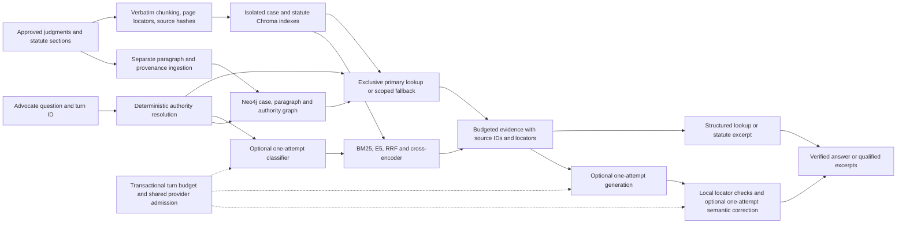

# Level 1 Direct Legal Knowledge Retrieval Implementation

## Summary

The advocate retrieval path now resolves explicit case and statute references before calling Groq. An eligible case is selected by identity and reranked within its own passages. Exact case identification and supported statutory subsection extracts can return without Groq. The unchanged [pre-implementation audit](direct_retrieval.md) records the historical results.

In the 16-question independent benchmark, all 13 case queries returned the requested judgment at rank one. Baseline rank one was already 13/13 for this sample. The stronger measured improvement was supporting passage coverage, which moved from 3/13 questions with all expected primary anchors in context to 13/13. The answer run did not meet the factual and judicial outcome acceptance targets. Provider rate and token admission caused most benchmark case queries to return qualified evidence excerpts.

Both source exclusions were preserved. The manifest describes the Mataguda criminal evidentiary ruling and the Roysa land judicial review as deliberately excluded. Repository history and local instructions available for this task do not identify the approval rationale beyond those notes. Mataguda remains a resolvable canonical authority with a source file and a graph record. The ruling has no primary chunks in the approved case index.

## Updated architecture



## Controlled implementation stages

| Stage | Changes and checks |
| --- | --- |
| Shared provider budget | One outbound reservation per classification, generation or verification stage. Flask uses the same authenticated turn key across both research requests. The central HTTP client consumes a stage before sending, counts a failed request or 429, and disables redirects and retries. Tests exercised exhausted stages, duplicate requests, concurrent attempts, 429 cooldown and the default Requests adapter. |
| Source integrity | Built the approved cases and statutes in separate development stores. Re-extracted case text with an explicit furniture filter, repaired verified private-use ligatures and preserved verbatim statute windows. Rebuilt index metadata with source hashes. A second case build changed two chunks and reused the other 78 embeddings. |
| Authority selection | Resolved neutral citations, names, aliases, one-edit party-name variants and statutory subsection paths. Case eligibility comes from the manifest. Deterministic resolution works without provider credentials or a classifier completion. The local hybrid stages continue to serve broad or unresolved queries. |
| Graph-assisted retrieval | Queried the existing local development graph in read mode. Primary case identity was retrieved independently of Chroma linkage. Incoming citations constrained secondary candidates when the primary could not be fetched. The graph conveyed the stored exclusion in a separately attributed note. |
| Answer pipeline | Retained relevant primary context and whole statutory excerpts. Validated model locators and exact passages locally, then used at most one semantic verification/correction call. Rendered the checked result. Used qualified original excerpts on failure. Tested both successful correction and suppression of unsupported original output. |

### Modified components

| Files | Technical change |
| --- | --- |
| [Case builder](../build_case_chunks.py), [PDF repair](../legal_text.py), [statute builder](../build_statute_chunks.py), [embedding loader](../embed_knowledge.py) | Keep substantive margin text, repair glyphs only when corroborated by words in the same PDF, preserve original statute text through tokenizer offsets and write stable source and embedding hashes. The isolated CLI supports explicit output paths and optional stale ID synchronization. |
| [Resolver](../direct_retrieval.py), [graph keys](../graph/keys.py), [classifier](../Qclassifier.py) | Share canonical identifiers between name/citation forms. Detect case lookup, facts, outcomes, reasoning, principles and statutory lookup before optional LLM routing. Preserve original terms alongside a rewrite on the broad path. Do not select a case from an unresolved collision. |
| [Case retriever](../Retriever.py), [statute retriever](../RulesRetriever.py), [embedding cache](../embeddings.py) | Normalize lexical tokens, preserve vector fusion and CE reranking, filter manifest exclusions and retain the terminal disposition alongside the highest-ranked passage for outcome/cost inquiries. Distinguish distance and CE scores. The lexical cache follows index file revisions, and the query-vector cache is bounded by model and query. |
| [Graph reads](../graph/queries.py), [graph ingest](../ingest/caselaw/pipeline.py), [graph PDF extraction](../ingest/caselaw/extract.py) | Resolve graph-only names without requiring Chroma mappings. Read existing Case and Paragraph relationship shapes. Keep seed data distinct from extracted primary passages. Create citation stubs only on a new key. Reuse paragraph FIRAC roles, source hashes, page locators and `SUPPORTED_BY` to connect a located disposition. |
| [Direct answers](../direct_answer.py), [citation verifier](../citation_verifier.py), [API routes](../app.py) | Assemble whole relevant paragraphs under a conservative context bound. Validate numbered evidence locators and their exact source text, render corrected claims, and provide evidence-only fallbacks. Sign retrieval results over the user, turn and payload when a signing key is available. |
| [Groq transport](../groq_client.py), [budget ledger](../groq_budget.py), [legacy chat adapter](../pixe.py), [research UI](../../frontend/app/components/ChatView.tsx) | Centralize Groq calls, preserve the turn ID across HTTP steps, remove automatic title calls from answer handling and disable the legacy SDK transport path. Authenticate evidence signing with a configured signing key or the configured provider key. |
| [Direct route tests](../tests/test_direct_routes.py), [retrieval tests](../tests/test_direct_retrieval.py), [ingestion tests](../tests/test_direct_ingestion.py), [budget tests](../tests/test_groq_budget.py) | Cover classifier outage, provider-independent citation lookup, tampered evidence, paragraph validation, verification failure, corpus hashing, concurrency and transport behavior. |

### Graph representation and provenance

This change reuses `Case`, `Paragraph`, `SourceDocument`, `Issue`, `Principle`, `Provision`, `Outcome` and the existing relationship vocabulary. Paragraph FIRAC tags distinguish material facts, submissions, issues, rules, reasoning and dispositions without copying the same text into separate fact nodes. Outcomes and evidence-specific rulings remain distinct from conditional principles. The lookup accepts case-level seed assertions and paragraph-level extraction edges. It can promote graph-linked evidence only when the source file hash matches and the paragraph text is present in an eligible Chroma chunk. Seeded case outcomes without that provenance are labeled as graph records.

The development Neo4j seed has no primary paragraphs for this case. The live comparison exercised canonical reads, case-level outcome, rules and incoming citations. It did not establish the impact of paragraph-level provenance on a populated graph. No graph writes or migrations ran against the existing service.

### API budget and operational evidence

The production-style Flask path atomically records one reservation per stage in a Firestore transaction. A shared provider admission document holds a 60-second request and estimated-token window, expiring concurrency leases and the 429 cooldown. The process also enforces a semaphore and admission window. Configurable defaults are 20 requests per minute, 60,000 estimated tokens per minute and two in-flight requests. Direct quote and identity paths can bypass all three stages. Requests uses one HTTP attempt, no key rotation, no redirect and no retry loop. The first configured credential is used. When a ledger write fails, the provider call is skipped.

The route records stage attempts, success, failed status, HTTP 429, available prompt/completion tokens and latency under a hashed turn reference. Full retrieval and model message tracing requires `LEGAL_RETRIEVAL_TRACE=1`, intended for isolated diagnostics. Since it can contain user questions and passages, leave it disabled for ordinary traffic. Automatic title generation was removed from the answer path. The existing explicitly requested title regeneration endpoint is a separate action. The benchmark used the in-memory turn ledger and live provider. Flask and shared provider transaction behavior were tested locally with a substituted persistence backend. A multi-instance production soak test was outside this work.

## Automated verification

The focused backend suite passed 127 tests. Four Firestore emulator integration tests were skipped because the emulator was not configured. The frontend TypeScript check and Git whitespace checks passed. The shared provider lease was exercised through a transaction double and the live Neo4j reads were exercised separately against the development graph.

## Isolated corpus verification

| Data | Approved/staged | Stored | Missing or mismatched | Valid 768-dimensional embeddings |
| --- | ---: | ---: | ---: | ---: |
| Case documents | 9 | 9 | 0 | — |
| Case chunks | 80 | 80 | 0 | 80 |
| Statute chunks | 1,334 | 1,334 | 0 | 1,334 |

The approved PDF and DOCX sources retained all parser output blocks in the stored chunks. PDF chunk IDs linked to the isolated coordinate sidecar and matched the source-file SHA-256. DOCX paragraphs have no PDF coordinates. A targeted check found no residual instances of the four diagnosed private-use glyphs in approved case chunks. Completeness is measured against approved source manifests and extracted text, with separate page and source-hash checks. It does not measure OCR against independently transcribed originals.

Evidence Act s.106B(4) now comes from `evidence_act__2023-12-11__s106B__0__c1` as a 938-character verbatim subsection, including (a) through (d). The sampled statute provisions s.78A(2), SCC Act s.13(5) and Civil Procedure Act s.34(1) likewise returned complete excerpts from the refreshed statute index.

## Benchmark and comparative measurements

The [eight diagnostics](../../eval/level1_direct_diagnostics.json) are separate from the [16 independent questions](../../eval/level1_direct_benchmark.json). The independent set covers all nine approved judgments, three statute provisions, factual and outcome questions, citation forms, a spelling variant and an insufficient-information question. It contains 13 case-retrieval questions and 13 passage-scored questions. Questions about an excluded source are measured separately.

The [runner](../../eval/run_level1_direct.py) and [raw comparison results](../../eval/results/level1_direct_comparison.json) record the measured runs. The runner measures Recall@K by the requested judgment's position among distinct results. A structured confirmed indexed lookup counts as rank one. MRR is the arithmetic mean of reciprocal ranks, assigning zero to a miss. Passage inclusion requires every manually selected primary-text anchor for that question to be present after assembly. It is a context proxy rather than a claim accuracy metric. Neither excluded source is eligible for primary recall.

| Configuration | Primary Recall@1 | Primary Recall@3 | MRR | All primary passage anchors | Independent retrieval median |
| --- | ---: | ---: | ---: | ---: | ---: |
| A. Baseline case retriever and historical excerpts | 13/13 | 13/13 | 1.00 | 3/13 | 14.82 s |
| B. Improved ingestion, lexical normalization and context, without identity routing | 13/13 | 13/13 | 1.00 | 11/13 | 15.16 s |
| C. Entity-aware retrieval without Neo4j | 13/13 | 13/13 | 1.00 | 13/13 | 0.88 s |
| D. Entity-aware retrieval with Neo4j | 13/13 | 13/13 | 1.00 | 13/13 | 1.07 s |

A and B are fixed-input retrieval comparisons. A uses the preserved case retriever, baseline index and 500/600-character excerpt limits. The statute comparison gave both runs the same known section filter. B used the refreshed evidence for the tested provisions, but ran before the final two Ogembo glyph repairs. C and D used the complete refreshed indexes. A through D used the same approved case identities. A through C were retrieval-only and did not run the answer model for this comparison. The audit preserves actual historical A responses for the eight diagnostics. The latency measurements came from local processes with different warm-up and resource contention and should not be used as production latency estimates.

| Acceptance metric | Observed |
| --- | --- |
| Exact case citation resolution | 5/5 explicit neutral-citation queries in the independent benchmark and 2/2 in the eight diagnostics. The resolution target is the canonical case identity, independent of whether its source is eligible. |
| Direct case fact and reasoning answers | 0/6 strict verified answers in the independent D provider replay. Qualified evidence excerpts were scored as abstentions even when their text overlapped the expected answer. |
| Judicial outcome accuracy | 0/4 strict verified answers in the independent D provider replay. Outcome questions with no verified claim were scored as abstentions. |
| Statutory requests | 3/3 full cited extracts in the independent D run. The H diagnostic also returned a full primary excerpt. |
| Source citation correctness | 3/3 canonical source aliases matched the primary provision excerpts for the independent substantive answers. This denominator is insufficient to establish the 98% target across generated answers. |
| Unsupported material legal claims | No unsupported material claim was observed in the three independently returned statutory excerpts. A corpus-level claim rate needs a larger set of generated answers and independent annotation. The zero-percent target is unverified. |

### Groq attempts and diagnostics

| D suite | Queries | Outbound attempts | Successful | HTTP 429 | Retry attempts | Attempts/query | Maximum per query | Reported input/output tokens |
| --- | ---: | ---: | ---: | ---: | ---: | ---: | ---: | ---: |
| Diagnostics | 8 | 3 | 2 | 1 | 0 | 0.375 | 2 | 6,471 / 360 |
| Independent | 16 | 1 | 1 | 0 | 0 | 0.0625 | 1 | 3,229 / 61 |
| Combined | 24 | 4 | 3 | 1 | 0 | 0.167 | 2 | 9,700 / 421 |

The two-attempt average target was met for this run, with a substantial contribution from provider cooldown and local admission denials. The count therefore does not establish high-quality answering at that average. The original audit counted provider 429 attempts during an earlier replay, but did not capture per-query attempted calls across every stage, so no equivalent historical total is reported. The transport tests enforce the three-stage cap even when provider requests fail. The provider replay preceded the final paragraph-ranking refinement for unavailable-provider excerpts. This refinement changes which excerpt is returned after an abstention, without upgrading it to a verified answer.

- **A** returned the missing-certificate reason with a verified secondary quotation and stated that the primary judgment was unavailable.
- **B, E and G** returned qualified evidence and the stored graph outcome separately. These were not counted as verified primary answers.
- **C and D** reached retrieval even under provider limits. The approved sources did not support the witness and erasure answers in the replay.
- **F** resolved the correct canonical case, disclosed its excluded source and used zero provider attempts.
- **H** returned all four certificate elements in a primary statutory excerpt with zero provider attempts.

The graph found the excluded canonical Mataguda node and supplied three eligible citing cases to secondary candidate selection. It did not add primary recall or increase anchor inclusion above configuration C in the independent set. Its observed incremental benefit was narrowing fallback authority scope and exposing the separately attributable seeded outcome. There was no controlled graph-enabled versus graph-disabled generation comparison under identical provider availability.

## Reproduction and remaining work

Use an explicit directory outside the active stores when rebuilding and a separate Neo4j connection for the graph-enabled read test. Keep the absent original judgment excluded unless the corpus owner approves a scope change.

```bash
DEV_ROOT=/tmp/legal-level1-rebuild
mkdir -p "$DEV_ROOT"
backend/venv/bin/python backend/build_case_chunks.py \
  --output "$DEV_ROOT/cases.jsonl" --locations "$DEV_ROOT/locations.db"
backend/venv/bin/python backend/build_statute_chunks.py --output "$DEV_ROOT/statutes.jsonl"
backend/venv/bin/python backend/embed_knowledge.py --source both --db-root "$DEV_ROOT" --sync \
  --cases-jsonl "$DEV_ROOT/cases.jsonl" --statutes-jsonl "$DEV_ROOT/statutes.jsonl"
backend/venv/bin/python eval/run_level1_direct.py --mode C --case-root "$DEV_ROOT" \
  --statute-root "$DEV_ROOT" --output "$DEV_ROOT/c.json"
```

For D, set `GRAPH_ENABLED=true` and configure the read-capable development Neo4j connection through environment variables. The runner accepts `--generate` for a provider replay and `--query-id` for focused diagnostics. Use preserved baseline databases and a preserved Retriever module with `--mode A --baseline-retriever <path>`.

- The strict factual and outcome targets require a larger live-provider comparison with separate annotation. This work established passage selection and controlled provider use, while the measured verified answer output remained below target.
- Very long or structurally ambiguous statute subsections can still span windows. The four tested control provisions fit complete indexed excerpts. A broader subsection-completeness test is needed before extending that claim.
- Shared claim verification for direct responses checks exact evidence and uses one semantic correction call when needed. Strategic answers keep the legacy reference validator and use its cleaned output. Its reference checks are weaker than direct claim verification.
- A production-shaped, multi-instance Firestore test and an isolated graph rebuild with paragraph provenance remain unverified. The new corpus was built and tested in temporary stores. No application deployment, commit or push was made.
